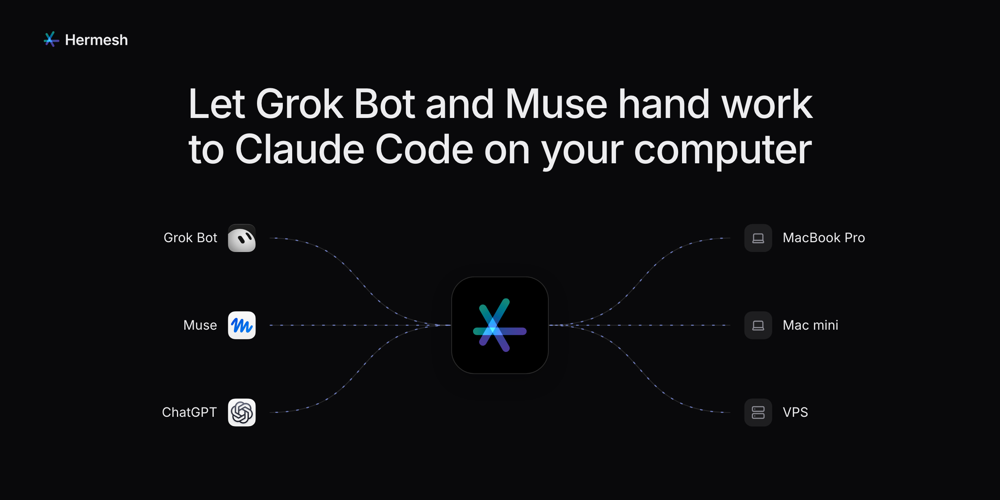
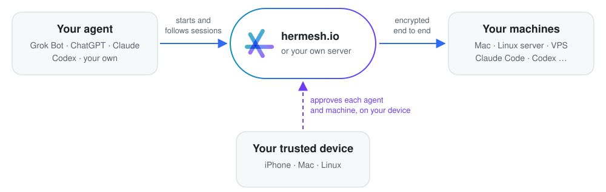

<p align="center">
  <a href="docs/assets/hermesh.mp4"></a>
</p>

<h3 align="center">Your AI assistants hand coding work to Claude Code and Codex<br>on your own computers.</h3>

<p align="center">You approve each one on your own device. Open source, and you can run the server yourself.</p>

<p align="center">
  <a href="https://github.com/hermeshai/hermesh/releases/latest"></a>
  <a href="https://github.com/hermeshai/hermesh/actions/workflows/ci.yml"></a>
  <a href="LICENSE"></a>
  
</p>

<p align="center">
  <a href="#get-started"><b>Get started</b></a> ·
  <a href="docs/assets/hermesh.mp4">Watch it in 50 seconds</a> ·
  <a href="#how-it-works">How it works</a> ·
  <a href="#security">Security</a> ·
  <a href="#documentation">Docs</a>
</p>

## What it's for

> **You**: From now on, when someone reports a bug in our repo, have Claude Code on my Mac mini fix it.
>
> *The next morning, a new issue: "Nothing happens on Sign in".*
>
> **Grok Bot**: Claude Code on your Mac mini fixed #142: the email wasn't checked before submitting. Here's PR #143.

Your agent starts a session on your machine, follows it, answers the coding agent's questions or passes them to you, and brings back the result and the diff. Your code, and your Claude Code or Codex sign-in, stay on your machine.

## How it works

<p align="center">
  <picture>
    <source media="(prefers-color-scheme: dark)" srcset="docs/assets/how-it-works-dark.svg">
    
  </picture>
</p>

Three words to know:

| | What it is | For example |
|---|---|---|
| **Trusted device** | Where you approve, with Face ID, Touch ID or a passphrase. It holds your key | The Mac app, the iPhone app, a Linux computer |
| **Machine** | A computer where coding agents work, in the folders you allow (projects) | Your Mac, a Mac mini, a Linux server |
| **Agent** | The assistant that hands out the work | Grok Bot, ChatGPT, Claude, Codex, your own |

A Mac can be your trusted device and a machine at once.

## Get started

You need a trusted device, a machine and an agent. Start from what you have:

| You have | Start with |
|---|---|
| **A Mac** | [The Mac app](#with-a-mac): your trusted device and first machine in one |
| **An iPhone and a Linux server** | [The iPhone app, then one command on the server](#with-an-iphone-and-a-server) |
| **Only Linux** | [A Linux computer as your trusted device](#only-linux) |
| **Your own server** instead of hermesh.io | [Run your own server](#run-your-own-server) |

### With a Mac

1. Download Hermesh for [Apple silicon](https://github.com/hermeshai/hermesh/releases/latest/download/Hermesh-macos-arm64.dmg) or [Intel](https://github.com/hermeshai/hermesh/releases/latest/download/Hermesh-macos-x64.dmg) (macOS 14 or later), drag it to Applications and open it.
2. Click **Get Started** and sign in at hermesh.io in your browser, with an email code, Google or GitHub. The first sign-in creates your account.
3. This Mac is now your trusted device and your first machine. Add a folder your agents may work in as a project, then [connect your agent](#connect-your-agent).

The app keeps itself up to date.

### With an iPhone and a server

1. Install **Hermesh for iPhone** (iOS 26 or later; coming to TestFlight soon) and tap **Sign In**. Its Get Started card leads you through the rest.
2. On the server, run:
   ```bash
   curl -fsSL https://github.com/hermeshai/hermesh/releases/latest/download/install.sh | sh
   ```
   Scan the code it shows with the app, approve with Face ID, and type on the server the two digits your phone shows. Run as root, it asks which user Hermesh runs as. From then on it starts with the server.
3. As that user, install Claude Code or Codex and sign in once (run `claude`); `hermeshd doctor` checks everything. Add a project from the app, then [connect your agent](#connect-your-agent).

### Only Linux

On a Linux computer that runs no coding agents (your desktop, or a user of its own):

```bash
curl -fsSL https://github.com/hermeshai/hermesh/releases/latest/download/install.sh \
  | sh -s -- --device
```

With no other device yet, it signs you in with a code your browser shows, and this computer becomes your first trusted device, its key sealed by a passphrase you choose. Then add machines as above, and approve what asks to join with `hermeshd approve`.

### Connect your agent

Choose **Connect Agent…** in the app (**Connect an Agent…** on the iPhone) and send your agent the line it gives you:

```text
Connect to Hermesh: follow https://hermesh.io/connect
```

- **Online assistants** (ChatGPT, Claude.ai, Grok Bot, Muse) add the MCP server `https://mcp.hermesh.io/mcp` and send you to sign in.
- **Agents on a computer** (Claude Code, Codex, Cursor, your own) install the CLI and sign in:
  ```bash
  curl -fsSL https://github.com/hermeshai/hermesh/releases/latest/download/install.sh \
    | sh -s -- --cli
  hermesh auth login --name "Codex on MacBook"
  ```

Its request comes to your trusted device: choose the projects it may use, and approve. Then ask it: *"Use Hermesh to have Claude Code say hello to me in the app project."*

### More machines

Run the same command on each one and scan its code (in the Mac app: **Enter Pairing Code…**). On a machine, `hermeshd doctor` says what to fix and `hermeshd project add <folder>` adds a project; [docs/hermeshd.md](docs/hermeshd.md) has every command.

## Works with

**Agents that hand out the work**: assistants that speak MCP, such as ChatGPT, Claude.ai, Grok Bot, Muse and Cursor, and any agent that can run a command line, through the [`hermesh` CLI](docs/cli.md).

**Coding agents that do it**, on your machines: Claude Code and Codex, and through the [Agent Client Protocol](https://agentclientprotocol.com) Gemini CLI, Cursor, GitHub Copilot CLI, OpenCode, Qwen Code, Goose, Augment, Kimi, Kiro, Qoder, Grok, DeepSeek Harness and CodeBuddy Code.

<details>
<summary>How Hermesh runs each one</summary>

| `--agent` | Tool | Integration |
|---|---|---|
| `claude` | Claude Code | `claude -p` stream-json |
| `codex` | Codex | `codex app-server` |
| `gemini` | Gemini CLI | `gemini --acp` |
| `cursor` | Cursor | `cursor-agent acp` |
| `copilot` | GitHub Copilot CLI | `copilot --acp` |
| `opencode` | OpenCode | `opencode acp` |
| `qwen` | Qwen Code | `qwen --acp` |
| `goose` | Goose | `goose acp` |
| `auggie` | Augment | `auggie --acp` |
| `kimi` / `kiro` / `qoder` / `grok` | Kimi CLI / Kiro CLI / Qoder CLI / Grok | Each one's own ACP entry point |
| `deepseek` | DeepSeek Harness | `dsh --profile acp`, or the copy inside the DSH Desktop app |
| `codebuddy` | CodeBuddy Code | `codebuddy --acp` |

ACP agents run as one long-lived process each, with multi-turn conversation, interruption and resumption, and every tool call and permission request seen by Hermesh. Their sign-in can't be checked in advance: run each CLI once as the machine's user first. Whichever is installed (and allowed by the grant) shows up in `hermesh project list`.

</details>

## Security

- **You approve everything, on your own device.** Adding a machine, an agent or a device takes Face ID, Touch ID or your passphrase. Your key stays on your trusted devices (in the Secure Enclave on a Mac or an iPhone), so neither hermesh.io nor your own server can approve, or forge a command.
- **Encrypted end to end**, with one difference:

  | Your agent connects with | Who can read the content |
  |---|---|
  | The `hermesh` CLI | Only your agent and your machine: hermesh.io, or your server, passes on encrypted bytes |
  | MCP (online assistants) | Also the MCP server, which holds that connection's key ([Privacy Policy](https://hermesh.io/en/privacy)). [Run your own server](#run-your-own-server) to keep it on yours |

- **Each agent gets a grant**: which machines, projects and coding agents, and for how long. Revoke it at any moment.
- **A grant is full trust.** There, a coding agent can do anything you can: read credentials, use the network, push code. Hermesh adds no sandbox. Grant access only to agents you trust; if one reads untrusted web pages or email, a prompt injection reaches as far as its grant.
- **Your own work stays apart.** A session works in its own git worktree, on a `hermesh/<session>` branch, and never pushes for you: review the diff before merging. An *in-place* project lets the agent write straight into the folder.
- **The center is trusted once, at most.** An agent pairing through hermesh.io takes your account's owner on the center's word, once; your machines accept only grants your key signed. Pair with your own server's connection address to trust no center at all.
- **Lose a device?** Remove it from another trusted device. With only one you'd set up again, so add a second: another iPhone, a Mac or a Linux computer.

More in [the technical design](docs/technical-design.md), [trusted devices](docs/trusted-devices.md) and [the MCP gateway](docs/mcp-gateway.md).

## Run your own server

Instead of hermesh.io: a Linux server with Docker, a domain name that points at it (relay.example.com below), and ports 80 and 443 open.

```bash
docker run -d --name hermesh-relay --restart unless-stopped \
  -p 80:80 -p 443:443 -v hermesh-relay:/data \
  -e HERMESH_RELAY_DOMAIN=relay.example.com -e HERMESH_RELAY_MCP=1 \
  ghcr.io/hermeshai/hermesh-relay
docker logs hermesh-relay   # shows the claim code
```

It gets its HTTPS certificate from Let's Encrypt by itself. In the Mac or iPhone app, choose **Use Your Own Server…** and enter the server's address and the claim code. Machines and agents then use the connection address the app gives you:

```bash
curl -fsSL https://github.com/hermeshai/hermesh/releases/latest/download/install.sh \
  | sh -s -- relay.example.com/o_xxxxxxxx
hermesh auth login relay.example.com/o_xxxxxxxx
```

`HERMESH_RELAY_MCP=1` also serves MCP, for Claude, ChatGPT and other online assistants, at an address with a key in it, so only you can connect apps: copy it from **Settings › Account & Devices › Advanced** on the Mac or **Account and Devices** on the iPhone, or print it with `docker exec hermesh-relay hermesh-relay mcp-url`. Leave it out if your agents all use the CLI.

<details>
<summary>Updating, a web server already on port 443, backups</summary>

- **Update:** `docker pull ghcr.io/hermeshai/hermesh-relay`, then `docker rm -f hermesh-relay` and the same `docker run`.
- **Behind your own web server** (nginx, Caddy…) that serves HTTPS: publish port 8080 instead (`-p 127.0.0.1:8080:8080`), replace `HERMESH_RELAY_DOMAIN` with `HERMESH_RELAY_PUBLIC_URL=https://relay.example.com`, and pass that name to it, WebSockets included.
- **Back up** the `hermesh-relay` volume: it is the server's identity and who its owner is. Without it you would set up again and pair your machines and agents again.

</details>

## Questions

<details>
<summary><b>Do I need a Mac?</b></summary>

No. The iPhone app or a Linux computer can be your trusted device, and your machines can be Linux servers.

</details>
<details>
<summary><b>Can hermesh.io read my code?</b></summary>

Not what goes through the CLI: that is end to end. Over MCP, its MCP server holds the connection's key, so it can read what that assistant sends and receives. Your own server keeps that to you.

</details>
<details>
<summary><b>Do my Claude Code or Codex accounts leave my machine?</b></summary>

No. They run on your machine with their own sign-in; Hermesh starts them there and never reads their keys.

</details>
<details>
<summary><b>What does a machine need?</b></summary>

macOS, or Linux on x86-64 or ARM64; on Linux, systemd keeps Hermesh running (elsewhere, run `hermeshd run` yourself). And a coding agent, signed in as the same user.

</details>

## Documentation

| | |
|---|---|
| [hermeshd.md](docs/hermeshd.md) | A machine: install, `doctor`, projects, the background service |
| [cli.md](docs/cli.md) | The `hermesh` CLI for agents: sessions, messages, output, exit codes |
| [onboarding.md](docs/onboarding.md) | First use without a Mac, and Linux trusted devices |
| [trusted-devices.md](docs/trusted-devices.md) | Your key, your devices, removing one |
| [mcp-gateway.md](docs/mcp-gateway.md) | Online assistants over MCP |
| [technical-design.md](docs/technical-design.md) | The whole design |
| [development.md](docs/development.md) | Building, testing and releasing |

## Components

| | |
|---|---|
| `Hermesh.app` | The Mac app ([desktop-app.md](docs/desktop-app.md)): approves, shows your machines and sessions; bundles `hermeshd` and a signer that keeps your key in the Secure Enclave |
| Hermesh for iPhone | The iPhone app ([iphone-app.md](docs/iphone-app.md)): approves, follows sessions, answers your agents' questions |
| `hermeshd` | Runs on each machine (macOS, Linux) and starts the coding agents' sessions; with `hermeshd device`, a Linux trusted device |
| `hermesh` | The command line for agents |
| `hermesh-relay` | The server you can run yourself: pairing, routing, revocation, and with `--mcp` the MCP gateway |

## Development

```bash
make generate && make lint test   # code from proto, static checks, unit tests
make e2e                          # full user flows with real binaries and scripted agents
```

More, and how to release: [docs/development.md](docs/development.md).

## License

Apache License 2.0, see [LICENSE](LICENSE).
