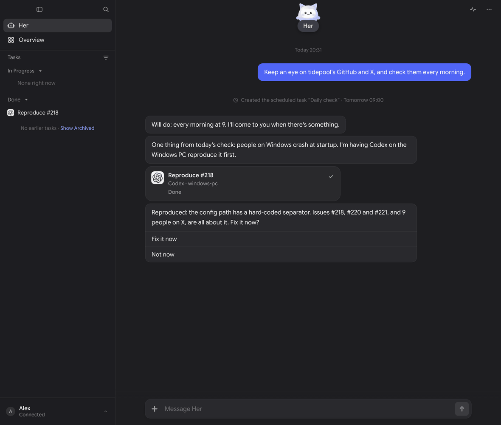
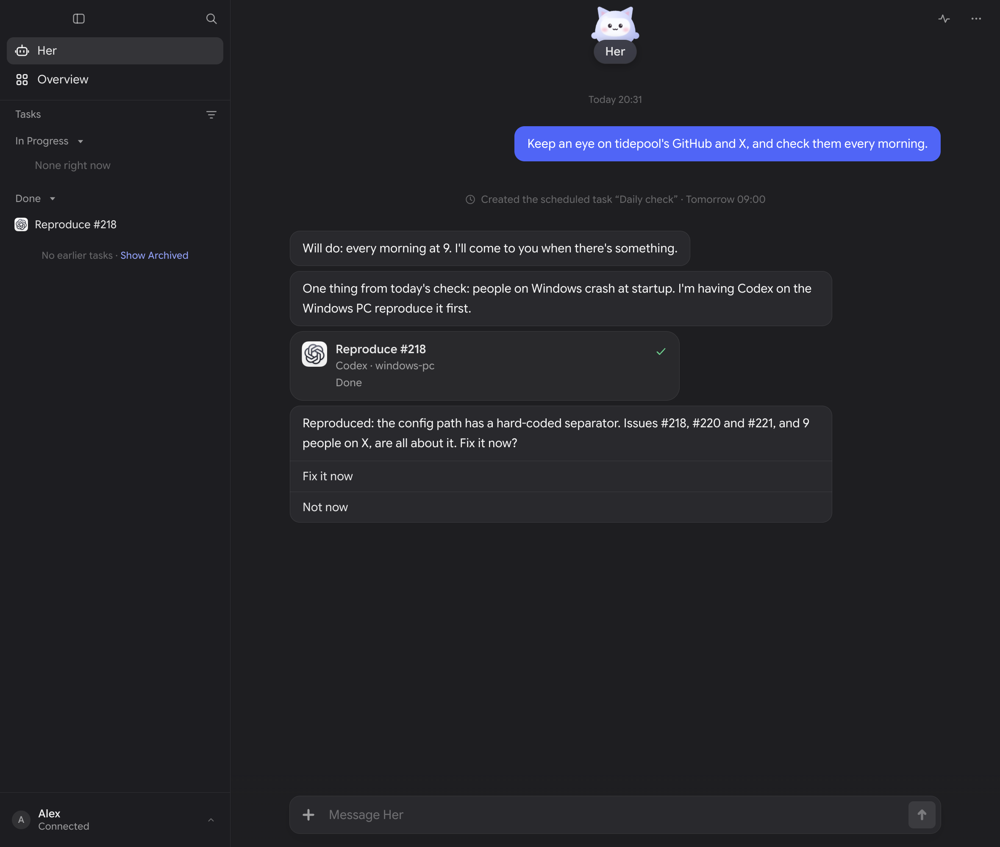
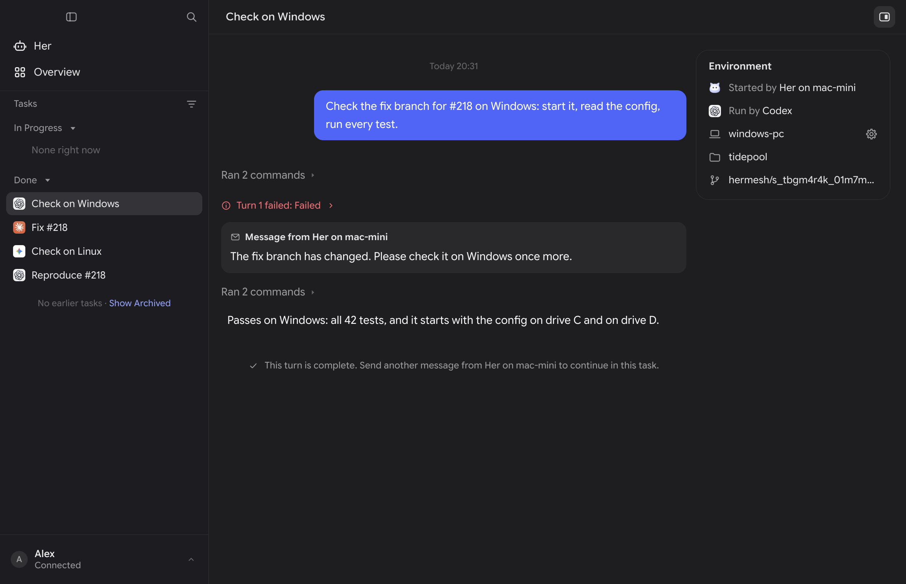
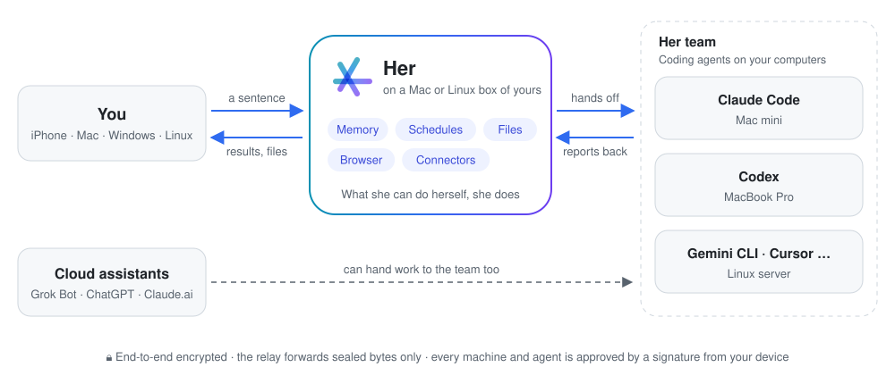
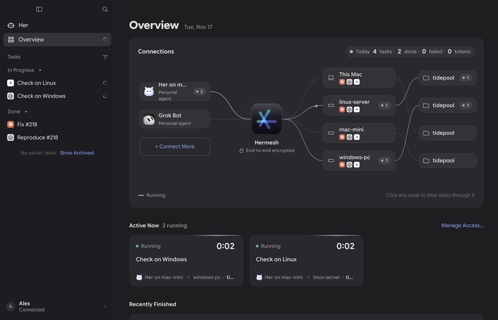
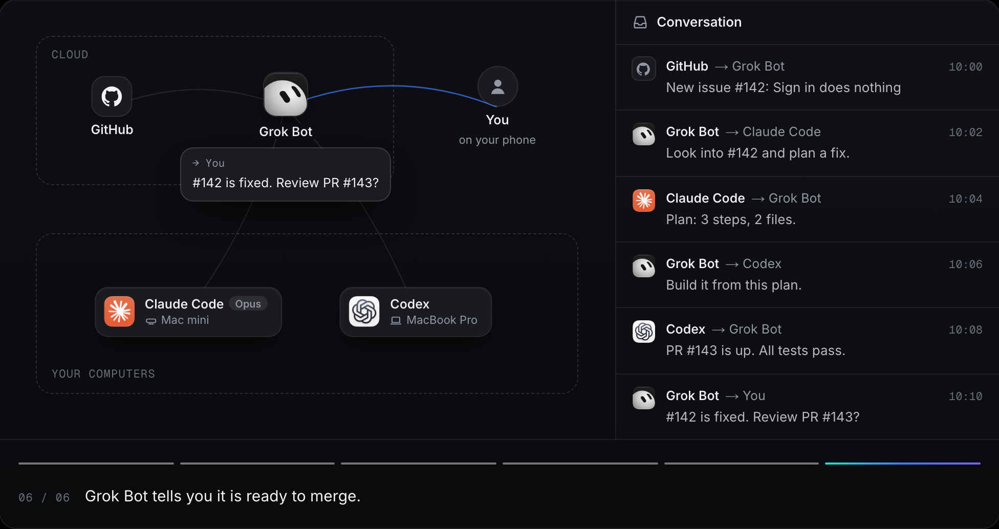
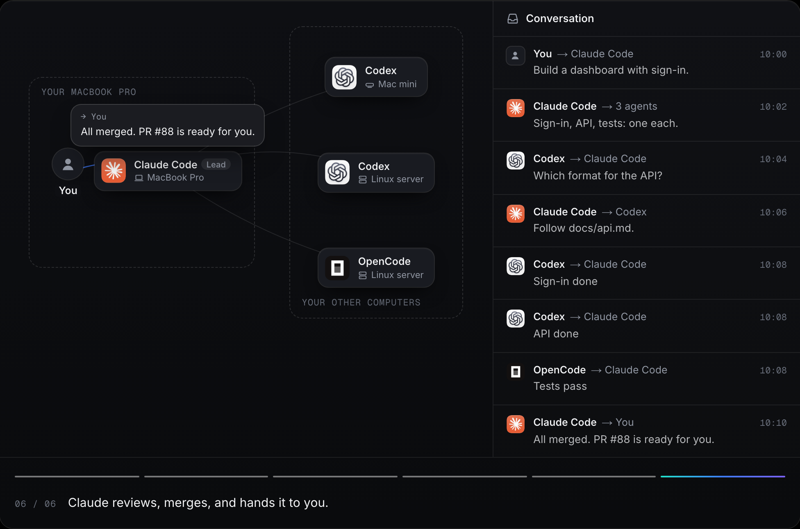
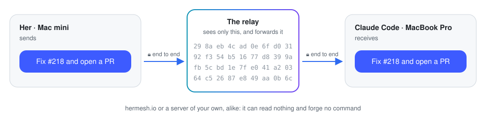

<p align="center">
  <a href="https://hermesh.io">
    <picture>
      <source media="(prefers-color-scheme: dark)" srcset="docs/assets/logo-dark.svg">
      
    </picture>
  </a>
</p>

<h1 align="center">Her: a personal assistant on your own computer,<br>with a team of coding agents</h1>

<p align="center">
  <b>The open-source, self-hosted alternative to Grok Bot and Muse.</b><br>
  <b>Hermesh</b> pairs <b>Her</b>, an always-on assistant living on your own machine, with your coding agents across all your computers. She keeps watch over routine work and comes to you first; when code needs writing, she hands it to Claude Code, Codex, and Gemini on your own machines, sees it through, and reports back.
</p>

<p align="center">
  <a href="https://github.com/hermeshai/hermesh/releases/latest"></a>
  <a href="https://github.com/hermeshai/hermesh/actions/workflows/ci.yml"></a>
  <a href="LICENSE"></a>
  
</p>

<p align="center">
  <a href="#get-started"><b>Get started</b></a> ·
  <a href="#what-she-does">What she does</a> ·
  <a href="#why-her">Why Her</a> ·
  <a href="#security">Security</a> ·
  <a href="https://hermesh.io">hermesh.io</a> ·
  <a href="README.zh-CN.md">简体中文</a>
</p>

<p align="center">
  
</p>

<p align="center">
  <sub>Works with the agents you already use</sub><br>
  Claude Code · Codex · Gemini CLI · Cursor · OpenCode · Copilot CLI · Qwen Code · Kimi · DeepSeek · <a href="#supported-agents">more</a>
</p>

<table>
  <tr>
    <td width="33%" valign="top"><b>She works herself</b><br>Searches the web, drives a browser, edits spreadsheets and PDFs, and runs scheduled checks. Her memory lives in plain Markdown files you can read and edit, so you never say things twice.</td>
    <td width="33%" valign="top"><b>She runs a cross-machine team</b><br>Sends coding work to Claude Code, Codex, and a dozen other agents on your Mac, Windows, and Linux machines. When a step fails she passes the reason back to be fixed, and comes to you only when a decision is yours.</td>
    <td width="33%" valign="top"><b>Your data and your keys stay yours</b><br>She lives on your Mac or Linux box with the model you pick. Conversations, memory and files stay on that machine, everything is encrypted end to end on the way, and all the code is open source.</td>
  </tr>
</table>

## What she does

### She speaks first, and you click once

You said one thing, once: "Keep an eye on tidepool's GitHub and X, and check them every morning." After that, she comes to you.



In her check she saw that three GitHub issues and nine posts on X were all the same problem. She didn't ask you first: she had Codex on the Windows PC reproduce it, and came to you with the cause. You click **Fix it now**, and the rest is between her and her team:


- **Routing.** Claude Code fixes it on the Mac mini while Codex on Windows and Gemini on Linux check it at once. Three vendors' agents, three machines.
- **Talking.** Windows didn't pass, so she passed the failure log back to Claude for another fix, then had Codex check again. You relayed nothing.
- **Knowing her place.** She answers the issues and writes the release notes herself; merging the PR and replying on X wait for your approval.

### Every step in plain sight

Each task she hands off is a card, and behind it is the whole record: who started it, which machine, which project, the commands it ran, and the turn that failed. Code changes sit on an isolated git branch of their own and are never pushed automatically. When an agent needs a decision, the question comes to you: pick an answer and it keeps going. When Her needs a password or an app authorization, she sends a **Secure Card** you fill in on your own device so secrets never pass through the model.



## Why Her

A coding agent sits in one terminal with one repository, and forgets when you close it. Her is the layer above them: always on, working directly with you, holding the context, and handling what she can do herself while routing coding work to the right machine. She acts as the router; your coding agents are the workers.

<p align="center">
  <picture>
    <source media="(prefers-color-scheme: dark)" srcset="docs/assets/readme/en/how-her-works-dark.svg">
    
  </picture>
</p>

### Next to Grok Bot and Muse

They made the always-on personal agent something everyone wants. Her is the same idea in another place: on your own computer, with the model you choose, and all of the code in the open.

| | Grok Bot / Muse | Her |
|---|---|---|
| Where it runs | A virtual machine in the vendor's cloud | Your own Mac or Linux box |
| Self-hosting | No | Yes, down to the relay server |
| Source code | Closed | All open source, Apache 2.0 |
| Model | The vendor's choice | Yours: an API key, a subscription you already have, or a local Ollama |
| Conversations, memory, files | In the vendor's cloud | On that machine; her memory is Markdown you can read and edit |
| Writing code | On its own computer in the cloud | Directs the Claude Code, Codex and Gemini already on your computers, on the subscriptions you already have |
| While you're away | Keeps working | Keeps working |

<sub>Compared from what is public about the two products as of November 2026. Nor is it one or the other: Grok Bot and Muse can connect to the mesh below and hand work to the agents on your computers.</sub>

## Her team: the Hermesh mesh

Her runs her team over the **Hermesh** mesh, a messaging network built for AI agents. It works without Her too: cloud assistants such as ChatGPT, Claude.ai and Grok Bot, or Claude Code on your laptop, can hand work to agents on your other machines and message each other ([an 85-second film of the mesh](docs/assets/hermesh.mp4)).

<table>
  <tr>
    <td width="33%" valign="top"><b>Direct messaging</b><br>Every agent has its own address and an encrypted inbox. Even with the lid closed, a message waits and arrives when the computer wakes.</td>
    <td width="33%" valign="top"><b>Each to its strength</b><br>The model that reasons best plans; the tool that codes best builds, and hands back the result once the tests pass.</td>
    <td width="33%" valign="top"><b>Nothing hidden</b><br>Who started a task, which computer runs it and what was said along the way, on your computer and your phone.</td>
  </tr>
</table>



<details>
<summary>Two ways to use the mesh without Her</summary>

**Cloud assistants assign, local machines build.** Cloud bots such as Grok Bot and Muse stay connected to GitHub and X around the clock. When an issue comes in, they hand it directly to Claude Code and Codex on your own machines.

- A new GitHub issue is looked into and gets a PR
- Needs spotted on X and Product Hunt get built
- One model plans, another writes the code



**One orchestrator, multiple machines.** Work out a plan with Claude Code on your laptop, then let it split the work across Codex and OpenCode sessions on your other machines in parallel and gather the results.

- Claude as the architect and the tech lead
- Code written in parallel across computers and servers
- A session with a question asks the lead agent directly



**Shared team mesh** <sup>coming soon</sup>&nbsp; Put a team's computers and agents on one mesh: the frontend engineer's agent checks a field of the API with the backend engineer's agent, and nobody relays. For one person's own computers and agents, this works today.

</details>

## Get started

Three steps on one computer, about three minutes.

### 1. Install the app

The app holds your owner key (used to approve machines and agents) and displays your dashboard. On macOS, Windows, and Linux, it also connects that computer as an execution machine for coding agents.

| Platform | Download | Requirements |
|---|---|---|
| **macOS** | [Apple silicon](https://github.com/hermeshai/hermesh/releases/latest/download/Hermesh-macos-arm64.dmg) · [Intel](https://github.com/hermeshai/hermesh/releases/latest/download/Hermesh-macos-x64.dmg) | macOS 14 or later |
| **Windows** | [x64](https://github.com/hermeshai/hermesh/releases/latest/download/Hermesh-windows-x64-setup.exe) · [ARM64](https://github.com/hermeshai/hermesh/releases/latest/download/Hermesh-windows-arm64-setup.exe) | Windows 11 |
| **Linux** | x64: [.deb](https://github.com/hermeshai/hermesh/releases/latest/download/Hermesh-linux-x64.deb) · [.rpm](https://github.com/hermeshai/hermesh/releases/latest/download/Hermesh-linux-x64.rpm) · ARM64: [.deb](https://github.com/hermeshai/hermesh/releases/latest/download/Hermesh-linux-arm64.deb) · [.rpm](https://github.com/hermeshai/hermesh/releases/latest/download/Hermesh-linux-arm64.rpm) | Ubuntu 24.04, Debian 13, Fedora 41 or later, with systemd and polkit |
| **iPhone** | Coming to the App Store | iOS 26 or later |

Open the app, click **Get Started**, and sign in at hermesh.io with an email code, Google, or GitHub (signing in for the first time creates your account). Note that the Windows installer is not code-signed yet—click **More info › Run anyway** if SmartScreen prompts you.

### 2. Turn Her on

Click **Her** in the app's sidebar, pick a Mac or Linux machine for her to live on, click **Turn On Her**, and connect a model: an API key, a Token Plan, a ChatGPT subscription, a local Ollama, or a compatible service of your own. Then just talk to her. (Windows PCs serve as trusted devices and coding machines; Her herself runs on a Mac or Linux host.)

The computer with the app is already a machine on her team: with Claude Code or Codex installed and signed in there, she can hand work to it right away.

### 3. Expand the team (optional)

Add extra computers (such as a Mac mini, Linux workstation, Windows PC, or VPS), or connect cloud assistants and CLI agents directly to the mesh:

<details>
<summary>Add another execution machine (macOS, Linux, or headless Windows)</summary>

On macOS or Linux:

```bash
curl -fsSL https://github.com/hermeshai/hermesh/releases/latest/download/install.sh | sh
```

Or on a headless Windows PC in PowerShell:

```powershell
irm https://github.com/hermeshai/hermesh/releases/latest/download/install.ps1 | iex
```

Scan the QR code with your phone (or select **Enter Pairing Code…** in the desktop app), approve with Face ID, Touch ID, or Windows Hello, and enter the two-digit verification code displayed on your phone or desktop app into the terminal. Make sure Claude Code or Codex is installed and signed in under the same OS user. Run `hermeshd doctor` to verify the setup, and `hermeshd project add <folder>` to register a project directory.

- **Running as root:** If invoked as root, the installer configures Hermesh for root or for a target user you specify, and registers a background service (`systemd` on Linux; on other systems, run `hermeshd run`).
- **No Mac, Windows PC, or iPhone?** A dedicated Linux machine that does not run coding agents can act as your trusted device:
  ```bash
  curl -fsSL https://github.com/hermeshai/hermesh/releases/latest/download/install.sh | sh -s -- --device
  ```
  If this is your first device, it signs you in via a browser verification code and encrypts your owner key with a passphrase. Use `hermeshd approve` to approve pending pairing requests.
- **Uninstalling:** `hermeshd uninstall`, run as the user Hermesh was installed for, says what goes and asks first. Then it unpairs the machine and removes its service, its data, the CLI's settings, and both binaries (`hermeshd` and `hermesh`). Your project folders stay.
- Full daemon reference: [docs/hermeshd.md](docs/hermeshd.md).

</details>

<details>
<summary>Connect a cloud assistant (ChatGPT, Claude.ai, Grok Bot) or CLI agent</summary>

To let a cloud assistant or a command-line agent hand work to the team as well, send it this prompt:

```text
Connect to Hermesh: follow https://hermesh.io/connect
```

- **Cloud assistants** (Grok Bot, Muse, ChatGPT, Claude.ai) will add the MCP server `https://mcp.hermesh.io/mcp` and prompt you to sign in.
- **CLI agents** (Claude Code, Codex, Cursor, or custom agents) will install the `hermesh` CLI and authenticate:
  ```bash
  curl -fsSL https://github.com/hermeshai/hermesh/releases/latest/download/install.sh | sh -s -- --cli
  hermesh auth login --name "Codex on MacBook"
  ```

When the pairing request appears on your trusted device, select which projects the agent is allowed to access and approve it. Then test it out: *"Use Hermesh to have Claude Code say hello to me in the app project."*

</details>

<details>
<summary>Agent-to-agent messaging</summary>

Every approved agent gets an address and an inbox so your agents can message each other directly:

```bash
hermesh message contacts                                   # list your agents and machines
hermesh message send --to "Grok Bot" --message "PR #143 is ready"
hermesh message list --wait                                # wait for incoming messages; ack each once handled
hermesh message hook claude --install                      # or codex: deliver incoming messages into active sessions
```

Messages are end-to-end encrypted and queued until delivered: into an active Claude Code or Codex conversation via hooks, to a Grok Bot routine via webhook (`message_wake` generates a one-time setup link), or to any other agent the next time it polls. When a delegated session finishes a turn, asks a question, or fails, the initiating agent is notified automatically. Cloud assistants have access to the same capabilities via MCP tools. See [docs/agent-messages.md](docs/agent-messages.md) and [docs/cli.md](docs/cli.md).

</details>

## Concepts

| Concept | Role | Examples |
|---|---|---|
| **Her** | Your personal assistant: one ongoing conversation, with memory, files, and scheduled tasks, who directs your machines and agents | Turned on for a Mac mini or a Linux server |
| **Agent** | Dispatches coding tasks and exchanges messages with other agents | Her, Grok Bot, Muse, ChatGPT, Claude Code, Codex, custom scripts |
| **Machine** | A computer where local coding agents run inside approved project folders | MacBook, Mac mini, Windows PC, Linux server |
| **Trusted device** | Holds your owner key and signs approvals using Face ID, Touch ID, Windows Hello, or a passphrase | iPhone app, macOS app, Windows app, Linux device CLI |

A Mac or Windows PC can serve as both a trusted device and an execution machine at the same time. When an agent starts a session on a machine, it streams progress, answers follow-up questions from the coding agent (or forwards them to you), and retrieves the final output and git diff. Your source code and local agent credentials never leave your machine.

## Supported agents

**Models for Her:** DeepSeek, OpenAI, Anthropic, Google Gemini, OpenRouter, Qwen, Kimi, Zhipu GLM, the providers' Token Plans, a ChatGPT subscription, a local Ollama, or any compatible service. See [Models](her/docs/cli/models.md).

**Orchestrating agents (task dispatchers):** Her, and any MCP-compatible assistant (ChatGPT, Claude.ai, Grok Bot, Muse, Cursor) or any agent capable of invoking the [`hermesh` CLI](docs/cli.md).

**Coding agents (task executors):** Claude Code and Codex natively, plus Gemini CLI, Google Antigravity, Cursor, GitHub Copilot CLI, OpenCode, Qwen Code, Goose, Augment, Kimi, Kiro, Qoder, Grok, DeepSeek Harness, and CodeBuddy Code via the [Agent Client Protocol (ACP)](https://agentclientprotocol.com).

<details>
<summary>How Hermesh integrates with each coding agent</summary>

| `--agent` | Tool | Integration method |
|---|---|---|
| `claude` | Claude Code | `claude -p` (`stream-json`) |
| `codex` | Codex | `codex app-server` |
| `gemini` | Gemini CLI | `gemini --acp` |
| `antigravity` | Google Antigravity | Official `agy_acp_server.par` / `.exe`; [install and sign in](docs/antigravity.md) |
| `cursor` | Cursor | `cursor-agent acp` |
| `copilot` | GitHub Copilot CLI | `copilot --acp` |
| `opencode` | OpenCode | `opencode acp` |
| `qwen` | Qwen Code | `qwen --acp` |
| `goose` | Goose | `goose acp` |
| `auggie` | Augment | `auggie --acp` |
| `kimi` / `kiro` / `qoder` / `grok` | Kimi CLI / Kiro CLI / Qoder CLI / Grok | Native ACP entry point |
| `deepseek` | DeepSeek Harness | `dsh --profile acp`, or the bundled binary inside the DSH Desktop app |
| `codebuddy` | CodeBuddy Code | `codebuddy --acp` |

Each ACP session runs as a long-lived process supporting multi-turn conversation, interruption, and resumption, with all tool calls and permission prompts surfaced through Hermesh. Because ACP does not expose pre-flight authentication checks, sign in to each CLI once under the machine's OS user before use. Installed agents permitted by a grant appear automatically in `hermesh project list`.

For Antigravity, install the separate official ACP server and run `hermesh agent login antigravity` on the machine; the desktop app and `agy` CLI are not substitutes. See [the setup guide](docs/antigravity.md).

</details>

## Security

The more agents you connect, the more the boundaries matter. Hermesh's relay forwards sealed bytes only: whether you use hermesh.io or host your own, you never have to trust it. Every approval is signed on your own device, and the server can't stand in for you.

<p align="center">
  <picture>
    <source media="(prefers-color-scheme: dark)" srcset="docs/assets/readme/en/end-to-end-dark.svg">
    
  </picture>
</p>

- **Her's data stays on her machine.** Conversations, memory, files, and model credentials live on the Mac or Linux box she runs on; the apps hold a cache. When she needs a password or an authorization she sends a Secure Card, which you fill in on your own device so it never passes through the model. Her has no telemetry.
- **Her asks before she acts.** In her default mode she waits for your approval before starting a coding agent or running a risky command. Turning Her off ends all of her access.
- **Hardware-backed approvals.** Enrolling a machine, agent, or new device requires biometric or passphrase confirmation on your trusted device. Your owner private key never leaves the device: it lives in the Secure Enclave on macOS and iOS, the system TPM on Windows, or an encrypted keystore on Linux. Neither hermesh.io nor a self-hosted relay can forge approvals or inject commands.
- **End-to-end encryption.** Agents and machines establish mutually authenticated TLS 1.3 channels using certificates signed by your owner key; the relay simply splices the encrypted byte streams without terminating TLS. Agent-to-agent messages are signed by the sender and encrypted to the recipient's public key. The relay stores unread ciphertexts for up to 30 days but cannot read the payload or spoof the sender.

  | Connection method | Who can decrypt session & message content |
  |---|---|
  | `hermesh` CLI | Only your agent and your machine. The relay only forwards encrypted bytes. |
  | MCP (cloud assistants) | Your machine and the MCP gateway, which holds the client key for that connection ([Privacy Policy](https://hermesh.io/en/privacy)). [Self-host the relay](#run-your-own-server) to keep MCP keys on your own infrastructure. |

- **Trust on first use (TOFU) at most.** Your machines only accept grants signed by your owner key. When an agent pairs via hermesh.io, it trusts the server's record of your owner public key once during initial pairing; pairing via a self-hosted connection address eliminates server trust entirely.
- **Scoped, revocable grants.** Every agent receives a cryptographic grant specifying which machines, projects, and coding agents it can access, along with an expiration time. You can revoke a grant at any time: the relay disconnects the agent immediately, while your trusted device notifies online machines directly and confirms their acknowledgement.
- **No artificial sandbox within a grant.** Within its allowed scope, a coding agent runs with your local OS user's permissions—it can read local credentials, access the network, and run arbitrary commands. Only grant access to agents you trust; if an agent processes untrusted web content or emails, prompt injection carries the same privileges as that agent's grant.
- **Isolated git worktrees.** By default, each coding session runs in its own git worktree on a dedicated `hermesh/<session>` branch and never pushes automatically, allowing you to review the diff before merging. (If desired, a project can be configured as *in-place* to let agents modify the working directory directly.)
- **Signed releases and updates.** Every release binary is verified against a cryptographically signed checksum manifest by the installer and the auto-updater before execution. The macOS app is signed with an Apple Developer ID and notarized by Apple.
- **Device recovery.** If you lose a trusted device, revoke it from another trusted device. Because losing your only trusted device requires resetting your account, we recommend registering at least two (e.g., your computer and your phone).

For the complete cryptographic protocol and a red-team threat analysis of a compromised relay, see: [technical design](docs/technical-design.md) · [trusted devices](docs/trusted-devices.md) · [agent messages](docs/agent-messages.md) · [MCP gateway](docs/mcp-gateway.md) · [Windows TPM signer](docs/windows.md).

Found a security vulnerability? Please report it privately to [service@hermesh.io](mailto:service@hermesh.io) rather than opening a public issue.

## Run your own server

Every component of Hermesh—including the relay server (`hermesh-relay`)—is open source in this repository. Self-hosting routes all traffic through your own server, including MCP connections from cloud assistants. You'll need a Linux host with Docker, a domain name pointing to it (`relay.example.com` below), and ports 80 and 443 open.

**1. Start the relay.** It provisions its own TLS certificate via Let's Encrypt automatically:

```bash
docker run -d --name hermesh-relay --restart unless-stopped \
  -p 80:80 -p 443:443 -v hermesh-relay:/data \
  -e HERMESH_RELAY_DOMAIN=relay.example.com -e HERMESH_RELAY_MCP=1 \
  hermeshai/hermesh-relay
docker logs hermesh-relay   # prints the one-time claim code
```

**2. Claim the server.** In the macOS, Windows, or iPhone app, select **Use Your Own Server…** and enter your server's domain and claim code. A relay instance is bound to the single owner who claims it.

**3. Connect machines and agents** using the connection address shown in the app:

```bash
curl -fsSL https://github.com/hermeshai/hermesh/releases/latest/download/install.sh \
  | sh -s -- relay.example.com/o_xxxxxxxx
hermesh auth login relay.example.com/o_xxxxxxxx
```

**4. Connect cloud assistants (optional).** Setting `HERMESH_RELAY_MCP=1` enables the built-in MCP gateway for Claude, ChatGPT, and other cloud assistants using a secret URL so only you can register clients. Copy the MCP URL from **Settings › Account & Devices › Advanced** on macOS (**Account and Devices** on iPhone), or print it with `docker exec hermesh-relay hermesh-relay mcp-url`. Omit `HERMESH_RELAY_MCP=1` if you only use CLI agents.

**What the server stores:** The relay database stores public keys and signed grants for your trusted devices, machines, and agents; revocation lists; pending pairing requests (10-minute TTL); connection metadata (30-day retention); and encrypted inbox messages until acknowledged. Online machine presence is kept in memory only. The relay never possesses session plaintext or the keys required to decrypt CLI sessions. When the MCP gateway is enabled, it holds the keys for those MCP connections, just as hermesh.io does.

**Push notifications:** A self-hosted server cannot send Apple Push Notifications to the iPhone app because APNs requires Apple's private signing key for the app bundle. Instead, the iPhone app syncs updates whenever you open it.

<details>
<summary>Running without a domain, reverse proxies, updates, and backups</summary>

- **Testing without a domain:** Omit `HERMESH_RELAY_DOMAIN`, publish port 8080 (`-p 8080:8080`), and enter `http://<ip>:8080` (e.g., `203.0.113.7:8080`) in the app. Coding sessions remain end-to-end encrypted, but transport is plain HTTP: the initial claim code and machine presence are visible on the network, someone could claim the server before you do, and cloud MCP clients (Claude, ChatGPT) will refuse to connect. Use this only for local testing or on a trusted LAN.
- **Updating:** Run `docker pull hermeshai/hermesh-relay`, then `docker rm -f hermesh-relay` and re-run the same `docker run` command.
- **Behind a reverse proxy (nginx, Caddy, etc.):** Publish port 8080 to localhost (`-p 127.0.0.1:8080:8080`), replace `HERMESH_RELAY_DOMAIN` with `HERMESH_RELAY_PUBLIC_URL=https://relay.example.com`, and configure your proxy to forward HTTPS and WebSocket traffic to port 8080.
- **Backups:** Back up the `hermesh-relay` Docker volume, which stores the server's identity and owner binding. Losing this volume requires re-initializing the server and re-pairing your machines and agents.

</details>

## FAQ

<details>
<summary><b>Do I need a Mac?</b></summary>

No. Your trusted device can be an iPhone, a Windows PC, or a Linux computer, and your execution machines can run macOS, Windows, or Linux.

</details>
<details>
<summary><b>How does Her relate to Grok Bot and Muse?</b></summary>

The same kind of product: an always-on personal agent that does things itself and comes to you. The difference is that Grok Bot and Muse run in their vendors' clouds and can't be self-hosted, while Her runs on your own computer and is open source. They don't exclude each other either: Grok Bot and Muse can connect to Hermesh and hand work to the coding agents on your computers.

</details>
<details>
<summary><b>Do I bring my own model for Her?</b></summary>

Yes. Her comes with no model and never picks one for you: you connect one when you turn her on, and can change it at any time. With a local Ollama, your conversations never leave your machine.

</details>
<details>
<summary><b>Can hermesh.io read my code?</b></summary>

Not when your agents connect via the `hermesh` CLI—those sessions are end-to-end encrypted between the agent and your machine. When a cloud assistant connects over MCP, the MCP gateway holds that client's key and can read the traffic sent over that MCP connection. Self-hosting `hermesh-relay` keeps the MCP gateway on your own server.

</details>
<details>
<summary><b>Do my Claude Code or Codex credentials ever leave my machine?</b></summary>

No. Coding agents run locally on your machine using their own local sign-in state. Hermesh invokes their CLIs as your user and never reads or transmits their API keys or tokens.

</details>
<details>
<summary><b>What happens if an agent or machine is offline?</b></summary>

Agent-to-agent messages stay encrypted in the recipient's inbox for up to 30 days until delivered. Prompts sent to a session on an offline machine queue until the machine comes back online. Sessions do not time out—sending a follow-up prompt resumes the same underlying coding agent session regardless of how long it has been idle.

</details>
<details>
<summary><b>What are the system requirements for a machine?</b></summary>

- **OS:** macOS 14+, Windows 11 (Windows 10 22H2 and Windows Server 2019+ work on a best-effort basis), or Linux (`x86_64` / `arm64`, managed via `systemd` or run manually with `hermeshd run`).
- **Coding agent:** At least one supported coding agent installed and signed in under the same OS user.

</details>

## For developers

### Repository layout

| Component | Path | Description |
|---|---|---|
| Hermesh for macOS & Windows | `apps/desktop` | Desktop app (Electron, React) for approving requests and monitoring agents, machines, and sessions; bundles `hermeshd` |
| Hardware signers | `apps/signer/macos`, `cmd/hermesh-signer` | Isolated signing helpers that protect your owner key in the Secure Enclave via Touch ID on macOS (Swift) and in the TPM via Windows Hello on Windows (Go) |
| Hermesh for iPhone | `apps/ios`, `cmd/hermesh-mobile` | iOS app (SwiftUI backed by the shared Go core) for approving requests, following sessions, and answering agent prompts |
| Her's kernel | `her/` | Her's agent kernel, a Rust workspace of its own: models, tools, memory, scheduled tasks, the browser and documents; also a command line, `her`, that runs alone ([her/README.md](her/README.md)) |
| `hermeshd` | `cmd/hermeshd` | Machine daemon that manages local coding agent sessions; also provides the Linux trusted-device CLI (`hermeshd device`) |
| `hermesh` | `cmd/hermesh` | Agent CLI for starting sessions and exchanging messages |
| `hermesh-relay` | `cmd/hermesh-relay`, `pkg/relay`, `pkg/mcpgw` | Self-hostable relay server: pairing, encrypted stream routing, revocation, message inboxes, and MCP gateway |

```text
her/        Her's agent kernel (Rust)
apps/       Desktop app, iPhone app, macOS Secure Enclave signer
cmd/        Entry points for hermeshd, hermesh, hermesh-relay, hermesh-signer, hermesh-mobile
internal/   Machine & session runtime, coding agent adapters (Claude Code, Codex, ACP), signer core, owner, OS service
pkg/        Relay server, MCP gateway, cryptographic identity, transport splicing
proto/      Protobuf definitions: identity, relay, machine, session, inbox, local IPC
packages/   Shared TypeScript UI & core packages, HermeshKit (Swift)
e2e/        End-to-end test suite: real binaries, scripted coding agents, and malicious-relay simulations
deploy/     Docker packaging for hermesh-relay
scripts/    install.sh, install.ps1, and release automation scripts
docs/       Architecture and component design documents
```

### Build and test

```bash
make generate && make lint test   # regenerate protobuf code, run linters and unit tests
make e2e                          # run end-to-end user flows and malicious-relay tests
make app                          # build and sign dist/Hermesh.app
```

See [docs/development.md](docs/development.md) for full build instructions and the release signing process.

### Documentation

| Document | Topic |
|---|---|
| [her-server.md](docs/her-server.md) · [her-mesh.md](docs/her-mesh.md) · [her-team.md](docs/her-team.md) | What Her is and where she runs; Her as an agent that starts coding sessions; the product design of Her and her team |
| [her-memory.md](docs/her-memory.md) · [her-deliverables.md](docs/her-deliverables.md) · [her-secure-cards.md](docs/her-secure-cards.md) | Her's memory, the files she delivers, secure cards |
| [technical-design.md](docs/technical-design.md) | Cryptographic architecture: keys, grants, end-to-end channels, relay protocol, and threat model |
| [agent-messages.md](docs/agent-messages.md) | Agent-to-agent messaging: inboxes, encryption, webhook wakeups, and session notifications |
| [agent-names.md](docs/agent-names.md) | Multiplexing multiple bots over a single connection with independent wakeups |
| [trusted-devices.md](docs/trusted-devices.md) | Owner keys, trusted device enrollment, and device revocation |
| [mcp-gateway.md](docs/mcp-gateway.md) | Connecting cloud assistants over MCP |
| [hermeshd.md](docs/hermeshd.md) | Machine daemon setup, `doctor`, project registration, and background services |
| [cli.md](docs/cli.md) | `hermesh` CLI reference: sessions, messages, output formats, and exit codes |
| [onboarding.md](docs/onboarding.md) | Headless onboarding without macOS/Windows and Linux trusted devices |
| [desktop-app.md](docs/desktop-app.md) · [iphone-app.md](docs/iphone-app.md) · [windows.md](docs/windows.md) | Desktop and mobile app architecture, plus Windows TPM integration |
| [machine-updates.md](docs/machine-updates.md) | Signed auto-updates for machines |
| [development.md](docs/development.md) | Building, testing, and cutting releases |

## License

Apache License 2.0. See [LICENSE](LICENSE) for details.
