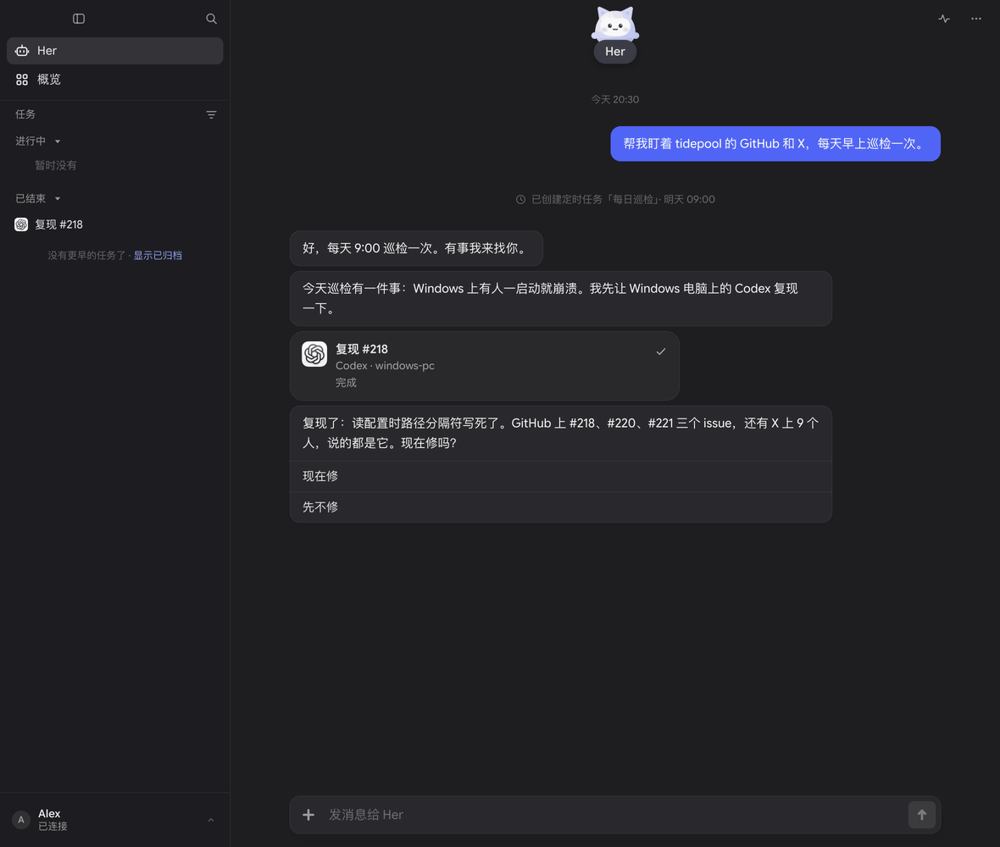
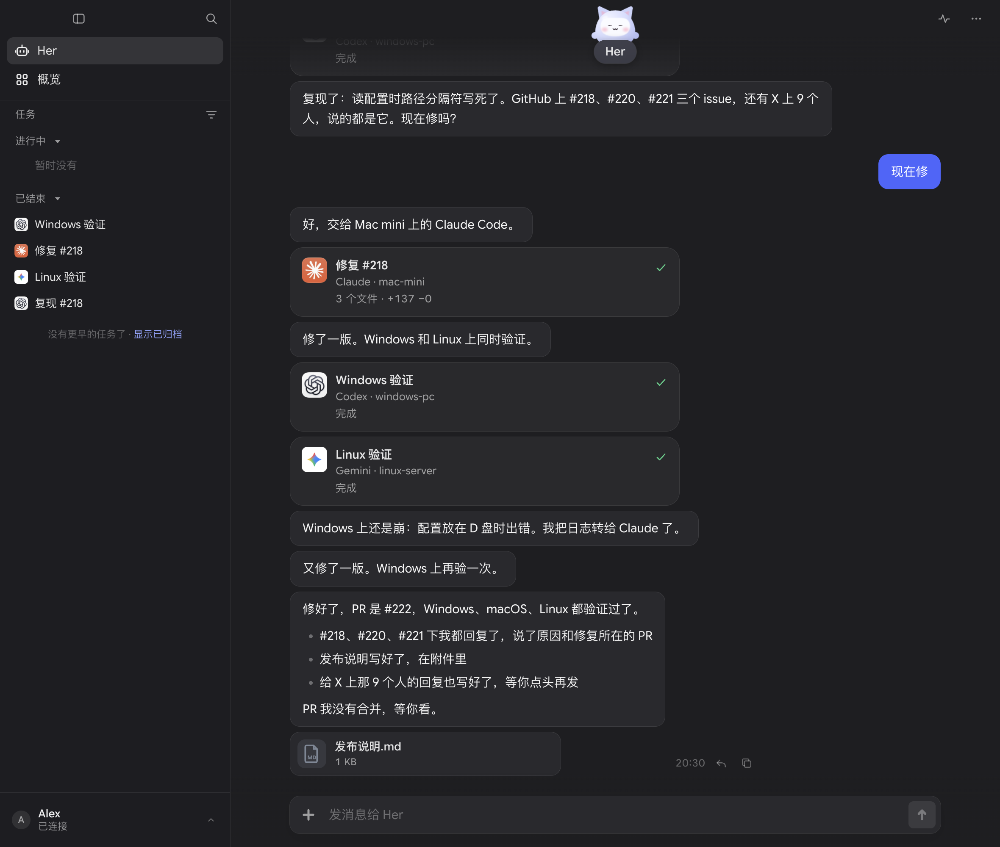
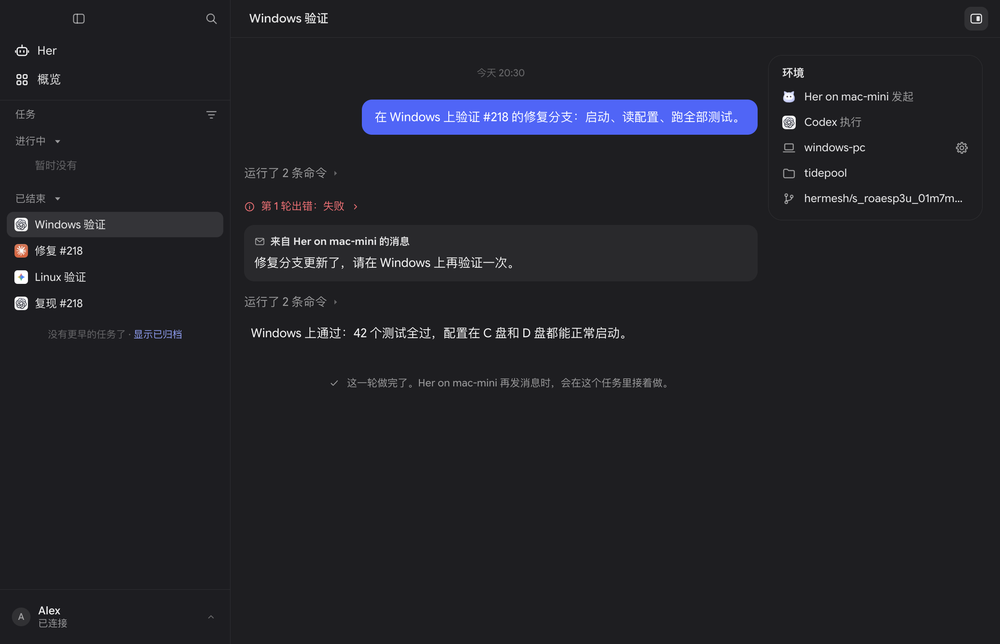
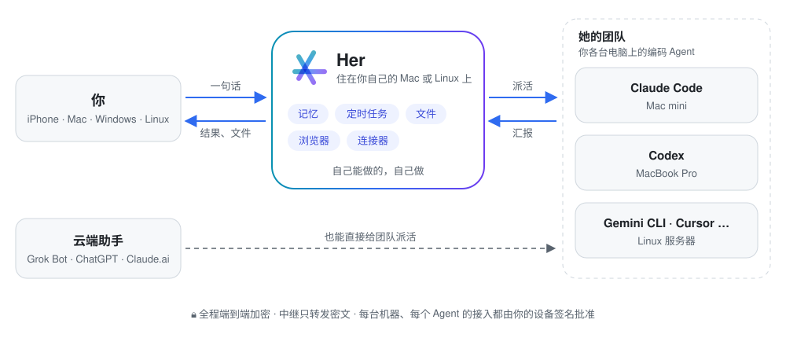
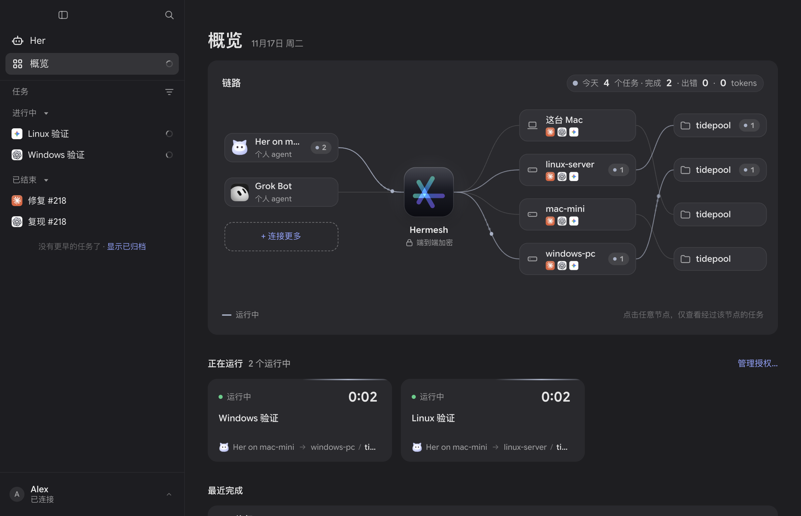
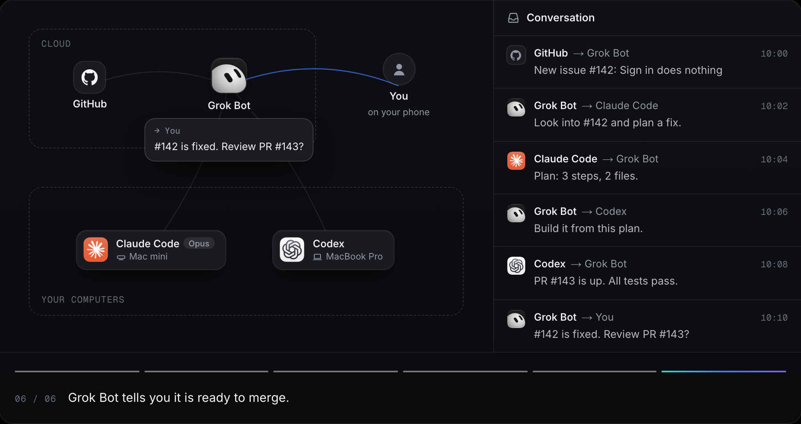
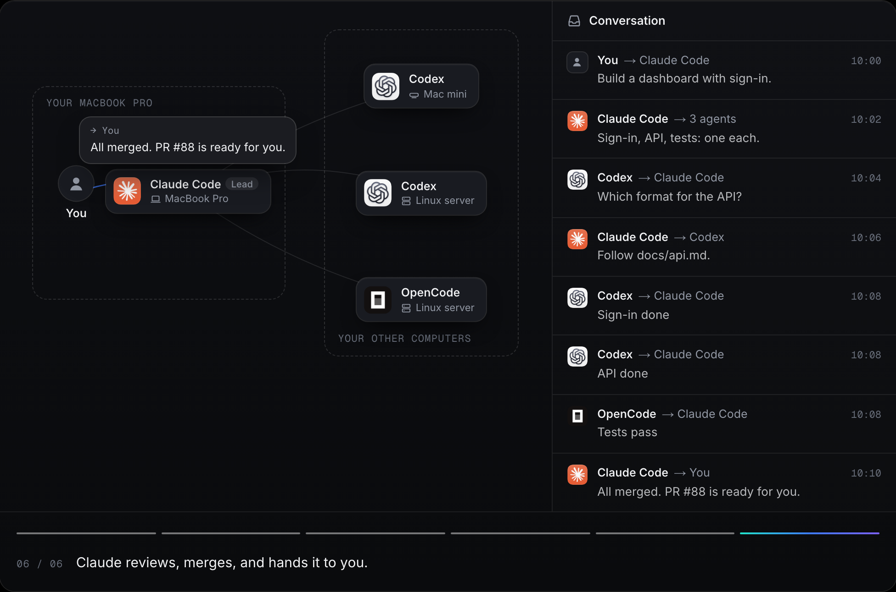

<p align="center">
  <a href="https://hermesh.io">
    <picture>
      <source media="(prefers-color-scheme: dark)" srcset="docs/assets/logo-dark.svg">
      
    </picture>
  </a>
</p>

<h1 align="center">Her：住在你自己电脑上的私人助理，<br>带着一支跨机 Agent 团队</h1>

<p align="center">
  <b>Grok Bot 和 Muse 的开源、自托管替代。</b><br>
  <b>Hermesh</b> 让 <b>Her</b> 常驻在你自己的电脑上，替你巡检项目、处理日常事务，有事主动找你；需要写代码时，她调度各台电脑上的 Claude Code、Codex 和 Gemini 接力完成，跟到结果再回来汇报。
</p>

<p align="center">
  <a href="https://github.com/hermeshai/hermesh/releases/latest"></a>
  <a href="https://github.com/hermeshai/hermesh/actions/workflows/ci.yml"></a>
  <a href="LICENSE"></a>
  
</p>

<p align="center">
  <a href="#快速开始"><b>快速开始</b></a> ·
  <a href="#她能做什么">她能做什么</a> ·
  <a href="#为什么是-her">为什么是 Her</a> ·
  <a href="#安全架构">安全架构</a> ·
  <a href="https://hermesh.io">hermesh.io</a> ·
  <a href="README.md">English</a>
</p>

<p align="center">
  <a href="https://testflight.apple.com/join/Nh2sjbdP?source=github"></a><br>
  <sub>欢迎试用官方 Hermesh iPhone 公开测试版（需 iOS 26+）。</sub>
</p>

<p align="center">
  
</p>

<p align="center">
  <sub>支持你日常在用的 Agent</sub><br>
  Claude Code · Codex · Gemini CLI · Cursor · OpenCode · Copilot CLI · Qwen Code · Kimi · DeepSeek · <a href="#支持的生态">更多</a>
</p>

<table>
  <tr>
    <td width="33%" valign="top"><b>她自己能干活</b><br>查网页、操作浏览器、处理表格和 PDF、跑定时任务。她用你能直接读、改的 Markdown 文件记住你的偏好，不用讲第二遍。</td>
    <td width="33%" valign="top"><b>她带队跨机写代码</b><br>写代码的活派给你 Mac、Windows、Linux 上的 Claude Code、Codex 等十几种编码 Agent。哪一步没过，她把原因转回去接着改；需要你拍板时才来找你。</td>
    <td width="33%" valign="top"><b>数据和密钥都在你手里</b><br>跑在你自己的 Mac 或 Linux 上，模型由你选。对话、记忆和文件留在那台机器里，传输全程端到端加密，全部代码开源。</td>
  </tr>
</table>

## 她能做什么

### 她先开口，你只点了一下

你只在第一天说过一句：「帮我盯着 tidepool 的 GitHub 和 X，每天早上巡检一次。」之后是她来找你。


她巡检时发现 GitHub 上三个 issue 和 X 上九条帖子说的是同一个问题，没有先来问你，而是先让 Windows 电脑上的 Codex 复现，带着原因来找你。你点「现在修」，剩下的是她和团队的事：



- **调度**：Claude Code 在 Mac mini 上修，Codex 在 Windows 上、Gemini 在 Linux 上同时验证。三家的 Agent，三台机器。
- **沟通**：Windows 上没过，她把失败原因转回给 Claude 接着修，再让 Codex 复验。你没有传过一句话。
- **边界**：她自己回复 issue、写发布说明；合并 PR 和在 X 上回复，等你点头。

### 每一步都看得见

她派出去的每个任务都是一张卡片，点开就是完整过程：谁发起、哪台机器、哪个项目、跑了哪些命令、哪一轮出了错。代码改在独立的 Git 分支上，不会替你推送到远端。Agent 需要你拍板时，问题会送到你面前，点一下它就接着跑；需要账号密码或应用授权时，她会发一张**安全卡片**，由你在自己的设备上填写，内容不经过模型。



## 为什么是 Her

一个编码 Agent 守着一个终端、一个仓库，关掉就忘了。Her 是它们上面的那一层：常驻运行、只面向你、记得上下文，自己能干的直接干，写代码的活分派出去——就像一个总调度（Router）带着一群编码 Agent（Worker）。

<p align="center">
  <picture>
    <source media="(prefers-color-scheme: dark)" srcset="docs/assets/readme/zh/how-her-works-dark.svg">
    
  </picture>
</p>

### 和 Grok Bot、Muse 比

它们让"常驻的个人 Agent"变成了人人想要的东西。Her 做的是同一件事，只是换了地方：在你自己的电脑上，用你自己选的模型，代码全部公开。

| | Grok Bot / Muse | Her |
|---|---|---|
| 跑在哪 | 厂商云端的一台虚拟机 | 你自己的 Mac 或 Linux |
| 能不能自己部署 | 不能 | 能，连中继服务器都可以自建 |
| 源代码 | 闭源 | 全部开源，Apache 2.0 |
| 用什么模型 | 由厂商决定 | 你选：API Key、已有的订阅，或本地 Ollama |
| 对话、记忆、文件 | 存在厂商的云上 | 留在那台机器上，记忆是你能读、能改的 Markdown |
| 写代码 | 在它云端的那台电脑里 | 调度你各台电脑上已有的 Claude Code、Codex、Gemini，用你已有的订阅 |
| 你不在时 | 照常工作 | 照常工作 |

<sub>对比依据两款产品截至 2026 年 11 月的公开资料。它们和 Her 也不是二选一：Grok Bot 和 Muse 可以接入下面这张网，给你电脑上的 Agent 派活。</sub>

## 她的团队：Hermesh 网络

Her 调度团队靠的是 **Hermesh** 网络，一张专为 AI Agent 搭的通信网。不开 Her，它也能单独用：ChatGPT、Claude.ai、Grok Bot 这样的云端助手，或者你笔记本上的 Claude Code，都可以给其他机器上的 Agent 派活、互发消息（[85 秒 Mesh 演示视频](docs/assets/hermesh.mp4)）。

<table>
  <tr>
    <td width="33%" valign="top"><b>直接通信</b><br>每个 Agent 都有独立的地址和加密收件箱。就算目标电脑合盖睡眠，消息也会暂存，唤醒即达。</td>
    <td width="33%" valign="top"><b>各展所长</b><br>让擅长推理的模型定方案，让擅长编码的工具写实现，测试跑通后把结果交回来。</td>
    <td width="33%" valign="top"><b>全局透明</b><br>谁发起的任务、哪台电脑在跑、中间说了什么，在电脑和手机上随时可查。</td>
  </tr>
</table>



<details>
<summary>不经过 Her 的两种用法</summary>

**云端派活，本地开发。** Grok Bot、Muse 等云端助手全天连着 GitHub 和 X。有新 Issue 时，它们把任务直接交给你电脑上的 Claude Code 和 Codex。

- 新的 GitHub issue 自动排查并提 PR
- 从 X 和 Product Hunt 发现需求并落地
- 用不同模型分别负责方案和编码



**一个总控，多台机器并行。** 在笔记本上和 Claude Code 定好方案，由它把任务拆开，分给其他机器上的 Codex 和 OpenCode 同时做，最后汇总结果。

- 让 Claude 担任架构师和技术负责人
- 跨多台电脑和服务器并行写代码
- 子会话有疑问，直接向主 Agent 请示



**团队共享网络** <sup>即将推出</sup>　把团队成员的电脑和 Agent 接入同一张网：前端的 Agent 直接向后端的 Agent 核对接口字段，不用两边的人来回传话。你个人名下的电脑和 Agent，今天已经可以这样互通。

</details>

## 快速开始

在一台电脑上开始用，三步，约三分钟。

### 1. 安装客户端

客户端负责保管你的管理密钥（用于审批机器与 Agent 接入）并展示全局看板。在 Mac、Windows 或 Linux 上，客户端还会同时把这台电脑作为执行机器接入网络。

| 平台 | 下载 | 系统要求 |
|---|---|---|
| **macOS** | [Apple 芯片 (arm64)](https://github.com/hermeshai/hermesh/releases/latest/download/Hermesh-macos-arm64.dmg) · [Intel (x64)](https://github.com/hermeshai/hermesh/releases/latest/download/Hermesh-macos-x64.dmg) | macOS 14 及以上 |
| **Windows** | [x64](https://github.com/hermeshai/hermesh/releases/latest/download/Hermesh-windows-x64-setup.exe) · [ARM64](https://github.com/hermeshai/hermesh/releases/latest/download/Hermesh-windows-arm64-setup.exe) | Windows 11 |
| **Linux** | x64：[.deb](https://github.com/hermeshai/hermesh/releases/latest/download/Hermesh-linux-x64.deb) · [.rpm](https://github.com/hermeshai/hermesh/releases/latest/download/Hermesh-linux-x64.rpm) · ARM64：[.deb](https://github.com/hermeshai/hermesh/releases/latest/download/Hermesh-linux-arm64.deb) · [.rpm](https://github.com/hermeshai/hermesh/releases/latest/download/Hermesh-linux-arm64.rpm) | Ubuntu 24.04、Debian 13、Fedora 41 及以上，需 systemd 和 polkit |
| **iPhone** | 即将上架 App Store | iOS 26 及以上 |

打开应用，点击 **立即开始**（Get Started），在浏览器中通过邮箱验证码、Google 或 GitHub 登录 hermesh.io（首次登录会自动创建账号）。Windows 安装包目前尚未进行代码签名，若弹出 SmartScreen 提示，点击 **更多信息 › 仍要运行** 即可完成安装。

### 2. 开启 Her

在客户端左侧点 **Her**，选一台 Mac 或 Linux 让她住下，点 **开启 Her**，再给她连一个模型：API Key、Token Plan、ChatGPT 订阅、本地 Ollama，或你自己的兼容服务。然后直接和她说话。（Windows 电脑目前作为控制端与执行机器，Her 本身需运行在一台 Mac 或 Linux 上。）

装客户端的这台电脑已经是她团队里的一台机器：只要上面装好并登录了 Claude Code 或 Codex，她就能直接派活。

### 3. 扩展团队（可选）

把更多电脑（Mac mini、Linux 工作站、Windows 电脑、云服务器）加入团队，或者把云端助手与命令行 Agent 接入网络：

<details>
<summary>添加更多执行机器（macOS、Linux 或无界面 Windows）</summary>

在 macOS 或 Linux 上执行：

```bash
curl -fsSL https://github.com/hermeshai/hermesh/releases/latest/download/install.sh | sh
```

如果是不装桌面端的 Windows 电脑，在 PowerShell 中执行：

```powershell
irm https://github.com/hermeshai/hermesh/releases/latest/download/install.ps1 | iex
```

用手机扫描终端显示的二维码（或在桌面端菜单中选择 **输入配对码…**），通过 Face ID、Touch ID 或 Windows Hello 批准后，把手机或桌面端显示的两位数字输入到终端。接着请确保同一系统用户下已安装并登录 Claude Code 或 Codex。运行 `hermeshd doctor` 可检查环境状态，运行 `hermeshd project add <目录>` 可添加项目目录。

- **以 root 身份运行：** 使用 root 执行安装脚本时，可以将 Hermesh 配置给 root 或你指定的其他用户，并自动注册系统开机自启服务（Linux 下使用 `systemd`；其他环境可手动运行 `hermeshd run`）。
- **没有 Mac、Windows 或 iPhone？** 你可以拿一台不跑编码任务的 Linux 机器作为可信设备：
  ```bash
  curl -fsSL https://github.com/hermeshai/hermesh/releases/latest/download/install.sh | sh -s -- --device
  ```
  如果这是你的第一台设备，它会通过浏览器显示的验证码完成登录，并用你设置的口令加密保护管理密钥。后续有新机器或 Agent 请求加入时，运行 `hermeshd approve` 即可审批。
- **卸载：** 以安装时的用户运行 `hermeshd uninstall`，它会先列出要删除的内容并请你确认，然后解除机器配对，删除后台服务、数据、CLI 设置以及 `hermeshd` 和 `hermesh` 程序本体。你的项目目录不受影响。
- 后台服务完整命令说明：[docs/hermeshd.md](docs/hermeshd.md)。

</details>

<details>
<summary>接入云端助手（ChatGPT、Claude.ai、Grok Bot）或命令行 Agent</summary>

想让云端助手或命令行 Agent 也能给团队派活，把下面这句话发给它：

```text
Connect to Hermesh: follow https://hermesh.io/connect
```

- **云端助手**（Grok Bot、Muse、ChatGPT、Claude.ai）会添加 MCP 服务器 `https://mcp.hermesh.io/mcp` 并引导你完成登录。
- **命令行 Agent**（Claude Code、Codex、Cursor 或你自建的 Agent）会安装 `hermesh` 命令行工具并发起登录：
  ```bash
  curl -fsSL https://github.com/hermeshai/hermesh/releases/latest/download/install.sh | sh -s -- --cli
  hermesh auth login --name "Codex on MacBook"
  ```

当你的可信设备收到连接请求时，勾选允许该 Agent 访问的项目并批准。然后可以对它说：*“用 Hermesh 在 app 项目里，让 Claude Code 跟我打个招呼。”*

</details>

<details>
<summary>Agent 之间的消息收发</summary>

每个获批的 Agent 都会分配到一个地址和收件箱，你的任意 Agent 都可以直接给它发消息：

```bash
hermesh message contacts                                   # 查看你的所有 Agent 和机器
hermesh message send --to "Grok Bot" --message "PR #143 is ready"
hermesh message list --wait                                # 等待接收新消息；处理完后逐条 ack
hermesh message hook claude --install                      # 或 codex：在对话收到新消息时自动投递
```

消息全程端到端加密，并一直暂存到接收方取走为止：Claude Code 或 Codex 会话可通过 Hook 实时接收；Grok Bot 定时任务可通过 Webhook 唤醒（调用 `message_wake` 会生成一次性配置链接）；其他 Agent 则在下次轮询时拉取。当受托执行的会话完成当前轮次、提出问题或出错时，通知也会自动发回给发起该会话的 Agent。云端助手同样可以通过 MCP 工具使用全部消息能力。详见 [docs/agent-messages.md](docs/agent-messages.md) 与 [docs/cli.md](docs/cli.md)。

</details>

## 核心概念

| 概念 | 作用 | 示例 |
|---|---|---|
| **Her** | 你的私人助理：持续不断的长期对话，有记忆、文件、定时任务，能调度你名下的机器与 Agent | 开在 Mac mini 或一台 Linux 服务器上 |
| **Agent** | 派发编码任务，并与其他 Agent 互发消息 | Her、Grok Bot、Muse、ChatGPT、Claude Code、Codex、自定义脚本 |
| **机器 (Machine)** | 在你允许的目录（项目）中实际运行编码 Agent 的电脑 | Mac、Mac mini、Windows 电脑、Linux 服务器 |
| **可信设备 (Trusted device)** | 保管你的管理密钥，通过 Face ID、Touch ID、Windows Hello 或口令签名批准操作 | iPhone 客户端、Mac 客户端、Windows 客户端、Linux 可信设备端 |

一台 Mac 或 Windows 电脑可以同时兼任可信设备与执行机器。当一个 Agent 在某台机器上发起会话时，它会实时跟进执行进度、回答编码 Agent 的追问（或转交给你回答），并在完成后取回结果和代码 Diff。你的源代码以及本地 Claude Code、Codex 的登录凭证始终留在你自己的机器上。

## 支持的生态

**Her 用的模型：** DeepSeek、OpenAI、Anthropic、Google Gemini、OpenRouter、通义千问、Kimi、智谱 GLM，各家 Token Plan，ChatGPT 订阅，本地 Ollama，或任何兼容服务。详见 [模型](her/docs/cli/models.md)。

**负责派活的统筹 Agent：** Her，以及所有支持 MCP 的云端助手或编辑器（如 ChatGPT、Claude.ai、Grok Bot、Muse、Cursor），以及任何能调用 [`hermesh` CLI](docs/cli.md) 的 Agent。

**负责干活的编码 Agent（运行在你的机器上）：** 原生支持 Claude Code 和 Codex；并通过 [Agent Client Protocol (ACP)](https://agentclientprotocol.com) 支持 Gemini CLI、Google Antigravity、Cursor、GitHub Copilot CLI、OpenCode、Qwen Code、Goose、Augment、Kimi、Kiro、Qoder、Grok、DeepSeek Harness 和 CodeBuddy Code。

<details>
<summary>Hermesh 如何调用各个编码 Agent</summary>

| `--agent` | 工具 | 接入方式 |
|---|---|---|
| `claude` | Claude Code | `claude -p` (`stream-json`) |
| `codex` | Codex | `codex app-server` |
| `gemini` | Gemini CLI | `gemini --acp` |
| `antigravity` | Google Antigravity | 官方 `agy_acp_server.par` / `.exe`；[安装与登录](docs/antigravity.md) |
| `cursor` | Cursor | `cursor-agent acp` |
| `copilot` | GitHub Copilot CLI | `copilot --acp` |
| `opencode` | OpenCode | `opencode acp` |
| `qwen` | Qwen Code | `qwen --acp` |
| `goose` | Goose | `goose acp` |
| `auggie` | Augment | `auggie --acp` |
| `kimi` / `kiro` / `qoder` / `grok` | Kimi CLI / Kiro CLI / Qoder CLI / Grok | 各自原生的 ACP 入口 |
| `deepseek` | DeepSeek Harness | `dsh --profile acp`，或 DSH 桌面端内置的二进制程序 |
| `codebuddy` | CodeBuddy Code | `codebuddy --acp` |

每个 ACP 会话都以常驻进程方式运行，支持多轮对话、中途打断与恢复，且所有工具调用和权限请求都会交由 Hermesh 处理。由于 ACP 协议不支持预先检查登录状态，使用前请先以机器上的对应系统用户运行一次该 CLI 完成登录。已安装且在授权允许范围内的编码 Agent 会自动出现在 `hermesh project list` 中。

Antigravity 需要安装独立的官方 ACP 服务，并在机器上运行 `hermesh agent login antigravity`；桌面应用或普通 `agy` CLI 不能替代它。详见[安装说明](docs/antigravity.md)。

</details>

## 安全架构

接入的 Agent 越多，安全边界越要紧。Hermesh 的中继只转发密文：无论用 hermesh.io 官方服务还是自建服务器，你都不需要信任它。每次授权都在你自己的设备上签名确认，服务器替不了你。

<p align="center">
  <picture>
    <source media="(prefers-color-scheme: dark)" srcset="docs/assets/readme/zh/end-to-end-dark.svg">
    
  </picture>
</p>

- **Her 的数据留在她住的机器上：** 对话、记忆、文件和模型凭据都在那台 Mac 或 Linux 上，客户端只是缓存。她需要密码或授权时，会发一张安全卡片，由你在自己的设备上填写，内容不经过模型。Her 没有遥测。
- **Her 动手前先问你：** 默认模式下，她启动编码 Agent、执行有风险的命令之前都会等你批准；关掉 Her，她的全部权限随即失效。
- **硬件级签名审批：** 添加机器、Agent 或新设备都必须在你的可信设备上通过 Face ID、Touch ID、Windows Hello 或口令确认。管理私钥永不离开可信设备：在 Mac 和 iPhone 上保存在安全隔区（Secure Enclave）中，在 Windows 上保存在 TPM 安全芯片中，在 Linux 上由口令加密封存。无论是 hermesh.io 还是自建服务器，都无法伪造审批或注入指令。
- **端到端加密：** Agent 与机器之间建立双向认证的 TLS 1.3 加密通道，两端均使用由你管理密钥签发的证书验证身份；中继服务器仅转发加密字节流，不终止 TLS。Agent 之间的消息由发送方签名、用接收方公钥加密：服务器最多暂存 30 天未读密文，但无法解密内容，也无法伪造发送方身份。

  | Agent 连接方式 | 谁能解密会话与消息内容 |
  |---|---|
  | `hermesh` 命令行 | 只有你的 Agent 和你的机器。中继服务器只转发加密字节流。 |
  | MCP（云端助手） | 你的机器以及代管该连接密钥的 MCP 网关（参见[隐私政策](https://hermesh.io/en/privacy)）。若希望密钥完全留在自己手里，可[自建服务器](#自建服务器)。 |

- **对服务器至多首次信任（TOFU）：** 你的机器只接受由你本人管理密钥签名的授权。通过 hermesh.io 配对的 Agent 仅在首次配对时信任一次服务器返回的账号公钥；若使用自建服务器的连接地址配对，则完全无需信任服务器。
- **细粒度、随时可撤销的授权（Grant）：** 每个 Agent 都会拿到一份由你签名的授权凭证，明确限定它能访问哪些机器、哪些项目、哪些编码 Agent 以及有效期。你可以随时撤销授权：服务器会立即切断该 Agent 的连接，同时你的可信设备会直接通知所有在线机器并展示每台机器的确认回执。
- **授权范围内无额外沙箱：** 在授权允许的范围内，编码 Agent 拥有与你本地系统用户相同的权限——可以读取本地凭据、访问网络、推送代码。请只向你信任的 Agent 授予权限；如果某个 Agent 会读取不可信的网页或邮件，提示词注入（Prompt Injection）所能触及的范围就等同于该 Agent 的授权范围。
- **独立的 Git Worktree 隔离：** 默认情况下，每个会话都在独立的 Git Worktree 和专属的 `hermesh/<session>` 分支中工作，且绝不会自动替你推送到远端，方便你在合并前先行审查 Diff。（如果需要，也可以将项目设为“原地”模式，让 Agent 直接修改工作目录。）
- **发布包签名校验：** 每次发布的所有二进制文件都包含在由发布密钥签名的校验和清单中，安装脚本与机器自动更新程序在运行新版本前都会严格验证签名。macOS 客户端已通过 Apple Developer ID 签名及公证（Notarization）。
- **设备丢失恢复：** 如果不慎遗失某台可信设备，可在另一台可信设备上将其移除。若只有一台可信设备且不慎丢失，则只能重置账号并重新配对，因此建议至少添加两台可信设备（例如电脑与手机）。

完整的密码学协议设计，以及针对“假设中继服务器已被攻破”的红队威胁核对清单，请参阅：[技术架构设计](docs/technical-design.md) · [可信设备](docs/trusted-devices.md) · [Agent 消息机制](docs/agent-messages.md) · [MCP 网关](docs/mcp-gateway.md) · [Windows TPM 签名器](docs/windows.md)。

如果发现安全漏洞，请勿公开提交 Issue，请发送邮件至 [service@hermesh.io](mailto:service@hermesh.io) 私密报告。

## 自建服务器

你的设备、机器、Agent 所运行的全部代码以及中继服务器 `hermesh-relay` 均开源在本仓库中。自建服务器后，所有流量（包括云端助手的 MCP 连接）都完全走你自己的服务器，不经过 hermesh.io。你只需要一台装有 Docker 的 Linux 服务器、一个解析到该服务器的域名（下文以 `relay.example.com` 为例），并开放 80 和 443 端口。

**1. 启动服务：** 容器会自动通过 Let's Encrypt 申请并续期 HTTPS 证书。

```bash
docker run -d --name hermesh-relay --restart unless-stopped \
  -p 80:80 -p 443:443 -v hermesh-relay:/data \
  -e HERMESH_RELAY_DOMAIN=relay.example.com -e HERMESH_RELAY_MCP=1 \
  hermeshai/hermesh-relay
docker logs hermesh-relay   # 查看首次启动生成的一次性认领码（claim code）
```

**2. 认领服务器：** 打开 Mac、Windows 或 iPhone 客户端，选择 **使用自己的服务器…**（Use Your Own Server…），填入服务器域名和认领码。每台自建服务器只能被认领它的唯一所有者绑定。

**3. 接入机器与 Agent：** 使用客户端生成的专属连接地址进行安装与登录：

```bash
curl -fsSL https://github.com/hermeshai/hermesh/releases/latest/download/install.sh \
  | sh -s -- relay.example.com/o_xxxxxxxx
hermesh auth login relay.example.com/o_xxxxxxxx
```

**4. 接入云端助手（可选）：** 环境变量 `HERMESH_RELAY_MCP=1` 会同时启用内置的 MCP 网关，供 Claude、ChatGPT 等在线助手连接。MCP 地址中带有专属密钥，确保只有你能接入应用：可在 Mac 客户端的 **设置 › 账号与设备 › 高级**（或 iPhone 的 **账号与设备**）中拷贝该地址，也可以运行 `docker exec hermesh-relay hermesh-relay mcp-url` 打印。如果所有 Agent 都通过命令行连接，去掉 `HERMESH_RELAY_MCP=1` 即可。

**服务器存储的数据：** 数据库仅保存你的可信设备、机器与 Agent 的公钥及你签名的授权凭证、撤销列表、有效期 10 分钟的配对请求、保留 30 天的连接元数据，以及尚未取走的加密消息；机器在线状态仅保存在内存中。服务器从不保存会话内容，也不持有可解密 CLI 会话的密钥。开启 MCP 网关时，服务器会像 hermesh.io 一样保管这些 MCP 连接的密钥。

**与官方服务的一点区别：** 自建服务器无法向 iPhone 发送 APNs 推送通知（Apple 仅接受由 App 专属私钥签名的推送）。打开 iPhone 客户端时会立即同步最新状态。

<details>
<summary>无域名试用、版本更新、反向代理及数据备份</summary>

- **没有域名？** 可以去掉 `HERMESH_RELAY_DOMAIN`，改用 8080 端口（`-p 8080:8080`），并在客户端中填入 `IP:端口`（如 `203.0.113.7:8080`）。此时会话内容依然端到端加密，但外层传输是未加密的 HTTP：网络上的人能看到认领码和哪些机器在线，甚至可能抢先认领服务器；Claude 和 ChatGPT 也无法接入 HTTP 地址。仅适合本地快速试用或在可信内网中使用。
- **更新版本：** 执行 `docker pull hermeshai/hermesh-relay`，然后 `docker rm -f hermesh-relay`，再用相同的 `docker run` 命令启动即可。
- **部署在现有反向代理（nginx、Caddy 等）之后：** 将端口绑定到本地回环地址（`-p 127.0.0.1:8080:8080`），把 `HERMESH_RELAY_DOMAIN` 替换为 `HERMESH_RELAY_PUBLIC_URL=https://relay.example.com`，并在反向代理中将 HTTPS 与 WebSocket 流量转发至 8080 端口。
- **数据备份：** 请务必备份 `hermesh-relay` 数据卷，其中保存了服务器的身份密钥及所有者绑定信息。一旦丢失，需要重新初始化服务器并重新配对所有机器和 Agent。

</details>

## 常见问题

<details>
<summary><b>我必须有一台 Mac 才能用吗？</b></summary>

不需要。iPhone、Windows 电脑或 Linux 电脑都可以作为你的可信设备，执行机器也可以是 Linux 服务器或 Windows 电脑。

</details>
<details>
<summary><b>Her 和 Grok Bot、Muse 是什么关系？</b></summary>

同一类产品：常驻、能自己做事、会主动找你的个人 Agent。区别在于 Grok Bot 和 Muse 跑在厂商的云上，不能自己部署；Her 跑在你自己的电脑上，全部开源。两者也不冲突：Grok Bot 和 Muse 可以接入 Hermesh，给你电脑上的编码 Agent 派活。

</details>
<details>
<summary><b>Her 需要我自己准备模型吗？</b></summary>

需要。Her 不自带模型，也不替你选：你在开启时连接一个，之后可以随时更换。用本地 Ollama 时，对话内容不会离开你的机器。

</details>
<details>
<summary><b>hermesh.io 能看到我的代码吗？</b></summary>

通过 `hermesh` 命令行连接时完全看不到，所有数据在你的 Agent 和机器之间端到端加密。通过 MCP 连接云端助手时，MCP 网关持有该连接的密钥，因此能读取该云端助手收发的内容；如果你自建 `hermesh-relay` 服务器，MCP 网关也运行在你自己的服务器上。

</details>
<details>
<summary><b>我的 Claude Code 或 Codex 账号凭证会离开本机吗？</b></summary>

不会。它们以你本机原有的登录状态在本地运行；Hermesh 只像你自己一样在命令行调用它们，从不读取或上传它们的 API Key 与 Token。

</details>
<details>
<summary><b>如果某个 Agent 或机器离线了会怎样？</b></summary>

发给离线 Agent 的消息会加密保存在它的收件箱里（最长保留 30 天）；发往离线机器上某个会话的消息也会排队等待机器上线。会话不会因为空闲而自动结束——无论隔了多久，再发一条消息都会在同一个编码 Agent 会话上继续。

</details>
<details>
<summary><b>作为执行机器需要满足什么条件？</b></summary>

- **操作系统：** macOS 14+；Windows 11（Windows 10 22H2 及 Windows Server 2019+ 尽力支持）；或 `x86_64` / `ARM64` 架构的 Linux（通过 `systemd` 保活，其他环境可手动运行 `hermeshd run`）。
- **编码 Agent：** 在同一系统用户下安装并登录至少一个受支持的编码 Agent。

</details>

## 开发者指南

### 仓库结构

| 模块 | 路径 | 说明 |
|---|---|---|
| Hermesh 桌面端 (macOS / Windows) | `apps/desktop` | 基于 Electron 与 React 的桌面应用：负责审批请求、展示 Agent / 机器 / 会话状态，内置 `hermeshd` |
| 硬件签名器 (Signers) | `apps/signer/macos`, `cmd/hermesh-signer` | 独立签名进程，保护管理私钥并展示签名内容：macOS 下基于 Swift 与 Secure Enclave (Touch ID)，Windows 下基于 Go 与 TPM (Windows Hello) |
| Hermesh iPhone 端 | `apps/ios`, `cmd/hermesh-mobile` | 基于 SwiftUI 与共享 Go 核心的 iOS 客户端：负责审批请求、跟进会话、回答 Agent 提问 |
| Her 内核 | `her/` | Her 的 Agent 内核，独立的 Rust 工作区：模型、工具、记忆、定时任务、浏览器与文档；也可作为命令行 `her` 单独使用，见 [her/README.md](her/README.md) |
| `hermeshd` | `cmd/hermeshd` | 运行在每台执行机器上的守护进程，负责管理编码 Agent 会话；`hermeshd device` 提供 Linux 可信设备功能 |
| `hermesh` | `cmd/hermesh` | 供 Agent 调用的命令行工具：管理会话与收发消息 |
| `hermesh-relay` | `cmd/hermesh-relay`, `pkg/relay`, `pkg/mcpgw` | 可自建的中继服务器：负责配对、加密流路由、权限撤销、消息收件箱与 MCP 网关 |

```text
her/        Her 的 Agent 内核（Rust）
apps/       桌面端应用、iPhone 端应用、macOS 签名器
cmd/        上述各可执行程序的入口
internal/   机器与会话运行时、编码 Agent 适配器（Claude Code、Codex、ACP）、签名器核心、Owner、系统服务
pkg/        中继服务、MCP 网关、密码学身份、传输层流拼接
proto/      Protobuf 协议定义：identity、relay、machine、session、inbox、local
packages/   跨端共享的前端 UI 与核心库（TypeScript）、HermeshKit（Swift）
e2e/        端到端测试：基于真实二进制、脚本化编码 Agent 与恶意中继模拟测试
deploy/     中继服务器的 Docker 镜像构建文件
scripts/    install.sh、install.ps1 及发布构建脚本
docs/       架构与各模块设计文档
```

### 编译与测试

```bash
make generate && make lint test   # 生成 Protobuf 代码、运行静态检查与单元测试
make e2e                          # 使用真实二进制与模拟恶意中继运行完整端到端测试
make app                          # 构建并签名 dist/Hermesh.app
```

完整的构建说明与发布签名流程请参阅 [docs/development.md](docs/development.md)。

### 设计文档

| 文档 | 内容 |
|---|---|
| [her-server.md](docs/her-server.md) · [her-mesh.md](docs/her-mesh.md) · [her-team.md](docs/her-team.md) | Her 是什么、住在哪；她如何作为一个 Agent 调度编码会话；「Her 和她的团队」的产品设计 |
| [her-memory.md](docs/her-memory.md) · [her-deliverables.md](docs/her-deliverables.md) · [her-secure-cards.md](docs/her-secure-cards.md) | Her 的记忆、交付的文件、安全卡片 |
| [technical-design.md](docs/technical-design.md) | 整体密码学与架构设计：密钥体系、授权凭证、端到端通道、中继协议及威胁模型 |
| [agent-messages.md](docs/agent-messages.md) | Agent 间消息通信：收件箱、加密封装、投递唤醒与会话状态通知 |
| [agent-names.md](docs/agent-names.md) | 单连接下复用多个 Bot 并支持各自独立唤醒 |
| [trusted-devices.md](docs/trusted-devices.md) | 管理密钥、可信设备管理与设备移除 |
| [mcp-gateway.md](docs/mcp-gateway.md) | 云端助手的 MCP 网关接入设计 |
| [hermeshd.md](docs/hermeshd.md) | 执行机器守护进程：安装、`doctor` 诊断、项目管理与后台服务 |
| [cli.md](docs/cli.md) | `hermesh` CLI 参考手册：会话、消息、输出格式与退出码 |
| [onboarding.md](docs/onboarding.md) | 无 Mac 环境下的首次配置与 Linux 可信设备 |
| [desktop-app.md](docs/desktop-app.md) · [iphone-app.md](docs/iphone-app.md) · [windows.md](docs/windows.md) | 桌面端与移动端设计，以及 Windows 平台安全机制 |
| [machine-updates.md](docs/machine-updates.md) | 执行机器的签名校验与自动更新机制 |
| [development.md](docs/development.md) | 编译、测试与版本发布流程 |

## 开源许可

Apache License 2.0，详见 [LICENSE](LICENSE)。
