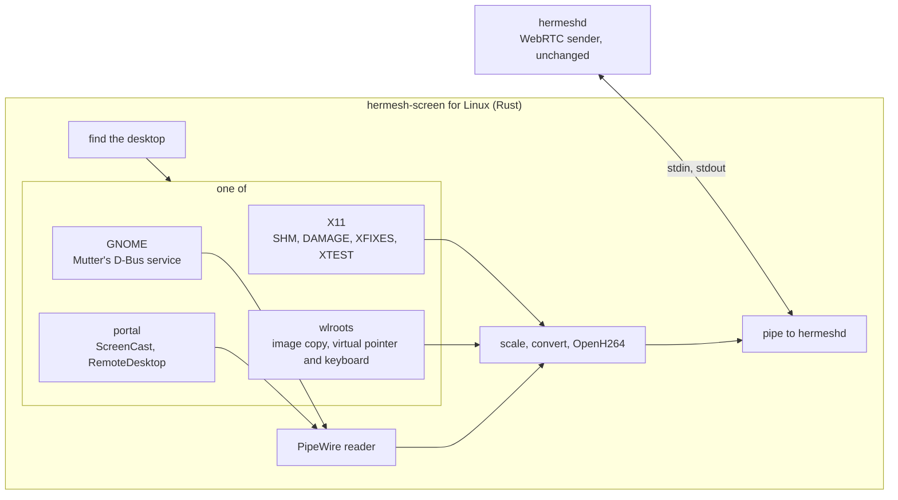

# Computer Control on Linux

Status: proposed 2026-11-12. Nothing is built. §9 has what was measured in
a container while writing this; §11 has what is not known yet.

[computer-control.md](computer-control.md) is the feature: the owner sees
and operates a Her Server's screen from the iPhone. It is built for the
Mac. This is the plan for Linux.

## 0. Summary

Everything outside one small program is shared with the Mac already: the
handshake, WebRTC, STUN and TURN, the iPhone page. The Mac's part that
touches the system is `hermesh-screen`, a helper that captures, encodes
and posts input. Linux needs its own.

Linux has no single way to do this. A desktop is one of four kinds, and
each kind has its own way to give a picture and take input:

| Desktop | Share today | How | Asks at the computer |
|---|---|---|---|
| X11 (Mint, Xfce, MATE, older releases, Nvidia on Ubuntu 22.04 and 24.04) | falling | X11's own extensions | never |
| GNOME on Wayland (Ubuntu, Fedora, Debian) | the largest | GNOME's remote desktop service | never |
| KDE Plasma on Wayland, COSMIC | the second | the desktop portal | once, or never after one command |
| Sway, Hyprland, niri and their kind | small | their own protocols | never |

The decisions proposed:

1. **One helper for Linux, in Rust**, with the same pipe to hermeshd as
   the Mac's. It finds out which desktop runs and picks the way.
2. **The four ways are built one at a time**, X11 first: it is the surest,
   it runs in a container, and the other three reuse all but the capture
   and input code.
3. **The encoder is OpenH264, in software, built into the helper.** No
   machine needs a graphics card. Hardware encoders come later, where
   there is one.
4. **GNOME is reached through its own remote desktop service**, which asks
   nothing, and through the portal where that service refuses.
5. **A server with no screen gets a virtual one** as its own step, after
   X11: it is the X11 way with a screen that exists only in memory.
6. **Nothing changes on the wire or in the relay.** hermeshd changes in two
   places, the iPhone app in its key row and its texts.

What Linux will not do, in any of these: show the login screen before
anyone has logged in, and (on GNOME's Wayland) show or unlock a locked
screen (§3.7).

## 1. What stays and what changes

| Piece | Change |
|---|---|
| `internal/screen` (Host, Viewer, WebRTC) | None. It has no Mac code |
| `ScreenService`, the relay's STUN and TURN | None |
| The pipe's messages (`internal/screen/pipe.go`) | None. Two new values of `State.error` (§3.6) |
| `hermesh-screen` | New for Linux: `apps/screen/linux` |
| `cmd/hermeshd` `screenBin()` | Finds the helper on Linux too |
| `internal/machine` `screenStatus()` | On Linux, asks the helper whether a desktop is there (§6) |
| `scripts/install.sh`, `internal/update`, `hermeshd uninstall` | Carry the helper as they carry `her` |
| `release.yml`, `scripts/release.sh` | Build and sign `hermesh-screen-linux-amd64` and `-arm64` |
| iPhone: key row | Ctrl, Alt, Super in place of ⌘, ⌥, ⌃ on a Linux machine |
| iPhone: texts | The ones that say "that Mac" and name macOS settings |
| Mac app, console | None |

## 2. Structure

Each way gives the same two things to the rest: frames of pixels (with
where the pointer is), and a place to send a move, a button, the wheel, a
key and text. Everything else is written once.

## 3. The helper

### 3.1 Finding the desktop

hermeshd on Linux is a systemd user service with lingering on. It often
starts before anyone logs in, so its environment has no `DISPLAY` and no
`WAYLAND_DISPLAY`. The helper does not read its own environment. Each time
it starts, it:

1. Asks logind for the user's graphical session and its type (`x11` or
   `wayland`), whether it is active and whether it is locked.
2. Takes `DISPLAY`, `XAUTHORITY`, `WAYLAND_DISPLAY` and
   `XDG_CURRENT_DESKTOP` from the user's systemd (`systemctl --user
   show-environment`), where GNOME and Plasma put them. Failing that, it
   looks for the sockets in `$XDG_RUNTIME_DIR` and `/tmp/.X11-unix`.
3. Picks the way: X11 for an X11 session; on Wayland, GNOME's service when
   it is on the session bus, else the wlroots protocols when the
   compositor offers them, else the portal.
4. With no graphical session: an X display that is there all the same (one
   the owner started, a VNC or xrdp desktop), then the virtual screen of
   step L2, then `no_display`.

`$HERMESH_SCREEN_DISPLAY` names an X display and skips all of this (tests,
and an owner who knows better).

### 3.2 The four ways

| | Picture | Input | Pointer in the picture |
|---|---|---|---|
| **X11** | `XShmGetImage` of the primary output when DAMAGE says the screen changed | XTEST | drawn in by the helper from XFIXES |
| **GNOME** | `org.gnome.Mutter.ScreenCast` `RecordMonitor`, read from PipeWire | `org.gnome.Mutter.RemoteDesktop` | drawn in by the helper from the stream's pointer data |
| **Portal** (KDE, COSMIC, GNOME's fallback) | `ScreenCast` inside a `RemoteDesktop` session, read from PipeWire | the session's `Notify…` calls | as GNOME |
| **wlroots** | `ext-image-copy-capture-v1`, else `wlr-screencopy` | `wlr-virtual-pointer`, `virtual-keyboard` with a keymap the helper makes | asked of the compositor per frame |

All four give frames only when the screen changes, so a still screen costs
nothing, as on the Mac.

**X11.** No permission, no dialog, and it goes on working on a locked
screen, so the owner can type the password. The extensions are in every
X server, Xvfb included.

**GNOME.** Mutter's service takes calls from any program of the user's
session and shows no dialog; GNOME's own remote desktop uses it. This is
read in Mutter's source (GNOME 46 to 51) and said by its developers; it
has not been run here yet (§9). It is not a public interface: GNOME's
developers have said they may limit who can call it. When the call is refused, the helper uses the portal, which GNOME
45 and later answer with a dialog once and a token after that.
GNOME shows its own mark in the top bar while a session lasts, with Stop.

**Portal.** The first session shows a dialog at the computer. The helper
asks for a token that lasts (`persist_mode` 2), keeps it in hermeshd's data
folder, and uses it from then on: Plasma 6.1.1 and later keep their word
across a restart. A token is used once and replaced each time, and a start
that fails spends it, so the helper never starts a session on a locked
screen. On Plasma 6.3 and later one command at the computer makes the
dialog never appear: `hermeshd screen allow` writes the permission the
portal looks for (`kde-authorized`, `remote-desktop`). The token belongs to
the program's identity, which for a user service with our unit's name is
empty; that works as long as the helper is always started the same way,
which it is.

**wlroots.** The protocols ask nothing. The compositor's variables reach
systemd only when the user's configuration says so (most distributions'
Sway does; Hyprland and niri users add a line): the helper finds the
socket in `$XDG_RUNTIME_DIR` without them.

### 3.3 From pixels to H.264

1. A frame arrives as BGRA (X11, wlroots) or in the format PipeWire agreed
   (BGRx, in memory: the helper offers no DMA-BUF format, so it is never
   handed a buffer that lives on a graphics card).
2. The pointer is drawn in when the viewer wants it (`pointer`, the same
   message as on the Mac).
3. The picture is made smaller to fit 1920 on its longest edge, both
   sides even, and turned into I420 (the `yuv` crate: under 1 ms, §9).
4. OpenH264 encodes it (§4). While a frame is being encoded, a newer one
   replaces the one waiting: never a queue.
5. The last picture is kept, so a keyframe asked for while the screen is
   still is made from it.
6. `bitrate` sets the encoder's target; below 0.8 Mbit/s the helper takes
   30 frames a second at most, as the Mac's does.

The helper answers `start` with 60 frames a second at most, whatever is
asked: no Linux way gives more and the encoder takes its time (§9).

### 3.4 Input

Positions come as fractions of the display, as on the Mac.

| Message | X11 | GNOME, portal | wlroots |
|---|---|---|---|
| `move` | XTEST, absolute | `NotifyPointerMotionAbsolute` on the stream | `motion_absolute` |
| `button` | XTEST button 1 or 3 | `NotifyPointerButton` | `button` |
| `wheel` | buttons 4 to 7, one for each 40 points gathered | `NotifyPointerAxis`, smooth | `axis`, smooth |
| `key`, named | its keysym's keycode | its keycode | its keycode in our keymap |
| `key`, a character with modifiers | modifier keys down, the key, modifiers up | the same | the same |
| `text` | each character on a spare keycode | see below | each character in our keymap |

- **Modifiers.** The message's `control`, `option`, `shift` and `command`
  become Ctrl, Alt, Shift and Super. Linux has no modifier flags on an
  event: the helper presses the modifier keys and lets them go, around the
  key, in one step, so none is ever held.
- **Text on X11.** A keycode nothing uses is given the character's keysym,
  the key is pressed, and the next character takes its turn (the way
  Chrome Remote Desktop types). Both of the keycode's levels get the
  keysym, or a capital comes out small (§9). The helper waits for the
  server between the two steps and puts the keycode back when it leaves.
- **Text on GNOME and the portal.** A character the keyboard layout has is
  typed as its key. One it has not (Chinese) can't be typed as a key:
  Mutter drops it. Plasma 6.6 and later take any character. Elsewhere the
  helper puts the text on the clipboard and pastes it (the session's
  clipboard calls, then Ctrl+V). A terminal pastes with Ctrl+Shift+V, so
  this fails there until tried and solved (§11).
- **Leaving clean.** When stdin closes, every button and key held is let
  go, the spare keycode is put back, the sessions are closed.

### 3.5 Which display

The primary one, as on the Mac: the primary output of RandR, the primary
monitor of GNOME's display configuration, the first output elsewhere.
Input fractions are of that display. More than one display is step 4 of
the Mac's plan and comes with it.

### 3.6 What the helper reports

`state` keeps its fields. `error` gets two values beside the Mac's:

| `error` | When | What the phone says |
|---|---|---|
| `no_display` (exists) | no desktop and no virtual screen | "*Name* has no desktop running" |
| `consent` (new) | the portal's dialog is waiting at the computer | "Allow it on *Name*'s screen, once" |
| `locked` (new) | GNOME on Wayland, screen locked | "*Name* is locked. Unlock it at the computer" |
| `capture`, `encoder` (exist) | the way failed; `detail` says how | as today |

`can_control` is false where a way gives a picture and no input (a portal
session granted for the screen alone).

`--status` prints, for hermeshd: which way would be used, or why none.
`--test-source` and `--input-log` do what the Mac's do, so the same tests
run against both helpers.

### 3.7 Lock, sleep, the login screen

- A session asks the desktop not to go idle while it lasts
  (`org.freedesktop.ScreenSaver.Inhibit`), and lets go when it ends.
- **X11**: a locked screen shows and takes input.
- **GNOME on Wayland**: locking ends every remote session and refuses new
  ones until it is unlocked. The helper reads the lock from logind first,
  reports `locked`, and starts nothing.
- **Plasma**: believed to go on while locked; to be checked (§11).
- **The login screen** belongs to another user. Out of reach everywhere.

## 4. The encoder

**OpenH264** (Cisco, BSD), compiled into the helper from source by the
`openh264` crate.

- Camera mode, not screen-content mode: screen-content mode took 39 ms a
  frame on a scrolling terminal against 9 (§9; Firefox found the same).
- Constrained Baseline, level by the size, no B-frames, parameter sets
  with every keyframe, a keyframe at the start and on request only.
- Sliced, four threads: 3 ms a frame at 1080p where one thread takes 8
  (§9). All slices of a frame leave as one message; the iPhone decodes
  them as one sample already.
- Rate control on, with frame skipping: without it the encoder ignores the
  target (19 Mbit/s asked for 3, §9). With it, a screen that changes
  everywhere at once gets fewer frames, not a blurred one. Whether that is
  the right trade is tuned in step L1 against x264's behaviour on paper.
- The bitrate is changed on the fly (`ENCODER_OPTION_BITRATE`, through the
  crate's raw interface).
- On x86-64 the build needs NASM, or the encoder is three times slower:
  the release build fails without it.

The receiver is ours: the stream says Baseline in its parameter sets while
the offer names High, and VideoToolbox decodes what the parameter sets
say.

**Not x264**: it is GPL, and the helper would be GPL with it.

**Hardware encoders** (VA-API for Intel and AMD, NVENC) are a later step,
loaded at run time where the machine has them. Most Linux Her Servers are
cloud machines without one.

**The H.264 patent pool.** OpenH264's source is free to use; Cisco pays
the pool's fees only for the binary Cisco itself builds and each user
downloads. A copy we compile, as Debian and Chromium do, has no such
cover. The other course is to download Cisco's binary at install time and
load it, under Cisco's terms (a switch the user can turn off, and Cisco's
line of text beside it). This is the owner's call (§11); the plan compiles
from source.

## 5. Packaging and install

- `apps/screen/linux`: a Cargo project of its own, the toolchain `her`
  uses.
- Release assets `hermesh-screen-linux-amd64` and `-arm64`, signed and in
  `checksums.txt` like the rest.
- `install.sh` puts it beside hermeshd as `hermesh-screen` when the
  release has it (the `her` pattern). `internal/update` updates it with
  hermeshd. `hermeshd uninstall` removes it.
- **Steps L1 and L2: a static program** (musl), built in the same
  container as `her`. X11 and OpenH264 link static: checked (§9), 1.8 MB.
- **From step L3: built against glibc 2.28** (Ubuntu 20.04, Debian 11,
  RHEL 8 and later). GNOME and Plasma give their picture through
  PipeWire, whose library loads its parts at run time, which a static
  program can't do. The helper loads `libpipewire-0.3.so.0` itself when a
  Wayland session needs it (as Chrome does), so a server without PipeWire
  still runs the same file. A distribution on musl (Alpine) then needs the
  static build kept beside it, with X11 and wlroots only: decided at L3.
- No package manager step, no root, for anything but the virtual screen
  (L2), which needs an X server installed.

## 6. In hermeshd

- `screenBin()` looks beside the program on Linux as on the Mac.
- **Whether the screen can be shown is not fixed on Linux**: a desktop
  comes and goes with a login. `screenStatus()` asks the helper
  (`--status`), keeps the answer for 30 seconds, and asks again off to the
  side. `screen.available` in the machine's status is that answer, so the
  row on the phone appears and leaves with the desktop.
- `hermeshd status` says who is in control. `hermeshd screen stop` ends
  the session (the local `StopScreen` call the Mac app's menu uses).
- `hermeshd screen off` and `on`: a file in the data folder that makes the
  machine refuse. On is the default (§11 has why, and the other choice).
- `hermeshd screen allow`: on Plasma, the one command of §3.2.
- The audit record of each session is already written.
- The comment on `ScreenStatus.available` stops saying "is a Mac".

## 7. On the iPhone

- The key row follows the machine's platform: on Linux, Ctrl, Alt, Super
  and Shift, sent as the same four fields.
- "That Mac" in the session's texts becomes the machine's name; the text
  about macOS's Screen Recording stays for a Mac only; the two new states
  get the texts of §3.6.
- Nothing else. The row in Her's settings follows `screen.available`
  already.

## 8. Who is in control, at the computer

The Mac app's menu bar says who is in control and offers Stop. There is
no Hermesh app on a Linux machine.

- GNOME and Plasma show their own mark while a remote session lasts, with
  a way to end it.
- On X11 and wlroots nothing does. The helper sends one desktop
  notification when a session starts ("*iPhone* is controlling this
  computer", with Stop), over D-Bus.
- `hermeshd status` and `hermeshd screen stop` everywhere.

## 9. Measured

2026-11-12, in a container (Alpine, arm64) on an M2 Max, a 1920×1080 Xvfb
screen, a throwaway program: `x11rb` for X11, the `yuv` crate, the
`openh264` crate 0.9.10 (OpenH264 2.7.0), built static with musl.

| | Median | 90% |
|---|---|---|
| `XShmGetImage`, the whole screen | 0.6 ms | 1.0–2.0 |
| BGRA to I420 | 0.8 ms | 0.9–1.2 |
| Encode, still screen, camera mode | 3.3 ms | 4.3 |
| Encode, terminal scrolling over the whole screen, camera mode, one thread, no rate control | 8.6 ms | 9.9 |
| The same with slices and four threads | 3.5 ms | 9.0 |
| The same in screen-content mode | 39 ms | 52 |

- 60 frames a second held in every row but the last (23).
- With no frame skipping the scrolling terminal came out at 19–21 Mbit/s
  against a target of 3. With it: 3.2 Mbit/s, and five frames in six
  skipped. A terminal scrolling over the whole screen is the worst
  picture there is; ordinary use is far milder.
- The Mac's hardware encoder takes 8.8 ms a frame
  ([computer-control.md](computer-control.md) §5.1): software on this
  processor is not slower. A cloud machine's core is two to three times
  slower than this one; not measured.
- XTEST: an absolute move was where asked 0.3 ms later.
- Text through a spare keycode reached a terminal as typed, Chinese and an
  emoji included, at 12 ms a character with the waits this used. With one
  level of the keycode set, capitals arrived small; with both, right.
- GNOME in a container, with no screen (`gnome-shell --headless`): not
  run. Three attempts stopped while installing its packages (the network
  here), before GNOME started. Nothing about GNOME, Plasma or wlroots in
  this plan has been run: it rests on their documentation and source
  (§13).

## 10. Steps

Each ends with an end-to-end test made from what a person does, and with
the tests before it still passing.

**L1. X11.** The helper's frame: the pipe, finding the desktop, the
encoder, input; the X11 way; hermeshd, install, update, uninstall,
release; the iPhone's key row and texts.

- `go test ./internal/screen`: the session test that runs against the
  Mac's helper runs against this one on Linux (`--test-source`,
  `--input-log`), in CI.
- `HERMESH_DOCKER=1 go test ./e2e -run TestLinuxScreen`: a container with
  Xvfb, a terminal and hermeshd; an iPhone's core opens its screen through
  the test relay. The root window is one colour: a keyframe, decoded, is
  that colour. Text typed from the phone, Chinese included, is in the file
  the terminal writes. A tap lands where the pointer is then read to be. A
  still screen sends nothing. Stop ends it.
- iPhone UI test: a Linux machine's page has Ctrl, Alt and Super.
- By hand: a Linux Mint virtual machine on the Mac, the checks of step 0
  of the Mac's plan, and the delay with a clock on both.
- Released when it passes: X11 desktops work from then on.

**L2. A server with no screen.** hermeshd starts a virtual screen when
there is none and the owner asked for one, and her starts her Chrome on
it, so the owner can sign in to a site or pass a check Her can't.

- Needs deciding first: what runs on that screen besides Chrome, and who
  installs the X server (§11).
- e2e: on a fresh Ubuntu server in Docker (the `TestLinuxHer` world), the
  phone sees Her's browser and types into a page.

**L3. GNOME on Wayland.** The PipeWire reader, the glibc build, Mutter's
service, the lock, the clipboard for text.

- First, in a virtual machine: the service called from a user service
  with no dialog (Ubuntu 24.04 and 26.04, Fedora); a session across a
  lock; Chinese into an editor and into a terminal.
- CI: a headless GNOME in a container if it can be made to run (§11);
  else the PipeWire reader against a test stream.
- By hand: Ubuntu's desktop in a virtual machine, the checks of L1.

**L4. Plasma and the portal.** The portal session, the token, `hermeshd
screen allow`, `consent`.

- By hand: Fedora KDE and Kubuntu in a virtual machine: the dialog once,
  no dialog after a restart, no dialog at all after the command. The
  portal on GNOME as the fallback of L3.
- CI: `kwin_wayland --virtual` in a container if it runs.

**L5. wlroots.** Image copy, virtual pointer, virtual keyboard.

- CI: Sway with no screen (`WLR_BACKENDS=headless`) in a container, the
  checks of `TestLinuxScreen`.

**L6. Later, as needed.** Hardware encoders; what step 4 of the Mac's plan
brings to both (pointer shapes, more displays, the clipboard).

L1 is the largest step: most of it is used by all the others. L3 is the
next largest (the PipeWire reader). L4 and L5 are small after L3.

## 11. Open questions

For the owner to decide:

1. **OpenH264 from source, or Cisco's binary** (§4).
2. **GNOME through Mutter's own service**: no dialog, and it may be closed
   to us in a later GNOME, where the portal takes over. Or the portal
   only: public, with a dialog once.
3. **On by default.** A Mac asks for two permissions at the Mac; X11,
   GNOME and wlroots ask for nothing. The owner's trusted devices can
   already run any command on the machine as that user, so the screen
   gives them nothing new, and the plan leaves it on. The other choice:
   off until `hermeshd screen on` is run at the machine.
4. **The virtual screen** (L2): what it holds, and whether it is in this
   work at all.
5. **musl distributions from L3**: keep a second, static build for them,
   or leave them X11 and wlroots through the last static release.

To find out:

- Software encoding on a cloud machine's core, x86-64 and arm64: the
  frame rate that holds at 1080p.
- GNOME with no screen in a container, for CI (§9).
- Text the layout has not, into a terminal on GNOME (§3.4).
- Plasma's locked screen.
- Whether logind lets hermeshd unlock the user's own session, and whether
  it should: it would open a locked GNOME screen from the phone without
  its password.
- The portal's token when hermeshd is run by hand and not by systemd (the
  identity differs).
- The picture on a display larger than 1920: what scaling costs.
- Nvidia's driver with X11's shared-memory capture.

## 12. Options considered

| Shape | Why not |
|---|---|
| The portal alone, for everything | X11 has none worth using; Sway and Hyprland have no input in theirs; GNOME's can't run without a person the first time |
| Kernel devices for input (`/dev/uinput`) and the display's memory for the picture | One way for every desktop, and it needs root to set up, keys only (no text), and a pointer that spans every display |
| GStreamer or FFmpeg for capture and encoding | Little code, and the result depends on which plugins each distribution installed |
| VNC or RDP servers already on the machine, through the tunnel | The Mac's reason: TCP through a far relay, a second password and switch, nothing to tune |
| Capture and encode inside hermeshd | hermeshd would need cgo and C libraries |
| x264 | GPL |
| One static program for all four ways | PipeWire's library can't be loaded from one |
| **One Rust helper, four ways, OpenH264 inside** | Chosen |

## 13. Sources

Read on 2026-11-12.

- The portal's RemoteDesktop, ScreenCast and Clipboard interfaces, and how
  it names a program that is not sandboxed:
  <https://flatpak.github.io/xdg-desktop-portal/docs/doc-org.freedesktop.portal.RemoteDesktop.html>,
  <https://github.com/flatpak/xdg-desktop-portal/blob/main/shared/xdp-app-info-host.c>
- Mutter's service has no check on who calls it:
  <https://discourse.gnome.org/t/security-for-mutter-screencast/35009>,
  `meta-remote-desktop.c` in <https://gitlab.gnome.org/GNOME/mutter>.
  Locking ends remote sessions: `js/ui/main.js` in gnome-shell. A keysym
  the layout has not is dropped: `meta-virtual-input-device-native.c`
- Plasma's permission that skips the dialog:
  <https://develop.kde.org/docs/administration/portal-permissions/>. Tokens
  across a restart: <https://bugs.kde.org/show_bug.cgi?id=480235>
- Which compositor has which protocol: <https://wayland.app/protocols/>;
  how wayvnc uses them: <https://github.com/any1/wayvnc>
- Typing through a spare keycode:
  <https://chromium.googlesource.com/chromium/src/+/main/remoting/host/linux/x11_keyboard_impl.cc>
- OpenH264, its limits and Cisco's terms: <https://github.com/cisco/openh264>,
  <https://www.openh264.org/faq.html>,
  <https://www.openh264.org/BINARY_LICENSE.txt>. Screen-content mode's
  speed: <https://bugzilla.mozilla.org/show_bug.cgi?id=1942245>
- PipeWire from a static program:
  <https://gamesbymason.com/blog/2025/statically-linking-pipewire>
- A user service's environment and logind:
  <https://www.freedesktop.org/software/systemd/man/latest/org.freedesktop.login1.html>
