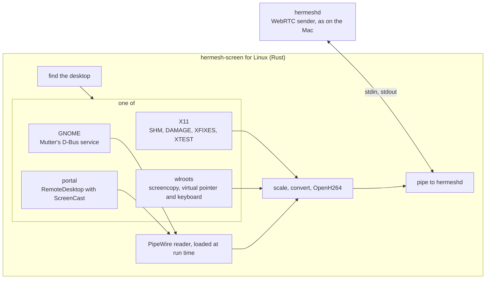

# Computer Control on Linux

Status: built 2026-11-12. The four ways of §3.2 run against the desktops
themselves in containers (§9, §10); the release build is checked on Debian
13 and Fedora 43. Not yet checked: a Plasma desktop (KWin's screen sharing
needs a graphics device a container here lacks), a real network, a real
iPhone (§11).

[computer-control.md](computer-control.md) is the feature: the owner sees
and operates a Her Server's screen from the iPhone. It was built for the
Mac. This is Linux.

## 0. Summary

Everything outside one small program is shared with the Mac: the
handshake, WebRTC, STUN and TURN, the iPhone page. The Mac's part that
touches the system is `hermesh-screen`, a helper that captures, encodes
and posts input. Linux has its own, `apps/screen/linux`, in Rust, with the
same pipe to hermeshd.

Linux has no single way to do this. A desktop is one of four kinds, and
each has its own way to give a picture and take input; the helper finds out
which runs and picks the way:

| Desktop | How | Asks at the computer |
|---|---|---|
| X11 (Mint, Xfce, MATE, older releases, Nvidia on Ubuntu 22.04 and 24.04) | X11's own extensions | never |
| GNOME on Wayland (Ubuntu, Fedora, Debian) | GNOME's own remote desktop service | never |
| KDE Plasma, COSMIC, and GNOME if its service refuses | the desktop portal | once, then a kept token; on Plasma never, after `hermeshd screen allow` |
| Sway, Hyprland, niri, river, labwc | their own protocols | never |

Decided (the owner left the choices to this work):

1. **OpenH264, compiled from source into the helper**, in software: no
   machine needs a graphics card. Not Cisco's downloaded binary (§4).
2. **GNOME through Mutter's own service**, which asks nothing; the portal
   when GNOME refuses it.
3. **On by default.** The owner's trusted devices can already run any
   command on the machine as its user, so the screen gives them nothing
   new. `hermeshd screen off` at the machine refuses them.
4. **No virtual screen for servers yet.** A machine with no desktop says
   so (§3.6). Showing Her's own browser on one is a feature of its own
   (§11).
5. **One build, against glibc 2.28.** A distribution on musl (Alpine) runs
   no helper, and its machines say they can't show their screen.

What Linux does not do: show the login screen before anyone has logged
in, or a locked GNOME screen on Wayland (§3.7).

## 1. What changed

| Piece | Change |
|---|---|
| `internal/screen` (Host, Viewer, WebRTC) | The host asks a Linux helper whether a desktop is there (§6), and minds `hermeshd screen off` |
| `ScreenService`, the relay's STUN and TURN, the pipe's messages | None. `State.error` takes three more values (§3.6) |
| `hermesh-screen` | New for Linux: `apps/screen/linux` |
| `cmd/hermeshd` | Finds the helper on Linux; `hermeshd screen`; a line in `status` |
| `scripts/install.sh`, `internal/update`, `hermeshd uninstall` | Carry the helper as they carry `her` |
| `release.yml`, `scripts/release.sh` | Build and sign `hermesh-screen-linux-amd64` and `-arm64` |
| iPhone | Ctrl, Alt, Super in place of ⌘, ⌥, ⌃ on a Linux machine; the texts of §3.6 |
| Mac app, console | None |

## 2. Structure

| File | What |
|---|---|
| `main.rs` | Arguments, the pipe's messages, starting the way |
| `detect.rs` | Finding the desktop (§3.1) |
| `x11.rs`, `mutter.rs`, `portal.rs`, `wlr.rs` | The four ways |
| `pipewire.rs` | `libpipewire-0.3.so.0` loaded at run time; SPA's format written and read by hand |
| `video.rs` | Scaling, I420, OpenH264, the newest picture only |
| `keys.rs` | Keysyms and evdev codes of the viewer's keys |
| `notify.rs` | The notification at the computer, keeping it from going idle |

## 3. The helper

### 3.1 Finding the desktop

hermeshd on Linux is a systemd user service with lingering on. It often
starts before anyone logs in, so its environment has no `DISPLAY` and no
`WAYLAND_DISPLAY`. Each time it starts, the helper:

1. Takes `DISPLAY`, `XAUTHORITY`, `WAYLAND_DISPLAY`, `XDG_CURRENT_DESKTOP`
   and the session bus from its own environment, else from the user's
   systemd (`systemctl --user show-environment`), where GNOME and Plasma
   put them, else from the sockets in `$XDG_RUNTIME_DIR` and
   `/tmp/.X11-unix`.
2. Asks logind for the user's graphical session: its type (`x11`,
   `wayland`) and whether it is locked.
3. Picks the way: X11 for an X11 session; on Wayland, GNOME's service when
   it is on the session bus, else the wlroots protocols when the
   compositor offers them, else the portal.
4. Says `no_display` when there is none of these.

`$HERMESH_SCREEN_WAY` (`x11`, `gnome`, `portal`, `wlroots`) picks the way
instead (tests).

### 3.2 The four ways

| | Picture | Input | Pointer in the picture |
|---|---|---|---|
| **X11** | `XShmGetImage` of the primary output when DAMAGE says the screen changed, or the pointer moved | XTEST | drawn by the helper from XFIXES, or left out |
| **GNOME** | `org.gnome.Mutter.ScreenCast` `RecordMonitor`, read from PipeWire | `org.gnome.Mutter.RemoteDesktop` | always drawn by GNOME |
| **Portal** | `ScreenCast` inside a `RemoteDesktop` session, read from PipeWire through the portal's own connection | the session's `Notify…` calls | always drawn by the desktop |
| **wlroots** | `wlr-screencopy`, a frame each time the screen changes (`copy_with_damage`) | `wlr-virtual-pointer`, `virtual-keyboard` with a keymap the helper writes | asked of the compositor per frame, or left out |

All four give frames only when the screen changes, so a still screen costs
nothing, as on the Mac.

**X11.** No permission, no dialog, and it goes on working on a locked
screen, so the owner can type the password.

**GNOME.** Mutter's service takes calls from any program of the user's
session and shows no dialog; GNOME's own remote desktop uses it. Checked
on Mutter 51 alone and under GNOME Shell 51 (§9), and on Debian 13's
Mutter 48. GNOME shows its own mark in the top bar while a session lasts.
It is not a public interface: GNOME's developers have said they may limit
who can call it. When a call is refused, the helper uses the portal.

- GNOME makes the session's keyboard with its first key, and what is
  typed while programs take it up is lost: the helper presses Shift, which
  types nothing, as the session starts.
- The pointer's mode is fixed for a stream, so it is always drawn; in
  trackpad mode the phone draws its own over it.

**Portal.** The first session shows a dialog at the computer; the helper
reports `consent` while it waits. GNOME's dialog has "Remember This
Selection" ticked and "Allow Remote Interaction" off: left so, the session
shows the screen and takes no input, and the phone says so. The helper asks
for a token that lasts (`persist_mode` 2), keeps it in
`~/.local/state/hermesh/screen-portal-token`, and the next session starts
with it and no dialog (§9). A token is used once and replaced each time.
On Plasma 6.3 and later, `hermeshd screen allow` writes the permission
Plasma looks for (`kde-authorized`: `remote-desktop`, `screencast`) for the
helper as the portal names it (systemd's unit gives it no name of its own,
so the empty one), and the dialog never appears.

- The portal takes each call on a thread of its own: input sent without
  waiting arrives out of order (keys swapped, a key held). The helper waits
  for each answer: a millisecond or two a call.

**wlroots.** The protocols ask nothing. The compositor's variables reach
systemd only when the user's configuration says so (most distributions'
Sway does; Hyprland and niri users add a line): the helper finds the
socket in `$XDG_RUNTIME_DIR` without them.

### 3.3 From pixels to H.264

1. A frame arrives as BGRA (X11, wlroots) or in the format PipeWire agreed
   (BGRx or RGBx, in memory: the helper offers no DMA-BUF format, so it is
   never handed a buffer that lives on a graphics card).
2. The pointer is drawn in where the helper draws it (X11).
3. The picture is made smaller to fit 1920 on its longest edge, both sides
   even (`fast_image_resize`), and turned into I420 (`yuv`).
4. OpenH264 encodes it (§4). A picture that comes while one is being
   encoded replaces the one waiting: never a queue.
5. The last picture is kept, so a keyframe asked for while the screen is
   still is made from it.
6. `bitrate` sets the encoder's target; below 0.8 Mbit/s the helper takes
   30 frames a second at most, as the Mac's does. Otherwise 60 at most,
   whatever `start` asks: no Linux way gives more.

### 3.4 Input

Positions come as fractions of the display, as on the Mac.

| Message | X11 | GNOME, portal | wlroots |
|---|---|---|---|
| `move` | XTEST, absolute | `NotifyPointerMotionAbsolute` on the stream | `motion_absolute` on the output |
| `button` | XTEST button 1 or 3 | `NotifyPointerButton` | `button` |
| `wheel` | buttons 4 to 7, a step for each 40 points | `NotifyPointerAxisDiscrete` | `axis_discrete` |
| `key` | modifier keys down, the key, modifiers up | the same, as keysyms | the key in our keymap, with `modifiers` |
| `text` | each character on its key, or on a spare keycode | keysyms; the clipboard for what the layout lacks | each character in our keymap |

- **Modifiers.** The message's `control`, `option`, `shift` and `command`
  are Ctrl, Alt, Shift and Super, pressed and let go around the key in one
  step, so none is ever held.
- **Text on X11.** A character no key has goes on a keycode nothing uses,
  both its levels (or a capital comes out small), a few at a time, the
  mapping settled before the keys are pressed (as Chrome Remote Desktop
  types); the keycodes are put back when the helper leaves.
- **Text on GNOME and the portal.** Mutter drops a keysym the layout has
  no key for. Text with any character outside ASCII is put on the
  session's clipboard and pasted with Ctrl+V. Most programs paste so; a
  terminal pastes with Ctrl+Shift+V, which the owner can press from the key
  row, the text still on the clipboard. On Plasma (6.6 and later type any
  character) the helper types keysyms instead.
- **Text on wlroots.** The helper writes an xkb keymap with each character
  on a key of its own, as `wtype` does, and sends it again when a new one
  comes.
- **Leaving clean.** When stdin closes, every button held is let go, and
  the spare keycodes are put back.

### 3.5 Which display

The primary one, as on the Mac: the primary output of RandR, the primary
monitor of GNOME, the one the portal's dialog chose, the first output on
wlroots. Input fractions are of that display.

### 3.6 What the helper reports

`state` keeps its fields; `error` takes three values beside the Mac's:

| `error` | When | The phone says |
|---|---|---|
| `no_display` | no desktop running | "*Name* has no desktop running. Log in to its desktop, then connect again." |
| `consent` | the portal's dialog waits at the computer | "*Name* is asking at its screen. Someone at that computer allows it there, once." |
| `locked` | GNOME on Wayland, screen locked | "*Name* is locked. GNOME shares no locked screen." |
| `capture`, `encoder` | the way failed | *Name* can't show its screen, and the helper's `detail` |
| `ended` | Stop in the notification at the computer | as when the Mac's menu stops it |

`can_control` is false where a session shows the screen without input (a
portal session allowed without remote interaction): the phone says "You
can watch, not control: *Name* shares its screen without its keyboard and
mouse."

`--status` prints, for hermeshd, the way it would take or why none, as
JSON. `--test-source` and `--input-log` do what the Mac's do. `--allow` is
`hermeshd screen allow`. `--version`, for updates.

### 3.7 Lock, sleep, the login screen

- A session keeps the desktop from going idle while it lasts (GNOME's
  session manager, else `org.freedesktop.ScreenSaver`).
- **X11**: a locked screen shows and takes input.
- **GNOME on Wayland**: locking ends every remote session and refuses new
  ones until it is unlocked. The helper reads the lock from logind and
  reports `locked` without starting one; one under way that GNOME ends
  reports it too.
- **The login screen** belongs to another user: out of reach everywhere.

## 4. The encoder

**OpenH264** 2.7.0 (Cisco, BSD), compiled into the helper from source by
the `openh264` crate.

- Camera mode, not screen-content mode: screen-content mode took 39 ms a
  frame on a scrolling terminal against 9 (§9; Firefox found the same).
- Constrained Baseline, level by the size, no B-frames, parameter sets
  with every keyframe, a keyframe at the start and on request only. The
  receiver is ours: the stream says Baseline while the offer names High,
  and VideoToolbox decodes what the parameter sets say.
- Slices of an MTU each, four threads: 3 ms a frame at 1080p where one
  thread takes 8. All slices of a frame leave as one message.
- Rate control with frame skipping: without it the encoder ignores the
  target (19 Mbit/s asked for 3). With it, a screen that changes
  everywhere at once gets fewer frames, not a blurred one.
- The bitrate changes on the fly (`ENCODER_OPTION_BITRATE`).
- On x86-64 the build needs NASM, or the encoder is three times slower;
  the release build installs it.

**Not x264**: it is GPL, and the helper would be GPL with it.

**Hardware encoders** (VA-API, NVENC) are for later, loaded at run time
where the machine has one. Most Linux Her Servers are cloud machines
without.

**The H.264 patent pool.** Cisco pays the pool's fees only for the binary
Cisco builds and each user downloads. A copy compiled by others, as Debian
and Chromium do and this helper does, has no such cover.

## 5. Packaging and install

- `apps/screen/linux`: a Cargo project of its own, with `her`'s toolchain.
- `apps/screen/linux/build-release.sh` builds it in AlmaLinux 8, against
  glibc 2.28 (Ubuntu 20.04, Debian 10, RHEL 8, Fedora and later), with
  libstdc++ linked in: it needs glibc and nothing else. PipeWire is loaded
  when a GNOME or portal session needs it, so a server without PipeWire
  runs the same file. 5.6 MB.
- The release job builds it on an amd64 and an arm64 runner; the assets
  `hermesh-screen-linux-amd64` and `-arm64` are signed in `checksums.txt`
  with the rest.
- `install.sh` puts it beside hermeshd as `hermesh-screen` when the
  release has it; updates replace it with hermeshd (it says `--version`);
  `hermeshd uninstall` removes it.
- No package manager step, no root.

## 6. In hermeshd

- `screenBin()` looks beside the program on Linux as on the Mac.
- **Whether the screen can be shown changes on Linux**: a desktop comes
  and goes with a login. The host asks the helper (`--status`), the first
  time while the caller waits, then keeps the answer for 30 seconds and
  asks again off to the side; while a session lasts the answer stands.
  `screen.available` in the machine's status is that answer, so the row on
  the phone comes and goes with the desktop.
- `hermeshd screen` says how it is: the way, who is in control, or why it
  can't; `hermeshd status` has the same line.
- `hermeshd screen stop` ends the session (the machine's control socket).
- `hermeshd screen off` and `on`: a file in the machine's data folder
  (`screen-off`) that makes it refuse and stop offering its screen.
- `hermeshd screen allow`: on Plasma, the one command of §3.2.
- Each session is a record in the audit log, as on the Mac.

## 7. On the iPhone

- On a Linux machine (its platform in the status) the key row reads Ctrl,
  Alt, Super, ⇧, sent as the same four fields.
- "That Mac" in the session's texts became the machine's name; the texts
  of §3.6 are new, in English and Chinese.

## 8. Who is in control, at the computer

- GNOME and Plasma show their own mark while a remote session lasts.
- On X11 and wlroots the helper sends a desktop notification when a
  session starts ("Your screen is shared"), with Stop.
- `hermeshd screen` and `hermeshd screen stop` everywhere.

## 9. Measured and checked

On an M2 Max, in containers (Alpine edge, arm64) with no screen, a
throwaway program first, then the helper as hermeshd drives it.

The encoder, a 1920×1080 Xvfb screen:

| | Median | 90% |
|---|---|---|
| `XShmGetImage`, the whole screen | 0.6 ms | 1.0–2.0 |
| BGRA to I420 | 0.8 ms | 0.9–1.2 |
| Encode, still screen | 3.3 ms | 4.3 |
| Encode, a terminal scrolling over the whole screen, one thread | 8.6 ms | 9.9 |
| The same with slices and four threads | 3.5 ms | 9.0 |
| The same in screen-content mode | 39 ms | 52 |

- 60 frames a second held in every row but the last (23).
- With no frame skipping the scrolling terminal came out at 19–21 Mbit/s
  against a target of 3; with it, 3.2 Mbit/s, five frames in six skipped.
- The Mac's hardware encoder takes 8.8 ms a frame
  ([computer-control.md](computer-control.md) §5.1). A cloud machine's
  core is two to three times slower than this one: not measured.

The ways, each against the desktop's own software, a terminal on it
writing what reached it:

| Desktop | Picture | Typed "Hello …", then Chinese and "Ünï" | Else |
|---|---|---|---|
| Xvfb (X11) | 1600×900, the root's colour right in the decoded frame | as typed | the pointer where asked; capitals right with both levels set |
| Mutter 51, headless | 1280×720 | as typed (Chinese pasted) | no dialog |
| GNOME Shell 51, headless | the shell's top bar with GNOME's sharing mark | as typed | first frame in 0.05–0.09 s |
| Sway 1.12, headless, pixman | 1280×720, the background's colour right | as typed, and Ctrl+A | no dialog |
| GNOME's portal over Mutter 51 | 1280×720 | as typed (Chinese pasted) | `consent` while the dialog waited; the dialog clicked through by GNOME's own way; the token kept; a second session with no dialog, first frame in 0.06–0.11 s |
| Debian 13 (glibc 2.41, Mutter 48), Fedora 43, the release build | see §10 | | |

Container lessons: Xvfb resets (root colour, pointer) when its last client
leaves unless started with `-noreset`; GNOME Shell waits 25 seconds on
every missing system service unless they fail at once; KWin's screen
sharing needs a render node (`/dev/dri`), which Docker Desktop has not.

## 10. Tests

- `apps/screen/linux`: `cargo test` (the pipe's JSON, keys, sizes,
  packing, the encoder, SPA's format, the keymap); `cargo clippy -D
  warnings`.
- `HERMESH_DOCKER=1 go test ./e2e -run TestLinuxScreen`: on X11, Sway and
  GNOME, each in a container with no screen, a Linux hermeshd (its
  environment naming no display, as under systemd) with the helper beside
  it is paired with the owner's Mac; an iPhone's core, joined as a trusted
  device, sees the screen offered and opens it through the relay. The
  picture comes from a keyframe on at the desktop's size, a direct path;
  `hermeshd screen` names the way and then the phone in control; a click
  and "Hello Linux 你好" reach the terminal; `hermeshd screen stop` ends it
  and the phone is told; `screen off` takes the screen from the phone and
  `on` gives it back. CI runs it.
- The Mac's `TestScreen` and `TestScreenThroughTURN` still pass.
- By hand, with a script that drives the helper as hermeshd does: the
  portal end to end on GNOME's portal (§9), the release build on Debian 13
  and Fedora 43.

## 11. Open

- Plasma: the portal against KDE's backend, `hermeshd screen allow`, a
  locked screen. Needs a machine or virtual machine with a graphics
  device.
- A real Linux desktop under systemd: the helper finding a logged-in
  session from the service, GNOME's lock.
- An iPhone UI test against a Linux machine: Her would have to run there
  (the row is in Her's settings).
- Software encoding on a cloud machine's core, x86-64 and arm64.
- Text the layout lacks, into a terminal on GNOME (pasting needs
  Ctrl+Shift+V there).
- A virtual screen for a server with no desktop, with Her's browser on it.
- Whether GNOME keeps its service open to other programs.

## 12. Options considered

| Shape | Why not |
|---|---|
| The portal alone, for everything | X11 has none worth using; Sway and Hyprland have no input in theirs; GNOME's can't run without a person the first time |
| Kernel devices for input (`/dev/uinput`) and the display's memory for the picture | One way for every desktop, and it needs root to set up, keys only (no text), and a pointer that spans every display |
| GStreamer or FFmpeg for capture and encoding | Little code, and the result depends on which plugins each distribution installed |
| VNC or RDP servers already on the machine, through the tunnel | The Mac's reason: TCP through a far relay, a second password and switch, nothing to tune |
| Capture and encode inside hermeshd | hermeshd would need cgo and C libraries |
| x264 | GPL |
| One static program for all four ways | PipeWire's library can't be loaded from one |
| **One Rust helper, four ways, OpenH264 inside** | Chosen |

## 13. Sources

Read on 2026-11-12.

- The portal's RemoteDesktop, ScreenCast and Clipboard interfaces, and how
  it names a program that is not sandboxed:
  <https://flatpak.github.io/xdg-desktop-portal/docs/doc-org.freedesktop.portal.RemoteDesktop.html>,
  <https://github.com/flatpak/xdg-desktop-portal/blob/main/shared/xdp-app-info-host.c>
- Mutter's service has no check on who calls it:
  <https://discourse.gnome.org/t/security-for-mutter-screencast/35009>,
  `meta-remote-desktop.c` in <https://gitlab.gnome.org/GNOME/mutter>.
  Locking ends remote sessions: `js/ui/main.js` in gnome-shell. A keysym
  the layout has not is dropped: `meta-virtual-input-device-native.c`
- Plasma's permission that skips the dialog:
  <https://develop.kde.org/docs/administration/portal-permissions/>. Tokens
  across a restart: <https://bugs.kde.org/show_bug.cgi?id=480235>
- Which compositor has which protocol: <https://wayland.app/protocols/>;
  how wayvnc uses them: <https://github.com/any1/wayvnc>
- Typing through a spare keycode:
  <https://chromium.googlesource.com/chromium/src/+/main/remoting/host/linux/x11_keyboard_impl.cc>
- OpenH264, its limits and Cisco's terms: <https://github.com/cisco/openh264>,
  <https://www.openh264.org/faq.html>,
  <https://www.openh264.org/BINARY_LICENSE.txt>. Screen-content mode's
  speed: <https://bugzilla.mozilla.org/show_bug.cgi?id=1942245>
- PipeWire from a static program:
  <https://gamesbymason.com/blog/2025/statically-linking-pipewire>
- A user service's environment and logind:
  <https://www.freedesktop.org/software/systemd/man/latest/org.freedesktop.login1.html>
