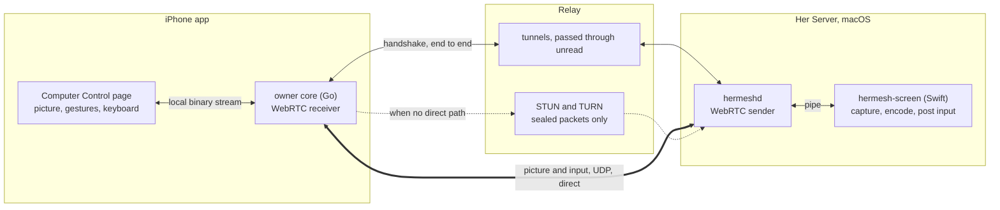
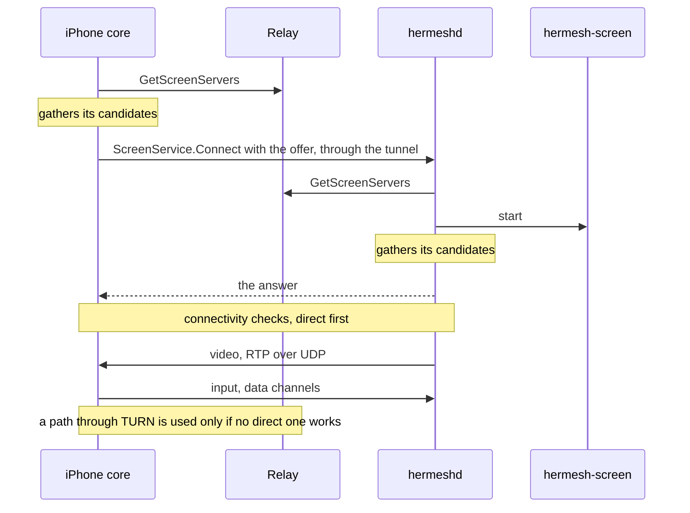

# Computer control: the owner's hands on a Her Server's Mac

Status: agreed 2026-11-10. Steps 1 to 3 of §8 are built: the Mac side, the
iPhone side and the relay's STUN and TURN. Step 0's questions about the
real screen (§10) and step 4 are open.

## 0. Summary

From the iPhone, the owner opens a live view of the Mac that Her runs on
and operates it: to do a step Her can't (a password, a system prompt, a
CAPTCHA), or to watch Her work. The entry is one row, **Computer Control**
(电脑操控), in Her's settings.

The first version is minimal and has one bar to clear: it must not lag.

The decisions:

1. **The picture and the input travel directly between the phone and the
   Mac, over UDP, as standard WebRTC.** They do not go through the relay's
   tunnel: that path is TCP all the way and the hosted relay can be
   hundreds of milliseconds away, so every click would take half a second
   and any lost packet would stall the picture.
2. **The existing tunnel carries only the handshake.** The two ends
   exchange their connection details through an RPC on the end-to-end
   tunnel, so the relay can't read them, replace them or pose as either
   end. No new signalling server.
3. **When no direct path exists, the relay forwards the encrypted
   packets** (TURN). It works everywhere and is slower where the relay is
   far away.
4. **One small native helper on the Mac** captures the screen, encodes it
   with the hardware encoder and posts keyboard and mouse events. hermeshd
   starts it on demand and speaks WebRTC itself.
5. **No new permissions and no new switch.** The helper uses the two
   macOS permissions Her's computer use already has
   ([her-server.md](her-server.md) §4.4). Granting them, at the Mac, is the
   switch. Each entry asks for Face ID on the phone.
6. **Her and the owner may act at the same time.** Connecting is often to
   watch, and Her mostly works inside one app. Nothing locks the other out.

"Computer use" stays the name for Her operating the Mac. This feature is
the owner operating it, and is named Computer Control everywhere.

## 1. What it looks like

1. In the iPhone app's Her entry, the owner taps Her's name and avatar,
   then **Computer Control** in the settings.
2. Face ID, then a full-screen page: "Connecting to *Mac mini*…", then the
   Mac's screen.
3. The owner looks, taps, types. A small bar holds the keyboard button and
   the close button.
4. Closing the page, or leaving the app, ends the session. On the Mac the
   menu bar item shows who is in control while it lasts, with Stop.

The row is shown when the environment is a Mac. It says why when it can't
start: the Mac is offline, or a permission is off at the Mac.

## 2. Structure

| Piece | Where | What it does |
|---|---|---|
| `hermesh-screen` | `Hermesh.app/Contents/Helpers`, Swift | ScreenCaptureKit capture, VideoToolbox H.264 encode, CGEvent input. No network |
| Screen sender | hermeshd, Go ([pion](https://github.com/pion/webrtc)) | Starts the helper, packs its frames into RTP, steers its bitrate, passes input to it |
| `ScreenService` | hermeshd, on the tunnel, owner role only | The handshake |
| Screen receiver | the iPhone's Go core, pion | Receives, reassembles frames, hands them to Swift; sends input |
| Computer Control page | iPhone app, SwiftUI | Shows frames as they arrive, turns touches and typing into input |
| STUN and TURN | `hermesh-relay` | Lets the two ends find a direct path; forwards sealed packets when there is none |

pion on both ends keeps one implementation in Go and lets the whole path
run in an end-to-end test with no phone. The wire is standard WebRTC, so
the iPhone side can move to libwebrtc later without touching the Mac.

hermeshd stays a cgo-free build: everything that needs Apple's frameworks
is in the helper.

## 3. Connecting

- **One call each way.** The phone gathers all its candidates, then sends
  its offer in `ScreenService.Connect`; the Mac gathers its own and
  answers. Nothing is trickled, so there is no stream to keep open, and a
  session lasts as long as the connection between the two does. A viewer
  that never arrives is given up on after 20 seconds.
- **Candidates**: local addresses (same Wi-Fi), IPv6 addresses, addresses
  seen by the relay's STUN, and the relay's TURN address. ICE picks the
  best that works. When the phone's network changes it sends a new offer
  for the same session (`session_id`), which restarts ICE.
- **Trust**: the DTLS fingerprints travel in the offer and answer, inside
  the tunnel, which is already pinned to the owner's root chain. A relay
  that forwards the packets sees SRTP and DTLS, nothing else.
- **TURN credentials** last an hour and are given by the relay only to
  admitted devices and machines, over their existing connection
  (`GetScreenServers`).
- **One controller at a time** per Mac. A second `Connect` ends the first,
  which is told so.
- The offer asks for one video track and opens two data channels: `input`
  (ordered, reliable: `Input` from the phone, `ScreenEvent` from the Mac)
  and `pointer` (unordered, nothing sent twice: pointer moves).

## 4. On the Mac

### 4.1 The helper

hermeshd starts `hermesh-screen` when a session opens and stops it when
the session ends. They talk over the helper's stdin and stdout in
length-prefixed messages:

| To the helper | From the helper |
|---|---|
| `start` (longest edge, frame rate, bitrate, pointer drawn or not) | `format` (the picture's size) |
| `bitrate`, `keyframe` | `video` (one frame as Annex B, capture time, key or not) |
| `input` (a move, a button, the wheel, a key, text) | `state` (why there is no picture; whether input can be posted) |
| `pointer` (drawn or not, from now on) | `log` |

- **Capture**: ScreenCaptureKit, the main display. The pointer is drawn
  into the picture for direct touch and left out for trackpad mode, where
  the phone draws its own (§6.1). Frames arrive only when the screen
  changes, so a still screen costs nothing.
- **Encode**: VideoToolbox, H.264, low-latency rate control, real time, no
  frame reordering, no periodic keyframes: a keyframe only at the start and
  when the receiver asks. If the encoder is still busy when a new frame
  arrives, the new frame is dropped, never queued. Longest edge 1920 px,
  60 frames a second (at 30 the picture was some 25 ms later, §8), and
  0.4–8 Mbit/s as the network allows.
- **Input**: CGEvent. Positions arrive as fractions of the display, so they
  don't depend on the encoded size. `text` is typed as Unicode, whatever
  input source the Mac has selected.
- **Keyframes on request**: the helper keeps the last picture, so a
  keyframe asked for while the screen is still is made from it.
- **Leaving clean**: when stdin closes, for any reason, the helper releases
  every button it holds down and exits. Keys are pressed and released in
  one step, so none is ever held.
- **Awake**: a session wakes the display and keeps it awake while it lasts.

### 4.2 Permissions

The helper is hermeshd's child, so macOS holds hermeshd responsible for it
(checked for Her's desktop tools, [her-server.md](her-server.md) §4.4):

| Permission | For | Switch |
|---|---|---|
| Screen & System Audio Recording | the picture | Hermesh |
| Accessibility | keyboard and mouse | hermeshd |

The Mac app's Settings › Machines › Computer use already shows both and
opens the right panes. Computer Control adds nothing there. The machine
reports the state end to end in `MachineService.GetInfo` (`screen`:
supported, the two permissions, who is in control); the relay learns none
of it.

### 4.3 Who may connect

- `ScreenService` answers the owner role only: trusted devices. Agents and
  MCP clients can't reach it.
- The device key is enough, as for Her's full access; the phone asks for
  Face ID each time the page opens.
- On a device, the picture is served to the iPhone app alone, on its
  core's loopback port behind the app's token. A computer's hermeshd does
  not serve it on its local socket, where any program of the user's could
  otherwise open another machine's screen.
- While a session lasts, the Mac app's menu bar panel says which device is
  in control and offers Stop (`LocalService.StopScreen`). macOS shows its
  own screen-recording mark too.
- Each new session is a record in the machine's audit log, with the
  device's name.
- Without Accessibility the picture still comes: the owner can watch, and
  the page says what to turn on to control.

## 5. Not lagging

| Where the time goes | Target | How |
|---|---|---|
| Network | the direct path's own delay | UDP, direct first |
| Capture and encode | under 20 ms | hardware encoder, no reordering, drop instead of queue |
| Receive | no added wait | no jitter buffer: a frame is decoded and shown as soon as it is whole |
| Loss | one round trip | resend the lost packet (NACK); if that is too late, ask for a keyframe |
| Congestion | never a backlog | the sender lowers bitrate, then frame rate, from the receiver's reports |
| Pointer moves | latest wins | an unordered, unreliable data channel; moves merged per frame |
| Clicks, keys, text | in order, none lost | a reliable, ordered data channel |
| Zoom, pan, tap feedback | zero | done on the phone, no round trip |

Targets from glass to glass: under 50 ms on one Wi-Fi, 80–120 ms on a
direct path across networks. Through TURN it is the direct figure plus the
detour to the relay.

## 6. On the iPhone

### 6.1 Gestures

Two modes. **Direct touch is the default**; a pointer button in the bar
switches to trackpad mode and back, and the app remembers the choice.

| Gesture | Direct touch | Trackpad |
|---|---|---|
| Tap | click where touched | click at the pointer |
| Double tap | double click | double click |
| Long press, or two-finger tap | right click | right click |
| Long press, then drag | drag | drag |
| One-finger drag | move the picture when zoomed | move the pointer; the picture follows |
| Two-finger drag | scroll | scroll |
| Pinch | zoom | zoom |

Direct touch needs no learning and suits "look, tap a button, type a few
words". It can't hover, so anything that appears only under the pointer is
out of reach. Trackpad can, and hits small targets without zooming. Its
pointer is drawn on the phone, so it moves with no delay; at first it is
always a plain arrow, and the Mac's pointer shapes (the text bar, the
hand) come later (§8, step 4).

### 6.2 Typing

The keyboard button raises the system keyboard. Text is composed on the
phone, Chinese included, and sent as text. A row above the keyboard has
esc, tab, ⌘, ⌥, ⌃, ⇧ and the arrows; a modifier latches until the next
key.

### 6.3 The page

- Full screen, both orientations. The picture starts fitted to the screen.
- One small bar: connection quality (the round trip, and "Relayed" when
  the packets go through the relay), the mode button, keyboard, close.
- Frames are shown with `AVSampleBufferDisplayLayer`, each marked to
  display at once.
- The Go core hands frames to Swift, and takes input back, over a local
  binary stream: the app opens `/screen/<machine_id>` beside LocalService
  and the connection becomes messages both ways (internal/owner/screen.go).
- When the decoder loses its place (the app was away), the app asks for a
  keyframe through the core.
- Leaving the page closes the session. In the background it ends, and it
  opens again when the app is back in front with the page still up.

## 7. In the relay

- A STUN and TURN server ([pion/turn](https://github.com/pion/turn))
  inside `hermesh-relay`, on one port, UDP and TCP:
  `--turn-listen :3478` (`HERMESH_RELAY_TURN_LISTEN`) turns it on, and
  `--turn-host` (`HERMESH_RELAY_TURN_HOST`) names the address devices and
  machines reach it by, the relay's own by default. A self-hosted relay
  publishes that port beside 443:
  `-p 3478:3478/udp -p 3478:3478/tcp -e HERMESH_RELAY_TURN_LISTEN=:3478`.
- TURN credentials come from the relay's control services
  (`GetScreenServers`), last an hour, and go to admitted devices and
  machines only.
- A relay on the internet forwards to public addresses only, and to its
  own, where the two ends' packets meet: never into the network it runs in.
- The relay counts the bytes that pass the port
  (`hermesh_relay_turn_bytes_total`). It stores nothing about a session.
- Without the port the feature still works wherever a direct path exists.
- A relay on several nodes runs a TURN server on each, named by that
  node's own address.

## 8. What we build

Each step ends with an end-to-end test made from what a person does.

**Step 0: the real screen.** Done by hand on 2026-11-10, with the iPhone
app in the Simulator on the Mac it controlled (so with no network between
the two), hermeshd started from a shell that had the two permissions:

- The Mac's desktop came up in the app and followed the screen.
- A tap put the Mac's pointer where it mapped to, to the point; typing
  from the phone reached a TextEdit document, and Command-A, delete and
  Command-S from the key row did what they do (the saved file had the
  text); a long press opened the context menu; a long press and drag moved
  a window by the distance dragged; two fingers scrolled; trackpad mode
  moved the Mac's pointer; the page turned on its side.
- Glass to glass, a millisecond clock on the Mac against the phone's own:
  39–76 ms at 30 frames a second (median 64), 29–47 ms at 60 (median 38),
  which is why it captures at 60. The helper took 2–6 % of a core.
- macOS asked once whether to let the app "bypass the system private
  window picker". The picture kept coming while the question stood.

Still to find out: whether the lock screen can be typed into from the
login session, how often that question returns, and the delay over a real
network and on an iPhone.

**Step 1: the Mac side.** Built: `hermesh-screen` (apps/screen/macos), the
sender (internal/screen), `ScreenService`, the `screen` state in the
machine's status, the menu bar notice with Stop.

- `go test ./internal/screen`: the frames put back together in order
  through loss and reordering; a session against the real helper, which
  shows a test picture (`--test-source`) and writes the input it gets to a
  file (`--input-log`) instead of posting it: frames from a keyframe on, a
  keyframe on request, input, a new path on a live session, a second
  viewer taking over, a viewer that never arrives, the helper gone at the
  end.

**Step 2: the iPhone side.** Built: the receiver in the core, the local
binary stream, the page, both gesture modes, the keyboard, the row in
Her's settings.

- `go test ./e2e -run TestScreen`: an iPhone's core, joined as a trusted
  device, opens the Mac's screen through a relay; the Mac's app sees who
  is in control and stops it, and the phone is told.
- `HERMESH_IPHONE_E2E=1 HERMESH_IPHONE_GREP=testComputerControl go test
  ./e2e -run TestIPhone`: in the Simulator, the row in Her's settings
  opens the page, the picture comes, a tap clicks where it lands and a
  long press is the right button, the keyboard types Chinese, esc and
  Command-C, trackpad mode clicks where its pointer went, the page turns
  with the phone, Close ends it.

**Step 3: any network.** Built: STUN and TURN in the relay, credentials,
ICE restart when the path breaks.

- `go test ./e2e -run TestScreenThroughTURN`: with the phone taking no
  direct path, the session connects through the relay's TURN server and
  says it is relayed.
- Not tested end to end: a phone that changes networks mid-session (the
  restart itself is, in internal/screen).

**Step 4: finish.** The Mac's pointer shapes and position sent to the
phone, a card in the conversation that opens the page when Her needs the
owner or is working on the desktop, more than one display, the clipboard.

## 9. Not doing now

- Sound, files, HDR, more than one display, the clipboard.
- A Mac with no display attached, or with its lid closed and no monitor:
  there is no picture to capture.
- The login window before anyone has logged in.
- Windows and Linux machines. The wire doesn't depend on the Mac, so each
  needs only its own helper.
- Controlling from the Mac app.
- Machines that aren't Her Servers.
- Direct connections for anything but this.
- A warning about mobile data.

## 10. Open questions

- The lock screen: whether input posted from the login session reaches it.
- macOS's recurring confirmation for screen recording, on a Mac nobody is
  sitting at: it did not stop a capture under way (§8), but how often it
  returns and what it does to a session that starts later is not known.
  Her's screenshots face the same question. The long-term answer may be
  Apple's persistent content capture entitlement.
- Whether pion's receiver holds up on a poor network, or the iPhone side
  should use libwebrtc.
- The hosted relay: opening the port and naming each node's TURN address.
- A limit on what one owner may send through TURN.
- The menu bar notice has no test that drives the Mac app.
- Where a second TURN node should be, once the detour through the first
  one is measured.

## 11. Options considered

| Shape | Why not |
|---|---|
| The picture through the existing tunnel | TCP all the way through a relay that can be far away: slow clicks, and one lost packet stalls everything |
| libwebrtc on the iPhone from the start | A large binary dependency and a second implementation; not needed to show frames as they arrive |
| A signalling service of its own | The tunnel already authenticates both ends and hides the handshake from the relay |
| Capture and encode inside hermeshd | hermeshd would need cgo and Apple's frameworks |
| macOS Screen Sharing (VNC) through the tunnel | Not made for a phone, nothing to tune for delay, and its own password and switch |
| A lock so only one of Her and the owner acts | The owner often connects to watch Her; they rarely want the same pointer |
| **WebRTC, direct first, handshake in the tunnel, a small native helper** | Chosen |
