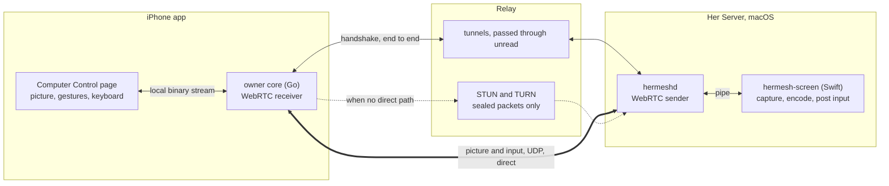
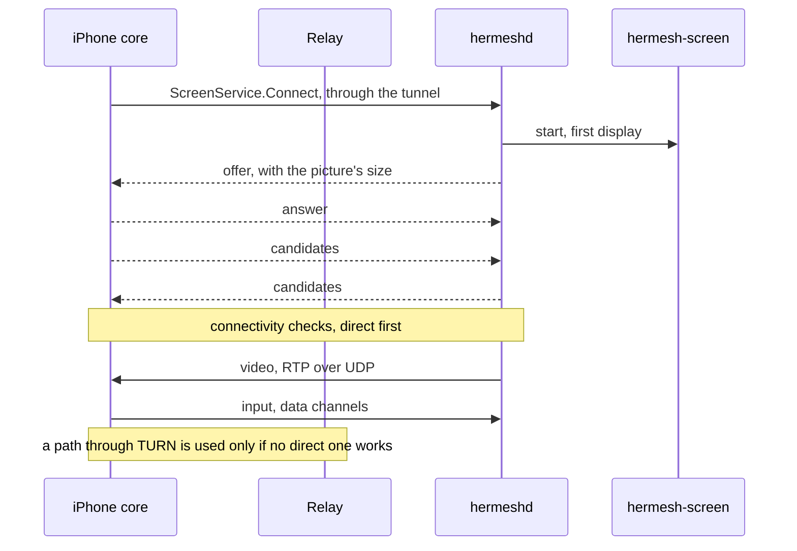

# Computer control: the owner's hands on a Her Server's Mac

Status: design, 2026-11-10. Nothing is built. The gesture model (§6.1) is
being chosen with an interactive demo; the rest is agreed.

## 0. Summary

From the iPhone, the owner opens a live view of the Mac that Her runs on
and operates it: to do a step Her can't (a password, a system prompt, a
CAPTCHA), or to watch Her work. The entry is one row, **Computer Control**
(电脑操控), in Her's settings.

The first version is minimal and has one bar to clear: it must not lag.

The decisions:

1. **The picture and the input travel directly between the phone and the
   Mac, over UDP, as standard WebRTC.** They do not go through the relay's
   tunnel: that path is TCP all the way and the hosted relay can be
   hundreds of milliseconds away, so every click would take half a second
   and any lost packet would stall the picture.
2. **The existing tunnel carries only the handshake.** The two ends
   exchange their connection details through an RPC on the end-to-end
   tunnel, so the relay can't read them, replace them or pose as either
   end. No new signalling server.
3. **When no direct path exists, the relay forwards the encrypted
   packets** (TURN). It works everywhere and is slower where the relay is
   far away.
4. **One small native helper on the Mac** captures the screen, encodes it
   with the hardware encoder and posts keyboard and mouse events. hermeshd
   starts it on demand and speaks WebRTC itself.
5. **No new permissions and no new switch.** The helper uses the two
   macOS permissions Her's computer use already has
   ([her-server.md](her-server.md) §4.4). Granting them, at the Mac, is the
   switch. Each entry asks for Face ID on the phone.
6. **Her and the owner may act at the same time.** Connecting is often to
   watch, and Her mostly works inside one app. Nothing locks the other out.

"Computer use" stays the name for Her operating the Mac. This feature is
the owner operating it, and is named Computer Control everywhere.

## 1. What it looks like

1. In the iPhone app's Her entry, the owner taps Her's name and avatar,
   then **Computer Control** in the settings.
2. Face ID, then a full-screen page: "Connecting to *Mac mini*…", then the
   Mac's screen.
3. The owner looks, taps, types. A small bar holds the keyboard button and
   the close button.
4. Closing the page, or leaving the app, ends the session. On the Mac the
   menu bar item shows who is in control while it lasts, with Stop.

The row is shown when the environment is a Mac. It says why when it can't
start: the Mac is offline, or a permission is off at the Mac.

## 2. Structure

| Piece | Where | What it does |
|---|---|---|
| `hermesh-screen` | `Hermesh.app/Contents/Helpers`, Swift | ScreenCaptureKit capture, VideoToolbox H.264 encode, CGEvent input. No network |
| Screen sender | hermeshd, Go ([pion](https://github.com/pion/webrtc)) | Starts the helper, packs its frames into RTP, steers its bitrate, passes input to it |
| `ScreenService` | hermeshd, on the tunnel, owner role only | The handshake |
| Screen receiver | the iPhone's Go core, pion | Receives, reassembles frames, hands them to Swift; sends input |
| Computer Control page | iPhone app, SwiftUI | Shows frames as they arrive, turns touches and typing into input |
| STUN and TURN | `hermesh-relay` | Lets the two ends find a direct path; forwards sealed packets when there is none |

pion on both ends keeps one implementation in Go and lets the whole path
run in an end-to-end test with no phone. The wire is standard WebRTC, so
the iPhone side can move to libwebrtc later without touching the Mac.

hermeshd stays a cgo-free build: everything that needs Apple's frameworks
is in the helper.

## 3. Connecting

- **Candidates**: local addresses (same Wi-Fi), IPv6 addresses, addresses
  seen by the relay's STUN, and the relay's TURN address. ICE picks the
  best that works and moves to another when the network changes
  (ICE restart; the handshake stream stays open for it).
- **Trust**: the DTLS fingerprints travel in the offer and answer, inside
  the tunnel, which is already pinned to the owner's root chain. A relay
  that forwards the packets sees SRTP and DTLS, nothing else.
- **TURN credentials** are short-lived and given by the relay only to
  admitted devices and machines, over their existing connection.
- **One controller at a time** per Mac. A second `Connect` ends the first.
- Every message, frame and input event carries the session's number.
  Anything from an earlier session is dropped.

## 4. On the Mac

### 4.1 The helper

hermeshd starts `hermesh-screen` when a session opens and stops it when
the session ends. They talk over the helper's stdin and stdout in
length-prefixed messages:

| To the helper | From the helper |
|---|---|
| `start` (display, longest edge, frame rate) | `format` (size, parameter sets) |
| `bitrate`, `keyframe` | `frame` (one access unit, capture time, key or not) |
| `pointer`, `button`, `wheel`, `key`, `text` | `state` (locked, display asleep, permission missing) |
| `stop` | |

- **Capture**: ScreenCaptureKit, the main display, the pointer drawn into
  the picture. Frames arrive only when the screen changes, so a still
  screen costs nothing.
- **Encode**: VideoToolbox, H.264, low-latency rate control, real time, no
  frame reordering, no periodic keyframes: a keyframe only at the start and
  when the receiver asks. If the encoder is still busy when a new frame
  arrives, the new frame is dropped, never queued. Longest edge 1920 px,
  30 frames a second, 1–6 Mbit/s as the network allows.
- **Input**: CGEvent. Positions arrive as fractions of the display, so they
  don't depend on the encoded size. `text` is typed as Unicode, whatever
  input source the Mac has selected.
- **Leaving clean**: on `stop`, and when stdin closes for any reason, the
  helper releases every key and button it holds down and exits.
- **Awake**: a session wakes the display and keeps it awake while it lasts.

### 4.2 Permissions

The helper is hermeshd's child, so macOS holds hermeshd responsible for it
(checked for Her's desktop tools, [her-server.md](her-server.md) §4.4):

| Permission | For | Switch |
|---|---|---|
| Screen & System Audio Recording | the picture | Hermesh |
| Accessibility | keyboard and mouse | hermeshd |

The Mac app's Settings › Machines › Computer use already shows both and
opens the right panes. Computer Control adds nothing there. The machine
reports the state end to end in `MachineService.GetInfo` (`screen`:
supported, the two permissions, who is in control); the relay learns none
of it.

### 4.3 Who may connect

- `ScreenService` answers the owner role only: trusted devices. Agents and
  MCP clients can't reach it.
- The device key is enough, as for Her's full access; the phone asks for
  Face ID each time the page opens.
- While a session lasts, the menu bar item says which device is in control
  and offers Stop. macOS shows its own screen-recording mark too.

## 5. Not lagging

| Where the time goes | Target | How |
|---|---|---|
| Network | the direct path's own delay | UDP, direct first |
| Capture and encode | under 20 ms | hardware encoder, no reordering, drop instead of queue |
| Receive | no added wait | no jitter buffer: a frame is decoded and shown as soon as it is whole |
| Loss | one round trip | resend the lost packet (NACK); if that is too late, ask for a keyframe |
| Congestion | never a backlog | the sender lowers bitrate, then frame rate, from the receiver's reports |
| Pointer moves | latest wins | an unordered, unreliable data channel; moves merged per frame |
| Clicks, keys, text | in order, none lost | a reliable, ordered data channel |
| Zoom, pan, tap feedback | zero | done on the phone, no round trip |

Targets from glass to glass: under 50 ms on one Wi-Fi, 80–120 ms on a
direct path across networks. Through TURN it is the direct figure plus the
detour to the relay.

## 6. On the iPhone

### 6.1 Gestures

Two models are in the demo. The first version ships one.

| Gesture | Direct touch | Trackpad |
|---|---|---|
| Tap | click where touched | click at the pointer |
| Double tap | double click | double click |
| Long press, or two-finger tap | right click | right click |
| Long press, then drag | drag | drag |
| One-finger drag | move the picture when zoomed | move the pointer; the picture follows |
| Two-finger drag | scroll | scroll |
| Pinch | zoom | zoom |

Direct touch needs no learning and suits "look, tap a button, type a few
words". It can't hover, so anything that appears only under the pointer is
out of reach. Trackpad can, and hits small targets without zooming, with
the pointer drawn on the phone so it moves with no delay.

### 6.2 Typing

The keyboard button raises the system keyboard. Text is composed on the
phone, Chinese included, and sent as text. A row above the keyboard has
esc, tab, ⌘, ⌥, ⌃, ⇧ and the arrows; a modifier latches until the next
key.

### 6.3 The page

- Full screen, both orientations. The picture starts fitted to the screen.
- One small bar: connection quality, keyboard, close. It can be collapsed.
- Frames are shown with `AVSampleBufferDisplayLayer`, each marked to
  display at once.
- The Go core hands frames to Swift, and takes input back, over a local
  binary stream. Today's JSON stream is too costly for video.
- Leaving the page or the app closes the session.

## 7. In the relay

- A STUN responder and a TURN server ([pion/turn](https://github.com/pion/turn))
  inside `hermesh-relay`, on one UDP port, with TCP as a fallback. A
  self-hosted relay publishes that port beside 443.
- TURN credentials come from the relay's control service, short-lived, to
  admitted peers only.
- The relay counts forwarded bytes, as it does for tunnels. It stores
  nothing about a session.
- Without the port the feature still works wherever a direct path exists.

## 8. What we build

Each step ends with an end-to-end test made from what a person does.

**Step 0: a throwaway check, on one Wi-Fi.** Helper to pion to the iPhone,
nothing else. Measure glass to glass with a millisecond clock on the Mac's
screen. Find out: can the lock screen be typed into from the login
session; does the helper get both permissions as hermeshd's child; does
macOS's recurring screen-recording confirmation interrupt a running
capture. If the delay misses the target, the design changes here.

**Step 1: the Mac side.** `hermesh-screen`, the sender in hermeshd,
`ScreenService`, the `screen` state in `GetInfo`, the menu bar notice.

- Test: the helper has a test source (a moving pattern that carries a
  frame number) and can write the input it receives to a file instead of
  posting it. Through a real relay, a Go receiver connects, sees frames
  advance, sends a click and text, and finds them in the file. Closing
  releases held keys.

**Step 2: the iPhone side.** The receiver in the core, the local binary
stream, the page, gestures, keyboard, the row in Her's settings.

- Test, in the Simulator against an owner Mac with the test source: open
  Computer Control from Her's settings, see the first frame, tap, and find
  a click at the matching position on the Mac side; type Chinese and find
  the text.

**Step 3: any network.** STUN and TURN in the relay, credentials, ICE
restart when the network changes, reconnecting.

- Test: with direct paths blocked, the session still connects, through
  TURN; switching the phone's network mid-session keeps the picture.

**Step 4: finish.** The pointer drawn on the phone, the second gesture
model, a card in the conversation that opens the page when Her needs the
owner or is working on the desktop, more than one display, the clipboard.

## 9. Not doing now

- Sound, files, HDR, more than one display, the clipboard.
- A Mac with no display attached, or with its lid closed and no monitor:
  there is no picture to capture.
- The login window before anyone has logged in.
- Windows and Linux machines. The wire doesn't depend on the Mac, so each
  needs only its own helper.
- Controlling from the Mac app.
- Machines that aren't Her Servers.
- Direct connections for anything but this.
- A warning about mobile data.

## 10. Open questions

- The lock screen: whether input posted from the login session reaches it.
- macOS's recurring confirmation for screen recording, on a Mac nobody is
  sitting at. Her's screenshots face the same question. The long-term
  answer may be Apple's persistent content capture entitlement.
- Whether pion's receiver holds up on a poor network, or the iPhone side
  should use libwebrtc.
- Where a second TURN node should be, once the detour through the first
  one is measured.

## 11. Options considered

| Shape | Why not |
|---|---|
| The picture through the existing tunnel | TCP all the way through a relay that can be far away: slow clicks, and one lost packet stalls everything |
| libwebrtc on the iPhone from the start | A large binary dependency and a second implementation; not needed to show frames as they arrive |
| A signalling service of its own | The tunnel already authenticates both ends and hides the handshake from the relay |
| Capture and encode inside hermeshd | hermeshd would need cgo and Apple's frameworks |
| macOS Screen Sharing (VNC) through the tunnel | Not made for a phone, nothing to tune for delay, and its own password and switch |
| A lock so only one of Her and the owner acts | The owner often connects to watch Her; they rarely want the same pointer |
| **WebRTC, direct first, handshake in the tunnel, a small native helper** | Chosen |
