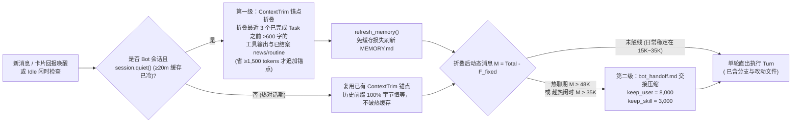

# Her 主会话上下文治理、压缩与唤醒优化可执行技术方案

配套压测依据：[Her 主会话上下文与压缩策略压测归档报告（2026-11-28）](her-bot-compaction-validation-2026-11-28.md)。

---

## 1. 核心优化思路

### 1.1 问题根因
Her 主会话是永不关闭的常驻个人助理入口，流量形态是**「跨多话题长生命周期 + 稀疏异步脉冲唤醒」**，与单任务密集循环的 CLI Coding Agent 完全相反。当前直接复用 Coding Agent 的满窗口策略（`threshold = 0.9, token_limit = 0`，在 `500K` 模型上软上限高达 `421.2K`）带来三大问题：
1. **缓存穿透与冷唤醒极贵**：异步唤醒间隔（10~30 分钟）常跨过服务商缓存 TTL，且多节点连接池路由存在缓存未命中，每次穿透都要重读十余万历史 Token。
2. **85%+ 窗口体积是已结案工具/通知噪音**：实测混合负载中，真正的人机对话仅占动态上下文不足 `15%`，其余全是早已处理完的 `project_list`、`session_diff`、`<session_news>`、`<routine_report>` 原始输出，既烧钱又稀释模型注意力（“聊越久越废”）。
3. **旧交接提示词与双轮汇报机制不匹配助理场景**：代码向 `handoff.md` 在压缩时会丢弃非编程类的用户事实与助手结构化结论；`<session_news>` 缺少分支与改动文件列表，迫使每次卡片完成都要多跑 2 轮工具检索与 `session_diff`。

### 1.2 三层治理总体架构与严格边界

- **严格作用域隔离**：本方案中的压缩水位、冷态工具折叠与 `bot_handoff.md` **仅对 `bot.is_some()` 的常驻 Bot 会话生效**；CLI 编码会话、Mesh 编码会话与子 Agent（`sub-agent`）保持现网 `90%` 窗口与 `handoff.md` 零改动。
- **明确不改项**：`Routine` 定时任务继续由主 Bot 统一决策是否汇报，不在子会话做 `NOTHING_TO_REPORT` 短路拦截（主会话瘦身 `82%+` 后，Routine 唤醒单次成本已自然同步下降）。



---

## 2. 简要的压缩策略对比

以下对比基于 `GPT-6.2-Sol` 在 `LongMemEval`（跨会话事实/时间/更新/拒答）与 `Her-LongLife`（混合编码卡片/工具/规则覆盖）上的实测结果汇总：

| 策略方案 | 触发机制 | 混合负载单步 Tokens | 压缩频率 | 记忆与任务质量 | 热缓存友好度 | 结论与取舍 |
| :--- | :--- | :---: | :---: | :--- | :---: | :--- |
| **现网默认满窗口**<br/>(`Baseline 90% = 421K`) | 满 90% 窗口才压 | `112K ~ 400K+` | 极低（几乎不压） | 短中期高（`94.3%`），超长后跨话题串扰幻觉增加（拒答仅 `73.3%`） | 一旦冷唤醒或切节点，单轮硬吃十万+全价 Tokens | **不可用**：越聊越贵、越聊越慢 |
| **旧编码提示词低水位**<br/>(`handoff.md @ 18K`) | 动态消息满 `18K` 压 | `~22.6K` | 高（每 2~3 个时段压一次） | **严重退化（`73.3%`）**：丢弃非编程事实、消费日期与助手推荐清单 | 好 | **淘汰**：提示词目标错位 |
| **激进低水位摘要**<br/>(`bot_handoff @ 10K`) | 动态消息满 `10K` 压 | `~22.0K` | 极高（几乎每时段都压） | **退化（`73.3%`）**：连续 3~4 代“摘要套摘要”导致摘要自身膨胀且细节磨损 | 一般（频繁重建上下文） | **淘汰**：压得太勤反而伤记忆且不更省钱 |
| **纯冷启动工具折叠**<br/>(`ContextTrim Only`) | 仅在缓存过期后折叠旧大工具输出，不跑摘要 | `14.3K ~ 21.5K`（工具型）<br/>无上限（纯文字聊天） | `0` 次 LLM 摘要 | **满分（`93.3% / 100%`）**：100% 保留人机对话原文，折叠内容可按需重查 | **极好**：仅冷态落锚 1 次，热对话前缀锁死不变 | **作为第一级主力**，但纯聊天无上限，需配第二级兜底 |
| **定稿：两级联动全栈**<br/>(`ContextTrim` + `35K/48K` 双水位 + `bot_handoff v2` + 单轮 `news`) | ① 冷唤醒先跑 `ContextTrim`；<br/>② 折叠后纯对话仍超 `35K(闲)/48K(忙)` 才跑 `bot_handoff v2` | **日常 `11K ~ 25K`**<br/>（峰值不超过 `58K`） | **极低频**（工具噪音被第一级消化，一两周才触发一次摘要） | **混合任务 `100%`**；核心助理记忆四类 **`93.3%`**（反超全窗口 `91.7%`） | **极好**：热聊不打断，闲时趁缓存未冷预压缩 | **最终采用方案**：兼顾 85%+ 降本、零损日常体验与长周期兜底 |

---

## 3. 提示词的变化（可执行定稿原文）

提示词层共有 **2 处精准改动**（不改动庞大的主提示词 `bot.md`，保持最小侵入）：

### 3.1 新增 Bot 专属交接提示词 `her/crates/her-core/src/prompts/bot_handoff.md`

- **保持不变**：`her/crates/her-core/src/prompts/handoff.md` 原封不动，继续服务所有 CLI 编码会话与子 Agent（聚焦代码修改、报错栈、下一步开发步骤）。
- **新增文件**：`her/crates/her-core/src/prompts/bot_handoff.md`（当 `session.is_bot()` 为真时在 `compaction.rs` 中选用）。相比编码版提示词，核心变化是**四段式职责分拣 + 最新状态覆盖去重（Latest Wins）+ 保护助手结构化编号结论不与正文散文混缩 + 彻底丢弃已结案工具/巡检噪音**：

```markdown
<handoff_request>
The context window has reached its working-set limit. Replace the conversation so far with a
compact, high-signal handoff summary for this assistant conversation. After this checkpoint,
you will have only `<memory>`, the user's most recent messages, and your summary.

Pause the task and write the handoff summary in plain Markdown (do not call tools), organized
strictly into these four sections:

1. **In-Flight Work (Exact IDs)**:
   - Every coding session (`session_id`, project, branch, agent, current state, and any pending
     question) or background sub-agent (`name` and task) that is STILL running or awaiting follow-up.
   - Copy identifiers (`s_…`, branch names, file paths) character-for-character. If none, write `None`.

2. **Open Thread & Active Constraints**:
   - Any unfinished topic, pending draft, or explicit output/formatting constraint the user set
     for upcoming replies.

3. **Key Facts, Timeline & Assistant Deliverables (Latest Wins)**:
   - Preserve concrete user facts, numbers, counts, named entities, and exact dates (`[YYYY-MM-DD]`
     or `[Session time: …]`) from both this conversation and any earlier `<conversation_summary>`
     when not already in `<memory>`.
   - **Structured deliverables**: Whenever the assistant provided a numbered list of objectives, aims,
     steps, or multi-item recommendations, keep each numbered item's exact core terms in order — never
     merge an explicit `Objectives` / `Recommendations` list with adjacent `Methods` or `Background` prose.
   - **Updates & corrections**: When a later message changed an earlier fact, count, schedule, location,
     or preference, record the latest state clearly and note the old one was superseded.

4. **Recently Completed Work (At Most 5 Items, 1 Line Each)**:
   - At most one line each (`session_id` / branch / key files / diff counts / 1-phrase outcome) for
     recently finished tasks in case the user refers back to them.
   - **Drop all noise**: Omit raw tool outputs, JSON listings, routine runs with nothing to report,
     step-by-step debugging logs, and settled chitchat.
</handoff_request>
```

### 3.2 `<session_news>` 模板与 `herlink` 工具准则变化（2~3 轮 → 1 轮直出）

在 Her 中，`session_diff` 属于延迟加载工具，旧规则强制“汇报任何改动前先调 `session_diff`”，导致每次卡片完成唤醒都要连跑 `search_tools → call_tool(session_diff) → send_to_user` 多轮完整上下文。将其改为**在 `<changes>` 中直接附带分支名与前 15 个改动文件统计，默认 1 轮直接向用户汇报**：

1. **`internal/herlink/news.go` XML 与尾注变更**：
   - **变更前**：
     ```xml
     <changes>2 files changed, 31 insertions(+), 9 deletions(-)</changes>
     ```
     尾注 `newsThen["turn_done"]`：
     > `"Tell the user what came of it, or go on with what they asked for. The result is the coding agent's own account: session_diff shows what changed, and session_get has the whole result when this one was cut."`
   - **变更后**：
     ```xml
     <changes branch="hermesh/s_relay_04">
     2 files changed, 31 insertions(+), 9 deletions(-)
     - internal/machine/letters.go (+19 -7)
     - internal/machine/letters_test.go (+12 -2)
     </changes>
     ```
     尾注 `newsThen["turn_done"]`：
     > `"Tell the user what came of it, or go on with what they asked for. When <changes> already lists the branch and modified files, report directly with send_to_user without calling session_diff; use session_diff or session_get only when <result cut=\"true\"> cut off needed details or the user asked to inspect the diff."`

2. **`internal/herlink/tools.go` `Guidelines[6]`（第 28 行）变更**：
   - **变更前**：
     > `"A session's result is the coding agent's own account. Before you tell the user that something changed, look at session_diff with stat. Say where the work is: a session in a worktree project leaves it on its own branch."`
   - **变更后**：
     > `"Say where the work is: a session in a worktree project leaves it on its own branch. When <session_news> already gives the branch and changed files in <changes>, tell the user directly without calling session_diff; look at session_diff (start with stat) when <changes> has no file list or when the user asks to review the changes."`

---

## 4. 压缩与唤醒策略的变化（工程实现细则）

### 4.1 第一级压缩：冷启动锚点式折叠（`EntryKind::ContextTrim`）

**目标**：在不损失任何对话原文、且**绝对不破坏后续热对话缓存前缀**的前提下，在缓存已自然过期的唤醒瞬间折叠历史重型工具噪音。

1. **持久化日志条目（`her/crates/her-core/src/store/entry.rs`）**：
   在 `EntryKind` 枚举中新增轻量锚点变体（向后兼容：旧版本遇到未知变体走 `EntryKind::Unknown` 不断链）：
   ```rust
   ContextTrim {
       /// 当前窗口内需要执行确定性折叠的截止条目 ID（含该条目）
       up_to: String,
   }
   ```
2. **落锚触发条件（`her/crates/her-core/src/task.rs` `run_task` 入口 `turn == 0`）**：
   在 `check_context` 之前执行，仅当**同时满足**以下 4 个条件时追加一条 `EntryKind::ContextTrim { up_to }`：
   - `session.is_bot()` 为真（仅限 Bot 会话）；
   - `session.quiet()` 为真（距上次 `Assistant` 回复 $\ge 20\text{ min}$，与 `refresh_memory()` 共用同一个免缓存惩罚窗口）；
   - 当前窗口 `branch[window_start..]` 内已完成（`TaskStatus::Completed`）的 Task 数 $> 3$，将截止锚点 `up_to` 定在**倒数第 3 个已完成 Task 之前**（确保最近 3 个完整交互周期 100% 原文不动）；
   - 自上次 `ContextTrim` 之后到 `up_to` 之间，可折叠条目的净节省估算值 **$\ge 1,500\text{ tokens}$**。
3. **确定性折叠边界（`her/crates/her-core/src/context.rs` `branch_messages`）**：
   读取当前窗口最后一条 `ContextTrim { up_to }`，对 `offset <= up_to` 的条目执行纯函数折叠：
   - **保持 100% 原文不动**：所有 `Message::User` 用户原话、所有 `Message::Assistant` 模型思考与工具调用、所有 `tool_name == "send_to_user"` 的结果、`<= 600 字符` 的短工具输出、含 `kind="question"` 的待决消息。
   - **折叠为单段元信息占位符**：
     - 长度 `> 600 字符` 的非 `send_to_user` `ToolResult`：保留前 `180` 个字符（含 JSON `ok` / `session_id` / 首行摘要）+ `\n…[settled <tool_name> output (<N> chars) folded after idle; re-run tool if full raw output is needed]`；
     - 长度 `> 600 字符` 且不含 `kind="question"` 的 `EntryKind::Mail`（`MailKind::News | MailKind::Routine`）：保留前 `180` 个字符（完整保留 `<session_news session="..." title="...">` 或 `<routine_report>` 标签头）+ `\n…[settled report (<N> chars) folded after idle]`。
   - **缓存稳定性证明**：落锚后进入连续热对话时，`session.quiet()` 为 `false`，不会写入新锚点；`branch_messages` 每次对 `0..=up_to` 生成**字节级完全一致**的消息序列，热缓存命中率不受任何影响。
4. **预算器基线校准（`her/crates/her-core/src/budget.rs` `measure_with`）**：
   从分支末尾倒序查找最近一次 `Assistant` `usage` 基线时，若先遇到 `EntryKind::ContextTrim` 则立即 `break`（令 `baseline = None`），使折叠当轮改用折叠后的真实估算值判断水位（避免拿着折叠前的 100K 旧 `usage` 误触发第二级摘要）；本轮响应返回后，新 `Assistant` 条目位于 `ContextTrim` 之后，后续轮次自动恢复精确的真实 `usage` 基线。

### 4.2 第二级压缩：基于动态消息的双水位与趁热闲时预压缩

**目标**：让水位与用户的 `MEMORY.md` 大小、MCP 工具多少解耦，热聊期不打断，闲下来趁缓存未冷提前归位。

1. **配置项扩展（`her/crates/her-core/src/config.rs` `CompactionSettings`）**：
   为 Bot 会话引入默认动态消息水位（均可通过 `config.toml` `[compaction]` 覆盖）：
   - `bot_idle_message_tokens: u64` = **`35,000`**（闲时预压缩动态水位，加上固定底座 `~10K` 约合总上下文 `~45K`）
   - `bot_active_message_tokens: u64` = **`48,000`**（活跃任务硬软限动态水位，约合总上下文 `~58K`，给连续长对话留出 `13K` 缓冲带）
   - `bot_keep_user_tokens: u64` = **`8,000`**（保留最近约 20~30 条用户原话）
   - `bot_keep_skill_tokens: u64` = **`3,000`**
2. **动态软上限计算（`her/crates/her-core/src/budget.rs`）**：
   - 对非 Bot 会话：沿用现网 `limits(model, thinking, settings)` 完全不变；
   - 对 Bot 会话（当 `settings.token_limit == 0` 未显式手工锁死时）：
     $$\text{soft}_{\text{active}} = \min\Big(\text{soft}_{\text{default}},\; \text{scale}(F_{\text{fixed}}, \text{ratio}) + \text{bot\_active\_message\_tokens}\Big)$$
3. **趁热闲时预压缩（Warm-Cache Idle Pre-Compaction，`session.rs` & `task.rs`）**：
   - 在 `her-protocol` 的 `CompactionReason` 中新增 `Idle`；
   - 当 `Session::check_idle()` 确认会话进入 `Idle` 时，检查若同时满足：
     1. `state.bot.is_some()` 且 `config.compaction.enabled`；
     2. 当前动态消息量 $M = \text{budget.tokens} - \text{scale}(F_{\text{fixed}}, \text{ratio}) \ge 35,000$（`bot_idle_message_tokens`）；
     3. 距最近一条 `Assistant` 回复耗时 **`< 4 分钟`**（即服务商 5 分钟 Prompt Cache **依然是热的**；若是刚重启加载的历史冷会话则绝不空跑后台请求，留待下次消息唤醒时先走 `ContextTrim`）。
   - 启动 **`90 秒`可取消延迟任务**：
     - 若 90 秒内收到用户新 `Prompt`、`Mail` 或 `Shutdown`：立即取消定时器，不打断用户热聊；
     - 若 90 秒静默期满且仍处于 `Idle`：启动 `Work::Compact(CompactionReason::Idle)`，利用尚存的热缓存低成本完成 `bot_handoff.md` 交接压缩并刷新 `MEMORY.md`，使窗口回落至 `~18K` 待命。

### 4.3 唤醒链路降噪（Go `machine` / `herlink` & Rust `cards`）

1. **屏蔽主人亲自操作编码会话产生的陪跑唤醒（`internal/machine/news.go`）**：
   - 位置：`sessionNews` 第 191 行：
     ```go
     // 原逻辑：只要 createdBy != asker 就抄送给创建者 Her
     if createdBy != "" && createdBy != asker {
     // 改为：仅当本轮触发者是另一个 Agent (c_…) 时才抄送创建者；主人亲自在卡片内对话时不唤醒 Her
     if createdBy != "" && createdBy != asker && strings.HasPrefix(asker, "c_") {
     ```
2. **携带分支与文件变更摘要（`proto/hermesh/inbox/v1/inbox.proto` & `internal/machine/news.go`）**：
   - 在 `SessionNews` protobuf 中新增向后兼容可选字段：
     ```protobuf
     string branch = 14;
     repeated string changed_files = 15; // 形如 "path/to/file.go (+19 -7)"，最多前 15 项
     ```
   - `newsMessage` 在 `run.completed` 时填入 `sess.GetBranch()` 与工作树变更文件简表（最多 15 条，超出注明 `… and N more files`），供 `herlink/news.go` 渲染单轮 `<changes branch="...">`。
3. **`deliverHerNews` 同目标微批合并与过期提问过滤（`internal/machine/her_mesh.go`）**：
   - **过期 `question` 过滤**：`takeHerNews` 收到 `kind == "question"` 且 `Question.ExpiresAt < now` 时，降级为普通状态更新或丢弃过期提问，避免离线恢复后唤醒 Her 调 `session_answer` 撞上已过期错误。
   - **同会话微批合并**：当队首为非紧急的 `turn_done` 时（`question` 与 `failure` 零延迟立即投递），等待 `1.5 秒` 微防抖窗口；若队列中存在多条发往同一 `(Bot, Conversation)` 的消息，将它们的文本按时间顺序合并在一次投递或连续入完 `inbox` 后只触发 1 次 `Task` 唤醒，消除串行逐条唤醒风暴。
4. **安全卡片自然过期静默入队（`her/crates/her-core/src/cards.rs` & `task.rs`）**：
   - `on_card` 接收参数增加 `expired: bool`（当 `card.outcome == "expired"` 时为 `true`）；
   - 当卡片属于超时自然过期（`expired == true`）且当前没有活跃子 Agent 正在运行等待时，仅将 `Delivery::Card(card)` 放入 `state.inbox`（设 `wake = false`），待用户下次说话时自动捎带写入历史，不再半夜冷启动唤醒主会话。

---

## 5. 分步落地清单与验证计划

### 5.1 代码改动文件清单

| 阶段 | 模块路径 | 改动内容摘要 |
| :--- | :--- | :--- |
| **Step 1：协议与单轮 `<session_news>`** | `proto/hermesh/inbox/v1/inbox.proto`<br/>`internal/machine/news.go`<br/>`internal/herlink/news.go`<br/>`internal/herlink/tools.go` | ① `SessionNews` 增加 `branch` 与 `changed_files`；<br/>② `sessionNews` 增加 `strings.HasPrefix(asker, "c_")` 过滤主人自聊抄送；<br/>③ `herlink` 渲染 `<changes branch="...">` 并更新单轮汇报规则。 |
| **Step 2：微批投递与过期卡片降噪** | `internal/machine/her_mesh.go`<br/>`her/crates/her-core/src/cards.rs`<br/>`her/crates/her-core/src/task.rs` | ① `deliverHerNews` 增加 `turn_done` 1.5s 同会话合并与过期 `question` 过滤；<br/>② `on_card` 对无在途任务的 `expired` 卡片静默入 `inbox` 不触发冷唤醒。 |
| **Step 3：第一级冷态锚点折叠 (`ContextTrim`)** | `her/crates/her-core/src/store/entry.rs`<br/>`her/crates/her-core/src/context.rs`<br/>`her/crates/her-core/src/budget.rs`<br/>`her/crates/her-core/src/task.rs` | ① 新增 `EntryKind::ContextTrim { up_to }`；<br/>② 实现 `plan_context_trim`（保留最近 3 个 Task，门槛 `1,500 tokens`）与 `fold_settled_entry`；<br/>③ `measure_with` 遇 `ContextTrim` 停止回溯旧 `usage`。 |
| **Step 4：第二级 `bot_handoff` 与双水位预压缩** | `her/crates/her-core/src/prompts/bot_handoff.md` (新)<br/>`her/crates/her-core/src/compaction.rs`<br/>`her/crates/her-core/src/config.rs`<br/>`her/crates/her-core/src/session.rs`<br/>`her/crates/her-protocol/src/event.rs` | ① 落盘 `bot_handoff.md` 并在 `session.is_bot()` 时启用；<br/>② `CompactionSettings` 加入 Bot 动态双水位（`35K / 48K / keep_user 8K`）；<br/>③ 新增 `CompactionReason::Idle` 与 `Idle` 90s 趁热预压缩定时器。 |

### 5.2 验收标准（单元 + 端到端测试）

1. **内核单元与集成测试（`cargo test -p her-core`）**：
   - **前缀字节恒等性测试**：构造含 5 个大工具输出的 Bot 会话，模拟静默 `>20m` 后唤醒触发 `ContextTrim`，断言紧随其后的连续 4 轮热请求中，所有历史消息序列化字节 **100% 恒等**，且重启 `resume` 后幂等；
   - **预算基线衔接测试**：断言 `ContextTrim` 落盘当轮 `budget().usage.tokens` 立即下降，不再沿用折叠前的虚高 `usage`；
   - **双水位与趁热预压缩测试**：断言连续热聊跨过 `35K` 未达 `48K` 时不打断压缩；进入 `Idle` 满 `90s`（且缓存未冷）自动触发 `CompactionReason::Idle`；等待期内来新消息则取消预压缩；冷加载历史会话（`quiet() == true`）绝不空跑后台预压缩；
   - **作用域隔离测试**：断言普通 CLI 非 Bot 会话不触发 `ContextTrim`、不使用 `bot_handoff.md`、水线仍为 `90%` 窗口。
2. **Go 侧单元与端到端测试（`go test ./internal/herlink ./internal/machine ./e2e/...`）**：
   - **`herlink/news_test.go`**：验证带 `branch` 与 `changed_files` 的 `turn_done` XML 渲染及超 15 个文件截断格式；
   - **主人自聊零唤醒 E2E**：Her 创建编码会话后，模拟主人直接向该会话发送消息并完成一轮，断言不向 Her 投递 `SessionNews`；
   - **单轮完成汇报与微批合并 E2E**：模拟两个由 Her 启动的编码会话在 500ms 内先后完成，断言合并投递且 Her 主会话 **仅用 1 轮 LLM 请求**完成分支与文件变更汇报。
