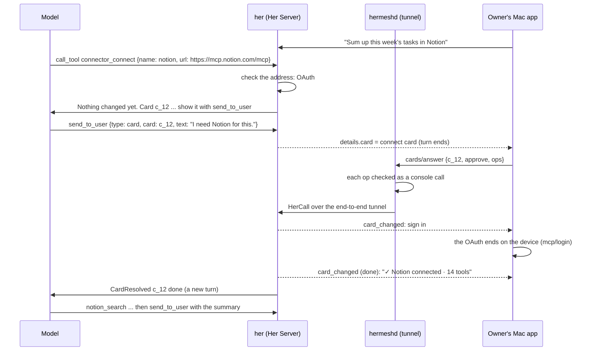
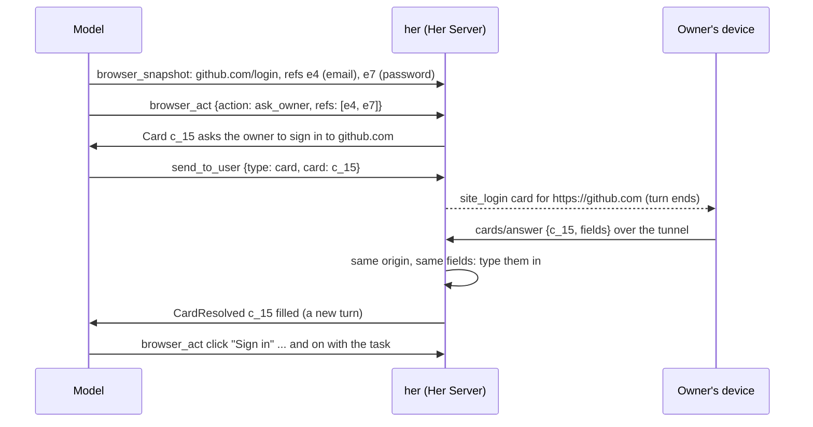

# Secure cards: when Her needs something only the owner can give

Status: step 1 (cards and connectors, §7) built 2026-11-09; step 2 and later
are not. It builds on
[her-server.md](her-server.md): the console (§10), security (§8) and the
Her entry (§9).

## 1. Goal, and what is left out

Her sometimes can't go on with a task without something only the owner can
give. Two cases come up most:

1. **A connector to authorize.** The task needs an app (Notion, Linear,
   GitHub…) over MCP: added by its address, then signed in, or signed in
   again once its sign-in expired.
2. **A website's sign-in.** Her's browser reaches a sign-in page that wants
   the owner's account, a password or a code.

For these, Her asks in the conversation with a **secure card**. The owner
answers on their device, and the task goes on. Two rules hold:

- **Her asks, the owner decides.** Nothing changes, and nothing is typed
  into a page, until the owner answers the card.
- **Secrets never pass through the model.** A key, a password or a code is
  entered on the owner's device and goes from there to the Her Server. The
  model learns only whether it worked.

**Not done by conversation.** These stay in the assistant settings panel
and the console:

- models (the first one is connected by the first-run onboarding);
- web search, skills;
- the browser's sites, the owner's Chrome;
- turning anything off, disconnecting or removing anything.

Others do the same:

- Hermes Agent (Nous Research) lets the agent connect a connector or install
  a plugin on a card, and leaves removing them to the user. Models are
  switched with a slash command.
- Grok Bot's cards are mostly a connector's authorization, and a site's
  sign-in it fills in for the user.

**Already covered without cards**, by her's approvals:

- a risky command or file write;
- a browser step on a site Her may not act on yet (the approval offers the
  site's permission);
- a step only the owner can do in a page Her's Mac shows, with
  `browser_wait` `user`.

## 2. How Her asks

### 2.1 Prepare with a tool, show with `send_to_user`

- **A tool prepares the card.** her builds it from the operation (the
  connector's address as checked, the page's real origin), never from the
  model's words. The tool changes nothing and types nothing.
- **`send_to_user` shows it.** It is already the only way anything from Her
  reaches the owner (bot-design §3.12). It gains one type, `card`, and one
  argument, `card`: the id the tool gave. her makes that id when it
  prepares the card (`c_` and a short random code), and it means something
  only in that session: the model can show only cards its own session
  prepared.

  ```json
  { "type": "card", "card": "c_12", "text": "Notion needs your sign-in to go on." }
  ```

  - `text` is optional: Her's own words, shown in her bubble above the card.
  - A card ends the turn, as a question does.
- **No new tool for cards.** A new kind of card later doesn't change
  `send_to_user`.

### 2.2 The tools that prepare cards

| Where | Tool | What it prepares |
|---|---|---|
| A new deferred group, `connectors` | `connector_status` | Nothing: it reads which connectors there are, and whether each is signed in |
| | `connector_connect` `name` and `url`, or `name` alone | A `connect` card: a connector added by its address, or an existing one signed in again |
| The browser group (exists) | `browser_act` with the new action `ask_owner` `refs` | A `site_login` card for those fields of the page |

- **Registered as her registers deferred tools today** (her-core
  `deferred.rs`):
  - The tool list stays the same for the whole session, so the prompt stays
    cached.
  - `connectors` is one line of `<deferred_tools>`:

    > connectors: connect an app or service the task needs, or sign in to one
    > again. The owner approves on a card.

  - `tool_search {server: "connectors"}` returns its two tools and their
    guidelines. `call_tool` runs them.
- **Only Her's own conversation gets `connectors`.**
  - her-server gives that session a `ConnectorHost`, where it gives
    `RoutineHost` today (`server.rs`: `header.bot.is_some()`).
  - Sub-agents and routine runs don't get it.
  - In a sub-agent, `ask_owner` returns "only Her's own conversation can
    ask the owner; say in your report what is needed".
- **`connector_connect` checks first**, as the console's Add Connector does
  (`mcp/probe`):
  - It reaches the address and finds how it signs in: OAuth, a header, or
    nothing.
  - A failed check comes back to the model as an error, and no card is made.
- **A connector whose sign-in expired** answers its next call with an
  error that names the way back: `connector_connect {name}`.
- **`ask_owner` takes the refs of the fields from `browser_snapshot`.**
  - her reads each field from the page itself: its label, its type (email,
    password, one-time code, text), and the origin of its frame.
  - The model's words are never on the card.
- **What the model gets back:**

  > Nothing changed yet. Card c_12 asks the owner to connect Notion
  > (https://mcp.notion.com/mcp) and sign in. Show it with send_to_user
  > {type: "card", card: "c_12"}: that ends your turn, and you hear how it
  > went.

- **They `run_unasked`:** they change nothing, so her's approval layer has
  nothing to ask. The card is the only way a change happens, in every
  permission mode, full access included.

### 2.3 Why not a CLI or an MCP server

- **A CLI run through `bash`** (Hermes Agent's skill does this):
  - a key would be in the command line, so in the transcript;
  - `bash` is judged as a command, and full access runs it without asking;
  - the CLI writes the files behind the running service.
- **An MCP server** would be one more process to run and secure, and still
  couldn't draw a card.

## 3. The cards

### 3.1 What a card is

A card is made by her's built-in code, never by the model and never by an
MCP server. It goes into `send_to_user`'s result `details`, which the model
never sees, and the apps draw it from there.

Every card has the same envelope:

```json
{
  "id": "c_12",
  "kind": "connect",
  "title": "Connect Notion",
  "asked_by": "owner",
  "expires_at": "2026-11-10T09:00:00Z",
  "ops": [
    { "method": "credentials/set", "params": { "name": "mcp.notion", "value": "<value:f1>" } },
    { "method": "config/write", "params": { "...": "the connector's entry, naming ${credential:mcp.notion}" } }
  ],
  "body": { "...": "by kind" }
}
```

- `ops`: the console calls the card makes when the owner agrees, exactly as
  the console would send them. A secret is the whole string
  `"<value:FIELD_ID>"`, for one of the body's fields: it goes into the
  credential store, and the connector's entry names it.
- `asked_by`: what started the turn that made the card (§5.3).

### 3.2 The two kinds

| | `connect` | `site_login` |
|---|---|---|
| Shows | The connector's name and address; "Her can use its tools; what she sends it leaves this machine"; the fields it needs (a header's value is masked); then its sign-in | The site's origin, large; the fields as the page has them (email, password, code), passwords and codes masked; "Typed into this page once, never kept, never seen by the model" |
| The owner | Connect, then signs in if it needs one (the OAuth ends on the device, her-server.md §5.4); or Cancel | Fills in and sends; or Skip |
| Answer | `{decision: "approve", ops}`, each `"<value:ID>"` filled; then the device runs the sign-in (`mcp/login`, `mcp/login_complete`), and her ends the card when the sign-in does | `{fields: {f1: "…", f2: "…"}}`; no `ops` |
| her does | Writes the connector, stores the header in the credential store, follows the sign-in, then lists the connector's tools | Checks the tab is still on that origin and the fields are still there, types each value into its field, and doesn't submit |
| Ends | Connected (with its tools), signed in again, declined, failed | Filled, skipped, out of date (the page changed) |
| Lives | 24 hours | 10 minutes: a page doesn't wait longer |

After a `site_login`, Her goes on as usual: she presses the page's own
button, and reads what comes next. The fields the card filled are masked in
her later snapshots, so no password or code reaches the model.

Later kinds, on the same envelope: `takeover` (the owner works Her's
browser for a step, from any device) and `root_sign` (a connector started
as a command, or one of her's curated connectors, signed with Touch ID).
For each, her adds a builder and an answer handler, and the apps add a
renderer. An app that doesn't know a kind shows "Update Hermesh to answer
this card", and nothing else.

### 3.3 Answering

- **One method for every kind:** `cards/answer {session_id, card_id, answer}`
  on her-server.
  - hermeshd lets only the owner's devices call it
    (internal/herhost/allow.go). Agents and MCP clients never.
  - It arrives as a HerCall over the end-to-end tunnel, so the relay sees
    nothing.
- **hermeshd checks each op an answer carries** with the same `check` the
  console's calls go through. A card can never change more than the
  owner's device could in the console.
- **her compares the answer with the card it keeps:** the same `ops` with
  only each `"<value:ID>"` filled in, compared as JSON values, or values for
  the card's own fields alone. A
  `site_login` answer can only type into its page.
- **A refused value stays on the card** (a header the connector refuses, a
  sign-in that failed). The card says why and waits for another try, and
  the model isn't woken for each try.
- **Answered once.** The first device's answer counts; the others show
  "Answered on iPhone". An answer to a card that ended fails with the kind
  `card_ended`.
- **A newer card for the same thing replaces the open one.**

### 3.4 How the model hears the outcome

- When a card ends, her writes one entry into the session, `CardResolved`.
  It is a new entry kind in store/entry.rs, like `Mail`. The model reads it
  as:

  ```
  <card id="c_12" kind="connect" outcome="done">Notion connected: 14 tools
  (notion_search, notion_create_page, …).</card>
  ```

  It holds no value.
- It wakes Her as a sub-agent's report does: a turn starts if she is idle,
  or she reads it at her next step.
- **Her keeps working while a card waits.** The card ended only the turn
  that showed it; the owner can go on talking.
- **Nothing new to store.** After a restart her finds the open cards in the
  history: a `card` result with no `CardResolved` after it.

### 3.5 Protocol changes

| Where | Change |
|---|---|
| `send_to_user` | Type `card`, argument `card` |
| Its result `details` | `{card: {...}}`, the envelope of §3.1 |
| `browser_act` | Action `ask_owner` with `refs` |
| Session events | `card_changed {card_id, state, note}`: open, working, retry (with the reason), done, declined, expired, replaced |
| her-server methods | `cards/answer` |
| Session history | The entry `CardResolved` |
| hermeshd allowlist | `cards/answer` from owner devices only, each of its `ops` checked as a console call |
| HerStatus | While a card waits, her's `BotSummary.waiting` is Her's `text`, else the card's title; hermeshd shows it as the newest, so a device notifies |

## 4. The cards in the Mac app

- **Where:** in the conversation, under Her's bubble with her `text`.
- **One look that only the apps draw:** a lock, "Secure card", and the
  machine it is for. A message's Markdown can't draw it, since cards come
  from `details`, not from text.
- The first-run onboarding's key field and a card's masked field are one
  component.

| Card | What it shows | Buttons |
|---|---|---|
| `connect` | "Connect Notion · mcp.notion.com"; what it lets Her do; a masked field per header; then "Sign in to Notion" and "Waiting for you to sign in in the browser…" | Connect · Cancel; then Open sign-in · Reopen · Cancel |
| `site_login` | "Sign in to **github.com**" (the origin, large); a field per page field, passwords and codes masked; "Typed into this page once, never kept" | Send · Skip |
| Ended | One line: "✓ Notion connected · 14 tools", "Filled in", "Declined", "Out of date", "Answered on iPhone" | None |

- While a card is open, the composer stays open too.
- With the window in the background, a waiting card notifies:
  "Her needs you: sign in to github.com".

## 5. Permissions

Seeing the tools gives no power: they only prepare cards. Power is in
answering one, which only the owner's devices can, within what hermeshd
allows.

### 5.1 Who sees the tools

| Where | `connectors` | `ask_owner` |
|---|---|---|
| Her's own conversation | Yes | Yes |
| Her's sub-agents, routine runs | No | Refused: they report what is needed |
| Other sessions on that machine (her as a coding agent, the `her` CLI) | No | Refused |
| Her on another Her Server | Its own connectors only | Its own browser only |

### 5.2 What the tools can do

- Add a connector by its address, or sign in to one again. Not turn one
  off, change it, or remove it.
- Fill a page's fields on the owner's answer. Not keep the values, nor
  fill a field in a frame of another origin.
- Connectors started as commands, and her's curated connectors, need the
  root key: not before `root_sign` (§7, step 3).

### 5.3 Who can make Her ask

Anything that reaches Her's conversation: the owner's messages, but also a
page she reads, a file, a connector's answer, a routine's report. So Her can
be led to ask for a card nobody wanted. Against that:

- **The card says who asked.** `asked_by` is `owner` when the turn began
  with the owner's message, `her` otherwise. A card Her asks for alone says
  "You didn't ask for this".
- **The card shows what is real:** the connector's address as checked, the
  page's origin as the browser has it. A page can't make a card say
  "google.com" for another site.
- **One open card per thing**, so cards can't pile up.

### 5.4 Who decides

- Only the owner's trusted devices reach Her (her-server.md §8), so only
  they can call `cards/answer`. Agents can't reach Her at all: not through
  hosted MCP, not through agent messages.
- hermeshd checks every op against its allowlist of console calls and its
  positive list of writable settings. A setting her adds later can't slip
  through a card.
- Permission modes don't apply: the tools change nothing, so even full
  access changes nothing without a card.

## 6. Two examples

A connector, asked for by the owner:



A website's sign-in, in the middle of a task:



Neither the header nor the password is in an event, a snapshot, a log or the
transcript. A test searches the session files and the logs for them.

## 7. What we build

1. **Cards, and connectors.**
   - her: `send_to_user` type `card`, `cards/answer`, `card_changed`,
     `CardResolved`, expiry, and open cards found again after a restart.
   - The `connectors` group: `connector_status`, `connector_connect`, and
     the `connect` card; an expired sign-in's error naming the way back.
   - hermeshd: the allowlist and HerStatus.
   - Mac app: the card, sharing the onboarding's masked field.
2. **Sign-ins on websites:** `ask_owner`, the `site_login` card, and filled
   fields masked in snapshots, in the built-in browser and the owner's
   Chrome.
3. **Later:**
   - `takeover`: for what only the owner can do (a passkey, a CAPTCHA), from
     any device;
   - `root_sign`: connectors started as commands, curated connectors;
   - the iPhone's cards (phase 3).

Tests for each step:

- her end to end:
  - A connector by its address with OAuth, and one with a header. The
    connector works afterwards, and the header appears in no session file
    and no log.
  - A local sign-in page: the card fills it, the password reaches no
    snapshot, no session file and no log, and a page that changed makes
    the card out of date.
- Through the relay, in Go: the card reaches the device, and the answer
  goes back on the tunnel. Refused: an agent's `cards/answer`, an answer
  whose `ops` differ from the card's, and an op the allowlist doesn't open.
- The Mac app (Playwright): both kinds draw, answer and fold; a refused
  header stays on the card.

## 8. Open questions

- Whether a `site_login` may offer to remember a site's sign-in on that
  machine. The proposal: no. The built-in browser keeps the site's cookies,
  so one sign-in lasts.
- Whether 24 hours and 10 minutes are the right lives for the two cards.
