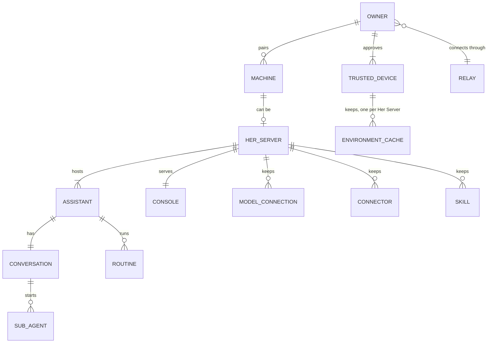
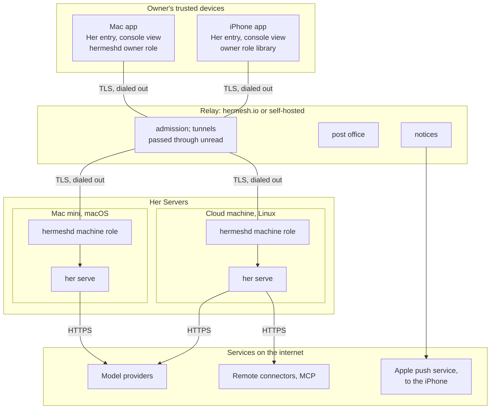
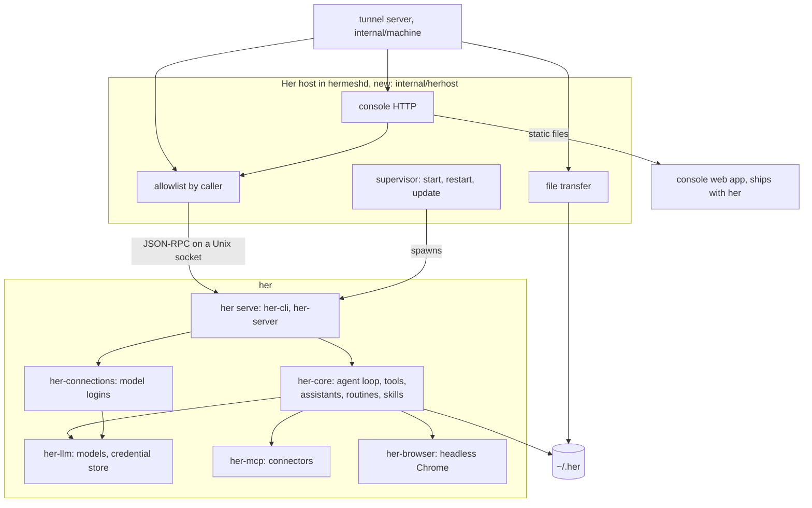
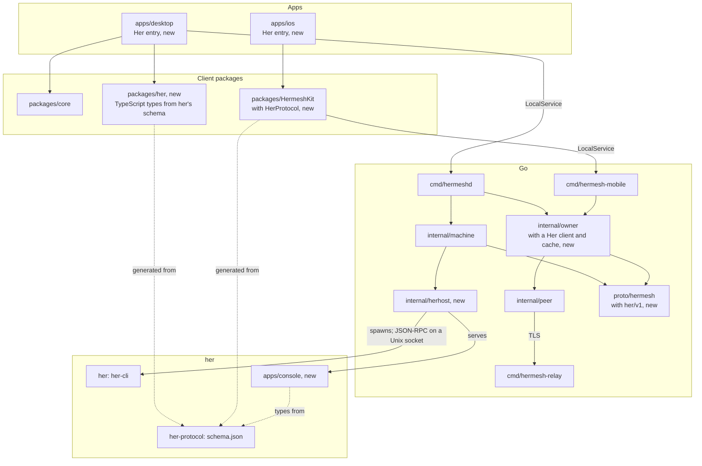
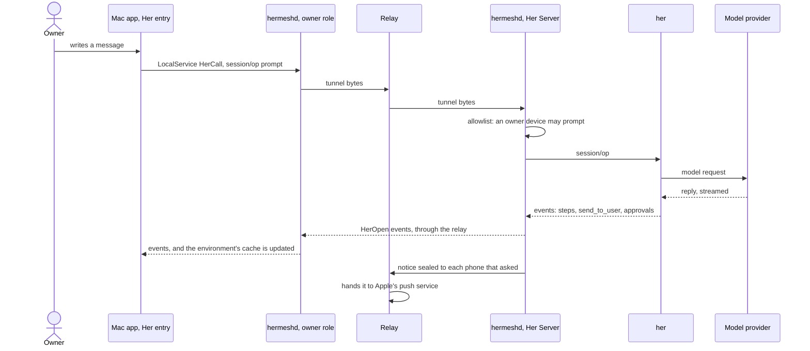
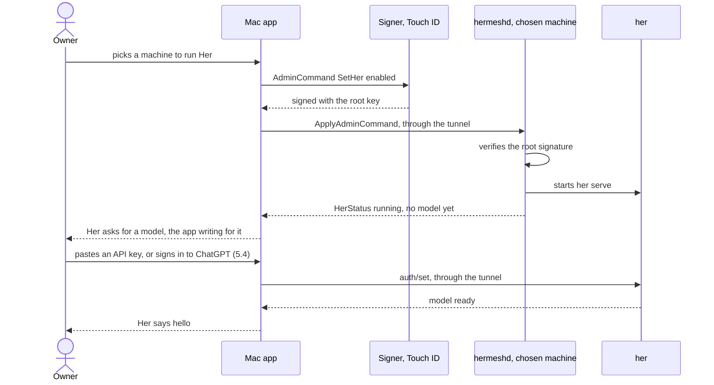
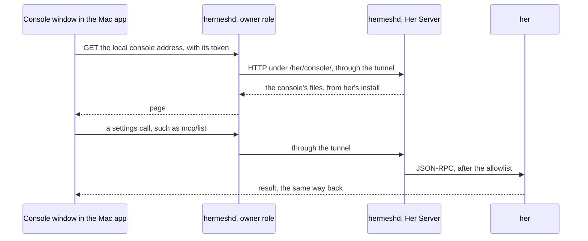
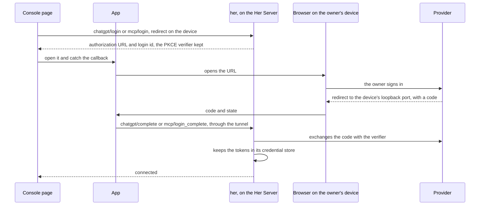
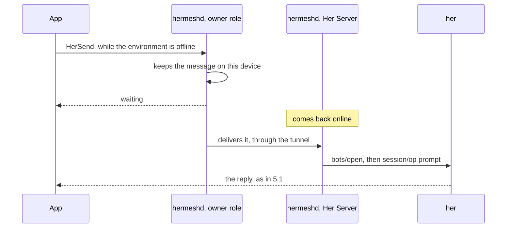

# Her Server: architecture and plan

Status: final design, 2026-11-08. Phases 1 and 2 are built (§11), and the
first step of phase 4, the Linux install command (§6.4); phase 3 and the
rest of phase 4 are not. This replaces the earlier drafts of this document.
The kernel is in [her/](../her/README.md).

## 0. Summary

Her is the agent built into Hermesh. It runs on **Her Servers**: macOS or
Linux machines the owner turns Her on for. Each Her Server is a
self-contained **environment**, with its own **assistants**, conversations,
model logins, connectors and skills, all managed in that environment's own
web **console**. The Hermesh apps only converse. They have one entry, **Her**
(so named in every language), where the owner picks an environment
and talks with Her, the way one picks where a session runs in Claude: her holds more
assistants, but the apps show Her alone for now (§9.1). Everything
travels end to end through the **relay**, which only connects: it sees
presence, names, versions and sealed bytes, never content.

The decisions:

1. **Clients converse, servers keep.** Conversations, memory, files,
   settings and secrets live on the Her Server. The apps hold a cache.
2. **One or more Her Servers per owner**, each self-contained, picked in the
   app as an environment. Nothing is shared or synced between them.
3. **Each server has its own console.** A Her Server's console manages its
   environment. The relay's console (hermesh.io, on the official service)
   manages the relay. They are never merged.
4. **hermeshd runs her** (`her serve --listen unix://…`), opens a her
   connection for each client stream and forwards her's own JSON-RPC, with an
   allowlist by caller. Hermesh adds file transfer, the
   console's HTTP and Her's status.
5. **Keys decide.** Only the owner's trusted devices reach Her. Actions
   that need the root key are signed in the apps, with Touch ID.
6. **Coding agents and the rest of Hermesh don't change.**

## 1. Names

| Name | What it is | In the apps |
|---|---|---|
| Owner | The person, identified by the root chain of their trusted devices (`owner_id`), not by an account | |
| Trusted device | One of the owner's devices with a root key in its Secure Enclave: the Mac app, the iPhone app. It approves, signs and reads | |
| Machine | A computer paired to the owner, running hermeshd's machine role, with a machine certificate | Its name: the hostname by default, renamable |
| Relay | The service every device and machine dials out to: admission, routing of tunnels, the post office, notices. The official one at hermesh.io, or a self-hosted one | "Official service" or "your own server" (自己的服务器), as today |
| hermeshd | Hermesh's daemon. The owner role runs on trusted devices (built into the Mac app, and a library, `hermesh-mobile`, in the iPhone app). The machine role runs on every machine | |
| her | The agent kernel, a Rust program ([her/](../her/README.md)) | |
| Her | The agent, and the default assistant of every Her Server | Her |
| Her Server | A machine Her is turned on for, where hermeshd runs her. A role, not a program or a kind of hardware | Shown as an environment |
| Environment | A Her Server as the apps show it | The machine's name, such as "Mac mini" |
| Assistant | A named bot on a Her Server (her's `bots/*`). It has its own conversation, memory, folder, routines, model, thinking level and approval mode, and shares its environment's logins, connectors and skills. The apps show one for now, Her | Assistant (助手) |
| Conversation | An assistant's one ongoing chat: a her session | |
| Sub-agent | A worker an assistant starts for part of a task. Never listed | Progress lines |
| Routine | Instructions an assistant runs on a schedule | Routine (定时任务) |
| Model connection | How an environment reaches models: an API key, a Token Plan's key, or a login such as ChatGPT | |
| Connector | An MCP server configured on a Her Server | Connector (连接器) |
| Skill | A `SKILL.md` package installed on a Her Server | Skill (技能) |
| Credential | A secret in a Her Server's credential store: the Keychain on macOS, `~/.her/credentials.toml` on Linux | |
| Console | A server's web pages for managing it | "Manage this environment" |
| Her entry | The apps' one place for Her: the conversation with Her, environment by environment | Her |
| Tunnel | The end-to-end TLS connection from a trusted device to a machine, carried by the relay | |
| Post office | The relay's store of sealed messages for whoever is offline, kept up to 30 days. Not used by Her yet (§5.5) | |
| Notice | An event a machine seals to a phone's notice key; the relay hands it to Apple's push service ([iphone-app.md](iphone-app.md) §3) | A notification |
| Agent | A coding agent, or a connected AI with a grant, as today. Can't reach Her in this version | As today |

The apps never call an environment a "server": Chinese already uses 服务器
for the self-hosted Hermesh service, and many owners will run both on one
cloud machine. "Agent" stays the word for coding agents and connected AIs,
so Her's bots are "assistants" (助手).

## 2. Entities and relationships



**Identifiers.**

- An environment is its machine's `machine_id` (`m_…`), and its name is the
  machine's.
- An assistant is `machine_id` plus her's bot id. Her is the bot marked
  `default`.
- A conversation is the assistant's her session id.

Everything an app keeps carries the `machine_id`, so a second environment
never collides with the first.

**Rules.**

- Every Her Server has exactly one default assistant, Her. It can't be
  deleted but can be renamed. her lets others be added and deleted freely;
  the apps show Her alone for now and leave any others alone (§9.1).
- Nothing links two environments: no shared assistants, settings or
  conversations.
- An owner connects through one relay, and every environment is reached
  through it.

## 3. Network



- **Everything dials out.** No device or machine opens a port, and a Her
  Server needs no public address.
- **Tunnels.** The tunnels run inside those connections: TLS 1.3, with
  both sides pinned to the owner's root chain
  ([technical-design.md](technical-design.md) §3.7). The relay forwards
  bytes it can't read.
- **On the same Mac.** A Mac app on a Mac that is a Her Server reaches her
  in process through its own hermeshd, never through the relay.
- **Models and connectors.** Her calls model providers and remote connectors
  straight from the Her Server, over that machine's own internet connection.
  The relay is not on that path.
- **What the relay sees**: which devices and machines are online, their
  names and versions, tunnel bytes, sealed post-office messages and sealed
  notices. Never a conversation, a setting or a secret.

## 4. Components and modules

### 4.1 What runs where

| Machine | Runs | Her role |
|---|---|---|
| Mac with the Mac app | The app; hermeshd with the owner role and the machine role; her when Her is on for this Mac | Client, and optionally a Her Server |
| Mac that is only a machine ([trusted-devices.md](trusted-devices.md) §4.7) | The app in machine-only mode, hermeshd's machine role; her when Her is on | Optionally a Her Server |
| Linux machine | hermeshd as a systemd user unit; her when Her is on | Optionally a Her Server |
| Windows machine | hermeshd, coding agents | None yet: her has no Windows code |
| iPhone | The app, with the owner role as a library | Client only |
| Relay host | `hermesh-relay`; on the official service also the hermesh.io console (in hermesh-cloud) | None |

### 4.2 Inside a Her Server



The Her host also turns her's notifications (a reply, a question, an
approval waiting) into notices sealed to the owner's phones (§5.1).

### 4.3 Code modules



Rules that keep the parts apart:

- **Go never links Rust.** hermeshd talks to her only as a child process,
  over JSON-RPC on a Unix socket only it can open. her stays buildable and testable on its own
  (`cargo test` in her/).
- **The apps never talk to her directly.** They always go through their
  owner-role hermeshd (LocalService), which goes in process or through a
  tunnel.
- **her's protocol is the one contract for Her.** The apps' and the
  console's types are generated from `schema.json`. Hermesh's protobuf
  carries only Hermesh's own things: machines, presence, whether Her is on,
  and the tunnel's Her service.
- **The console ships with her, not with the apps.** A new her brings its
  own console, so no app can be out of step with a setting.

### 4.4 Computer use on a Mac Her Server

her's desktop tools (`cua_*`) run `agent-desktop`, which reads and operates
other apps through macOS's Accessibility API and takes screenshots of their
windows. macOS grants both to the process it holds responsible for
agent-desktop. launchd makes each job its own responsible process and
children inherit it, so on a Mac Her Server that is **hermeshd**, the
LaunchAgent: not Hermesh.app, her or agent-desktop. Checked on macOS 27.2:
the LaunchAgent is its own responsible process, and tccd's log attributes
agent-desktop, started by her started by Hermesh 0.1.4's hermeshd, to
hermeshd.

What the owner allows, in System Settings › Privacy & Security, once per
Mac:

| Permission | Needed for | Switch on | Listed as |
|---|---|---|---|
| Accessibility (Device Control and Data Access from macOS 27) | every desktop tool but `cua_apps` | **hermeshd** | the program itself, `Hermesh.app/Contents/Helpers/hermeshd`, held to its identifier and Hermesh's team, so updates keep it |
| Screen & System Audio Recording | `cua_screenshot` and acting at a point of one | **Hermesh** | the app: for this permission macOS gives a helper inside an app the app's switch |

- The first check under hermeshd lists hermeshd under Accessibility,
  switched off, without a prompt. Hermesh is listed under Screen Recording
  once the app tried to capture, which the Mac app does when the owner asks.
  A grant counts from the next call; nothing restarts.
- agent-desktop serves each `--session` namespace from one background
  process, whoever started it, and keeps it some minutes after the last call.
  macOS holds the process that started it responsible for it, and once that
  process is gone, agent-desktop itself. her names its namespaces after its
  own process, so it never reaches one left from before hermeshd restarted.
- her's tool results say what to switch on. `desktop/status` reports both
  permissions as agent-desktop finds them from inside her, which nothing
  else can: the app's own checks answer for Hermesh.app. The Mac app shows
  them under Computer use (§9.1).
- On another Mac that is a Her Server, the owner switches them on at that
  Mac.
- Computer use is on by default on a Mac Her Server: hermeshd starts her
  with `HER_DESKTOP=on`, so her's tools are on unless the owner's
  configuration sets `[desktop] enabled = false`. Nothing works until the
  owner switches the two permissions on, and Her asks once per app and
  conversation before it reads or acts in an app `[desktop.apps]` doesn't
  allow.

## 5. Call flows

### 5.1 Talking to an assistant



An approval works the same way back: the app answers with `session/op`
(approval), which takes the same path to her.

### 5.2 Turning Her on for a machine

The first run of the Her entry, and "Add environment" later.



### 5.3 Opening the console



The owner-role hermeshd serves the console to the Mac app on a loopback
address guarded by a token it hands the app. The iPhone app loads it in a
web view through a URL scheme handler of its own. Either way, the console
acts as the device that opened it: no password, no open port.

### 5.4 Signing in on a remote Her Server



Tokens are made on the Her Server and never leave it. On a Mac that is the
Her Server, her's own loopback callback works as it does today, and none of
this is needed.

### 5.5 A Her Server offline



The device that wrote a message keeps it (`HerSend`, `ListHerWaiting`) and
delivers it once the machine answers again. Its files go by their path on
the device; a pasted picture, which has none, is kept by hermeshd with the
message, uploaded as a file too, and deleted once the message is delivered
or dropped. The relay's post office
([agent-messages.md](agent-messages.md) §5) would deliver it even after the
device goes away, but today it takes no messages from owner devices, and
changing that needs a relay release (§12).

## 6. Interfaces

### 6.1 her's protocol, by caller

| Methods | Used by | Owner's devices | Agents |
|---|---|---|---|
| `bots/*`: assistants, their routines, unread marks | Her entry | Allowed | No |
| `session/op` and session events: prompts, approvals, answers, stopping | Her entry | Allowed | No |
| `models/list` | Her entry, console | Allowed | No |
| `desktop/status`: whether computer use can work there (§4.4) | Her entry | Allowed | No |
| `config/*`, `connections/*`, `credentials/*`, `mcp/*`, `skills/*`, `web_search/*`, `browser/allow`, `browser/status`, `browser/use_extension` | Console | Allowed | No |
| `doc/*`, `deck/*`, `docx/*` and the other `browser/*` methods: desktop document panels and a built-in browser, which Hermesh does not have | Nobody | Not forwarded | No |

Types are in [schema.json](../her/crates/her-protocol/schema.json), and the
reference is [protocol-reference.md](../her/docs/cli/protocol-reference.md).
Declaring them again in protobuf would make a second contract to keep in
step, so hermeshd forwards them.

### 6.2 Additions to Hermesh's protocol

The protos are the contract; this is their outline.

- [her/v1/her.proto](../proto/hermesh/her/v1/her.proto): `HerService`,
  served by a machine to the owner's devices only.
  - `Open` opens a her connection, runs its setup requests (such as
    `bots/subscribe` or `bots/open`), then streams her's notifications on it.
  - `Call` sends one request on a connection an `Open` holds, or on one of
    its own.
  - `Upload` and `Download` move files into and out of an assistant's folder.
  - The console is plain HTTP on the same tunnel connection: its files under
    `/her/console/`, server-sent events at `/her/console/events`, and
    JSON-RPC requests at `/her/console/rpc`.
- [identity.proto](../proto/hermesh/identity/v1/identity.proto): three
  root-signed `AdminCommand`s. `SetHer` turns Her on or off for a machine;
  `SetHerAssistantMode` sets an assistant's permission mode, the only way to
  reach `bypass-permissions`; `SetHerCommandConnector` manages connectors
  started as commands.
- [machine.proto](../proto/hermesh/machine/v1/machine.proto): `HerStatus` in
  `MachineStatus`. Besides enabled, running, version, a ready model and
  errors, it carries the unread count and the newest message, so the
  sidebar and notifications need no stream of their own. Agents never get it.
- [local.proto](../proto/hermesh/local/v1/local.proto): `Machine.her` keeps
  each machine's Her as last seen, so an offline environment stays listed.
  LocalService gains `SetHer`, `SetHerAssistantMode`,
  `SetHerCommandConnector`, `HerOpen`, `HerCall`, `HerSend`,
  `ListHerWaiting`, `GetHerConversation` (what the device keeps of an
  environment's Her, §7), `HerUpload`, `HerDownload` (files go by path on
  the device) and `GetHerConsole` (a 127.0.0.1 address with a token).

### 6.3 Changes in her

1. **Assistants.** Rename the default bot to Her (today `HerBot` in
   [bots.rs](../her/crates/her-server/src/bots.rs)). New assistants ask
   before risky steps instead of starting with full access.
2. **Remote sign-in.** `chatgpt/login` and `mcp/login` take an optional
   `redirect_uri` on the client's device (loopback only) and return the
   authorization request without listening. `chatgpt/complete` and
   `mcp/login_complete` finish it with the code (and `client_id` or `iss`
   when the redirect carried them). her keeps the PKCE verifier and does the
   exchange (§5.4).
3. **Files.** A prompt's input is text and images today. Other files are
   uploaded into the assistant's folder, and the message names them.
   `skills/install` installs from an uploaded archive.
4. **The console.** A web app in `her/apps/console`, released with her.
5. **Updates.** Inside Hermesh nothing calls `her upgrade`: hermeshd ships
   her and updates it.

### 6.4 Packaging and updates

- **macOS**: her sits inside the Mac app's bundle beside hermeshd, in
  `Contents/Helpers`, and its console in `Contents/Resources/console`.
- **Linux**: a Hermesh release carries her for Linux, `her-linux-amd64` and
  `her-linux-arm64`, built static with musl and without local-accounts, as
  the Mac app's, and the console, `her-console.tar.gz`, all in the signed
  checksum list with the other programs. On a machine (not `--cli` or
  `--device`), `install.sh` puts her beside hermeshd in `~/.local/bin` and
  the console in `her-console/` there, where hermeshd finds them.
- **One version.** hermeshd's self-update, `hermeshd update` and the
  background updater ([machine-updates.md](machine-updates.md)), replaces
  hermeshd, hermesh, her and the console together from one release, and
  hermeshd starting again starts her again. It waits while Her's assistants
  are at work (a turn, sub-agents, a routine's run), as for sessions. A
  machine installed before her shipped gets it by running the install
  command again; until then it shows as unable to run Her.
- **Started only when needed.** hermeshd starts her only on a machine Her
  is on for, as the machine's user, so her's home is that user's `~/.her`.
  `hermeshd doctor` and `status` say whether her is installed, its version,
  and whether Her is on and running; `hermeshd uninstall` removes her and
  the console, and leaves `~/.her`.
- **What a Linux server lacks.** Chrome and her's PDF component aren't
  installed: Her works without them; only her's browser and PDF tools need
  them. Where Chrome is installed and her runs as root, her starts it
  without its sandbox (`--no-sandbox`), as Chrome refuses root otherwise.
- **The owner's own Chrome, on a Mac.** While Her is on, hermeshd registers
  the her it ships as the Hermesh extension's native host for the Chromium
  browsers installed (`her browser extension install --socket` with her's
  socket), again at every start so it follows her after an update, and
  takes it back when Her is turned off. The extension then lends Her the
  owner's Chrome, with its sign-ins (her/apps/chrome-extension).
  - The app ships the extension in `Contents/Resources/chrome-extension`.
  - At every start, hermeshd copies it to
    `~/Library/Application Support/Hermesh/Chrome Extension`, unless the
    copy is the same already.
  - The console's guide has the owner load it from that folder, until it is
    in the Chrome Web Store. The manifest carries the extension's key, so
    its ID doesn't depend on the folder.

## 7. Data

| What | Each Her Server | Owner's devices | Relay |
|---|---|---|---|
| Assistants, conversations, memory, files Her makes, routines | The only copy, in `~/.her` | Recent messages per environment, to open at once and read offline | Nothing |
| Model logins, API keys, connector tokens | The credential store | Status only: connected, which account, until when | Nothing |
| Connectors, skills, web search and browser settings | `~/.her` | Nothing | Nothing |
| Whether a machine runs Her | Its machine settings, signed | The signed setting | The signed setting, which it can't change |
| Messages written while a Her Server is offline | Delivered when it is back | Kept on the device that wrote them, shown as waiting | Nothing |
| Presence | | | Online or offline, name, version |

The owner-role hermeshd keeps each environment's recent messages in its
`owner.db`, so the Her entry opens at once and an offline environment still
shows what was said, after a restart too. For each machine it keeps Her, as
`bots/subscribe` and `bots/changed` last listed the assistants, and the end
of Her's conversation as the entry shows it, in her's own snapshot JSON.
That is its last 100 messages: the owner's, the reports delivered into it
by sub-agents and routines, and Her's, holding only the calls that sent the
owner something (`send_to_user`, `manage_routine`); with those calls'
results and how each task ended. Her's own steps and earlier history are
left out. hermeshd takes it from the `HerOpen` streams it passes on while
the entry follows them (`bots/open`'s snapshot, then the conversation's
events), so her is asked nothing more, and serves it as
`GetHerConversation`. What Her says while no window follows the
conversation is kept once the entry opens it again. It all goes when the
machine is removed or Her is turned off there.

What `~/.her` holds on a Her Server:

```
~/.her/
  config.toml        connectors, web search, the browser: the user layer
  models.toml        model providers and models
  bots/<id>/         an assistant: bot.json, its avatar, its folder
  sessions/          conversations, as JSON lines, by date
  skills/            installed skills; .system/ holds the built-in ones
  credentials.toml   secrets, on Linux only (the Keychain on macOS)
```

## 8. Security

**Keys decide, not accounts.**

- A Her Server is one of the owner's machines, paired with a certificate a
  trusted device signed. On every connection it checks the other side
  itself, against the owner's root chain it pins. The relay's admission only
  keeps out abuse.
- Only the owner's trusted devices reach Her and its console, plus the Her
  Server's own app. Agents can't.
- A new device becomes trusted only when one of the owner's devices approves
  it ([trusted-devices.md](trusted-devices.md) §4.2). Someone holding the
  owner's account alone reaches nothing.

**Accounts.**

- On the official relay the owner signs in to hermesh.io. The account lets
  the relay put the owner's devices and machines together, and lets a new
  device find its owner. It is not a key.
- With a self-hosted relay there is no hermesh.io account: devices join with
  the connection address.
- A Her Server goes by keys alone, so it works the same with either relay.

**What needs the root key (Touch ID)**, as other changes that add
permissions do ([trusted-devices.md](trusted-devices.md) §4.6):

- turning Her on or off for a machine;
- adding a connector started as a command on the Her Server.

Everything else in the Her entry and the console uses the device key,
switching an assistant to full access included: the owner chooses it, on a
sheet that says what it means (decided 2026-11-09). A
console never signs: it asks, and the app's signer shows exactly what will
be signed. Letting Her use the owner's own Chrome is one of these: it
connects only after the owner adds the Hermesh extension to that Chrome by
hand on the Mac, and that step is the decision.

**How a console is reached**, in this order:

1. From the Hermesh app, through the tunnel (§5.3). This is the first step.
2. Later: any browser, approved by a trusted device that scans a code the
   page shows, for a limited time.
3. Later: from the internet without the app. The relay forwards the
   encrypted connection without opening it, to a name and certificate of the
   Her Server's own, as Home Assistant's remote access works.

**Threats.**

- **A compromised relay** can't read conversations, settings or secrets,
  and can't add an environment or send the apps to another machine, since
  whether a machine runs Her is signed. It can withhold traffic, as it can
  today.
- **A compromised Her Server** gives away that environment's data and
  credentials, and nothing of the others. It needs no open port, updates
  itself like every machine, and should use disk encryption.
- **Every device lost.** The owner starts over as today
  ([trusted-devices.md](trusted-devices.md) §4.5) and pairs the machines
  again. Each environment's assistants, conversations and settings are on its
  machine, and pairing again must keep them.
- **One owner per Her Server.** Sharing Her with other people is not in
  this design.

## 9. The apps

### 9.1 The Her entry

One entry in each app, for conversation only. In the Mac app it is one item
in the sidebar under Overview and Search. The rest of the app is unchanged.

**One assistant for now.** her holds as many assistants as are made
(`bots/*`), but the apps show one, Her: each environment's default
assistant. There is no list of assistants and no adding or deleting them;
any others her holds are left alone. The page is the conversation with Her,
full width.

What the page has, for that one assistant:

- the conversation: messages, files, questions with buttons, the last
  bubble while it works, messages sent in a row, its steps, the moving
  avatar;
- the approval window and the input box;
- the blank page, where Her greets;
- Her's settings;
- menus, unread marks and alerts;
- routines.

What changes, because Her may run on another computer than the app:

- **Environments.** One at a time. At the page's top, in the middle, is
  Her's avatar, larger than a bar's, with its name on a capsule over the avatar's lower
  edge, on the Mac as on the iPhone; the conversation scrolls under them.
  On the Mac, when there are two or more environments, the capsule also
  holds the environment shown as a quiet menu ("Her · Mac mini"): each
  environment with whether it is online and its unread count, then Add
  Environment. With a single environment no menu shows. The app remembers
  the last one.
- **Models.** Her picks only from the models its environment can already
  use. Adding a key or a login is in the console, and the model menu links
  there.
- **Permissions.** Her asks before risky steps; full access is the owner's
  choice, confirmed once on a sheet. Full access is never the default, because a Her Server reads web pages and
  messages from anyone.
- **Files.** Her's files are on its Her Server: the app previews or saves
  them through the tunnel, and files dragged into a conversation are
  uploaded there.
- **What was said, kept.** The page opens with Her and Her's conversation
  as this device keeps them (§7) until her answers, and shows them while the
  environment is offline, under the line of §9.3, after the app restarts
  too. That copy is read-only: questions and approvals wait for the
  machine, and what the owner writes waits on the device (§5.5).
- **Not carried over**: the switch between bot mode and session mode (the
  apps have Hermesh's own sessions), the list of assistants and making
  them, the built-in browser (Her browses on its Her Server), and the
  document panels beside the conversation.

On the right of the top bar: Her's routines, Her's settings and ⋯, which
holds "Manage this environment" (the console). Her's settings panel holds its name, avatar, model, thinking level and
approval mode, whether it notifies, and lets the owner clear its
conversation. Environment-wide settings are in the console.

Settings › Machines shows, for this Mac while Her is on there, Computer
use: the two permissions of §4.4 as her finds them, with a button for each
missing one that opens its pane of System Settings. They belong to the Mac,
not to an assistant.

### 9.2 First run

While no machine runs Her, the Her entry shows the first run:

1. **Choose where Her runs.** The choices are this Mac (Her goes offline
   while the Mac sleeps), a Mac or Linux machine already paired, or a new
   server (an install command, paired as Add Machine does; once paired, it
   comes first, marked as just paired). Windows machines are shown as not
   yet supported. Touch ID turns Her on there.
2. **Connect a model**, in the conversation: Her speaks first (the app
   writes for it, since no model can yet, and keeps none of it in her's
   conversation) and offers the ways in a list: signing in to ChatGPT, a
   Token Plan (a model plan the owner subscribes to), or an API key, each
   then asking which plan or provider and its key there. Any step can go
   back to another way. Other services are in the environment's console.
3. **Her says hello**, naming the model it talks with.

"Add environment" in the switcher runs the same steps for another machine.

### 9.3 States

- **An environment is offline.** Its cached conversations stay readable,
  with a line such as "Mac mini offline · seen 3 min ago", and messages
  written meanwhile show as waiting.
- **A login expired.** A card appears in the conversation; the fix is in
  the console.
- **Notifications** arrive while the app is in the background. They name
  the assistant, and the environment too when there is more than one.

### 9.4 iPhone app

The same design, written in Swift.

- The console opens in a web view.
- Notices cover Her's replies, questions and approvals, with actions.
- Sign-ins catch their callback in the app.
- Files come from the Files app or the share sheet.

## 10. The console

A web app per Her Server. Its
renderer already builds for a plain browser, today against a mock server.
Sections:

| Section | What it does |
|---|---|
| Models | Model connections: API keys, sign-ins such as ChatGPT |
| Connectors | MCP servers: add by address, sign in, see their tools; connectors started as commands need Touch ID |
| Skills | Installed skills: turn on or off, add by upload, remove, read |
| Web search | The search provider and its key |
| Browser | The sites Her may open without asking; on a Mac, whether the owner's own Chrome is connected through the Hermesh extension, and used |

There is no overview, no defaults for new assistants and no instructions for
all of them: the apps show Her alone, whose model, thinking and permissions
are in Her's own settings in the app, and hermeshd refuses those settings
from the console. Exporting an environment's data, with backup and restore,
is phase 4.

## 11. What we build

Each phase ends with an end-to-end test made from what a person does,
through the real apps and the relay.

### Phase 1: Her in two environments, from the Mac app

1. hermeshd ships her on macOS and Linux, runs it when Her is on, and
   reports `HerStatus`.
2. Turning Her on or off for a machine (`SetHer`, Touch ID), from the first
   run, "Add environment" and Settings → Machines.
3. `HerService` through the tunnel and in process (`Open`, `Call`),
   with the allowlist.
4. The console through the tunnel, with Models (API keys, plus the ChatGPT
   sign-in on a Mac Her Server).
5. The Mac app's Her entry, with Her alone (§9.1):
   - the environment switcher, beside Her's name;
   - the conversation: messages, questions, the approval window, steps,
     the busy state, the input box, unread marks;
   - Her's settings;
   - the first run.
6. Offline handling: cached conversations, messages kept on the device
   until the machine is back, macOS notifications. The cached conversations
   are built: the owner-role hermeshd keeps each environment's (§7), and the
   Mac app shows them until her answers and while the machine is offline.
7. her: the default assistant named Her; new assistants ask by default.

Test: this Mac and a Linux cloud machine as two environments.

- Turn Her on for both.
- Enter an API key in each console.
- Talk to Her in each, and switch between them.
- Take the Linux machine offline, write to it, bring it back, and get the
  reply.
- Switching an assistant to full access asks the owner to confirm it.

### Phase 2: everything an environment can do

1. Files both ways, with previews and saving.
2. The rest of the console: Connectors (with sign-in), Skills (upload), Web
   search, Browser. Export moved to phase 4.
3. Sign-ins started on the Her Server (§5.4), for ChatGPT and for MCP
   connectors.
4. Routines in conversations.

Test, on the Linux environment:

- Sign in to ChatGPT from the Mac.
- Add a connector that needs a sign-in, and install a skill by upload.
- Have Her use them in a conversation.
- Leave a routine to run at night and see its result arrive.

### Phase 3: the iPhone app

1. The Her entry in Swift.
2. The console in a web view.
3. Notices for Her's replies, questions and approvals. The notices are
   built, without actions yet: the Her Server's hermeshd seals a notice of
   kind `her` to each iPhone that asked for it whenever the Mac app would
   notify (`HerStatus.latest` new, unread grown, the assistant not muted),
   and the app words it as the Mac does.
4. Sign-ins with the app's callback.

Test, from the iPhone alone:

- Talk to both environments.
- Answer an approval from a notification.
- Change an assistant's model.
- Open the console.

### Phase 4: Her Servers anyone can set up

1. A Linux install command that sets up hermeshd with her and pairs the
   machine, as Add Machine does. Built (§6.4), with updates and uninstall;
   `TestLinuxHer` is its test, on a fresh Ubuntu server in Docker.
2. Export and backup of an environment, and restoring it on the same
   machine after starting over.
3. The console in any browser, approved by a trusted device scanning a
   code.

Test:

- A fresh cloud machine becomes an environment with one command from the
  app's instructions.
- Backing it up, wiping it and restoring it keeps its assistants and
  conversations.

## 12. Not doing now

- Her working on the owner's other machines (starting coding sessions,
  reading files there) through Hermesh's tools.
- Environments talking to each other, sharing settings, or moving a
  conversation between them. Copying one environment's settings into a new
  one, secrets left out, may come later.
- Windows as a Her Server, and computer use on Linux: her's desktop tools
  use the macOS accessibility API.
- Hermesh running Her for its users.
- Sharing Her with other people, such as a family or a team.
- The console from the internet without the app (§8).
- A console for the self-hosted relay.
- Messages to an offline Her Server waiting at the relay's post office, so
  they arrive even after the device that wrote them goes away: the relay
  takes no messages from owner devices yet, and the official relay would
  need a release.
- Direct connections on a local network.

## 13. Open questions

- Sign-in from the iPhone for providers that accept only loopback
  redirects.
- How large a file may go through the relay.
- The format of an environment's backup and export.

## 14. Options considered

| Shape | Why not |
|---|---|
| Her on every machine, by itself | Every machine needs a setup nobody asked for, and Windows machines can't run her |
| The relay stores conversations and settings, as Claude's Remote Control keeps transcripts on Anthropic's servers | In plaintext it breaks Hermesh's promise that the relay sees no content. Encrypted, it needs an account-wide data key, rotation when a device is removed, and a recovery key |
| Hermesh runs Her for its users | Hermesh would see everything, and would carry the compute, the isolation between users and the liability |
| Her's settings inside the apps | Every new setting waits for the Mac, iPhone and Windows releases; an older app can't show a newer server's settings; the same screens are written once per app |
| A second contract for Her in protobuf | Some sixty of her's methods declared twice, kept in step by hand |
| **Her Servers the owner chooses, each with its own console; the apps only converse** | Chosen. Each environment is set up on its own, with its own model login, and work at night needs a machine that stays on |

Each environment keeps one ChatGPT login of its own. A login shared between
machines breaks when one of them rotates its refresh token, which can't
happen here.
