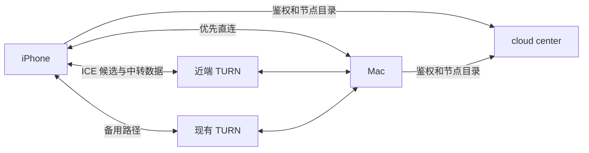

# 近端 TURN 节点与动态选路实施计划

日期：2026-11-13。状态：待实施的设计与验收计划。

目标是在直连失败时自动使用实际链路较好的中转，并支持节点新增、故障、维护和 IP 变化。首期采用一个近端节点与现有硅谷节点并存；最终依据手机到 Mac 的实际路径选择，而非只凭地理位置或单端 ping。近端中转不会使原本被 NAT 阻断的链路自动变成直连。

客户端审查基线：hermesh `2a4af781`；cloud 审查基线：本地 hermesh-cloud `d64cd6c`。本文不代表已经改造 cloud 或部署服务器。

## 1 现有能力和缺口

| 部分 | 已有能力 | 需要扩展 |
| --- | --- | --- |
| cloud | 已鉴权的 GetScreenServers 下发服务器地址和临时凭据；双 center 共享集群配置 | 多节点目录配置、逐节点凭据、健康过滤、版本与缓存期限、部署和回滚 |
| relay 库 | TURNConfig.Others 可下发额外节点，但所有节点复用一个密钥 | 节点目录到服务返回值的接入；逐节点独立密钥；旧接口兼容 |
| 客户端 | 并行实际 Allocate；选择申请耗时最短者；本地优先、ICE 重启、直连升级 | 保留少量备用节点，测整条路径，TLS 可达性、换网强制重测、故障恢复和缓存隔离 |
| 缓存 | 超过 20 分钟使用时触发后台刷新，40 分钟后不再使用；无中转地址会 Doubt | 区分节点目录有效期、凭据有效期和网络测量有效期；刷新空结果及并发乱序保护 |
| 现有 TURN | 内嵌 Pion，UDP/TCP 3478；既有 allocation 的凭据过期处理有专门实现 | 近端独立部署，可信 TLS 443、容量管理、完整长期会话验收 |

目前每端测完只留下一个节点。两端各自最近不等于两端之间最佳；申请最快也不证明视频带宽足够。现在的 Allocate 测量没有额外验证端到端转发。修改节点列表只影响后续获取和 gathering，不会把现有会话自动迁移。

代码入口：internal/screen/servers.go、viewer.go、host.go、internal/owner/screen.go、internal/machine/screen.go、pkg/relay/turn.go、proto/hermesh/relay/v1/relay.proto；cloud 的 cmd/hermesh-center/main.go、center/center.go、deploy/prod/compose.yaml。

## 2 总体方案和复用边界

控制面继续由 center 处理身份、目录和信令。新增节点只承担 STUN/TURN，不复制账号库、center 或远程桌面业务。两端可通过一个 TURN 节点，也可由 ICE 验证采用两端不同节点的路径；服务器之间不另建私有转发协议。

协议继续使用 ICE、TURN、DTLS/SRTP 和 SCTP。TLS 443 是客户端到 TURN 的传输兜底，不是 ICE-TCP 直连；保持原先暂缓 ICE-TCP 的决定。

节点配置、凭据生成和探测结果的数据结构保持与媒体无关。客户端先在现有 Servers 边界实现目录和选择策略，RPC/文件传输实际接入时再提取公共 peerlink。视频编码、画面恢复和输入留在 screen；RPC 的授权、数量和生命周期不由这次计划顺带改变。

## 3 cloud 改造

### 3.1 一个版本化目录，先用配置文件管理

首期增加只由运维提供的节点配置文件，由两个 center 挂载同一版本；通过配置校验及受控 reload 生效。暂不建设自动注册平台或公开管理页面。配置拒绝非法 URL、重复 ID、缺失密钥、无效端口和不支持的传输，失败时保留上一份有效配置。

每个节点包含：

| 字段 | 作用 |
| --- | --- |
| id、region | 稳定身份和辅助排序，region 不代替实测 |
| urls | 同节点的 UDP/TCP/TLS URL 组，不能拆成几个独立地区 |
| endpoint_generation | IP、地址或部署实例变化时使旧测量失效 |
| state | enabled、draining、disabled |
| secret_ref | 服务器端密钥文件引用，不进入客户端响应 |
| limits | allocation、带宽与预算相关上限 |
| catalog_revision | 每次发布递增；回滚旧内容也用新 revision |

近端 coturn 使用独立 TURN 密钥，center 逐节点签发凭据。现有内嵌节点保留现行兼容行为；不把 center 集群原始密钥复制到新机器。需要补 relay 库的逐节点签发能力，不能直接用目前共享密钥的 Others 代替。

### 3.2 扩展下发接口，保留旧客户端

给 GetScreenServersResponse 增加可选字段：目录 revision、refresh_after、valid_until。给每个 IceServer 增加 node_id、region、endpoint_generation、credential_expires_at。沿用 urls、username、credential，分别承载节点自己的临时凭据。

旧客户端忽略新增字段，仍收到可用的旧结构；新客户端连旧 center 时回退现有缓存策略。第一批最多下发近端节点与现有节点；节点变多后按健康、策略和粗地区给出最多 3 个候选，客户端再测。无需向 center 上传本地候选或完整会话路径。

目录服务必须允许 center 仅签发外部节点地址和凭据，不要求本机监听 TURN，也不依赖旧 startTURN 必须配置 Host 的初始化路径。保留现有内嵌节点作为首期 fallback，同时验证外部节点独立运行的配置。只有已接纳的设备能获取凭据，目录/凭据接口增加按主体限频。

center 的两个实例必须加载相同目录和密钥版本。测试轮询经过不同实例时返回一致；配置 reload 和 revision 传播应有明确失败状态。健康状态可通过现有 Redis 共享，检查任务利用现有 leader 机制去重，目录本身仍由配置文件持久保存。

### 3.3 健康与维护

每节点检查实际 Allocate 和受控双向数据转发；TLS 节点还检查可信证书、名称和到期时间。不能仅以 TCP 端口能连或进程存活作为健康。

建议起始参数：30 秒一次、连续 3 次失败停止向新请求推荐、连续 3 次成功恢复。至少结合节点自身状态和外部可达性；单一监测点故障不应错误摘除所有节点。云端健康只作筛选，客户端实测仍是最终依据。

draining 停止在新目录中推荐，不立即终止正在使用的 allocation。已经缓存的凭据可能在过期前继续申请，因此“下线目录”不等于“瞬间禁止所有新 allocation”。需要严格撤销时另行定义服务端拒绝策略，并明确对存量会话的影响。

### 3.4 凭据和长期会话

继续使用 coturn 支持的 TURN REST 临时凭据，不把共享密钥写入 App。首期沿用一小时凭据，但在接口中明确到期时间，缓存不超过凭据安全余量；NTP 保证 center 和节点时钟一致。

内嵌 Pion 对过期凭据的既有 allocation 有专门处理；不能假定 coturn 完全相同。先验证实际版本的 Allocate、Refresh、Permission 和 ChannelBind 到期行为。若既有 allocation 可安全刷新，维持原路径并给新建连接换凭据；若不可，必须在到期前建立替代路径并受控恢复。仅 SetConfiguration 更新密码不能证明旧 allocation 已续期。

密钥轮换先验证双密钥过渡能力：节点同时接受旧/新密钥、center 改签新凭据、等待旧凭据和存量会话排空后移除旧密钥。实现不支持安全重叠时，采用第二实例逐步迁移，不直接覆盖运行实例的密钥。70 分钟和两小时真实转发测试是上线条件。

## 4 客户端改造

### 4.1 三份缓存分别管理

目录缓存按 center 身份和 revision 管理；凭据按节点与到期时间管理；测量结果按本地网络代次、node_id、endpoint_generation 管理。私有地址、UDP 端口等仅保存在本机。

换 Wi-Fi、Wi-Fi/5G、VPN 路径或地址变化时，增加网络代次，使旧测量失效并触发有去抖的目录获取和测量。取消旧探测；即使旧请求晚回，也不能覆盖新网络状态。现有 refreshLocked 单 busy 和 put 无代次提交检查需要补回归。center 断连或身份变化也必须隔离缓存。

完整目录与筛选结果分别保留，避免筛掉备用节点后无法迅速恢复。空响应区分“权威禁用全部节点”和“网络请求失败”：前者应用新 revision，后者保留尚有效的旧目录；没有有效凭据时不能无限期复用旧缓存。

建议目录软刷新 5 分钟；活跃会话每 60 秒带抖动检查版本及凭据到期。相同版本不重复扫描全部节点。空闲时按使用触发；手机后台停止主动测速。首期采用拉取，不承诺实时推送；强制故障恢复立即触发一次受预算限制的拉取。

### 4.2 有限候选竞速

1. 连接开始时继续先交换局域网候选，节点获取和测速不阻塞局域网握手。
2. 对最多 3 个下发节点并发进行有认证的 Allocate；UDP 首选，失败或不可用时尝试 TCP/TLS，TLS-only 节点也能参选。
3. 申请结果用于预排序，最多保留 2 个可用节点；释放专用于测速的 allocation。
4. 将少量真实 TURN 候选交给原有 ICE，验证实际候选对可达性。两端共同节点及不同节点组合都纳入受限候选集合，不能强制每端只用自己最近的一个。
5. 依据实际候选对的 RTT 和现有传输统计选择；媒体恢复、操作通道和首帧一起验收。带宽测试不在手机每次连接时发送大流量文件。

初始探测预算：最多 3 节点、每节点最多 2 种传输尝试、单次探测窗口总计不超过 3 秒。使用 Go context 将 DNS、连接和 Allocate 都纳入同一截止时间；超时取消并回收连接，不能每个 URL 独立增加整个窗口。早成功即可参与连接，迟到成功可补候选。

备用地址多不意味着永久保留大量 allocation 或每秒检查所有地址对。需要审查并限制当前 Pion keepAliveCandidatesForRenomination 的全会话探测开销：稳定后仅对选中路径维持协议必需的 consent/keepalive，备用验证低频且有总预算，失败节点短暂退避。关闭、重启、换网和后台时及时取消资源。

### 4.3 质量改善和故障恢复分开处理

质量改善先复用当前会话已有的有效 ICE 候选和 renomination；这类升级必须保留 PeerConnection、DTLS/SRTP 和输入通道。候选完全不在本轮 gathering 中时，不能把更新服务器列表当作已经增加可用候选。

建议初始防抖条件：新路径 RTT 持续改善至少 20 ms 且 20%，观察 5 秒，非故障切换冷却 30 秒。持续丢包或画面停顿只触发有限重测，不能凭一次编码慢就换节点。具体阈值以对照数据调整，这些不是当前已实现参数。

故障时立即尝试已验证备用候选；必要时获取新目录、凭据并做一次串行化 ICE restart。复用已修复的 pending-offer 恢复，避免并发重启。现有会话中追加新 TURN server、DNS 变更和 allocation 迁移不能承诺无缝；若必须重启，需要报告重连状态并测恢复时间。保持健康直连时不为目录变化重启画面。

## 5 IP 变更和节点升级

生产优先使用固定公网 IP 加每节点稳定域名，如 turn-hk-a.hermesh.io。目录可以接受裸 IP；它是有效试运行方案。

| 情况 | 运维动作 | cloud 与客户端行为 |
| --- | --- | --- |
| 裸 IP 改变 | 更新节点监听/公布地址和目录 | 提升 endpoint_generation 与 revision；客户端失效旧测量，重新建连 |
| 稳定域名换 IP | 更新 A/AAAA、证书和节点实际公布的中转地址 | 同时提升 endpoint_generation；重新解析和建连，失败走备用 |
| 计划迁移 | 新实例健康后先加入目录，旧实例 draining | 新会话偏向新实例，旧会话排空后停旧实例 |
| 突然宕机 | 修复实例或启用替代实例 | 本地失败检测先恢复；目录健康过滤随后收敛 |

DNS TTL 可先设 60–300 秒，但系统 DNS 缓存和现有会话不会据此自动迁移。coturn 的 external-ip、NAT 转发规则或 Pion 启动时解析出的 RelayAddress 也要更新；只改域名可能仍公布旧 IP。计划迁移优先新旧并存，避免在同一实例上直接换 IP。

## 6 节点部署和你需要准备的资源

首期只准备一个候选近端节点，和现有节点做真实路径对照。地区依据你的手机运营商、Mac 所在地及实测决定；“香港”或“新加坡”本身不保证更快。暂不预订多个地区。

| 资源 | 试运行要求 |
| --- | --- |
| 服务器 | Linux，建议 2 核 2 GB 作为留有余量的起点；不是性能保证，不需要 GPU |
| 地址 | 固定公网 IPv4 优先；有可用 IPv6 则同时测。NAT 后部署需严格端口映射和公布地址验证 |
| 网络 | UDP 入出站可用；能控制系统防火墙和云安全组；两端无需额外代理即可稳定访问该节点更理想 |
| 带宽 | 单路按实际画面峰值加余量；首期 20 Mbps 可用出口作单会话试验，正式按并发计算 |
| 域名 | 试运行可以 IP；正式建议每节点独立子域名，直接 DNS 解析，不经过普通 HTTP CDN |
| TLS | TURN TLS 使用公开可信证书，自动续期；现有 Cloudflare origin 专用证书不能直接当作客户端可信证书 |
| 端口 | UDP/TCP 3478、TCP 443；UDP relay 端口段建议首期预留 49160–49359，并与服务配置一致 |
| 管理 | SSH 别名和可部署权限，Docker/服务管理权限，DNS 与安全组修改能力；密码和私钥不放进文档或聊天 |
| 预算 | 出口带宽、月流量、预期并发和每日使用时长；告警及超额处理方式 |

443 要能供 TURN TLS 使用，不能默认与已有 HTTPS 服务共占同一监听端口；试运行优先独立 IP/主机。采用固定版本或镜像 digest 的 coturn，配置临时凭据认证、allocation 配额、单会话与总带宽约束，限制未授权转发；健康监测和设备允许的必要路径须有真实转发回归。参数不能直接沿用默认无限额。

容量估算：N 路平均视频码率 B Mbps，出口初始预算约为 N × B × 1.3，另外核对入站、双中转路径与供应商计费规则。例：5 路各 8 Mbps，按 52 Mbps 出口起算；不是“20 Mbps 可承载 5 路”的承诺。按十进制计算，5 Mbps 视频持续一小时约 2.25 GB 出站，加上输入、重传和协议开销；若入出双向计费需另算。200 个 relay 端口不等于 200 个用户，allocation 数包括两端、传输和测速临时占用，需要压测后定额。

你需要提供：服务器 SSH 别名/地区/公网地址、标称及可用带宽、月流量或费用上限、首期并发目标、常用运营商与 Mac 所在地、可用域名及 DNS 权限。工程侧负责生成并安全部署密钥、证书、服务配置、监控和接入改造，不要求你手工往手机填中转地址。

## 7 实施顺序和交付

| 阶段 | 客户端与库 | cloud 与运维 | 验收后才进入下一步 |
| --- | --- | --- | --- |
| A 接通近端 | 保持原选择逻辑兼容；补多节点及 TLS-only 基线 | 静态节点配置、独立节点签发、近端 coturn、旧节点 fallback；接通两 center 下发 | 两端确实获取近端地址，凭据可分配且能转发，旧客户端可用 |
| B 正确择优 | 网络代次缓存、前 2 节点、候选对实测、超时/取消和预算 | revision、到期字段、共享健康状态、有效配置 reload | 构造“单端最近但全程更慢”的网络，选到实际更好路径 |
| C 自动恢复 | 换网重测、备用提升、串行 ICE restart、DNS/目录失效与防抖 | draining、节点故障与迁移流程、密钥和证书生命周期 | 断节点、改 IP、切网、长期会话都恢复且资源回收 |
| D 灰度上线 | 本地节点/路径/首帧诊断，资源和耗电测量 | 基础设施健康、带宽、allocation、证书/费用告警与操作手册 | 真机与负载验收达标，再开放更多用户/地区 |

工程顺序：先协议与库的向后兼容改动，再 cloud 配置与兼容下发，再客户端策略，最后启用新节点。跨仓库依赖使用可复现的发布版本或精确提交；不让 cloud 使用尚未发布的本地 replace。每个阶段独立提交、记录测试和回滚点。计划阶段不自动购买服务器或改生产配置。

## 8 验收矩阵

以下数字是起始验收目标，需在选定节点和设备上实测，不是已达到的承诺。

| 测试 | 检查内容和通过标准 |
| --- | --- |
| 旧/新版本互通 | 旧 App、旧 daemon、旧 center 与新版本组合均可连接；未知字段不影响 |
| 目录一致性 | 两 center 同版；旧响应、旧网络结果不覆盖新代次；空结果、过期和失败语义正确 |
| 选路真实性 | 3 个受控节点设置不对称延迟/丢包；实际画面和输入经较好候选对；记录选中节点与两端路径 |
| 传输兜底 | UDP 阻断后 TLS 443 能实际分配及转发；证书错误必须拒绝；UDP 恢复后有界重测 |
| 故障切换 | 全面断开当前节点，仍有可用备用时恢复目标 ≤8 秒；30 次故障注入不结束可恢复会话 |
| IP/配置变更 | 裸 IP、DNS、endpoint_generation 和 draining 全覆盖；接受短暂恢复，不把 DNS 变更算作无缝迁移 |
| 连接与路径时延 | 可用近端路径下 30 次连接成功率 30/30；首帧 P95 ≤3 秒；中继 RTT 中位数相对当前基线改善 ≥50%，并报告 P95 与丢包 |
| 正常直连 | 同 Wi-Fi 的直连不等远端测速；时间相对既有基线无显著退化 |
| 长期会话 | 70 分钟和 2 小时画面/输入持续正常，跨凭据到期、allocation refresh、密钥过渡有真实数据 |
| 资源和手机耗电 | 探测不超节点/时间预算；无后台持续扫描；开关 100 次与换网 30 次后 socket/goroutine/allocation 回归稳定基线 |
| 容量与运营 | 目标并发和峰值码率下测出口、CPU、丢包；限额生效且未产生未授权中转；告警可触发 |
| center 暂不可达 | 有效既有会话继续使用数据路径；没有有效目录/凭据的新建连接明确失败和退避，恢复后自动重试 |

单位测试外，每阶段都跑真实 TURN 与 WebRTC 画面/操作 E2E。阶段 C/D 加完整 iPhone UI 和真实手机 5G/Wi-Fi、Surge 常用模式对照；USB 调试链路不得算作公网直连。结果记录通过/失败/未运行和网络环境，不把 Xcode 全跳过当通过。

## 9 指标与回滚

客户端本地记录 node_id、目录/网络代次、候选获取耗时、失败阶段、实际选中路径 RTT、首包/首帧和切换原因；不记录凭据或媒体。延续现有决定，不新增自动向 center 上传用户会话路径、局域网地址或诊断日志。

服务器仅采集运营所需的基础设施指标：服务/证书健康、allocation 数、认证失败汇总、入出字节、限额和成本告警；采用最小保留期，不保存屏幕数据或用户名级连接轨迹。TURN 端本身能看到传输元数据，不能把端到端加密理解成看不到 IP；画面内容仍由两端加密。

回滚：先将新节点停止推荐；保留旧节点兼容下发。已有健康会话尽量排空，新会话回旧节点；需要强制迁移时有明确恢复提示。客户端新策略可关闭并回退单节点选择。协议字段只追加，回退 cloud 不要求同时回退所有 App。回滚不能撤回已泄漏凭据，安全撤销单独执行。

## 10 参考与证据

本地实现证据见第 1 节路径及 peer-connectivity.md、peer-connectivity-validation-2026-11-13.md。上述阈值、目录字段和运维机制均为本计划新增设计。

- [RFC 8656 TURN](https://www.rfc-editor.org/rfc/rfc8656.html)：allocation、Refresh、权限及多种客户端到服务器传输的协议基础。
- [RFC 8445 ICE](https://www.rfc-editor.org/rfc/rfc8445.html)：候选对检查和提名；本文的动态质量策略属于本地优化，并非声称所有改进由 RFC 自动提供。
- [coturn 官方配置](https://github.com/coturn/coturn/blob/master/examples/etc/turnserver.conf)：TURN REST 认证、TLS、relay 端口、external-ip、配额和带宽限制。部署时固定版本并对行为做互通测试。

TURN REST 的时间戳/HMAC 凭据和 RFC 7635 OAuth STUN token 不是同一种实现；本计划复用前者，不引入 OAuth token 机制。
