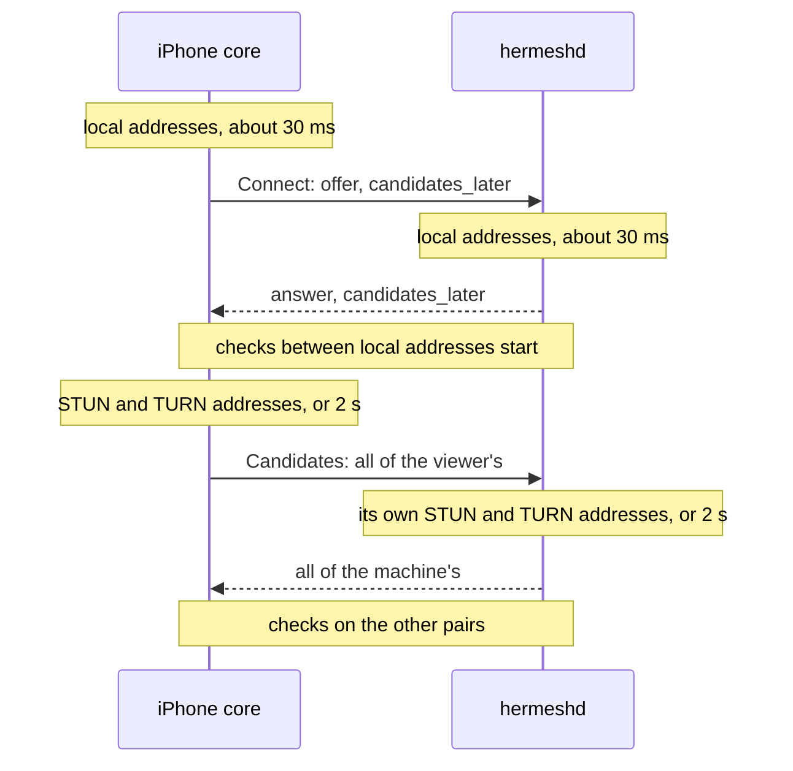

# Peer connectivity: direct paths between a device and a machine

Status: 2026-11-12. Stage 1 (§2) is built and tested on one Mac; what needs
real devices and networks is in
[peer-connectivity-tests.md](peer-connectivity-tests.md). Stages 2 and 3
(§5) are designed and not built. Remote Desktop
([computer-control.md](computer-control.md)) is the one user of a direct
path today; this document owns how that path is found, kept and reported.

## 0. Decisions

1. **Stay on standard WebRTC with pion** (WebRTC v4.2.26, ICE v4.4.8).
   What was missing was never the protocol: it was the life of a
   connection after its first handshake, and where the relay's TURN server
   is. Changing the transport fixes neither.
2. **A path on one network never waits for a server.** Each end's half of
   the handshake goes with its local addresses; the addresses that need the
   relay's STUN and TURN servers follow in a second call (§2.1).
3. **The first path is not the last.** A session that starts through the
   relay moves to a direct path once one answers, the picture going on
   (built before this round, §1).
4. **A new network means a new offer.** pion gathers addresses once per
   offer, so a device whose network changed restarts ICE at once instead of
   waiting for the old path to be declared dead (§2.2, §3).
5. **The relay stays.** No design connects every pair of networks
   directly.
6. **No shared connection package yet.** The code stays in
   `internal/screen` until a second user exists (direct RPC, §5.2); a
   package shaped by one user would be shaped wrong.
7. **What a session went through is written where its owner can read it**
   (the machine's log, the page on the iPhone). Nothing about connections is
   sent to the center, which keeps knowing presence, name and version only.

## 1. Where it stood

Before this round (`b8f8fc95`), Remote Desktop already had:

- gathering that ends at the first TURN address or after 2 s, not when
  every server has answered or given up;
- the other end's IPv6 link-local addresses ignored (they took the first
  picture from under a second to 5–12 s);
- the relay's servers kept between sessions (credentials last an hour, used
  for 40 minutes, asked for ahead of time);
- pion's renomination, checking every second, with no pair given up while
  the first path is looked for: relayed to direct within seconds of a
  direct path answering (`TestScreenTurnsDirect`);
- the path and round trip reported from the pair in use;
- `Status.Nearby`: relayed while both ends are seen at one public address,
  with a note on the page saying what to allow;
- TURN's forwarded ports in a range, and one TURN server for a center on
  several nodes.

The remaining gaps, in the order they hurt:

| Gap | Effect |
|---|---|
| Each end gathered all its candidates before its half of the handshake | Two ends on one Wi-Fi waited for the relay's servers, twice: a few round trips to the relay each, 2 s each when they do not answer |
| A network change was noticed by interface name on the iPhone, and by the path dying (5 s) in the session | One Wi-Fi to another went unnoticed; a session waited 6.5 s before it looked for a new path |
| An unknown path was reported as direct | A wrong word on the page while the pair was not yet known |
| The relay's servers failing to come was silent | No way to tell "no TURN configured" from "timed out" |
| The machine logged nothing about a session's path | A slow session could not be explained afterwards |
| One TURN node, UDP and TCP only | The relayed path is as slow as that node is far; no way through a network that allows only TLS on 443 |

## 2. Stage 1: built

### 2.1 Candidates later



- `ScreenService.Connect` carries `candidates_later`. The viewer sends its
  offer once no new local address has come for 30 ms; the machine answers
  the same way. Both then check the pairs they have.
- `ScreenService.Candidates` is one more call: the viewer sends every
  candidate it found once its gathering has ended (the rule of §1: a TURN
  address, or 2 s), the machine adds them and answers with its own once its
  gathering has ended. Two calls, no stream to keep open.
- Each exchange names the offer it belongs to by its ICE username
  fragment. The machine refuses candidates of an offer that another has
  replaced; the viewer drops an answer that comes after it sent a newer
  offer. The viewer tries the exchange three times.
- **Old and new together.** A machine says it takes candidates later in
  its state (`ScreenStatus.candidates_later`), which the device holds before
  the page opens. To a machine that does not, the viewer sends an offer with
  all its candidates, as before. An older viewer never sets the field and
  gets an answer with all of the machine's. If the state was stale and the
  machine answers without the field, the viewer waits one second for the
  local addresses to connect and then sends an offer with everything.
- pion's waits before a path is taken (0.1 s through a NAT, 1 s through
  TURN) count from the first check, and were set when both ends had every
  candidate by then. They stay: a relayed path taken before a direct one
  answered is left for the direct one by renomination.

Measured on one Mac (e2e, the page opening to the first frame):

| Case | Before | Now |
|---|---|---|
| Direct, the relay's servers answering | 0.59 s | 0.55 s |
| The relay's STUN and TURN out of reach | 4.2 s | 0.60 s |
| Both ends' servers dead, handshake to connected (`TestCandidatesLater`) | 4.1 s | 0.33 s |

On one Mac the servers answer in under a millisecond, so the first row
does not show the gain a real network has: there each end's gathering is a
few round trips to the relay, and both are now off the way.

### 2.2 A network that changes

- **On the iPhone** the system reports every change of the network's path.
  A change of interfaces connects again, as before. Any other change goes
  to the core (`PathChanged`), which compares the device's addresses
  (loopback and link-local left out) with those last seen and connects
  again when they differ: one Wi-Fi to another keeps the interface and
  changes the address.
- **A session under way** is told at once (`Device.Reconnect`): it sends an
  offer that restarts ICE from the addresses the device has now, through
  the tunnel as soon as that is back. It no longer waits for the old path
  to be declared dead. A second change during a restart is kept and done
  after it. A path that only broke still waits 1.5 s for itself first, as
  before.
- `TestScreenNetworkChange`: the picture is back on a new path 0.25 s after
  the change on one Mac (the relay and the tunnel reconnecting included).
- **The machine's network changing** is not announced. The viewer notices
  the path dying (5 s), waits 1.5 s, and restarts; the machine's answer
  then has its new addresses. A machine that gains a better network while
  the old path lives (it joins the phone's Wi-Fi) is not noticed at all.
  Telling the viewer over the data channel would cover the second case
  only, since a dead path carries nothing: left out until someone needs it.

### 2.3 Saying what the path is

- `Status.Path` is empty while the pair in use is not known, never
  "direct" by default. The status is sent the moment the pair changes, and
  every two seconds as before.
- The machine's log has, for each session: the kinds of candidates each
  end had (`screen: candidates local="host 3, srflx 1, relay 2" remote=…`)
  and each path taken with how long after the session opened
  (`screen: path local="host 192.168.1.5:50123" remote=… after=412ms`).
- Each end logs why the relay's STUN and TURN servers did not come.

## 3. What pion does and does not do

Read from the source of the versions in use; the tests of §6 hold them.

- **Connected, the controlling end (the viewer) pings every pair that has
  not failed, on every keepalive (1 s), with no budget**
  (`keepAliveCandidatesForRenomination`). A pair fails only while the first
  path is looked for, after `SetICEMaxBindingRequests` checks (100, about
  20 s). So a direct pair that did not answer at first is still tried for
  as long as the session lasts.
- **It moves** from a relayed pair to one between two local addresses
  always; to any other pair when its round trip is 10 ms shorter or its
  score 15 % better; once per renomination interval (1 s) at most. The
  controlled end follows.
- **It gathers once per offer.** `GatherCandidates` refuses to run again
  until `Restart`, and servers given later take effect at the next
  gathering only. A new local address, or the relay's servers arriving
  late, reach a connection by an ICE restart and no other way.
- **A restart forgets the pair in use** and every candidate: the picture
  stops until a pair is taken again (0.25 s on one Mac). It is the answer
  to a changed network, never a way to look for a better path on a
  healthy one.

## 4. Costs and limits known

- **Pings for the whole session.** Every pair, every second, from the
  phone. Pairs are made within one address family from each end's local,
  public and relayed addresses: tens of them on real devices, some from the
  phone's cellular interface while it is on Wi-Fi. pion has no setting to
  slow this down once connected. What it costs in packets and battery is
  not measured: test T6. If it is too much, the options are fewer
  candidates (no cellular while on Wi-Fi) or a patch upstream for an
  interval that grows.
- **A relayed start can stay relayed** when the direct pair is between
  public addresses and the relay is near enough that its round trip is
  within 10 ms. That is slower by nothing worth a move, and it uses the
  relay's bandwidth.
- **Loopback addresses** are gathered everywhere, for a viewer on the
  machine itself (the Simulator, the tests). They add pairs that never
  leave the device. Left as is.
- **The machine's side of a network change**: §2.2.

## 5. Not built

### 5.1 Stage 2: the relayed path (needs the hosted center)

- A TURN node near the owners it serves, chosen by the round trip both
  ends measure to it. Today's reports of 400 ms relayed are the one node
  being far.
- TURN over TLS on 443, for networks that allow nothing else.
- Credentials renewed for a session that restarts ICE after their hour.
- Whether the embedded pion server stays for the hosted center or coturn
  takes over there (the embedded one stays for self-hosting and the tests).

This is deployment work in the private repository, and the numbers of T5
and T7 say how much of it is worth doing.

### 5.2 Stage 3: RPC on a direct path

Calls between a device and a machine go through the relay's tunnel. On a
direct path they would not pay the detour. The shape, when it is built:

```text
Connect RPC over HTTP/2             as today
end-to-end TLS 1.3, identities      as today (pkg/transport)
a net.Conn over one data channel    new
DTLS, SCTP, ICE                     as Remote Desktop
```

- The tunnel carries the handshake (a `Connect` and `Candidates` pair like
  the screen's) and stays the fallback. New calls move to the direct
  connection once it is up; calls under way finish where they are; a call
  that is not safe to repeat is never sent again by itself.
- The code shared with Remote Desktop (gathering, candidates later,
  restarts, the path's status) moves to `internal/peerlink` when this is
  built, shaped by both users.

It waits for decisions that are the owner's, and for one measurement:

1. **Who may open a direct connection.** Its candidates show the machine's
   local, VPN and public addresses to the other end. Proposed: the owner's
   devices only at first, never the hosted MCP gateway.
2. **How many, and for how long.** Each one is a peer connection and a
   TURN allocation on the machine: a limit per principal, closing when
   idle, and what an iPhone in the background does with it.
3. **Whether it is worth its pings** (§4, T6): a second connection doubles
   them.

### 5.3 Set aside

| Option | Why not now | Looked at again when |
|---|---|---|
| Candidates one by one over a stream (full trickle) | Two lots get a path on one network first, which was the point; the rest saves one round trip | A network where the public address comes much earlier than the TURN one, and it shows in T2 |
| libwebrtc on the iPhone | pion does what §3 needs | T6 or a poor network says otherwise |
| QUIC or another transport | Changes neither NAT traversal nor where the relay is | Files or data become the main load |
| Port mapping (NAT-PMP, PCP) | Not what keeps two ends on one Wi-Fi apart | T5 shows many networks where only that would connect directly |
| ICE over TCP | Not TURN over TCP, and no answer to a symmetric NAT | Networks that block UDP are common among owners |
| Finding each other with no relay (mDNS) | The handshake needs the tunnel's trust | Someone needs it offline |

## 6. Tests

Automated, on one Mac (`go test ./internal/screen ./e2e -run 'Screen|Candidates|Gather'`):

| Test | Holds |
|---|---|
| `TestGatheringEarlyDoesNotWaitForServers` | The local addresses are in within 0.5 s whatever the servers do; the gathering still ends at 2 s |
| `TestCandidatesLater` | Both new: connected in 0.33 s with dead servers. An older viewer and an older machine still connect; no candidates are sent to a machine that takes none |
| `TestCandidatesOfAnEarlierOfferAreRefused` | An exchange for a replaced offer, or for no session, is refused |
| `TestSession` | A whole session with candidates later, a restart included |
| `TestScreen`, `TestScreenThroughTURN` | Direct, and relayed only |
| `TestScreenUnreachableTURN` | Servers out of reach: the first frame within 3 s (0.6 s measured) |
| `TestScreenTurnsDirect` | Relayed first, direct once local packets pass, the note shown meanwhile |
| `TestScreenNetworkChange` | The network changes: same session, a new path, the picture on it |
| `testComputerControl` (iPhone UI test) | The page through all of it on the Simulator |

What one Mac cannot show (two real devices, real networks, the phone's
battery) is the plan in
[peer-connectivity-tests.md](peer-connectivity-tests.md).
