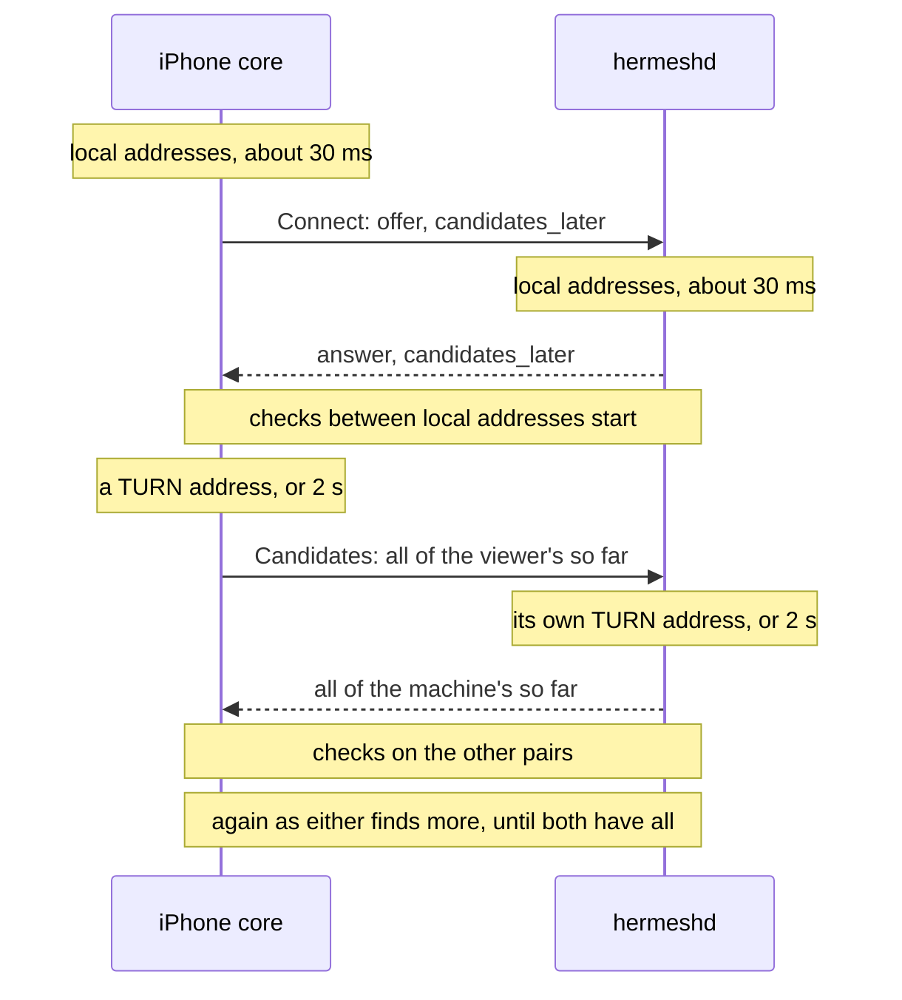

# Peer connectivity: direct paths between a device and a machine

Status: 2026-11-12. Stage 1 (§2) is built, with what the first tests on
real devices found wrong in it put right (§2.4); it is tested on one Mac,
and what needs real devices and networks is in
[peer-connectivity-tests.md](peer-connectivity-tests.md). The relayed path
(§5.1) has its code and waits for servers; RPC on a direct path (§5.2) is
designed and not built. Remote Desktop
([computer-control.md](computer-control.md)) is the one user of a direct
path today; this document owns how that path is found, kept and reported.

## 0. Decisions

1. **Stay on standard WebRTC with pion** (WebRTC v4.2.26, ICE v4.4.8,
   the latter with a small patch kept in this repository, §3). The
   protocol was never what was missing: it was the life of a connection
   after its first handshake, how the library is used, and where the
   relay's TURN server is.
2. **A path on one network never waits for a server.** Each end's half of
   the handshake goes with its local addresses; the addresses that need the
   relay's STUN and TURN servers follow as they are found (§2.1). The
   handshake itself goes through the tunnel, as before.
3. **The first path is not the last.** A session that starts through the
   relay moves to a direct path once one answers, the picture going on
   (built before this round, §1).
4. **A new network means a new offer.** pion gathers addresses once per
   offer, so a device whose network changed restarts ICE at once instead of
   waiting for the old path to be declared dead (§2.2, §3).
5. **The relay stays.** No design connects every pair of networks
   directly.
6. **No shared connection package yet.** The code stays in
   `internal/screen` until a second user exists (direct RPC, §5.2); a
   package shaped by one user would be shaped wrong.
7. **What a session went through is written where its owner can read it**
   (the machine's log, the page on the iPhone). Nothing about connections is
   sent to the center, which keeps knowing presence, name and version only.

## 1. Where it stood

Before this round (`b8f8fc95`), Remote Desktop already had:

- gathering that ends at the first TURN address or after 2 s, not when
  every server has answered or given up;
- the other end's IPv6 link-local addresses ignored (they took the first
  picture from under a second to 5–12 s);
- the relay's servers kept between sessions (credentials last an hour, used
  for 40 minutes, asked for ahead of time);
- pion's renomination, checking every second, with no pair given up while
  the first path is looked for: relayed to direct within seconds of a
  direct path answering (`TestScreenTurnsDirect`);
- the path and round trip reported from the pair in use;
- `Status.Nearby`: relayed while both ends are seen at one public address,
  with a note on the page saying what to allow;
- TURN's forwarded ports in a range, and one TURN server for a center on
  several nodes.

The remaining gaps, in the order they hurt:

| Gap | Effect |
|---|---|
| Each end gathered all its candidates before its half of the handshake | Two ends on one Wi-Fi waited for the relay's servers, twice: a few round trips to the relay each, 2 s each when they do not answer |
| A network change was noticed by interface name on the iPhone, and by the path dying (5 s) in the session | One Wi-Fi to another went unnoticed; a session waited 6.5 s before it looked for a new path |
| An unknown path was reported as direct | A wrong word on the page while the pair was not yet known |
| The relay's servers failing to come was silent | No way to tell "no TURN configured" from "timed out" |
| The machine logged nothing about a session's path | A slow session could not be explained afterwards |
| One TURN node, UDP and TCP only | The relayed path is as slow as that node is far; no way through a network that allows only TLS on 443 |

## 2. Stage 1: built

### 2.1 Candidates later



- `ScreenService.Connect` carries `candidates_later`. The viewer sends its
  offer once no new local address has come for 30 ms; the machine answers
  the same way. Both then check the pairs they have.
- `ScreenService.Candidates` follows: the viewer sends every candidate it
  has once a TURN address is among them or 2 s have passed (the rule of
  §1), the machine adds them and answers with its own once it has as much.
- **Until both have found everything.** An address can come later than
  that: a TURN server that is slow or far (its allocation is two round
  trips, three over TCP), or its second transport when the first is
  blocked. The viewer calls again whenever it has more, and while the
  machine says it has not found all of its own (`complete`); the machine
  waits up to a second for something new before it answers such a call.
  Every call carries all of an end's candidates so far, so a call that is
  lost or comes twice costs nothing, and there is no stream to keep open or
  resume. It ends when both are complete, or 15 s after the offer. A
  machine that answers once (it does not set `again`) is called again only
  when the viewer has more to give.
- Each exchange names the offer it belongs to by its ICE username
  fragment. The machine refuses candidates of an offer that another has
  replaced; the viewer drops an answer that comes after it sent a newer
  offer. Applying the viewer's whole candidate response is serialized
  with creating an offer, so a restart cannot fall between that check and
  applying the candidates. The viewer tries the exchange three times.
- **Old and new together.** A machine says it takes candidates later in
  its state (`ScreenStatus.candidates_later`), which the device holds before
  the page opens. To a machine that does not, the viewer sends an offer with
  all its candidates, as before. An older viewer never sets the field and
  gets an answer with all of the machine's. If the state was stale and the
  machine answers without the field, the viewer waits one second for the
  local addresses to connect and then sends an offer with everything,
  only when gathering found candidates missing from the first offer.
  With no new addresses it leaves the connection's handshake running.
- pion's waits before a path is taken (0.1 s through a NAT, 1 s through
  TURN) count from the first check, and were set when both ends had every
  candidate by then. They stay: a relayed path taken before a direct one
  answered is left for the direct one by renomination.
- **A lost initial answer.** Initial `Connect` attempts have a six-second
  deadline and retry transient unavailable/deadline errors up to three
  times. A timed-out signaling tunnel is forgotten before the next call.
  Each retry opens a fresh host session: an answer delivered after that
  host's ICE deadline must not strand the page. Permission errors do not
  retry. Established sessions retain the existing restart policy.

Measured on one Mac (e2e, the page opening to the first frame):

| Case | Before | Now |
|---|---|---|
| Direct, the relay's servers answering | 0.59 s | 0.55 s |
| The relay's STUN and TURN out of reach | 4.2 s | 0.60 s |
| Both ends' servers dead, handshake to connected (`TestCandidatesLater`) | 4.1 s | 0.33 s |

On one Mac the servers answer in under a millisecond, so the first row
does not show the gain a real network has: there each end's gathering is a
few round trips to the relay, and both are now off the way.

### 2.2 A network that changes

- **On the iPhone** the system reports every change of the network's path.
  A change of interfaces connects again, as before. Any other change goes
  to the core (`PathChanged`), which compares the device's addresses
  (loopback and link-local left out) with those last seen and connects
  again when they differ: one Wi-Fi to another keeps the interface and
  changes the address.
- **A session under way** is told at once (`Device.Reconnect`): it sends an
  offer that restarts ICE from the addresses the device has now, through
  the tunnel as soon as that is back. It no longer waits for the old path
  to be declared dead. A second change during a restart is kept and done
  after it. A path that only broke still waits 1.5 s for itself first, as
  before.
- `TestScreenNetworkChange`: the picture is back on a new path 0.25 s after
  the change on one Mac (the relay and the tunnel reconnecting included).
- **The addresses of the moment.** pion's own network object reads the
  interfaces once, when a connection is made, and a restart gathered from
  that old list: a device that had moved offered the addresses it had
  left. Hermesh gives pion a network object that reads them at every
  gathering (`systemNet`).
- **The servers of the moment.** An offer that restarts ICE first takes
  the relay's servers as they are then, on both ends: the credentials a
  session began with last an hour, and on another network another server
  may be the near one (§5.1).
- **The machine's network changing** is not announced. The viewer notices
  the path dying (5 s), waits 1.5 s, and restarts; the machine's answer
  then has its new addresses. A machine that gains a better network while
  the old path lives (it joins the phone's Wi-Fi) is not noticed at all.
  Telling the viewer over the data channel would cover the second case
  only, since a dead path carries nothing: left out until someone needs it.

### 2.3 Saying what the path is

- `Status.Path` is empty while the pair in use is not known, never
  "direct" by default. The status is sent the moment the pair changes, and
  every two seconds as before.
- `Status.Nearby` (relayed though a direct path should exist) is true
  when the other end has an address on one of this device's networks, or
  both ends are seen at one public address. The second alone fails behind
  a proxy app, which shows the STUN server its own exit.
- The machine's log has, for each session: the candidates each end had,
  by kind and by address (`screen: candidates local="host 3, srflx 1,
  relay 2" … local_addresses=…`), each path taken with how long after the
  session opened (`screen: path local="host 192.168.1.5:50123" remote=…
  after=412ms`), the connection's states, the first encoded frame, when
  input was ready, and for a session slow to connect how the checks
  between addresses on one network went (`screen: nearby check …
  requests_sent=31 responses_received=0`). No description, password or
  picture is written.
- Each end logs why the relay's STUN and TURN servers did not come, and
  the device how long each call of the handshake took.

### 2.4 What real devices found

The first sessions between a real iPhone and a Mac, both running a proxy
app, on a phone's hotspot and on an office Wi-Fi, with the relay on
another continent (0.3 s away), were slow to connect or did not connect.
What was wrong, in the order it mattered:

| Found | Why | Now |
|---|---|---|
| A path on one network took 8 to 16 s, or the session failed | The TURN client asks its server for a permission inside each first write to an address, and waits. pion made that write on the one thread that also runs every other check: with a dozen local addresses on the other end and a server 0.3 s away, the checks between local addresses starved. The relay refuses private addresses, so each wait ended in a refusal and was asked again at the next check | Writes from a relayed address leave that thread, and none goes to a private address from a server on the internet (the patch, §3): 106 permissions asked in 3.5 s became 2 |
| Checks between the two ends' local addresses got no answer with the proxy app on | A socket bound to an address is still routed by the system's table, where the proxy's interface comes first | On Apple systems each local address's socket is bound to its interface (`IP_BOUND_IF`). The sockets for STUN and TURN keep the system's routing: they reach the relay the way everything else does |
| A device that changed network offered its old addresses | pion read the interfaces once | §2.2 |
| An answer that came after the machine had given up (20 s once, through the proxy) left the page waiting | The first `Connect` had no limit | It has 6 s, three times, each on a new tunnel and a new session on the machine; a refusal is not tried again |
| A candidate answer could be applied after a restart had begun | The check and the applying were not one step | They are, under the lock an offer takes |
| A TURN address that came after 2 s was never told to the other end | The exchange was one call | §2.1 |
| A relayed session lost its path 20 to 60 minutes in | The TURN server checks the credential again at every refresh, and it lasts an hour from when it was handed out, which can be 40 minutes before the session | The relay lets a credential keep the session it began (`turnAuth`); a restart takes fresh ones (§2.2) |
| The app's Go core could be an older build than its Swift | The Xcode script that builds it declared no output | It is a target of its own that the app depends on |

On the hotspot, with both proxy apps on, the first path is then one
between local addresses in 0.5 to 0.8 s. On the office Wi-Fi the two
ends' checks to each other get no answer by IPv4 or IPv6, the Mac's
neighbour table has no entry for the phone and a stand-in for its
hardware address: that network keeps its devices apart, and nothing on
the devices makes a direct path there. It needs the relay, and so a relay
that is near (§5.1).

## 3. What pion does and does not do

Read from the source of the versions in use; the tests of §6 hold them.

- **Connected, the controlling end (the viewer) pings every pair that has
  not failed, on every keepalive (1 s), with no budget**
  (`keepAliveCandidatesForRenomination`). A pair fails only while the first
  path is looked for, after `SetICEMaxBindingRequests` checks (100, about
  20 s). So a direct pair that did not answer at first is still tried for
  as long as the session lasts.
- **It moves** from a relayed pair to one between two local addresses
  always; to any other pair when its round trip is 10 ms shorter or its
  score 15 % better; once per renomination interval (1 s) at most. The
  controlled end follows.
- **It gathers once per offer.** `GatherCandidates` refuses to run again
  until `Restart`, and servers given later take effect at the next
  gathering only. A new local address, or new servers, reach a connection
  by an ICE restart and no other way. A candidate that the gathering under
  way finds late is another matter: pion takes it whenever it is given.
- **Its network object reads the interfaces once** (`stdnet.Net`), and a
  restart does not read them again: §2.2.
- **A relayed address's writes wait for the TURN server.** The TURN client
  makes the permission for an address inside the first write to it, and
  again inside every write while the server refuses. pion writes its
  checks on the thread that runs the whole agent. The copy of pion's ICE
  in [third_party/pion-ice](../third_party/pion-ice/HERMESH.md) differs
  from v4.4.8 in two things, both in how a check is sent from a relayed
  address: it is written off that thread, one at a time for each pair and
  kind of message; and it is not written at all to a private address from
  a server on the internet, which forwards to none. Media, the checks from
  other addresses, and what the server allows are as upstream. The first
  belongs upstream; the copy goes when a release has it.
- **A restart forgets the pair in use** and every candidate: the picture
  stops until a pair is taken again (0.25 s on one Mac). It is the answer
  to a changed network, never a way to look for a better path on a
  healthy one.

## 4. Costs and limits known

- **Pings for the whole session.** Every pair, every second, from the
  phone. Pairs are made within one address family from each end's local,
  public and relayed addresses. pion has no setting to slow this down once
  connected. Measured once at the Mac, on a hotspot, a minute into a
  session: 21.6 STUN packets a second over 12 pairs, under T6's 50. The
  phone's battery and its cellular interface are not measured yet. If it
  is too much, the options are fewer candidates (no cellular while on
  Wi-Fi) or an interval that grows, in the patch.
- **Behind a proxy app, no direct path across the internet.** The STUN
  server sees the proxy's exit, not the device's router, so the address it
  reports opens nothing. Two such ends on different networks are relayed.
- **A relayed start can stay relayed** when the direct pair is between
  public addresses and the relay is near enough that its round trip is
  within 10 ms. That is slower by nothing worth a move, and it uses the
  relay's bandwidth.
- **Loopback addresses** are gathered everywhere, for a viewer on the
  machine itself (the Simulator, the tests). They add pairs that never
  leave the device. Left as is.
- **The machine's side of a network change**: §2.2.

## 5. Not built

### 5.1 Stage 2: the relayed path (needs servers)

Where no direct path exists (a network that keeps its devices apart, a
carrier's NAT, two ends behind proxy apps), the session is as good as the
relay is near. One TURN server on another continent is 0.3 s away from
some owners; the handshake goes through the same far center.

The code for it is in place:

- **Several TURN servers.** `TURNConfig.Others` names the center's other
  TURN servers by their URLs (`turn:` over UDP and TCP, `turns:` for TLS on
  443). The relay hands them out after its own, with the same credential:
  they share its secret, so they can be another `hermesh-relay` or coturn
  with that secret as its `static-auth-secret`.
- **Each end uses the nearest.** When a device or machine is given several,
  it asks each for a relayed address over UDP, with the credential, and
  keeps the one that gives it soonest (`screen.Servers`, measured when the
  servers are asked for, which is ahead of a session and again after a
  network change). The measure is what a session needs of a server, so one
  that answers and cannot relay (it is down, or has another secret) is
  never the one kept. The two ends may keep different servers: each relays
  through its own, and the servers pass the packets between them. Where
  none gives an address over UDP all are kept, and the checks find the one
  that works, TLS on 443 among them; a server's every transport is one
  entry, so the one kept brings them all.
- **A server that goes.** A session whose TURN servers gave it no relayed
  address within 5 s doubts them (`Servers.Doubt`): they are asked for and
  measured again at once, and the next offer, which a session without a
  path sends every few seconds, goes with the server that then answers.
- **Credentials** keep the session they began, and a restart takes new
  ones (§2.4).

What is left is not code in this repository: the servers themselves (where,
and who pays), the certificate for TLS on 443, the center's configuration
naming them, and whether the center itself can be reached from where its
owners are without a proxy. T7 and T14 measure the result.

### 5.2 Stage 3: RPC on a direct path

Calls between a device and a machine go through the relay's tunnel. On a
direct path they would not pay the detour. The shape, when it is built:

```text
Connect RPC over HTTP/2             as today
end-to-end TLS 1.3, identities      as today (pkg/transport)
a net.Conn over one data channel    new
DTLS, SCTP, ICE                     as Remote Desktop
```

- The tunnel carries the handshake (a `Connect` and `Candidates` pair like
  the screen's) and stays the fallback. New calls move to the direct
  connection once it is up; calls under way finish where they are; a call
  that is not safe to repeat is never sent again by itself.
- The code shared with Remote Desktop (gathering, the candidate exchange,
  restarts, the path's status) moves to `internal/peerlink` when this is
  built, shaped by both users. Tracks, codecs, the helper and input stay
  in `internal/screen`.

It waits for decisions that are the owner's, and for one measurement:

1. **Who may open a direct connection.** Its candidates show the machine's
   local, VPN and public addresses to the other end. Proposed: the owner's
   devices only at first, never the hosted MCP gateway.
2. **How many, and for how long.** Each one is a peer connection and a
   TURN allocation on the machine: a limit per principal, closing when
   idle, and what an iPhone in the background does with it.
3. **Whether it is worth its pings** (§4, T6): a second connection doubles
   them.

### 5.3 Set aside

| Option | Why not now | Looked at again when |
|---|---|---|
| Candidates one by one over a stream (full trickle) | The call that repeats until both ends have everything (§2.1) leaves no candidate out, with nothing to keep open, order or resume | An address that must reach the other end sooner than the next call, and it shows in T12 |
| libwebrtc on the iPhone | pion does what §3 needs | T6 or a poor network says otherwise |
| QUIC or another transport | Changes neither NAT traversal nor where the relay is | Files or data become the main load |
| Port mapping (NAT-PMP, PCP) | Not what keeps two ends on one Wi-Fi apart | T5 shows many networks where only that would connect directly |
| ICE over TCP (a direct path over TCP, not TURN over TCP) | One end must be reachable by a TCP connection: across NATs neither is, and pion has no simultaneous open. A network that keeps its devices apart blocks TCP between them too; one that does not passes UDP. pion dials it with its own dialer, past the interface binding of §2.4, so a proxy app would take it. And it is a listening port on the owner's computer | T13: a real network where a TCP connection between the two ends is made and UDP is not |
| Finding each other with no relay (mDNS) | The handshake needs the tunnel's trust | Someone needs it offline |

## 6. Tests

Automated, on one Mac (`go test ./internal/screen ./pkg/relay ./e2e -run 'Screen|Candidates|Gather|TURN|Network|Session'`):

| Test | Holds |
|---|---|
| `TestGatheringEarlyDoesNotWaitForServers` | The local addresses are in within 0.5 s whatever the servers do; the gathering still ends at 2 s |
| `TestCandidatesLater` | Both new: connected in 0.33 s with dead servers. An older viewer and an older machine still connect; no candidates are sent to a machine that takes none; the machine's log has the session's lines |
| `TestLateTURNAddressIsExchanged` | A TURN address that comes after the first exchange reaches the other end, in three calls; a machine that answers once is called twice |
| `TestCandidatesOfAnEarlierOfferAreRefused`, `TestCandidatesWaitForOffer`, `TestLateCandidateResponseAfterRestart` | An exchange for a replaced offer is refused, waits for an offer under way, and is dropped after it; the picture goes on |
| `TestLateCandidatesNeedAnOfferOnlyWhenNew` | An older machine gets a second offer only for candidates the first lacked |
| `TestSessionRecoversLostInitialAnswer`, `TestInitialSignalRetriesOnlyTransientErrors`, `TestInitialSignalHasLimitedAttempts` | A first answer that is lost is asked for again, three times at most, and a refusal is not |
| `TestNetworkRefreshesInterfacesOnRestart` | A restart gathers from the interfaces of the moment |
| `TestRestartTakesTheServersOfTheMoment` | A restart takes the relay's servers as they are then, on both ends |
| `TestHostUDPUsesItsInterface` | On Apple systems a local address's socket is bound to its interface |
| `TestSlowTURNDoesNotBlockDirectChecks`, `TestRelaySTUNDoesNotBlockOrQueueDuplicateChecks` | A slow TURN server's permissions do not hold up a direct path (the patch) |
| `TestPublicTURNIsNotAskedForPrivatePeers`, `TestRelaySTUNSkipsPrivatePeersOfAPublicServer` | A TURN server on the internet is asked for no permission to a private address: 2 asked in 3.5 s, where it was 106 |
| `TestNearestTURNServer` | Of several TURN servers the one that gives a relayed address soonest is kept, never one that refuses the credential; all, when none gives one |
| `TestServersDoubted`, `TestGatheringDoubtsServersThatGiveNoRelay` | Servers that gave a session no relayed address are asked for and measured again, and another is kept |
| `TestOnNetworks` | Nearby is told by the other end's address on one of this device's networks |
| `TestTURNCredentialOutlivedByItsSession` | A credential past its time keeps its session and begins none; other TURN servers are handed out with the relay's credential |
| `TestSession` | A whole session with candidates later, a restart included |
| `TestScreen`, `TestScreenThroughTURN` | Direct, and relayed only |
| `TestScreenUnreachableTURN` | Servers out of reach: the first frame within 3 s (0.6 s measured) |
| `TestScreenTurnsDirect` | Relayed first, direct once local packets pass, the note shown meanwhile |
| `TestScreenNetworkChange` | The network changes: same session, a new path, the picture on it |
| `testComputerControl` (iPhone UI test) | The page through all of it on the Simulator |

What one Mac cannot show (two real devices, real networks, the phone's
battery) is the plan in
[peer-connectivity-tests.md](peer-connectivity-tests.md).
