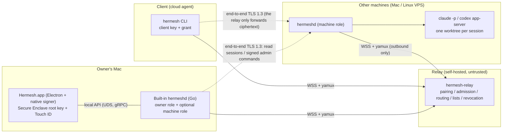
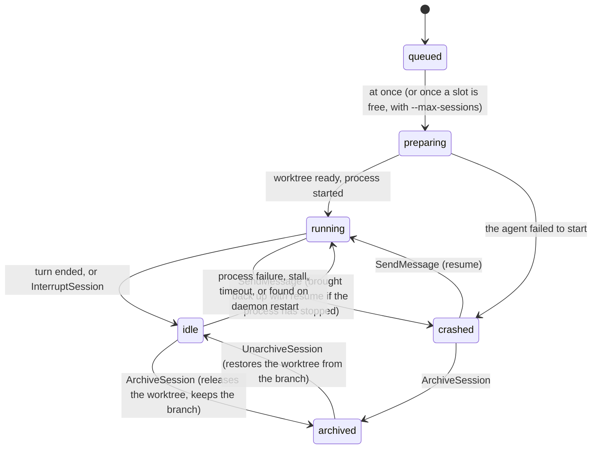

# Hermesh Technical Design (Final)

> Version: v2.2 (2026-10-16)
> Status: P1 (personal edition MVP) finalized; P2 is a directional plan
> Changes from v2.0:
> - Coding agents run with **full access** by default; the owner can change this per client;
> - Task is renamed to **Session**;
> - Clients and machines both join with a **pairing code**;
> - P1 drops the approval flow.
>
> v2.2 additions (from an external review):
> - The "trust model" and "the relay is untrusted" are written down as two inviolable principles (section 2.2);
> - The install script is now fetched from GitHub Releases; the relay no longer serves any executable content;
> - RootCert supports a set of root keys, leaving room for a second owner device later;
> - The P2 MCP design no longer relies on the relay vouching for anything.

---

## 0. Reading Guide and Terminology

- Sections 1–14: the complete P1 design.
- Section 15: later phases.
- Section 16: summary of settled decisions.
- Appendices: measured records of key facts, and sources.

| Term | Meaning |
|---|---|
| **Owner** | The user, who owns all machines and grants |
| **Hermesh.app** | The macOS desktop app: **the owner's console**, and the manager of the background service. The owner's root key lives in its Secure Enclave; every authorization-type operation is confirmed here with Touch ID |
| **Relay** | `hermesh-relay`, self-hosted by the user. It **only coordinates and forwards**: pairing, the machine list, online status, tunnel routing, revocation distribution. It is **untrusted**: it cannot forge a grant and cannot see content |
| **Machine** | A machine running the `hermeshd` background service (a Mac mini, a MacBook and a Linux VPS are fully equal). It is what actually runs Claude Code or Codex |
| **Client** | The party that starts work with the `hermesh` CLI, usually a cloud agent such as Grok Bot |
| **agent (coding agent)** | The Claude Code, Codex or ACP agent doing the work on a machine; the "agent" in `--agent claude` refers to it |
| **Grant** | The authorization the owner issues to a client: which machines and projects it may use, which coding agents it may use, and the validity period |
| **Session** | One coding agent session: Claude Code, Codex or an ACP agent running on one project of one machine, possibly over several rounds of conversation; depending on the project setting it runs in its own git worktree or directly in the project directory (in place). Corresponds to a Claude session or a Codex thread |
| **Turn** | One round of "user message → agent works → done" within a session |
| **Pairing code** | The 12-character code shown in the terminal of a new client or machine that joins without the owner's connection address; the owner enters it in the app to complete pairing. With the connection address the request reaches the owner's devices by itself, and the terminal shows only the verification code |
| **Connection address** | For example `relay.example.com/o_7k3m9x2q`: the relay address plus the owner fingerprint. It never changes and is not a secret |

---

## 1. Product Positioning and Scope

### 1.1 Positioning

**Personal edition**: one person safely connects a handful of their own machines (Mac mini, MacBook, VPS) to their own cloud agents (clients), so those agents can call Claude Code and Codex.

**Scale assumptions**:
- ≤ 10 machines;
- ≤ 10 clients;
- ≤ a few dozen sessions running at the same time;
- one relay belongs to exactly one owner.

### 1.2 P1 Goals

1. **A cloud agent drives Claude Code and Codex on any of the user's machines through the `hermesh` CLI**: start sessions, watch streaming progress, append messages, cancel, fetch the diff, and summarize progress across machines.
2. **The owner does all management in the Mac app, with no command line needed**:
   - first-run setup;
   - pairing machines and clients;
   - choosing permissions for each client;
   - managing projects;
   - pausing or starting the service on a machine;
   - revoking;
   - viewing sessions.
3. **Joining takes only two steps**: run one fixed command on the new machine or client, and a pairing code appears in the terminal; enter the pairing code in the app. No machine opens an inbound port.
4. **Security baseline**:
   - even if the relay is compromised, it **cannot forge commands or grants, and cannot read content**;
   - each client's permissions are decided by the owner and can be changed or revoked at any time;
   - Hermesh itself never carries any credentials;
   - the audit log is tamper-evident.

### 1.3 Out of Scope for P1

- Approval flow (P2);
- MCP endpoint;
- iPhone app;
- Automatic updates (P1 upgrades manually, but release packages are signed);
- A web UI for the relay (the Mac app is the UI);
- Teams and multi-tenancy;
- Large-scale deployment;
- Agents or capabilities other than Claude Code and Codex.

### 1.4 P1 Acceptance Scenarios (all need end-to-end verification, built as closely as possible from real user actions)

| # | Scenario | Pass criteria |
|---|---|---|
| A1 | A new user follows the README: deploy the relay with one `docker run` → install the app → first-run setup → check "这台 Mac 也作为执行机器" (Also use this Mac as a machine) | Done within 10 minutes |
| A2 | Run the install command on a Linux VPS and on another Mac, and enter the pairing codes from their terminals into the app | Both machines appear in the app and show as online; `hermeshd doctor` points out problems such as Claude/Codex not being logged in |
| A3 | Grok Bot runs `hermesh auth login <connection-address>`, and the owner enters the pairing code in the app; this client opens a Claude session on a project on the Mac mini | Streaming events are visible; the diff is fetched at the end; the user's own working directory is untouched |
| A4 | Same as A3, but a Codex session on the VPS | Same as above |
| A5 | Append a message to an idle session to start a second turn; interrupt while running and the session is kept; `hermesh session list` and the app's Sessions page both summarize progress across all machines | The second turn carries the context; after cancel, the whole process group exits; offline machines are clearly marked unreachable |
| A6 | Narrow the client's grant to Codex only, then open a session with Claude | Opening the session is refused; after the grant changes, it takes effect from the next session, and old grant versions are rejected |
| A7 | **Malicious relay test suite** (every row of section 3.8) | All fail; the machine's audit has records of the rejections; packet capture confirms the relay side only sees ciphertext |
| A8 | Revoke a client | The relay disconnects it immediately; the app notifies every online machine over the end-to-end channel and shows each machine's acknowledgement |
| A9 | Resilience: the daemon is killed with kill -9, the relay restarts, the app quits and reopens, `hermesh login` is interrupted while waiting for pairing and then rerun | Sessions are not interrupted, or are marked crashed and can be resumed; `--wait` resumes reading by seq without losing events; rerunning login shows the same pairing code |
| A10 | Trusted devices: a second Mac joins, approved on the first; the first is lost and removed from the second | All machines accept the new chain and reject the removed key; grants and machine certificates it signed are reissued automatically; agents need to do nothing; the removed Mac learns it was removed |

---

## 2. Overall Architecture



### 2.1 Four Components

| Component | Runs on | Responsibilities |
|---|---|---|
| `Hermesh.app` | The owner's Mac | UI; manages the local background service (start, stop, status); the owner root key (Secure Enclave); signing confirmation ("sign what you see") |
| `hermeshd` | Every machine; the app also embeds a copy | **Machine role**: identity, sessions, provider adapters, worktrees, audit. **Owner role** (only inside the app): connects to the relay, handles pairing, reads each machine's sessions over the end-to-end channel, sends admin commands |
| `hermesh-relay` | The user's own VPS (Docker) | Pairing matchmaking, admission, online status, machine and client lists, tunnel routing, revocation distribution |
| `hermesh` | The machine where the client runs | Client-facing CLI with machine-readable output |

### 2.2 Three Protocol Layers

| Layer | Contents | Who can see it |
|---|---|---|
| L0 outer transport | WSS (TLS to the relay) + yamux; every stream starts with a `StreamHeader` | The relay |
| L1 end-to-end channel | Inside the stream the relay has spliced together, the two ends run **TLS 1.3 mutual authentication** directly; the certificates embed credentials issued by the owner | Only the two ends |
| L2 RPC | HTTP/2 + Connect (protobuf) | Only the two ends |

**Two inviolable principles** (no phase and no feature may break them; changing them later means a full migration and re-pairing every device):

1. **The trust model and key hierarchy are fixed**:
   - the root chain of trusted devices (the first device names the owner; each later version is signed by a device of the one before, [trusted-devices.md](trusted-devices.md)) → root keys → device certificates, machine certificates, grants, admin commands;
   - a machine only accepts credentials that trace back to an owner signature;
   - the only exceptions: operations that "only reduce permissions", such as revocation and lowering permissions, can be carried out directly by the relay or with the device key, because at worst they cause a denial of service; and a machine's settings (its projects, pausing), which a trusted device sends with its device key: they grant nothing, since a grant is full trust on its machines and projects only tell agents what to use.
2. **The relay is untrusted**:
   - the relay holds **no authority that could make a machine execute anything**: it issues no credentials, vouches for no request, and **serves no code that gets executed** (install scripts and binaries all come from GitHub Releases);
   - it **stores no plaintext secrets**: everything it stores is public signed objects and metadata;
   - it **cannot see session content**: it only handles L0, and authorization decisions are made only on the machine.

Both principles are part of the malicious relay test suite (A7) and are verified on every CI run.

One opt-in exception (2026-10-21): a relay server may run the **MCP gateway** (docs/mcp-gateway.md), which holds the client keys of the MCP connections its owners approved with Touch ID, so that remote agent products can use Hermesh. Within such a connection's grant the server can act as it and see the sessions it reaches; it gains nothing over any other client or machine, cannot widen a grant, and cannot create a connection that reaches a machine without the owner's Touch ID. People who don't accept that run their own relay.

### 2.3 The Complete User Journey

1. Run one `docker run …` on a VPS to start the relay; the log prints a **claim code**.
2. Install Hermesh.app and go through first-run setup:
   1. fill in the relay address and the claim code;
   2. press Touch ID to generate the owner key; this Mac becomes the first trusted device;
   3. check "这台 Mac 也作为执行机器" (Also use this Mac as a machine).
   Another Mac joins later with "加入已有的主人" (Join an Existing Owner), approved on this one.
3. **Add a machine**: the app shows a one-line install command; copy it to the Mac mini or VPS and run it. The terminal shows a pairing code; go back to the app, enter it, and press Touch ID.
4. **Add a project**: choose the machine and the path, and press Touch ID.
5. **Add a client**: give the connection address from the app to Grok Bot and have it run `hermesh auth login <connection-address>`. It shows a pairing code; you enter it in the app, confirm the permissions (full access by default) and scope, and press Touch ID.
6. From then on the client opens sessions, appends messages and fetches diffs by itself; in the app you can see the progress of all sessions, and you can change the client's permissions or revoke it at any time.

---

## 3. Identity and Trust Model

### 3.1 Key System (ECDSA P-256 throughout)

```
Root chain: RootCert v1 (the first device's root key, which names the owner) → v2 → …
  each version lists the trusted devices' root keys (Secure Enclave in the app; Touch ID on every use)
  and is signed by a key of the version before ([trusted-devices.md](trusted-devices.md))
    each root key ├─issues→ OwnerDeviceCert: its device's device key (Keychain, everyday use, no Touch ID)
                  └─issues→ MachineCert, Grant, AdminCommand
Machine keys (one per machine)    Client keys (one per client)
```

| Key | Stored in | Purpose | Impact if leaked |
|---|---|---|---|
| **Root key** (one per trusted device) | The app's Secure Enclave, access control `userPresence`, not exportable | Issues every object that "adds permissions", and the next RootCert when a device joins or is removed. The first device's key is the trust anchor: `owner_id = "o_" + fp(its public key)[:24]` | If a Mac is stolen, the attacker still has to pass Touch ID or the password; another trusted device removes it |
| **Device key** | Keychain software key; the app and the built-in hermeshd share an access group | Connects to the relay as the owner; over the end-to-end channel it **reads** sessions, cancels sessions and pushes revocations | Can only read, cancel and revoke; cannot add any permission |
| **Machine key** | macOS: Keychain; Linux: `~/.local/share/hermesh/keys/machine.key` (0600) | Machine identity; TLS server key for L1; relay admission | Affects only this one machine; can be revoked |
| **Client key** | `~/.config/hermesh/client.key` (0600) on the client's machine | Client identity; TLS client key for L1; relay admission | Valid only within the grant's scope; revocable; has an expiry |
| Relay TLS certificate | The relay (ACME) | Used only for the outer TLS | **Plays no part in any authorization** |

**ID rules**:
- `fp = lowercase base32(SHA-256(SubjectPublicKeyInfo DER))`;
- `machine_id = "m_" + fp[:24]`, `client_id = "c_" + fp[:24]`;
- the short fingerprint for humans to compare is `fp[:8]`.

### 3.2 Signed Envelope

Every credential is a protobuf message wrapped in an outer signature. The signature covers the **raw serialized bytes**, and the body is parsed only after the signature verifies.

```proto
message Signed {
  string type = 1;            // e.g. "hermesh.identity.v1.Grant"; also used for domain separation of the signature
  bytes  body = 2;
  string signer_key_id = 3;
  SignatureAlgorithm alg = 4; // P1: ECDSA_P256_SHA256 (signatures produced by the Secure Enclave have the same format)
  bytes  signature = 5;       // signature over "hermesh-sig-v1\0" || type || "\0" || body
}
```

### 3.3 Credential Objects

| Object | Signer | Key fields |
|---|---|---|
| `RootCert` | v1: the first device's root key; later: a root key of the version before | `root_keys` (the trusted devices' root public keys, each with a label and platform), `version` (each one more than the last), issued_at; verifiers keep the whole `RootChain` |
| `OwnerDeviceCert` | Root key | device_public_key, device_label |
| `PairingRequest` | The applicant's own key (self-signed, proving possession of the private key) | kind (MACHINE / CLIENT), subject_public_key, label (the name the agent reports for itself, or the hostname), platform, created_at |
| `MachineCert` | Root key | machine_id, machine_public_key, issued_at, device_key_id (a trusted device's own machine). Its name is not in it: the name is a setting the machine presents itself (below) |
| `Grant` | Root key | grant_id, `version`, client_public_key, client_label, `machine_ids`, `project_ids`, `agents` (claude / codex), `task_visibility`, `max_concurrent_sessions`, not_before, expires_at |
| `AdminCommand` | Root key, or none for settings | command_id, target_machine_id, expires_at (5 minutes), command body (add or remove a project, pause or resume, set the name, set a coding agent's defaults: all settings, sent unsigned by a trusted device) |

**Validation rules**:
- Only the **RootCert with the highest version** counts. Objects issued by any of its root keys are valid; everything issued by a root key removed from the list becomes invalid immediately.
- For a given `grant_id`, a machine only accepts the **highest version** it has seen. Lowering permissions bumps the version and is pushed to the machines proactively (see F6), which invalidates the older, more permissive versions.

**Grant scope**:
- An empty `project_ids` allows no projects; allowing everything is written as `"*"`; the same goes for `machine_ids`. When the app adds a client, "all machines, all projects" is checked by default.
- `task_visibility`:
  - `OWN` (default): can see only the sessions it created;
  - `ALL`: can view all sessions within scope, read-only;
  - in both cases it can only operate on sessions it created.

**Machine names**:
- Rule: lowercase letters, digits and `-`, length 1–63, unique per owner.
- Defaults to the hostname in the pairing request; can be changed in the app.
- Written into the MachineCert signed by the owner, so **the relay cannot change it**.
- Machine names are metadata the relay can see. If a hostname contains a real name, the app suggests renaming it.

### 3.4 A Grant Means Full Trust

Hermesh does not build its own permission controls (since 2026-10-18; the earlier four presets "full access / sandbox / read-only" have been removed). A grant only limits **who** can open sessions, on **which machines and which projects**, with **which coding agents**, and for **how long**; inside a session the coding agent runs with full access and behaves the same as if you ran it yourself on that machine:

| Claude Code | Codex | ACP agent |
|---|---|---|
| `--dangerously-skip-permissions`, loading the user's usual configuration | `sandbox: danger-full-access`, `approvalPolicy: never` | Always choose `allow_once` for permission requests |

- A separate worktree (or in-place directory) per session, an audit record for every tool call, end-to-end encryption and signed grants all stay as before.
- Each coding agent's own permission mode (Claude's `--permission-mode`, Codex's sandbox, ACP's session mode) can later be passed through as is, without Hermesh mapping between them; this is not done yet.

### 3.5 Pairing (one mechanism shared by clients and machines)

**How the pairing code is computed**:

```
code = CrockfordBase32( SHA-256("hermesh-pair-v1\0" || kind || applicant public key SPKI) )[:12]
shown as XXXX-XXXX-XXXX (about 60 bits)
```

The pairing code **is computed from the applicant's public key**, so:
- if the relay swaps the public key in the request for its own, the pairing code the app recomputes will not match;
- making a fake public key with the same pairing code within the 10-minute validity window would take about 2^60 key generations, which is computationally infeasible.

**Connection address**: `relay.example.com/o_7k3m9x2q`. It contains the owner fingerprint, so clients and machines learn "who the owner is" **from the address you gave them**, not from the relay. Otherwise a compromised relay could make them connect to an impostor owner.

```mermaid
sequenceDiagram
  autonumber
  participant S as Applicant (client CLI / new machine)
  participant R as Relay
  participant A as App (owner)
  S->>S: Generate a key; record the owner_id from the connection address as the trust anchor
  S->>R: POST /v1/pairing (PairingRequest, self-signed)
  R-->>S: Registered (valid for 10 minutes)
  S->>S: Terminal shows: enter pairing code K7QM-2XPA-9RTD in the Hermesh app, then wait
  A->>R: User enters the pairing code → lookup
  R-->>A: Return the PairingRequest
  A->>A: Verify the signature, recompute the pairing code from the public key and compare with the input → show name, platform, hostname<br/>User confirms the machine name, or chooses the scope for the agent → Touch ID
  A->>R: Signed MachineCert / Grant (with RootCert)
  R-->>S: Deliver the credential
  S->>S: Verify the credential chain against the trust anchor → done
```

- **Client**: run `hermesh auth login relay.example.com/o_7k3m9x2q [--name grok]`. The pairing state is saved locally, so if the command is cut off by a timeout, rerunning it shows **the same pairing code** and keeps waiting.
- **Machine**: run `curl -fsSL https://github.com/<org>/hermesh/releases/latest/download/install.sh | sh -s -- relay.example.com/o_7k3m9x2q`. The argument is the connection address. After installation it starts pairing automatically and shows the pairing code. To show it again, run `hermeshd pair`.
- **The owner's own Mac**: needs no pairing; check "这台 Mac 也作为执行机器" (Also use this Mac as a machine) in the app, and the root key issues its MachineCert directly.
- **Anti-harassment**: the pairing endpoint is public. The relay rate-limits it by IP and caps the number of pending requests (20 by default). Next to the input field the app shows the hint "只输入你刚刚让 agent 或机器显示的配对码" (Only enter a pairing code you just had an agent or machine display).

### 3.6 Other Flows

**F1 Deploy the relay**

```bash
docker run -d --name hermesh-relay -p 443:443 -v hermesh-relay:/data ghcr.io/<org>/hermesh-relay:<version> --domain relay.example.com
```

The relay obtains its certificate automatically through ACME. On first start it prints a claim code, and until it is claimed it only accepts the claim request.

**F2 First-run setup (app)**
1. The user fills in the relay address and the claim code.
2. The app generates the root key in the Secure Enclave; one Touch ID signs RootCert v1 (listing only it, which names the owner) and the OwnerDeviceCert.
3. The claim is submitted to the relay with the chain. If the claim fails, the app reports a clear error.
4. Optional: make this Mac a machine.

**F5 Renewal**: 7 days before a grant expires, the app sends a reminder. The user renews with one click (batches are possible) and one Touch ID. The CLI fetches the new grant automatically on its next connection.

**F6 Change permissions / revoke**

1. The relay acts immediately: on revocation, it stops routing for this client and kicks its connections; on lowering permissions, it only hands the client the new grant version. This step needs no signature, because it only reduces permissions.
2. Using the device key over the end-to-end channel, the app **pushes the "revocation" or the "minimum grant version" directly to every online machine**; the machines apply it immediately and reply with an acknowledgement. The app shows each machine's result.
3. Offline machines catch up from the relay and the app the next time they come online.

If the relay withholds these messages, it will be noticed: it cannot drop just this push while keeping the tunnel working normally. The worst case is bounded by the grant's validity period.

A revoked client leaves the owner's list: the relay forgets its grant, and the revocation list (kept apart, never pruned, also held by every machine) is what keeps refusing it. Removing a machine revokes the clients whose grant names only removed machines, and lists the others without the removed machine; a removed machine's id never comes back, and the next signed version of the grant leaves it out.

**F7 Manage machines**: add or remove projects, pause or resume accepting new sessions, rename, set a coding agent's defaults. The app builds an AdminCommand and sends it to the machine over the end-to-end channel, authenticated as one of the owner's trusted devices:
- projects, pausing, the name and agent defaults are settings, not permissions (a grant is already full trust on the machine; projects and the name tell agents what to use), so they go unsigned, without Touch ID; the machine accepts them only from a trusted device, never from an agent or the relay.

**Agent defaults**: for Claude Code and Codex, each machine keeps the model, reasoning effort and (Codex) speed their sessions run with when the client starting one names no model (`AgentDefaults`, set in the app on the agent's row of the machine page). Empty fields follow the agent's own configuration; a model the client names wins over the default model, the default effort and speed still apply. They are resolved when a session starts and stored with it, so a resumed process runs as the session began. Hermesh passes them per session (`--model`/`--effort` for Claude Code; `model`, `config.model_reasoning_effort` and `serviceTier` in Codex's `thread/start`) and never edits the agents' own configuration files. To pick from, a check of the agents also reports the models each offers (Claude Code's aliases; Codex's `model/list`) and Codex's own configuration (`config/read`), so the app can say what following it means.

**Machine names**: a machine is identified by its key (machine_id); its name is a label. It names itself when it pairs (its operator's `--name`, else its host name); a name chosen in the approval window is set on it once it connects, and the owner can rename it at any time. Agents address projects as `name/project`, and the relay could relabel machines in the list it hands out, so the name the agent holds a machine to is the one the machine presents in the end-to-end handshake (`Credentials.machine_name`, authenticated by that handshake): a machine that calls itself something else than the list said is not used.

**F8 Another Mac, a lost Mac** ([trusted-devices.md](trusted-devices.md))
1. A new Mac joins with the owner's connection address: it shows a verification code, and any trusted device that shows the same code approves it with Touch ID by signing RootCert v(n+1) listing it. The person types on the new Mac the two digits the approving device then shows; then it is a trusted device (and a machine) like the others.
2. A lost Mac is removed from any other trusted device: one Touch ID signs RootCert v(n+1) without it, re-issues the MachineCerts and Grants it had signed, and revokes its own machine. Machines adopt the new chain; everything the removed key signed stops verifying, and the re-issued credentials are fetched automatically.
3. With no trusted device left, the owner starts over and pairs again.

### 3.7 Relay Admission and the End-to-End Channel

**Admission (L0, only to prevent abuse)**:
1. The relay first sends `Challenge{nonce, relay_id, server_time}`.
2. The peer replies `Hello{role, credentials, proof}`: `role` is machine, client or owner; `proof` is a signature over `"hermesh-admit-v1" || relay_id || nonce || role`.
3. The relay checks that the credential chain traces back to the owner_id that claimed this relay, and that it has not been revoked.

**Passing admission does not imply any authorization.**

**End-to-end channel (L1)**:
- The initiator is the TLS client and the machine is the TLS server; they run TLS 1.3 mutual authentication with ALPN `h2`.
- Both sides use ephemeral self-signed X.509 certificates, which embed each side's credential chain in a private extension (OID `2.25.<UUID>`).
- Both sides verify the peer against a **locally pinned trust anchor** (the owner id → the root chain they hold), and check that the machine_id is the machine they meant to reach.
- After the handshake, the connection carries a `Principal`:
  - `client{grant}`: a client;
  - `owner-device`: the app. It can read all sessions, cancel sessions, push revocations and receive AdminCommands; the AdminCommand itself still has its root key signature verified separately.
- **Why TLS 1.3 rather than Noise**: Go, Swift and Rust all have mature, audited implementations with native P-256 support; Noise would require designing our own identity binding, which amounts to inventing a small piece of cryptographic protocol.

**Local API**:
- The app and the built-in hermeshd talk over a Unix socket: 0600 in a 0700 directory, the uid checked with `LOCAL_PEERCRED`. Callers' code signatures are not checked: other processes of the same user are trusted with everything on the owner's Mac except the root key ([desktop-app.md](desktop-app.md) §12).
- Even so, operations that add permissions still need a root key signature.

### 3.8 Threats from a Compromised Relay (P1 Red-Team Checklist)

| Malicious relay behavior | Result | Reason |
|---|---|---|
| Forge a client to open a session | Fails | It has no client private key and cannot produce a grant signed by the root key |
| Forge a machine, impersonate a daemon | Fails | The initiator verifies the machine credential against the trust anchor |
| Swap the applicant's public key for its own during pairing | Fails | The app recomputes the pairing code from the public key, and it does not match what the user entered |
| Slip an impostor owner to the applicant during pairing | Fails | The applicant's trust anchor comes from the connection address the user gave it |
| Forge an admin command | Fails | Requires a root key signature (Touch ID) |
| Keep letting a client use the old grant version after permissions are lowered | Fails | The app pushes the minimum version directly to each machine |
| Reconnect the tunnel to a different machine | Fails | machine_id does not match |
| Replay, tamper with or inject traffic | Fails | TLS 1.3 ephemeral keys and AEAD |
| Read prompts, output, diffs | Fails | L1 encryption |
| Swap a machine name | Fails | The machine name is in the signed credential |
| Forge a RootCert to take over the identity | Fails | Requires the root key of a current trusted device |
| Withhold a revocation message | Gets noticed | The app pushes directly over the end-to-end channel and waits for acknowledgements; the worst case is bounded by the validity period |
| Make a new machine run malicious code (tamper with the install script or binary) | Fails | The relay serves no executable content; the install script and binaries come from GitHub Releases, and binaries are verified with minisign |
| Denial of service; seeing metadata (who, when, which machine was reached, machine names, machine status, traffic volume) | **Possible** | Cannot be defended against; stated honestly in the threat model |

---

## 4. Transport and Routing

### 4.1 Outer Connection

- `coder/websocket` sends and receives binary messages, wrapped into a `net.Conn` with `websocket.NetConn`, with `hashicorp/yamux` running on top.
- Convention: **whoever opens a stream is the HTTP client on that stream.**
- yamux keepalive is 15 seconds: the relay closes a machine's or agent's connection once a ping goes unanswered for 30 seconds (30–45 seconds after it went quiet), an owner device's only after 5 minutes without an answer (`ownerQuiet`), so that the iPhone app, suspended in the background, comes back on the connection it kept; meanwhile it counts as online. Reconnects use exponential backoff with full jitter, from 1 second to 60 seconds; the backoff resets only after the connection has been stable for 60 seconds.
- Every stream first writes a `StreamHeader` (4-byte big-endian length + protobuf, at most 64 KiB), followed by raw bytes.

| StreamHeader.kind | Opened by | Purpose |
|---|---|---|
| `MACHINE_CONTROL` | Machine | `MachineControlService`: reports the machine's name and version (`ReportStatus`, when it connects and when it is renamed; its coding agents, sessions and pausing are asked of it end to end with `MachineService.GetInfo`, never told the relay); receives credentials, RootCerts and the revocation list |
| `CLIENT_CONTROL` | Client | `ClientControlService`: `ListMachines`, `WhoAmI`, fetching the latest grant |
| `OWNER_CONTROL` | App | `OwnerControlService`: look up requests by pairing code, submit issued credentials, machine and client lists, revocation, upload renewed credentials and RootCerts |
| `TUNNEL{machine_id}` | Client or app | The relay checks that the machine is online and that the grant covers it, then opens a `TUNNEL{principal_kind, subject_id, tunnel_id, trace_id}` stream on the machine's session and runs `io.Copy` in both directions |

Pairing uses two public HTTPS endpoints (the applicant has no credentials yet at this point):
- `POST /v1/pairing`: submit the request;
- `GET /v1/pairing/{code}/wait`: long-poll for the result.

### 4.2 Routing

A single-process in-memory map: `machine_id → connection`. If the same machine_id connects again, the newest connection is kept. No abstraction for horizontal scaling.

---

## 5. Contracts (protobuf)

### 5.1 Layout and Tooling

```
proto/hermesh/
├── options/v1/options.proto     # method options: capability (session / admin / owner), access (READ / WRITE)
├── identity/v1/identity.proto   # Signed, RootCert, OwnerDeviceCert, PairingRequest, MachineCert, Grant, AdminCommand
├── relay/v1/relay.proto         # Challenge, Hello, StreamHeader, Machine/Client/OwnerControlService, pairing messages
├── machine/v1/machine.proto           # MachineService (GetInfo, ListProjects), MachineAdminService (ApplyAdminCommand, PushRevocations)
├── session/v1/session.proto     # SessionService, Session, SessionProgress, SessionEvent
└── local/v1/local.proto         # LocalService: app ↔ built-in hermeshd (signing delegation, local service control, status, event subscription)
```

- `buf` handles lint and code generation: `protoc-gen-go` + `protoc-gen-connect-go` on the Go side, `swift-protobuf` for the signer, `protoc-gen-es` for the desktop app. Generated code is committed.
- **CI runs `buf breaking` against main.** The app, the daemons on the machines and the CLI are not upgraded at the same time, so only additive evolution is allowed.
- `protocol_version` is exchanged in the handshake, and the app shows a "需要升级" (Upgrade required) prompt for machines that are too old.

### 5.2 SessionService

```proto
service SessionService {
  rpc StartSession(StartSessionRequest)   returns (StartSessionResponse); // WRITE
  rpc GetSession(GetSessionRequest)       returns (Session);              // READ
  rpc ListSessions(ListSessionsRequest)   returns (ListSessionsResponse); // READ, filtered by task_visibility; paged with limit + before
  rpc WatchSessions(WatchSessionsRequest) returns (stream WatchSessionsResponse); // READ, the sessions that change, as they change
  rpc StreamEvents(StreamEventsRequest)   returns (stream SessionEvent);  // READ, replays from after_seq first, then follows live
  rpc SendMessage(SendMessageRequest)     returns (SendMessageResponse);  // WRITE, usable in any state that has not ended (see below)
  rpc CancelSession(CancelSessionRequest) returns (Session);              // WRITE
  rpc GetDiff(GetDiffRequest)             returns (GetDiffResponse);      // READ, per turn or cumulative
}

message StartSessionRequest {
  string idempotency_key = 1;   // the same (client_id, key) returns the same session within 24 hours
  string project_id = 2;
  string agent = 3;             // "claude" | "codex"
  string prompt = 4;
  string base_ref = 5;          // optional
  string model = 6;             // optional; unset: the machine's default for the agent, else the agent's own
}

message Session {
  string session_id = 1; string machine_id = 2; string project_id = 3;
  string agent = 4;      SessionStatus status = 6;
  string created_by = 7;                       // client_id or "owner"
  SessionProgress progress = 8;
  string provider_session_ref = 9;             // Claude's session_id / Codex's thread_id, for troubleshooting
  google.protobuf.Timestamp created_at = 10; google.protobuf.Timestamp updated_at = 11;
}

message SessionProgress {        // tells you where the session is without pulling the event stream
  uint32 turn_count = 1;
  string phase = 2;              // editing / running_shell / idle …
  string last_message_excerpt = 3;
  string current_tool = 4;
  DiffStat diff_stat = 5;
  Usage usage = 6;
  uint64 last_event_seq = 7;
}

message SessionEvent {
  uint64 seq = 1; google.protobuf.Timestamp ts = 2; string turn_id = 3;
  oneof kind {
    StatusChanged status = 10;     TurnStarted turn_started = 11;
    UserMessage user_message = 12; AgentMessage agent_message = 13;
    ToolCall tool_call = 14;       // normalized action + decision
    ToolResult tool_result = 15;   // summary, truncated at 16 KiB, kept valid UTF-8 with NULs removed
    TurnCompleted turn_completed = 16; ErrorEvent error = 17;
  }
}
```

**Session lists: pages and pushed changes** (2026-10-19):

- `ListSessions` with `limit` returns one page, newest first by `(updated_at, session_id)`, starting just past the cursor `before`, and `next` names where the following page starts (unset on the last). Without `limit` it returns everything, as before (the CLI and older callers). On the machine, live sessions are read from memory and archived ones from SQLite in index order (`sessions_by_update`); stored `updated_at` has whole seconds, which the cursor comparison allows for.
- The first page (no `before`) also carries every unsettled session however old: queued, preparing, running, waiting for an answer or crashed, or whose last turn failed (not interrupted). So the app's 需要处理 and 进行中 sections are always complete, whatever has been paged in.
- A change only moves a session's `updated_at` forward, i.e. to the front of the list; the watch reports it there. So paging never skips a session, and a session that changed while older pages load is merged by its state (`last_event_seq`, then `updated_at`).
- `WatchSessions` first sends an empty message once the watch is in place, then the sessions the caller can read that changed since its last message (each committed row or event marks its session; one message per 100 ms at most, so a busy session costs one message per interval). The owner's tunnel carries it end to end; revoking a grant closes the tunnel and so the watch.
- **Across machines (`LocalService`)**: `ListSessions` asks every online machine for a page of `limit` past the same cursor, merges, keeps the newest `limit` (plus, on the first page, the unsettled ones) and returns the next cursor when any machine had more or some were cut. Since [state-sync.md](state-sync.md), hermeshd keeps a replica of the owner's world: what the relay pushes (`WatchOwner`), and each other online machine followed with `MachineService.Watch` (resumable; `SessionService.WatchSessions` for a machine without it); the trusted device's own machine is read in process. The first page of `ListSessions` (BASIC) and every other List call answer from it, and the screens follow `LocalService.Watch` instead of polling. `LocalService.WatchSessions` stays for older callers and reports `machines_changed` as before. A watcher that falls 256 messages behind is ended and watches again. Session content never passes through the relay in the clear (decision #12).

**Appending messages while running (SendMessage)**:

| Session state | Behavior |
|---|---|
| idle / crashed | Start a new turn (resuming the original provider session if the process has stopped) |
| archived | Refused: an archived session is read-only; `UnarchiveSession` first |
| queued | Merged into the prompt of the turn that has not started yet |
| preparing | Inserted into this turn as soon as the agent starts |
| running | Inserted into the current turn: Claude Code receives it at the next tool boundary (a user message written to stream-json), Codex uses `turn/steer` (with `expectedTurnId`). ACP agents do not support input mid-turn, so the message runs as the next turn right after this one ends, without passing through idle |

- A turn's `TurnCompleted` appears only after the agent has handled all appended messages, so both `send --wait` and `start --wait` wait until those messages are handled.
- When there are no further tool calls, Claude Code first gives this turn's result and then runs the appended message as a new turn (measured on 2.1.292). The adapter uses the echo from `--replay-user-messages` (`isReplay`) to tell whether a message has been received, holds back the result until it has, and still presents it as one turn.
- When a turn fails, the appended messages waiting on that turn are discarded too, and an error event is emitted asking for them to be resent.

**Agent asking questions mid-turn** (`Question`, `AnswerQuestion`, state `WAITING_INPUT`):

| Agent | Native mechanism | How Hermesh wires it up |
|---|---|---|
| Claude Code | `AskUserQuestion` goes to the permission host through the `can_use_tool` control request; in `-p` mode without a permission host the tool is not offered, and `--permission-prompts none` also makes it get denied automatically | Add `--permission-prompt-tool stdio`. The question request is held; an answer replies `allow` plus `updatedInput.answers` (keyed by question text, multiple values joined with `", "`), and a refusal to answer replies `deny` with an explanation. Other permission requests are still denied (equivalent to the former none); `ExitPlanMode` is denied |
| Codex | Default mode: an `agentMessage` with `delivery:"async"` and `questions`, after which it waits for input with `sleep` (measured on 0.162); Plan mode: `item/tool/requestUserInput` (blocking) | Async questions get the answer sent in with `turn/steer`; `requestUserInput` is answered with `{answers}` per question id, and a refusal also replies with explanatory text, never an empty answer |
| ACP | The form mode of `elicitation/create` (stable since 2026-07) | Declare `elicitation.form`; map the schema to sub-questions (enum and oneOf become single choice, array becomes multiple choice, boolean becomes yes/no, everything else becomes free text), convert answers back to schema values, reply `decline` on refusal; URL mode is not declared |

- When a question is asked, the session enters `WAITING_INPUT`. While waiting there is no stall detection and the wait does not count toward the turn's duration; a question timeout runs instead: 30 minutes by default, changed with `question_timeout_seconds` when opening the session, and persisted.
- On timeout, on refusal, and with 0 (nobody will answer), the agent is told explicitly: "nobody answered; don't wait; continue with your own judgment and state your assumptions". The lesson from the reference project: giving an empty answer makes the agent silently invent one itself.
- Who answers: the session creator, or the owner (the app answers as owner over the local API and the end-to-end channel). A `SendMessage` sent while waiting is treated as a free-text answer to all sub-questions; if the text equals one of the options, that option counts as chosen.
- The events `QuestionAsked` and `QuestionResolved` record the question and its outcome (answered, declined, timed_out, cancelled); answers to secret sub-questions are recorded as `[secret]` in events, and the audit only records a hash.
- When a turn ends, is interrupted, the session is archived, or the agent process exits, pending questions are marked cancelled; after a daemon restart, pending questions are lost along with the process.
- CLI: `--wait` returns immediately on `WAITING_INPUT` with exit code 8; `session answer` supports `--choose` (label or index), `--text`, `--item <title or id>=<value>`, `--decline`.

**Attachments** (`StartSessionRequest.attachments` / `SendMessageRequest.attachments`, `-f/--file` in the CLI):

- At most 20 files and 32 MiB in total per message, uploaded with the RPC over the end-to-end channel; the relay cannot see the contents.
- The machine stores the files under `<data-dir>/sessions/<id>/attachments/<message>/`, outside the worktree, so they are not part of snapshots or diffs; only the base name of each file is kept, and duplicates are renamed automatically; they are cleaned up with the worktree according to the retention period. The audit records file name, size and sha256.
- A `[Hermesh] Attached files…` section is appended to the end of the message, listing each file's path, type and size; the agent reads them with its own tools as needed. The `UserMessage` event carries `attachments` (path, type, size, sha256).
- Images whose content really is PNG/JPEG/GIF/WebP and that are no larger than 3.5 MiB are also given to the model directly: Claude Code gets a base64 `image` block in stream-json, Codex gets `localImage`, and ACP agents get an `image` block when `promptCapabilities.image` is true.
- The attachments directory is created when the agent starts and is readable by the agent: Claude Code via `--add-dir`; Codex can read it already.

---

## 6. The Machine Daemon (hermeshd)

### 6.1 Deployment Forms

| Form | Process management | Notes |
|---|---|---|
| Built into the app (the owner's Mac) | The app registers it as a LaunchAgent with `SMAppService.agent`; **the app can start, stop and restart it, and view its status** | Takes the owner role and (optionally) the machine role; upgraded together with the app |
| Standalone Mac | install.sh writes `~/Library/LaunchAgents/com.hermesh.daemon.plist` | Machine role only; the app can remotely pause or resume accepting new sessions |
| Linux (VPS) | install.sh writes a systemd user service and runs `loginctl enable-linger` | Same as above; **does not run as root**; a separate regular user for Hermesh is recommended |

- Runs in user space, because it needs the user's CLI login state and home directory.
- A pidfile plus flock ensures a single instance.
- Data directory: `~/Library/Application Support/Hermesh/` on macOS, `$XDG_DATA_HOME/hermesh/` on Linux.

```
Hermesh/
├── hermeshd.db          # SQLite: projects, sessions, turns, session_events, idempotency, grants_seen, revocations, trust, kv
├── config.yaml          # local limits (concurrency, timeouts, etc.)
├── run/hermeshd.sock    # local API (directory 0700, socket 0600)
├── worktrees/<session_id>/
├── sessions/<session_id>/   # tmp/ (session-specific TMPDIR), raw.jsonl (raw provider output, only for local troubleshooting), stderr tail
├── audit/
└── logs/
```

### 6.2 Core Structure

```
internal/daemon/
├── app/        # assembles modules by role, manages lifecycle
├── relaylink/  # WSS + yamux; MACHINE_CONTROL / OWNER_CONTROL clients; turns TUNNEL streams into a net.Listener
├── e2e/        # TLS server and client over tunnels, extracts the Principal
├── localapi/   # UDS service (peercred: same user only)
├── authz/      # Connect interceptor: Principal + method option + request → authorization decision → audit
├── sessions/   # state machine, event storage and fan-out, concurrency and queueing, timeouts, recovery, GC
├── workspace/  # worktrees, per-turn snapshot commits, diff, cleanup
├── admin/      # verifies and executes AdminCommands
├── audit/
├── owner/      # owner role: pairing, grants and revocation, cross-machine summaries, signing delegated to the app
└── store/      # SQLite (modernc.org/sqlite) and embedded migrations
internal/provider/{provider.go, claude/, codex/, acp/, fake/, providertest/}
internal/platform/{keystore, service(launchd/systemd), shellenv, peercred}
```

**Order of authorization checks** (on every RPC):
1. The Principal's grant is valid: not expired, not revoked, version not below the minimum version;
2. The machine, project and agent are all within the grant's scope;
3. This machine is not paused;
4. Limits allow it.

Every decision is written to the audit.

### 6.3 Provider Interface

```go
type Provider interface {
    Name() string                                  // "claude" | "codex"
    Discover(ctx context.Context) (Info, error)    // path, version, login status
    Start(ctx context.Context, spec StartSpec) (Session, error)
}

type StartSpec struct {
    SessionID, WorkDir, TempDir string
    Prompt string
    Model  string
    Resume *ResumeToken   // Claude: session_id; Codex: thread_id
    Env    []string       // built by the core
    Gate   ToolGate       // decides and records tool calls (see 6.4)
}

type Session interface {
    Events() <-chan Event
    Send(ctx context.Context, text string) error
    Interrupt(ctx context.Context) error
    Close(ctx context.Context) error   // graceful exit → SIGTERM to the process group → SIGKILL
    ResumeToken() ResumeToken
    Wait() ExitInfo                    // exit code, stderr tail (64 KiB), stall diagnostics
}
```

**Common process management**:
- `Setpgid` puts the child in its own process group; on close, SIGTERM goes to the process group first, SIGKILL after 5 seconds, followed by 3 extra sweeps within 2 seconds.
- A single stdout line is capped at 32 MiB.
- Watchdog (since 2026-10-16, see [reliability-plan.md](reliability-plan.md) §3): handshake timeout 30–60 seconds; liveness is judged by any output from the agent: no output for 3 minutes after start, for 15 minutes with no tool running, or for 2 hours with a tool running is judged a stall; by default there is no limit on a turn's total duration. A stalled or crashed turn ends as `interrupted`, and the session can resume and continue.
- CLI discovery: first `exec.LookPath`; if not found, resolve PATH with a login shell and cache it. The coding agents are checked (version, login) only when something needs to know, never in the background (since 2026-10-21): the app showing them (it asks again while waiting for a sign-in in Terminal), the owner's devices reading a machine's state (the first check only), an agent asking where it can work (a check under 5 minutes old stands), and a session whose agent the last check found missing (that agent is checked again). Each agent shows as soon as its own check ends (`checking` until then). Refuse to start if it is below the minimum supported version.
- Why an agent is not available (since 2026-10-26): each check runs the agent with the login shell's PATH (a Node CLI finds `node`) and says what kept it from running, as `AgentStatus.problem` with the agent's own words in `detail`: not found; its desktop app installed without the command line tool (Qoder.app without `qodercli`); the machine out of processes; no answer within 20 s; its runtime missing (`env: node: No such file or directory`, or a `#!` interpreter that is gone); any other failure, with the first line it printed. The apps show found-but-broken agents with that reason instead of "not installed". An agent starting a session there is told the same. The login shell's PATH is read with a 10 s limit; a failed read is used for a minute and then tried again (at once when the shell could not start for want of processes), instead of for the daemon's whole life.
- Machine health (since 2026-10-26, `MachineStatus.problems`): what keeps a machine from working, read from the system without starting a process: the user's processes at 90% of their limit or more (the lower of `kern.maxprocperuid` and `RLIMIT_NPROC`; and the parent holding the most ended, unreaped children, named when it holds 50 or more; on macOS by its app as the person sees it, the bundle's display name in their language read from its `InfoPlist.strings` or `InfoPlist.loctable` ("千问办公", not the executable's "QwenWorkCN")), under 2 GB free on the disk with Hermesh's data, hermeshd's open files at 90% of its limit, and the login shell's PATH unreadable. It is read only while the machine's status is asked for (at most every 15 s), never in the background, and goes end to end to every screen of the owner: the overview's needs-you section (this Mac's and every other machine's), the machine's node on the map, its page in settings. Out of processes, a session start is refused with that reason; once they are below the limit, agents whose last check failed for want of them are checked again by themselves. `LocalService.GetDiagnostics` (Settings › the Mac's page › Copy Diagnostics, and `hermeshd doctor`) gives all of it, with each agent's binary and failure, as text to send; nothing leaves the Mac unless the person copies it.

### 6.4 ToolGate

The Gate lets every tool call through and **only records it** (audit, `SessionProgress.current_tool`). It is still the entry point for Claude's `AskUserQuestion` and `ExitPlanMode` and for ACP permission requests.

### 6.5 Session Model



- **ID**: `session_id = "s_" + machine_id short prefix(8) + "_" + ULID`. The CLI finds the machine from the prefix, so the relay does not need to store a session mapping.
- **Events**: written to SQLite first, then fanned out; each session has its own monotonically increasing seq. A subscriber that cannot keep up is disconnected, and the client resumes reading by seq.
- **Path redaction**: absolute paths in events are always rewritten as paths relative to the worktree. The project directory itself is the exception: `project list` hands it to agents that have permission, to help them recognize the project (decided 2026-10-17).
- **Sessions never end on their own**: there is no terminal state, only archiving. After 10 minutes idle the coding agent process is reclaimed, and the same provider session is resumed when another message arrives; an archived session is read-only and can continue after being unarchived.
- **Deleting and renaming** (the owner's devices only): `DeleteSession` interrupts a turn in progress, archives the session, then removes its record, events, turns and attachments. The branch stays in the project, and its tokens stay in `GetUsage` (kept in `deleted_sessions` by who started it, where, and with which agent). Watches report it in `deleted_session_ids`. `RenameSession` changes the title without counting as activity, so the session keeps its place in lists.
- **Restart recovery**: on startup, sessions with a turn in progress are marked `crashed`, leftover process groups are cleaned up, and `git worktree prune` is run.
- **Idempotency**: `(client_id, idempotency_key) → session_id` is kept for 24 hours.
- **Limits** (`config.yaml`):

  | Item | Default |
  |---|---|
  | `max_concurrent_sessions` | 4 |
  | `session_timeout` | Unlimited (see the watchdog above) |
  | `idle_process_ttl` (how long idle before the process is stopped; it can be resumed afterwards) | 10m |
  | `idle_session_ttl` (how long idle before the session is closed automatically) | 24h |

### 6.6 Workspace (git worktree)

- **Project**: `project_id`, real path, `workspace`, `default_base_ref` (worktree projects only), `agents` (the coding agents that may work in it, empty for all; the machine refuses a session with any other). Can only be added or changed through a signed AdminCommand (adding the same ID again changes it, affecting only new sessions). When adding a project on this Mac, the app offers a file picker.
- **Workspace mode** (`Workspace`):
  - `WORKTREE`: the approach described below in this section. Requires the path to be the root of a git repository.
  - `IN_PLACE`: the session uses the project directory as its working directory, just as when the owner runs the agent there themselves. The daemon creates no worktree, no branch and no snapshot commits; `GetDiff` returns `FailedPrecondition`; `base_ref` is meaningless (passing it when opening a session is refused outright). Concurrent writes to the same directory are not coordinated; the agent handles that itself. Cleanup only touches `<data>/worktrees/<session_id>` and never the in-place directory.
  - When not specified on add: a git repository root uses `WORKTREE`, and any other directory (including a subdirectory of a repository) uses `IN_PLACE`. Specifying `WORKTREE` for a non-git directory is refused.
  - At session start the project's mode and directory at that moment are recorded, so later changes to the project do not affect existing sessions.
- **Creation**: first rev-parse to get `base_commit`, then run `git -C <repo> worktree add -b hermesh/<session_id> <data>/worktrees/<session_id> <base_commit>`. Git write operations on the same repository are serialized. The baseline is the committed version and does not include the user's uncommitted changes.
- **Per-turn snapshot commits**: after each turn, the daemon runs:

  ```
  git -c core.hooksPath=/dev/null add -A
  git -c core.hooksPath=/dev/null commit --no-verify -m "hermesh <session_id> turn <n>"
  ```

  This makes per-turn diffs possible. The agent committing or pushing on its own is not restricted.
- **Diff**: `git diff --binary <base_commit>..<turn or HEAD>`, at most 10 MiB per response, paged beyond that.
- **Delivery**: changes stay on the local branch `hermesh/<session_id>`. **The daemon itself never pushes.**
- **Cleanup**: on archive the worktree is deleted, and the branch `hermesh/<session>` keeps every turn's snapshot; on unarchive the worktree is rebuilt from the branch (same path, so the coding agent's session can resume in its original working directory).

### 6.7 Claude Code Adapter

Common arguments (based on measurements with 2.1.292, see Appendix A):

```
claude -p --input-format stream-json --output-format stream-json --verbose
  (--session-id <uuid> | --resume <id>)  [--model <m>]
```

Plus `--dangerously-skip-permissions`: loads the user's usual settings and MCP configuration, and behaves the same as running claude yourself.

- **cwd**: the worktree. **TMPDIR**: the session-specific directory.
- **Environment variables**: inherit the daemon's user environment (PATH as resolved, TMPDIR set to the session-specific directory).
- **Login**: reuses the existing `claude` login state of this user on this machine; credentials never leave the machine. `hermeshd doctor` checks whether it is logged in.
- **Startup handshake**: send `control_request{subtype:"initialize", hooks:{PreToolUse:[{matcher:null, hookCallbackIds:["gate"]}]}}`. Every `hook_callback` calls the Gate and replies `allow` or `deny`.
  - Whether the hook still fires in full-access mode needs to be confirmed in S0. If it does not, record audit and progress from the `tool_use` events in the stream instead.
- **stdin always stays open**: `Send` writes one user message line; `Interrupt` sends an interrupt control_request.
- **Event normalization**:

  | Claude output | Normalized event |
  |---|---|
  | assistant text | AgentMessage |
  | assistant tool_use | ToolCall |
  | user tool_result | ToolResult |
  | `result` | TurnCompleted |
  | `system/init` | Record session_id as the ResumeToken |

- **Resume failure**: when a resume is refused, fall back to a new session and mark the old session as poisoned.
- **Also to confirm in S0**: whether `--dangerously-skip-permissions`, the first time it is used in `-p` mode, requires interactive acceptance of a disclaimer. If it does, `hermeshd doctor` guides the user to accept it manually once.

### 6.8 Codex Adapter (based on the official docs; S0 confirms against the schema of the actual version)

- Process: `codex app-server`, stdio JSONL, JSON-RPC (without the `"jsonrpc"` field). Uses the user's usual `CODEX_HOME`, reusing the existing login state directly.
- **Protocol flow**:
  1. `initialize` → `initialized`;
  2. `thread/start {cwd: worktree, sandbox: danger-full-access, approvalPolicy: never}`;
  3. `turn/start {threadId, input:[{type:"text", text}]}`.
- **Events**: `item/*` and `turn/completed` are normalized into common events; file changes and command executions are recorded both in the Gate and in the audit.
- **Interrupt and resume**: `turn/interrupt` interrupts; `thread/resume` resumes.
- **Type generation**: export the schema with `codex app-server generate-json-schema`, generate Go types and commit them; CI detects schema drift.
- **Known pitfalls**: when it exits before the handshake, collect the stderr tail; recognize three kinds of stall: no semantic progress, no progress in the first turn, handshake timeout.

### 6.8.1 ACP Adapter (P2, 2026-10-16)

Apart from Claude/Codex, coding agents either speak ACP (Hermes, Kimi, Kiro, Grok, Qoder, Trae, etc.) or expose a vendor-specific per-turn JSON interface (Cursor, Copilot, OpenCode run, Pi, etc.). Cursor (`cursor-agent acp`) and Copilot (`copilot --acp`) support ACP as well, so Hermesh implements one generic ACP adapter and registers a launch command per agent (`internal/provider/acp/agents.go`).

- **Protocol**: JSON-RPC 2.0, one message per line over stdio. `initialize` (no fs/terminal capabilities declared; the agent uses its own tools) → `authenticate` when needed (by the method priority in the registry entry, such as Cursor's `cursor_login` or Grok's `cached_token`) → `session/new {cwd: worktree, mcpServers: []}` → `session/set_model` when a model is given (failure fails the session start; the model is never silently swapped) → `session/prompt`.
- **Resume**: chosen by the capabilities the agent declares: `sessionCapabilities.resume` → `session/resume`; `loadSession` → `session/load` (it first replays history as `session/update`, and all events during the replay are dropped); if neither is supported, startup fails and the core falls back to a new session.
- **Events**: `agent_message_chunk`s are joined into one AgentMessage (emitted when a tool call arrives or the turn ends); `tool_call`/`tool_call_update` are normalized by ACP kind (read / edit·delete·move / search / execute / fetch); the response to `session/prompt` is the TurnCompleted (`stopReason`, `usage`); `session/cancel` interrupts, and `cancelled` is recorded as interrupted.
- **Gate**: each tool call is decided only once (the `tool_call` notification and `session/request_permission` share the decision). Permission requests only ever choose `allow_once` or `reject_once`, **never `allow_always`/`reject_always`**, so the agent does not remember the choice beyond the session.
- **Discovery**: `<cli> --version`; ACP has no way to query login state in advance, so login problems are reported by the agent itself when the session opens. `hermesh project list` only lists agents that are installed and allowed by the grant.
- **Tests**: `internal/provider/acp/fakeacp` is a scripted agent that speaks real ACP; unit tests cover multiple turns, tools and the Gate, load/resume, authentication, models, interrupts and failures; `e2e/acp_test.go` runs the full flow with the real relay, daemon and CLI (including `session/load` recovery after a daemon restart).

### 6.9 Audit

- Each machine appends locally to `audit/YYYY-MM.jsonl`, with `hash = SHA-256(prev_hash || canonicalized record)`.
- What is recorded: tunnel setup and teardown, all WRITE-type RPCs, **every tool call**, AdminCommands, changes to credentials, revocations and grant versions, provider process start and exit. Prompts are recorded only as summaries.
- Every hour or every 1000 records, the head of the chain is signed with the machine key as a checkpoint. `hermeshd audit verify` checks the whole chain.

---

## 7. Hermesh.app (the Owner's Desktop App)

Replaced on 2026-10-19 by the hybrid design in [desktop-app.md](desktop-app.md): an Electron app whose page reaches hermeshd only through its main process, and a separate native signer (Hermesh Signer.app, Swift) that creates the root key, renders what is signed from the signed bytes and asks for Touch ID. The bundle:

```
Hermesh.app/
├── Contents/MacOS/Hermesh                    # Electron: windows, menu bar, notifications, API gateway
├── Contents/Resources/app.asar               # main process and the page (React)
├── Contents/Helpers/hermeshd                 # the same Go binary as on other machines (LaunchAgent)
├── Contents/Helpers/Hermesh Signer.app       # root key (Secure Enclave), confirmation panel, Touch ID
└── Contents/Library/LaunchAgents/…plist      # SMAppService.agent registers the built-in hermeshd
```

- **Signing delegation (sign what you see)**: hermeshd pushes `SigningRequest{type, body}` on `LocalService.WatchSigningRequests` to the signer only (the page cannot reach it); the signer parses the body itself, refuses what it cannot fully show, renders it, and signs after Touch ID; one authentication covers a batch. hermeshd also asks the signer to create the root key (`create_root_key`), and tags each request with the local process that caused it.
- **Keys**: root key in the Secure Enclave with `.privateKeyUsage + .userPresence`, kept in the signer's Keychain access group when it has a Developer ID provisioning profile (otherwise its Secure Enclave handle in a file); device key: a 0600 file of hermeshd.
- **Distribution**: Developer ID signing and notarization (`apps/desktop/scripts/build-app.mjs`), shipped as a zip through GitHub Releases.

---

## 8. hermesh CLI (Client-Facing)

**Principles**:
- Fully non-interactive; prints human-readable text by default, and stable JSON with `-o json` (or the environment variable `HERMESH_OUTPUT=json`). Every command has the same outer structure `{ok, exit_code, error, <data key>}`, where `error` is `{kind, message, hint, retryable}`; the full conventions are in [cli-output.md](cli-output.md);
- Exit codes: 0 success, 1 internal error, 2 bad arguments, not found or state does not allow it, 3 not paired, revoked or refused, 4 the relay or the machine needed is offline or unreachable, 5 session failed, 6 wait timed out, 7 retryable, 8 waiting for an answer;
- Write operations carry an idempotency key automatically; every wait can be resumed by seq.

```
hermesh auth login <connection-address> [--name N]           # pairing (section 3.5); rerun after an interruption to show the same pairing code; rerun after revocation or expiry to apply again as a new agent
hermesh auth status                               # diagnostics: local identity, grant, relay connection, whether the grant is up to date
hermesh auth logout                               # delete the local key and grant (revocation is done by the owner in the app or console)
hermesh project list [--machine N]                # a flat list: every place work can happen, written as machine/project, with description, path, base branch, number of sessions in progress, platform, usable coding agents and whether a session can be opened; exit code 4 when no machine is reachable
hermesh session start --project machine/project --agent claude|codex
                      [--base REF] [--model M]
                      (--prompt TEXT | --prompt-file F, F of - reads stdin)
                      [--wait [--timeout D]] [--idempotency-key K]     # background by default: returns immediately; use session get for progress and results
hermesh session get|interrupt|archive|unarchive <session_id>   # get: status, progress, questions; after a turn ends it includes the full result
hermesh session list [--machine N] [--status S] [--since T] [--archived]   # archived sessions excluded by default
hermesh session events <session_id> [--limit N] [--after SEQ | --before SEQ]   # one page of events in chronological order; the latest 50 by default; the JSON `page` carries first_seq/last_seq/has_more_*
hermesh session send <session_id> (--message TEXT | --message-file F)
hermesh session diff <session_id> [--turn N] [--stat]
```

- Config directory: `~/.config/hermesh/` (overridable with `HERMESH_HOME`), holding the client key, in-progress pairing state, grant and trust anchor.
- `--project` is written as `machine/project` (e.g. `vps-1/demo`); if the project name exists on only one machine, the project name alone is enough; if several machines have it, it is an error that lists the candidate addresses. Machine names contain only `[a-z0-9-]` and project names only `[a-z0-9._-]`, so `/` is never ambiguous.
- When a machine is offline its projects cannot be listed (projects are stored only on the machine), so the list shows it as a single row `machine/*` with status `offline` and the last-seen time. Offline is a status in the list, not an error: as long as the relay answers, the list command succeeds; it fails with exit code 4 only when the machine the command needs is offline.
- The project description is filled in by the owner when adding the project (at most 200 characters) and is delivered to the machine with the signed admin command; adding a project with the same name again changes it.
- `--machine` (the filter for `projects` and `session list`) accepts either a machine name or a machine_id.
- **Cross-machine summaries** (`project list`, and `session list` without `--machine`): first `ListMachines` to get the list, then open end-to-end tunnels to each online machine concurrently (at most 8 at a time) and merge locally. In the JSON, sessions are under `sessions` and offline machines under `offline` (`machine`, `machine_id`, `last_seen`, `error`). The relay never sees session content. The app's session list uses the same fan-out, paged and kept current by `WatchSessions` (§5.2).

---

## 9. Relay (hermesh-relay)

| Item | Design |
|---|---|
| Responsibilities | Claiming (one relay belongs to one owner), pairing matchmaking, admission, online status, machine and client lists, grant directory (holding the latest versions of public credentials), revocation (immediate enforcement + distribution), tunnel routing |
| **Does not** | Store session content; make authorization decisions; issue any credential; vouch for any request; serve any code that gets executed; keep any plaintext secret |
| Storage | SQLite: `owner`, `root_certs`, `machines`, `clients`, `grants`, `pairing_requests` (expire after 10 minutes), `revocations`, `connection_log` (metadata only, kept for 30 days). Online status and each machine's reported name and version live only in memory |
| Endpoints | `GET /v1/connect` (WSS); `POST /v1/claim`; `POST /v1/pairing`; `GET /v1/pairing/{code}/wait`; `GET /healthz` |
| Deployment | Single binary + SQLite; Docker image; built-in ACME (it can also sit behind Caddy); only port 443 needs to be open |
| On the same host as a machine | Do not deploy it on the same VPS under the same system user as a machine; at the very least use a different user or container |

---

## 10. Installation, Diagnostics and Upgrades

### 10.1 install.sh

```bash
curl -fsSL https://github.com/<org>/hermesh/releases/latest/download/install.sh | sh -s -- relay.example.com/o_7k3m9x2q
```

This command is fixed and contains no secret; it can be copied directly from the "添加机器" (Add Machine) page in the app. **The script and binaries both come from GitHub Releases and never pass through the relay.** The script does the following in order:
1. Detects the OS and architecture (darwin or linux, arm64 or amd64).
2. Downloads a pinned version of `hermeshd` from **GitHub Releases**, verifies its signature with the minisign public key built into the script, and aborts if verification fails.
3. Installs it to `~/.local/bin` and writes the launchd or systemd user service.
4. Runs `hermeshd pair`: starts pairing, shows the pairing code, and waits for the owner to enter it in the app.
5. After pairing, runs `hermeshd doctor` and prints anything the user still needs to do, for example "run `claude` once as this user to log in".

**Source of trust**: at install time what is trusted is GitHub Releases and the project's minisign release key, not the relay. The README also offers `brew install` and manual download plus verification.

### 10.2 hermeshd Local Commands (only for pairing and diagnostics)

`hermeshd pair`, `hermeshd doctor`, `hermeshd status`, `hermeshd audit verify`, `hermeshd uninstall`.

### 10.3 Upgrades and Compatibility

- P1 upgrades manually: rerun install.sh, or upgrade the app.
- Components negotiate by protocol version, and the app warns about machines that are too old.
- Release packages come with SHA-256 checksums and minisign signatures.

---

## 11. Security Baseline Checklist and Residual Risks

| Threat | Controls |
|---|---|
| Compromised relay | End-to-end authentication from 3.7 + the red-team test suite from 3.8 (A7) |
| Impersonation during pairing | The pairing code is computed from the public key and the app recomputes it to verify; the trust anchor comes from the connection address |
| Someone tricks you into entering their pairing code | The app shows the requester's name, platform and hostname, and reminds you to only enter a code you just saw with your own eyes; pairing codes expire after 10 minutes |
| Client private key leaked | Revocation takes effect immediately (A8); 30-day validity by default |
| The owner's Mac is stolen | The root key needs Touch ID or the password to use; another trusted device removes it, and what it signed becomes invalid immediately (A10) |
| A machine is compromised | It only has its own machine key and cannot issue any credential; it can be removed on its own |
| Other local processes accessing the local API | socket 0600 + uid check; processes of the same user (e.g. coding agents on the owner's Mac) are trusted except with the root key: operations that add permissions need a root key signature, confirmed with Touch ID on the signer's panel |
| Tampered release channel | The install script and binaries are fetched only from GitHub Releases; binaries have minisign signatures, with the public key built into the script and the app; the app is notarized |
| Dependency supply chain | Pinned go.sum; CI runs `govulncheck`; release packages have minisign signatures; the app is notarized |

**P1 residual risks (stated honestly in the README and in the app's grant explanation)**:
- **A grant means full trust; the agent can do anything on this machine that you can do yourself**: read `~/.ssh` and all kinds of credentials, access the network, modify any file, push code. If the calling agent reads a malicious web page or email and gets prompt-injected, the consequences are the same. What Hermesh does guarantee: only agents you have granted can start sessions, only within the grant's scope (machines, projects, coding agents, validity period); every tool call has an audit record; and you can narrow or revoke the grant at any time.
- The relay can see metadata and can deny service.
- Files the agent writes into the worktree (a Makefile, say) take effect when the owner later runs them, so diffs need human review before merging.
- Provider login state on a VPS is kept on the cloud provider's disk.

---

## 12. Repository Layout (monorepo)

```
hermesh/
├── AGENTS.md  README.md  LICENSE
├── go.mod  go.sum                     # a single Go module
├── Makefile                           # generate / lint / test / e2e / build / release
├── buf.yaml  buf.gen.yaml
├── proto/hermesh/…                    # the single source of contracts
├── gen/go/…                           # generated Go code (committed; Swift and TypeScript go next to their apps)
├── cmd/
│   ├── hermeshd/                      # machine + owner roles
│   ├── hermesh-relay/
│   └── hermesh/                       # the CLI used by clients
├── internal/
│   ├── identity/                      # keys, signed envelope, credential chain validation, pairing codes, TLS certificate construction (shared by all sides)
│   ├── transport/                     # WSS ↔ net.Conn, yamux, StreamHeader, E2E dial and listen (shared by all sides)
│   ├── daemon/…                       # section 6.2
│   ├── provider/…
│   ├── relay/{gateway,control,pairing,store}
│   ├── cli/
│   └── platform/…
├── apps/desktop/                      # the desktop app (Electron, React; docs/desktop-app.md)
├── apps/signer/macos/                 # Hermesh Signer.app (Swift; SwiftPM)
├── packages/{proto,core,ui}/          # TypeScript: generated contracts, pure logic, shared UI (pnpm workspace)
├── scripts/install.sh                 # published with each GitHub Release
├── e2e/                               # end-to-end scenarios, malicious relay, fake CLI programs, test git repositories, headless owner test harness
├── deploy/relay/                      # Dockerfile, sample configuration
└── docs/
```

**Main dependencies**:

| Purpose | Dependency |
|---|---|
| WebSocket | `coder/websocket` |
| Multiplexing | `hashicorp/yamux` |
| RPC and HTTP/2 | `connectrpc.com/connect`, `golang.org/x/net/http2` |
| protobuf | `google.golang.org/protobuf` |
| SQLite | `modernc.org/sqlite` |
| Keychain | `keybase/go-keychain` (cgo, darwin only) |
| ID | `oklog/ulid` |
| CLI framework | `spf13/cobra` |
| Logging | standard library `log/slog` |
| Signer (Swift) | `swift-protobuf` (Connect over the Unix socket, hand-written) |
| Desktop app | Electron, React, `@connectrpc/connect`, `@bufbuild/protobuf` |

---

## 13. Testing and Verification

| Level | Contents | Environment |
|---|---|---|
| Unit tests | Signatures and credential chains (including rotation, grant versions and revocation), pairing code computation, state machines, path normalization, event truncation | Linux + macOS CI |
| Provider conformance tests | `providertest` covers every provider with the same set of cases. CI uses **fake CLIs** (replaying recorded interactions); real CLIs are enabled manually with `HERMESH_REAL_CLI=1`, using the cheapest model | Fake ones in CI; real ones locally |
| Integration tests | Relay, several machines and several clients started in one process | CI |
| **End-to-end tests** | Real binaries + temporary HOME and data directories; the **headless owner test harness** calls `LocalService` directly, with a software key in place of the Secure Enclave, taking the same path as the app; runs through A2–A10 one by one | Fake CLIs in CI; real CLIs locally and on a real VPS |
| Malicious relay | `e2e/evilrelay`: a programmable relay that carries out each attack from section 3.8 and asserts that all of them fail | CI |
| App | XCUITest smoke tests (first-run setup, add machine, add client); A1 is walked through by hand following the README | macOS |
| Contract checks | `buf lint` + `buf breaking`; Codex schema drift detection | CI |

---

## 14. P1 Implementation Plan

Each step is done when the "Verification" column is met.

| Step | Contents | Verification |
|---|---|---|
| **S0 Technical spikes (3 days)** | ① Claude: the first-use confirmation of `--dangerously-skip-permissions` in `-p` mode; whether hooks fire in full-access mode; interrupt, resume; the config field for sandbox network access; the Linux sandbox and `failIfUnavailable`. ② Codex: schema, the behavior of `approvalPolicy: never` with the three sandbox modes, `-c` config overrides, the Linux sandbox. ③ Go: self-signed certificates with a private extension, yamux over websocket, `http2.ServeConn`. ④ macOS: Secure Enclave signing, whether the helper can read the shared Keychain, SMAppService, peercred and code signature checks | Each item produces a runnable small program and a written conclusion, stored in `docs/spikes/` |
| S1 Skeleton and contracts | Directories, proto, buf (Go and Swift), Makefile, CI | Both platforms build; lint passes |
| S2 Identity and pairing | Credential chains, rotation, grant versions, pairing codes, pairing endpoints | Unit tests + pairing integration tests (including the public-key swap attack) |
| S3 Transport and relay | Claiming, admission, routing, end-to-end TLS, an Echo test service | **The malicious relay test suite passes** |
| S4 Session core | sessions, workspace, events, fake provider, SessionService, CLI | End-to-end tests of start, logs, send, cancel and diff pass with the fake provider |
| S5 Claude adapter + presets | Sections 6.4, 6.7 | Conformance tests cover the four presets; A3 and A6 pass with the real CLI |
| S6 Codex adapter | Section 6.8 | Conformance tests cover the four presets; A4 passes with the real CLI |
| S7 Owner role (Go) | Pairing, grant issuance and versions, revocation push, admin commands, cross-machine summaries, recovery, LocalService, local service control | A2, A5, A7, A8 and A10 pass with the headless owner test harness |
| S8 Mac app | All screens from section 7.2; signing delegation; SMAppService | XCUITest smoke tests; A1 walked through by hand |
| S9 Installation and release | install.sh, `hermeshd pair` and `doctor`, GitHub Actions release (minisign signing, notarization), Docker image | A2 passes on a real VPS |
| S10 Hardening and docs | Resilience, GC, log rotation, README (including the preset risk notes), threat model, operations manual | A1–A10 all pass |

Rough estimate for one person: **8–10 weeks**, to be revised after S0. Prerequisites: an Apple Developer account, a VPS for testing and a domain name.

---

## 15. Later Phases

| Phase | Contents |
|---|---|
| **P2 Personal experience improvements** | Pass through the coding agents' native permission modes and forward their approval requests to the requester; iPhone app (as a second owner device); MCP access (**without the relay vouching**: either `hermesh mcp` runs on the agent side as a local stdio MCP server that holds the client key, or the remote MCP endpoint lives on the user's own machine and the relay only forwards TLS ciphertext); automatic updates (Sparkle + minisign, with GitHub Releases as the update source, not via the relay); audit viewer; more agent providers (OpenCode, ACP, etc.); connecting local services at home (NAS, Home Assistant, etc.) as new capabilities; rotating the recovery key |
| Long term (no commitment) | Team collaboration, sandboxed "hands", large-scale deployment. The protocols are all defined in proto and adding a capability means adding a service, so these directions stay possible, but no complexity is paid for them up front |

**Extension points**:

| To be added later | P1 extension point it relies on | Scope of change |
|---|---|---|
| Approvals | The ToolGate interface (a decision can return "needs to wait"); Claude's hook reply can be held (Appendix A) | New approval messages and an app screen |
| MCP | The `hermesh` CLI already holds the client key and can be wrapped directly as a stdio MCP server; SessionService already has complete session semantics | A new `mcp` subcommand in the CLI; the relay is unchanged |
| iPhone as another trusted device | The root chain lists any number of devices + OwnerDeviceCert | A new client that joins like a Mac (trusted-devices.md 4.2), with the credential format unchanged |
| New agents | The `Provider` interface + `providertest` | One new package |
| New capabilities (local services, etc.) | Capability = proto service + method option; the authz and audit interceptors are generic | New services and their implementations |

---

## 16. Summary of Settled Decisions

| # | Decision | Rationale |
|---|---|---|
| 1 | Personal edition only: one owner, ≤10 machines | Focus; drop the complexity that exists for scale |
| 2 | The relay coordinates; the owner root key authorizes | Gets both a one-click experience and "the relay cannot do harm" |
| 3 | The owner console is a desktop app: an Electron UI, a separate native signer and the built-in Go core, which it also manages ([desktop-app.md](desktop-app.md), 2026-10-19) | One UI for macOS, Windows and Linux; the Secure Enclave and Touch ID stay in a small native process |
| 4 | Signing happens only in the native signer, which parses and displays what is being signed itself; the web UI never sees signing requests | Prevents "showing one thing and signing another", even with a compromised UI |
| 5 | Equal trusted devices in a root chain as the trust anchor, each root key in its Secure Enclave, the device key for everyday use | Secure Enclave keys cannot be exported: another trusted device is the way to a new Mac, and nothing exportable exists to be stolen ([trusted-devices.md](trusted-devices.md)) |
| 6 | **Clients and machines both join with "connection address + pairing code"** | One mechanism, two steps; the pairing code is computed from the public key, so the relay cannot impersonate anyone |
| 7 | **A grant means full trust, and coding agents run with full access**; Hermesh does not build its own permission controls (the four presets were removed on 2026-10-18) | Simplest early on; to restrict, narrow the grant's scope or don't grant; passing through the coding agents' native permission modes can be considered later |
| 8 | **Concepts aligned with mainstream agents: Session and Turn** | Corresponds to Claude's session and Codex's thread |
| 9 | **No approvals in P1** | A grant means full trust, so approvals have no use; this saves a whole mechanism of inboxes, encryption and notifications |
| 10 | Revocation and lowering permissions are enforced immediately by the relay, and the app pushes directly over the end-to-end channel and collects acknowledgements | Reducing permissions needs no signature; withholding messages can be detected |
| 11 | The end-to-end channel uses TLS 1.3 mutual authentication with credentials embedded in a certificate extension; P-256 throughout | Mature standard implementations; the Secure Enclave only supports P-256 |
| 12 | Cross-machine summaries are done by client fan-out; the relay stores no session information | Fast enough for up to 10 machines; keeps end-to-end encryption |
| 13 | Machine names default to the hostname and are written into the signed credential | The relay cannot change names |
| 14 | `task_visibility` defaults to OWN; grants are valid for 30 days by default, renewed with one click, and fetched automatically by the CLI | Minimal visibility; limits the impact of a key leak |
| 15 | The daemon automatically commits a snapshot each turn; the daemon itself never pushes | Supports per-turn diffs |
| 16 | The daemon runs as a regular user (LaunchAgent on macOS, systemd user service on Linux) | Needs the user's login state; no root |
| 17 | Claude and Codex both reuse the user's usual login state and config directories | No extra login after installation; behaves the same as when the user runs them |
| 18 | The CLI has no `hermesh run` shortcut command | Keep it simple for now |
| 19 | No MCP, iPhone, automatic updates or relay web UI in P1 | Control scope |
| 20 | **Two inviolable principles**: the trust model and key hierarchy are fixed; the relay is untrusted (no execution authority, no plaintext secrets, serves no code) | Recommended by the external review; changing them later costs a full migration and re-pairing |
| 21 | Install scripts and binaries come from GitHub Releases, not via the relay | The relay serves no executable content |
| 22 | RootCert supports a set of root keys from the first version | Adding a second owner device later keeps the credential format unchanged |
| 23 | P2 MCP does not rely on the relay vouching; the opt-in MCP gateway (docs/mcp-gateway.md) is the one exception, bounded by the owner's Touch ID for each connection | Upholds principle 2; amended 2026-10-21 for the cold start |

---

## Appendix A: Measurements of the Claude Code Headless Protocol (2026-10-15, Claude Code 2.1.292, model haiku)

These experiments originally served the sandbox preset (removed on 2026-10-18, see §3.4) and the P2 approvals.

| Experiment | Configuration | Result | Conclusion |
|---|---|---|---|
| 1 | Only `--permission-prompts host`, no initialize sent | `echo` runs directly; `mkdir` and Write are denied, and no `can_use_tool` appears | Read-only commands are let through by built-in rules, so the permission callback alone cannot see every call |
| 2 | Register a PreToolUse hook (matcher=null) that returns `ask` | **All** three operations trigger `hook_callback` | The hook is the interception point that sees every call |
| 3 | The hook returns `allow` | Everything runs successfully | The hook's allow overrides the CLI's own permission decision |
| 4 | Add `--permission-prompt-tool stdio`, no hook registered | Only `mkdir` and Write trigger `can_use_tool` | The permission callback only covers operations that "would otherwise prompt for confirmation" |
| 5 | The hook returns `ask` + permission callback | `ask` goes back to the CLI's own permission flow | P2 approvals have to be implemented by **holding the hook's reply** |
| 6 | Hook allows everything + `--settings {"sandbox":{"enabled":true}}` | Writes inside the worktree succeed; writing to `$HOME` reports `Operation not permitted`; `curl` is blocked by the sandbox | **The OS sandbox works in `-p` mode** and is the real boundary of the sandbox preset |
| 7 | Control group: hook allows everything, no sandbox | Writing to `$HOME` and network access both succeed (test files deleted) | This is the actual range of capability under the full-access preset |

## Appendix B: Sources

- [Claude Code sandboxing docs](https://code.claude.com/docs/en/sandboxing): Linux depends on bubblewrap and socat; AppArmor restrictions on Ubuntu 24.04; `failIfUnavailable`.
- [Codex App Server docs](https://developers.openai.com/codex/app-server): stdio JSONL; `initialize` and `initialized`; `thread/start` and `turn/start`; approval requests; `generate-json-schema`.
- [Unlocking the Codex harness](https://openai.com/index/unlocking-the-codex-harness)
- [Codex App Server Architecture (third-party write-up)](https://codex.danielvaughan.com/2026/04/21/codex-app-server-architecture-custom-client-integrations/)

---

## Appendix C: P1 Implementation Status (2026-10-16)

### Acceptance Scenarios and Automated Tests

| Scenario | Coverage | Tests |
|---|---|---|
| A1 First-run setup | Relay claim → Secure Enclave root key → Setup, verified by the app's self-test mode in a real login session (`Hermesh --api-test`); a full UI walkthrough needs the owner to press Touch ID | `e2e/scenario_test.go`, app self-test |
| A2 Add machines | macOS machine pairing; a Linux machine (Alpine in Docker) pairs and runs a session | `TestUserJourney`, `TestLinuxMachineInDocker` |
| A3/A4 Claude/Codex sessions | Real local Claude Code (haiku) and Codex write files and fetch diffs through Hermesh | `HERMESH_REAL_CLI=1 TestUserJourney` |
| A5 Multiple turns, interrupt, summaries | The second turn keeps context (checked with the real CLI), interrupt, `hermesh session list` summaries and unreachable marking | `TestUserJourney` |
| Session lifecycle | The same session continues after an interrupt; archiving is read-only, releases the worktree and keeps the changes; unarchiving restores it; revoking a client interrupts its sessions | `TestSessionLifecycle` |
| A6 Change a grant | After narrowing, the old grant version is invalid and coding agents outside the scope are refused | `TestUserJourney` |
| A7 Malicious relay | All 14 attacks fail (forged grants, impersonated machines, rerouting, replay, tampering, swapped pairing public keys, forged admin commands, etc.) | `TestEvilRelay` |
| A8 Revocation | The relay disconnects immediately; each online machine acknowledges over the end-to-end channel; the revoked client gets exit code 3 | `TestUserJourney` |
| Revoked clients and removed machines | A revoked client leaves the list and is still refused, also after a relay restart; removing a machine revokes the clients that could use only it and drops it from the others' scope | `TestRevokedAgentsLeaveTheList` |
| A9 Resilience | A machine reconnects after kill -9 with its history intact; offline machines are marked unreachable | `TestUserJourney` |
| A10 Trusted devices | A second Mac joins with the first's approval; the first is lost and removed from the second; machines and clients keep working without any action; the first, back, learns it was removed and leaves | `TestUserJourney` |
| Release pipeline | Installation only proceeds when signature verification passes; a tampered binary or a forged checksum manifest is rejected | Manually verified `scripts/release.sh` + `install.sh` |

### Differences from the Design (P1 implementation trade-offs, to be filled in later)

1. **Machine keys and device keys are stored as 0600 files**, not yet in the macOS Keychain. The root key is in the Secure Enclave as designed (CryptoKit, no restricted Keychain entitlement needed).
2. **The local API only checks the peer uid**, by decision (2026-10-19, [desktop-app.md](desktop-app.md) §12): a code-signature check would not keep same-user processes away from hermeshd's files. Operations that add permissions still need a root key signature.
3. **The owner reaches the trusted device's own machine in process**, as designed (since 2026-10-21; until then it went through a relay tunnel like a remote machine): its state and coding agents, projects, settings, sessions, answers, diffs and revocation pushes never go through the relay, and all keep working while the relay is down (`TestOwnMacWithoutRelay`). Only other machines, devices and agents are reached through the relay. Agents on the same Mac still connect through the relay.
4. **Release signing uses ECDSA P-256 + openssl instead** (the design originally called for minisign), so target machines need no extra tools, and it matches the key algorithm used across the project.
7. **The relay gained two capabilities**: `GetInfo` returns the current root certificate (needed for recovery); after a credential is replaced (lowered permissions or recovery), the holder of the old credential can complete admission with the new credential using the same key, which is how "agents need to do nothing" is achieved.
8. **Not yet done in the app**: notarization, automatic updates, XCUITest; SMAppService registration needs to be verified when you launch the app yourself.
