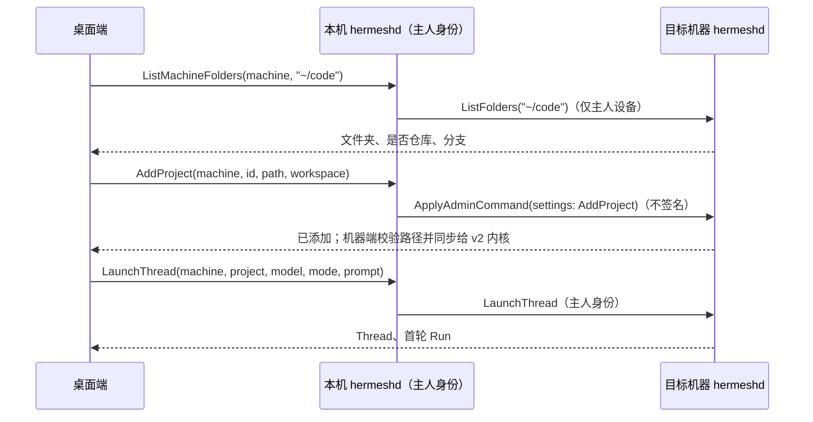

# 新建会话：环境、项目与模型

状态：三期都已实现，2026-11-22（§10–§12 记录做了什么、和本文的出入）。交互见可点击的原型
[thread-composer-demo.html](thread-composer-demo.html)（第 2 版）。本文说明在现有系统上
怎么把它做出来，重点是两件事：环境是远程机器，以及它对项目授权模型的影响。
§9 是需要你决定的事，决定之前不动代码。

基于分支 `feat/thread-v2-control-plane`（v2 线程内核）。文中「已核实」的结论都对应到
代码位置；没有核实的单独标出。

## 0. 结论

- **远程选目录不需要新后端。** 机器端已有 `ListRepos` 和 `ListFolders`，只有主人的
  设备能调，iPhone 的「添加项目」已经在用。桌面端只是还没接，现在只能手输路径（§4.2）。
- **真正缺的后端有四处**，都不大：`AddProject` 会静默把同名项目改指向别的目录；v2 内核不检查
  项目的 Agent 限制；离线机器的项目和模型目录读不到；旧版本机器没有 v2 时没有提示（§5）。
- **授权模型不用改结构，但「添加项目」不再是一个孤立的设置动作。** 授权按项目名匹配，
  所以新项目可能在没有任何签名的情况下立刻落进已有授权的范围。方案是保留现有语义，
  在添加时把后果说清楚，并堵住覆盖（§3）。
- **在机器上新建空文件夹**是唯一需要新协议的功能，建议放到第二期（§4.3）。
- **分三期**：第一期只动桌面端和两处机器端加固，可以独立发布（§7）。

## 1. 范围

要做的：

1. 侧栏「新建会话」入口，项目分组的组头 ＋。
2. 输入框沿用 Her 的；框外一行设置：环境、项目、独立 worktree、模型（供应商 → 模型 →
   思考强度）、权限模式。
3. 在会话里继续聊；运行中可打断，可排队。
4. 在选定的环境上添加项目：选那台机器上的目录。

不做的（代码里已有，这一版界面不放）：编码 / 规划切换、模型的其他参数、中途引导、
单次会话指定基准分支。iPhone 的对应界面放到第三期。

## 2. 现状（已核实）

### 2.1 一次操作经过哪里

桌面端只和本机的 hermeshd 说话；到别的机器由它经中继或直连转发。



| 要读 / 要做 | 接口 | 谁能调 | 机器离线时 |
|---|---|---|---|
| 机器列表 | `ListMachines` / Watch | 主人设备 | 仍列出，标离线 |
| 项目列表 | `ListProjects` | 主人设备；授权方只看到自己范围内的 | **读不到**：离线机器进 `unreachable`（`owner.go` `ListProjects`） |
| 最近的仓库 | `ListMachineRepos` → `ListRepos` | 仅主人设备 | 失败 |
| 浏览文件夹 | `ListMachineFolders` → `ListFolders` | 仅主人设备 | 失败 |
| 添加项目 | `AddProject`（设置类管理命令） | 仅主人设备 | 失败（本机除外，进程内执行） |
| 供应商与模型 | v2 `ListProviders(machine, project)` | 主人设备；授权方按 `agents` 过滤 | **读不到**：不缓存（`owner/threads.go`） |
| 发起会话 | v2 `LaunchThread` | 主人设备；授权方受范围限制 | 进离线队列，上线后重放 |

目录读取的边界（`internal/machine/setup.go`）：

- `ListRepos` 只扫主目录下 3 层，最多 100 个，按最近提交排序；跳过 macOS 受保护的
  文件夹（桌面、文稿、下载等），因为读它们会在那台 Mac 上弹系统询问。
- `ListFolders` 一次列一层，最多 500 个文件夹；文件只计数不列出；返回是否仓库、
  当前分支、本地分支列表和解析符号链接后的完整路径。接受 `~/…` 或完整路径，
  所以主目录之外也能到。读的结果不落盘。

### 2.2 项目与授权

- **项目属于机器。** 存在那台机器的库里，主键是 `project_id`（小写字母、数字、`.`、
  `_`、`-`）。同名项目在不同机器上是不同的目录。
- **授权（Grant）是三张独立的清单**：`machine_ids`、`project_ids`、`agents`，
  `"*"` 表示全部（`pkg/identity/trust.go` `Allows`）。机器只看「我在不在
  `machine_ids` 里」和「这个项目名在不在 `project_ids` 里」，两张清单是乘起来的，
  不是成对的。
- **授权界面有「所有项目（包括以后添加的）」**（`sheets/Scope.tsx`）。Her 的授权
  三张清单都是 `"*"`（`docs/her-mesh.md` §3.2）。
- **改授权要根密钥签名，加项目不用。** `AddProject` 属于「设置类」命令，和改机器名、
  暂停一样，主人设备直接发，机器只核对主人和目标机器（`services.go` `ApplySettings`）。
  每次都记审计日志。
- **`AddProject` 是覆盖写入。** 机器端不检查项目名是否已存在，库里是
  `ON CONFLICT(project_id) DO UPDATE SET path=…`（`store.go` `PutProject`）。
  这个覆盖是有意被依赖的：桌面端改项目的 Agent 或工作方式，就是用同名同路径再调
  一次 `AddProject`（`AgentList.tsx` `save`），CLI 也没有单独的修改命令。
  添加表单在客户端避开了已用的名字，但这只是界面上的保护。
- **项目可以限定 Agent**（`Project.agents`，空表示全部）。v1 发起会话时检查
  （`sessions.go`），**v2 内核不检查**：同步给内核的工作区里没有这个字段
  （`engine.go` `SyncWorkspace`）。
- **v2 多了一个「临时工作区」**（`scratch`）：内核在每台机器上自建的目录，不在项目
  列表里。授权方要 `project_ids` 含 `"*"` 或 `scratch` 才能用。
- **v2 内核对 Her 不看清单。** 发起人是主人或 Her 时，项目和 Agent 的范围检查直接
  放行（`engine.go` `allowsProject`、`allowsAgent`）。Her 的授权本来就是全 `"*"`，
  所以现在结果一样，但它意味着收窄 Her 的授权在 v2 里不会生效。
- **权限模式的上限**有两层：机器上限和授权上限（`Grant.max_runtime_mode`）。
  机器上限这一层内核支持，但机器启动内核时没有传值，等于没有（`machine/threads.go`）。

### 2.3 两套会话

- 侧栏的「任务」是 v1 会话（Her 或外部 Agent 发起）。v2 线程不在侧栏里，只在
  线程页顶部的一排标签里（`ThreadPage.tsx`）。
- 现在的 v1 会话页只能看和打断，不能发消息；这正是这次要补的。

## 3. 授权模型：影响与方案

这是这次改动里最需要想清楚的地方。把「添加项目」放进输入框旁边以后，它会变成一个
高频、顺手的动作，而它的后果其实落在授权上。

### 3.1 会发生什么

| # | 情形 | 后果 | 现在有没有提示 |
|---|---|---|---|
| A1 | 某个授权是「所有项目」 | 新项目立刻对它开放（Her 的授权总是如此） | 没有 |
| A2 | 某个授权列了 `relay`，机器范围含 devbox；你在 devbox 上新加了一个叫 `relay` 的项目 | 它立刻能在 devbox 的这个新目录里干活 | 没有 |
| A3 | 添加时项目名和已有项目相同（比如另一台设备的旧版界面、CLI、或并发） | 已有项目被改指向新目录，所有列了这个名字的授权跟着换目录 | 没有，机器端直接覆盖 |
| A4 | 授权是「所有项目」 | 也能用「临时工作区」 | 没有 |
| A5 | 项目限定了只给 Claude Code 用，但用 v2 发起 | 限制不生效，任何供应商都能进 | — |

A1、A2 是现有语义的自然结果，不是 bug：「所有项目」的文案本来就写了「包括以后
添加的」。但以前加项目是在设置里郑重其事地做，现在是发消息前顺手点一下，
所以需要在当场说出来。A3、A5 是缺陷。A4 是 v2 新引入的范围，需要定个说法。

### 3.2 方案

**不改授权的结构和语义。** 改成按「机器 + 项目」成对授权看起来更干净，但那是另一件
大事：要改 Grant 的签名内容、所有校验点、三个客户端的授权界面，还要迁移现有授权。
这次的目标达不到那个量级，也不需要。

要做的是四件小事：

1. **添加时说出后果（A1、A2）。** 表单在「添加」上方加一行，由本机根据已知的授权
   算出来，不需要新接口：

   - 「Her、Grok Bot 能用这台机器上的所有项目，添加后也能用它。」
   - 「ChatGPT 的授权里有叫 relay 的项目，添加后它也能用 devbox 上的这个目录。」
   - 两种都没有时不显示。

   数据来自 `ListClients` 的 `spec.machine_ids / project_ids`，条件是「机器范围含
   这台机器」且「项目范围含 `*` 或这个名字」。项目名改了这行跟着变，所以改名就是
   避开 A2 的办法。

2. **机器端拒绝换目录（A3）。** 不能简单拒绝同名，因为现有客户端靠同名同路径的
   `AddProject` 来改设置（§2.2）。改成：项目名已存在且**路径不同**时返回
   `AlreadyExists`，并在错误里写出现有的目录；路径相同照旧更新。比较的是机器解析
   符号链接后的完整路径。真要给已有项目换目录，就先移除再添加，这样它是一个看得见
   的动作。

3. **v2 检查项目的 Agent 限制（A5）。** 内核的工作区带上 `agents`，
   `LaunchThread`、`DispatchMessage`、`ForkThread` 在选定供应商时检查，和 v1 一致。
   对主人也生效：这是项目自己的设置，不是授权。界面上，模型面板把这个项目不允许的
   供应商置灰并说明原因。

4. **「临时工作区」默认只给主人（A4）。** 授权的 `"*"` 不再包含 `scratch`，
   要用必须显式列出。理由：它是内核自建的目录，不是主人指给 Agent 的地方。
   Her 不受影响，因为内核对她不看清单（§2.2）；要不要让 Her 也按授权清单走，
   是单独的一件事，这次不动。见 §9 第 2 条。

另外两点不需要动：

- **主人自己发起的会话不受授权限制**，只受项目自己的设置（Agent 限制）和机器上限约束。
  这和 v1 一致。
- **浏览目录只有主人设备能做**，授权方调不到，所以不扩大授权方能看到的东西。

## 4. 功能设计

对应原型里的每一块，这里只写原型上看不出来的规则。

### 4.1 设置行的每一项

| 项 | 数据来源 | 默认值 | 不可用时 |
|---|---|---|---|
| 环境 | 机器列表 | 上次用的；没有则本机 | 离线可选，发送即入离线队列，发送键提示「离线入队」 |
| 项目 | 该机器的项目 + 临时工作区 | 该机器上次用的；没有则临时工作区 | 机器离线且没有缓存：只有临时工作区 |
| 独立 worktree | 项目的工作方式 | 跟项目 | 临时工作区、非 git 目录：不显示 |
| 模型 | 该机器的供应商目录 | 该机器上次用的；没有则第一个可用供应商的默认模型 | 未安装 / 未登录 / 项目不允许：置灰并写明 |
| 思考强度 | 模型的可选档位 | 该模型上次用的；没有则模型默认 | 模型没有档位：整排换成一句说明 |
| 权限模式 | 四档 | 上次用的；没有则「智能自动」（内核默认） | 超过上限的档位置灰，写明是机器还是授权限制 |

- **「上次用的」按机器记**，存在本机（和侧栏的视图设置同一处）。不存到机器上，
  也不让模型替你选（没有「自动」档）。
- **换环境时**：新机器有同名项目就保留，否则回到该机器上次用的项目，再否则临时工作区；
  模型同理。现在的代码是一律回到临时工作区，这是一处行为变化。
- **独立 worktree 是单次覆盖**，不改项目设置。后端已支持：`LaunchThread` 的
  `workspace.mode` 优先于项目默认。要让勾选框知道「这个项目是不是 git 仓库」，
  `Project` 需要多一个字段（§6）。

### 4.2 添加项目

沿用 iPhone 已有的流程和文案，三步：

1. **最近的仓库**（`ListRepos`），去掉已经是项目的。打开时才读，读的时候显示
   「正在找仓库…」。
2. **浏览其他文件夹**（`ListFolders`）：面包屑、文件夹列表、显示隐藏文件夹、
   输入路径。主目录不能直接选（「进入一个文件夹再选择」）。macOS 受保护的文件夹
   进入前先确认，因为打开它会让那台 Mac 弹出系统询问（iPhone 已有这一步）。
3. **确认**：目录、项目名、工作方式、新分支基于、以及 §3.2 的那行后果说明。

规则：

- 项目名默认取文件夹名并规整成合法字符，和该机器已有的重名时自动加后缀；可改。
- 是 git 仓库：默认「独立 worktree」，可选基线分支（来自 `ListFolders` 的分支列表）。
  不是：只能「原地」。选的目录在某个仓库内部时，机器会拒绝并指出仓库根
  （`ValidateRepo`），界面把这句话原样显示并提供「改选仓库根」。
- **本机**多一个「选择…」，用系统的文件夹选择框，和现在一样。
- 添加成功后项目菜单直接选中它，并提示「已添加项目「x」」。
- 机器离线时「添加项目…」置灰。

错误都来自机器，原样显示：目录不存在、没有权限读、不是目录、在仓库内部、
项目名已被另一个目录占用。

### 4.3 新建文件夹（建议第二期）

「新建项目」如果指在机器上从零建一个目录，需要新协议，因为现在没有任何写文件系统
的管理命令：

- 新的设置类命令 `CreateFolder { parent, name, git_init }`，返回建好的路径。
- 机器端约束：`parent` 必须已存在且可写；`name` 是单层名字，不含分隔符、不以 `.`
  开头；目标不存在；可选 `git init` 并做一次空提交（否则没有 `HEAD`，独立 worktree
  建不出来）。
- 放在浏览文件夹那一步的角上：「新建文件夹…」，建好后自动进入。

它比其他设置类命令多一层风险（写磁盘），但范围很小，而且只有主人设备能发。是否
要求根密钥签名见 §9 第 3 条。

### 4.4 模型面板

一个面板，不嵌套：搜索、左列供应商、右列该供应商的模型、底部一排思考强度。

- 供应商多、模型多时：两列各自滚动；搜索跨供应商，结果按供应商分组。
- 选模型不关面板，方便接着调强度；点面板外或 Esc 关闭。
- 换模型时强度的规则沿用 Her 的：新模型有当前档位就保留，否则用新模型的默认，
  并提示一次「x 没有「高」档，思考强度改为「中」」。
- 目录按机器取。首屏用本机缓存的上一次结果，同时在后台刷新；机器离线时用缓存
  并标注「上次读到的」。缓存是新增的（§5.3）。

### 4.5 继续聊、打断、排队

后端都已具备（`DispatchMessage`、`InterruptRun`、队列），这里只定界面规则：

- 会话里环境和项目只读。模型和权限模式可改，改的是下一轮；正在跑的一轮不受影响
  （这一点依赖上一轮评审修复的问题 6、7）。
- 运行中：发送键旁出现「打断」；这时发的消息进队列，气泡下标「将在下一轮处理」。
- 等待审批时输入框照常可用，审批卡片在输入框上方（和 Her 的审批位置一致）。

### 4.6 入口

| 入口 | 预填 |
|---|---|
| 侧栏「新建会话」、⌘N | 上次用的环境、项目、模型、模式 |
| 按项目分组时组头的 ＋ | 这个项目；环境取组里最近一个任务所在的机器 |
| 在某个会话里按 ⌘N | 同第一行，不继承当前会话 |

按项目分组是按项目名分的，同名项目可能跨机器。组头 ＋ 进去后环境可以再改，
同名项目会保留（§4.1）。

### 4.7 侧栏里的会话

原型把新建的会话直接放进了侧栏的「任务」。实际上侧栏现在只列 v1 会话，所以需要
把 v2 线程并进同一张列表：

- 一行需要的字段两边都有：标题、机器、项目、Agent、发起人、状态、时间。
- 分组、排序、归档、搜索按现有规则，对两种来源一视同仁。
- 点 v1 的行开现在的会话页，点 v2 的行开新的会话页。
- 列表叫「任务」，入口叫「新建会话」：叫法要统一，见 §9 第 4 条。

## 5. 远程：需要补的地方

### 5.1 机器端加固（第一期）

- `AddProject` 拒绝给已有项目换目录（§3.2 第 2 条）。
- v2 内核同步并检查 `Project.agents`（§3.2 第 3 条）。
- `scratch` 不在 `"*"` 里（§3.2 第 4 条，取决于你的决定）。

### 5.2 版本不一致

目标机器可能还没有 v2。按 [version-skew.md](version-skew.md) 的做法：

- 机器在状态里报告它有 v2 线程服务；老机器不报，视为「未知」。
- 未知或没有时，环境菜单里这台机器照常显示，带「需更新」标记；选中后输入框上方
  说明「这台机器的 Hermesh 需要更新才能新建会话」，发送键禁用。不隐藏，免得找不到。
- 兜底：调用返回未实现时，同样落到这个提示，而不是报错。

### 5.3 离线

- **项目列表**：本机保存每台机器上次读到的项目，离线时用它，标「上次读到的」。
  现在离线机器直接读不到。
- **模型目录**：同上，按机器缓存 `ListProviders` 的结果。
- **发起**：已有离线队列。上一轮评审修了它的两个问题（追加消息丢失、被拒后没有
  提示），这次依赖那些修复。被机器拒绝的原因（项目不存在、供应商被禁用）显示在
  那条会话上。
- **添加项目、浏览目录**：离线不可用，不排队。排队加项目没有意义，路径没法校验。

### 5.4 其他

- **时延**：浏览一层目录是一次往返。每进一层取消上一次未完成的请求；超过约 300
  毫秒才显示「正在读取 devbox…」，避免闪烁。
- **Windows 机器**：路径分隔符和盘符由机器返回的路径原样显示，前端不拼路径，
  只用机器给的 `path`。输入路径的占位符按机器的平台给例子（现有表单已这样做）。
- **附件**：发往远程机器前先同步到那台机器（已有），大小上限 64 MiB（已有）。
- **幂等**：发起和添加都带 `command_id`；并发重试只执行一次（上一轮评审修复的问题 12）。
- **机器上限**：内核支持但没接线。第二期给机器加一个「权限模式上限」设置。

## 6. 协议变更汇总

| 变更 | 位置 | 期 | 兼容性 |
|---|---|---|---|
| `AddProject` 同名且路径不同时返回 `AlreadyExists` | 机器端行为 | 1 | 同名同路径照旧更新，现有客户端改设置不受影响；只有「换目录」从静默覆盖变成报错 |
| 内核工作区带 `agents` 并检查 | 机器端内部 | 1 | 无协议变化 |
| `"*"` 不含 `scratch` | 机器端行为 | 1 | 现有「所有项目」授权不再能用临时工作区 |
| `Project.is_repo`（是否 git 仓库） | `local.proto`、`machine.proto` | 1 | 新增字段，老机器不填，按「未知」不显示勾选框 |
| 机器状态报告有 v2 | `machine.proto` | 1 | 新增字段 |
| 本机缓存各机器的项目与模型目录 | 本机内部 | 2 | 无协议变化 |
| `CreateFolder` 管理命令 | `identity.proto` | 2 | 新命令，老机器返回未知命令，界面不显示入口 |
| 机器的权限模式上限 | `identity.proto` 设置命令 | 2 | 新命令 |

生成的代码有三套（Go、TS、Swift），proto 变更要一起重新生成。

## 7. 分期

**第一期：能用，且不留授权上的坑。** 可独立发布。

1. 机器端：`AddProject` 拒绝换目录；内核检查项目的 Agent 限制；`scratch` 的范围；
   `Project.is_repo`；报告有 v2。
2. 桌面端：侧栏入口与组头 ＋；输入框与设置行；模型面板；权限模式菜单；
   添加项目（接 `ListMachineRepos`、`ListMachineFolders`），含后果说明；
   会话页继续聊与打断；侧栏并入 v2 线程；版本不一致的提示。
3. 按机器记住上次的选择。

**第二期：离线与新建。** 本机缓存项目和模型目录；`CreateFolder`；机器上限。

**第三期：iPhone。** 同一套规则搬到 iPhone 的线程页。

第一期的前提：上一轮评审的 15 个修复先合入，其中问题 6、7、8、9、11、12 直接影响
这里的行为。

## 8. 测试

每条都要有端到端测试，用真实的二进制和脚本化的供应商（现有的 `e2e/`）：

- **远程添加项目**：owner + 远程机器；浏览到目录、添加、在它上面发起会话并完成一轮。
- **拒绝换目录**：同名、不同目录的添加返回错误，原项目的路径不变；同名同目录
  改 Agent 或工作方式照旧成功。
- **授权后果**：建一个「所有项目」授权和一个列了 `relay` 的授权；在第二台机器加
  `relay`；两个授权都能在新目录发起（确认现有语义没变），而界面事先列出了它们
  （桌面端 Playwright）。
- **Agent 限制**：项目限定 Claude Code；主人和授权方用 v2 选 Codex 都被拒。
- **scratch**：「所有项目」授权不能在临时工作区发起；显式列出后可以。
- **离线**：机器离线时发起、追加消息；上线后按顺序执行。被拒的显示原因。
- **版本不一致**：对一个没有 v2 的机器，界面显示「需更新」而不是报错。
- **桌面端**：三个菜单、添加项目三步、组头 ＋ 预填、换环境保留同名项目、
  运行中排队与打断（Playwright，沿用 `thread-v2.spec.ts`）。

单元测试覆盖：后果说明的计算、项目名规整与去重、换环境时的保留规则、强度随模型变化。

## 9. 决定（2026-11-22，按建议）

1. 添加项目时只提示后果，不拦截。
2. 「临时工作区」不对外部授权开放，`"*"` 不包含它，要用须在授权里写明 `scratch`。
3. 新建文件夹不要求根密钥签名，只能建在主目录之下（第二期）。
4. 叫法：入口「新建会话」，列表仍叫「任务」，统一放到以后单独处理。
5. 第一期包含把 v2 线程并入侧栏。

以下是当时列出的问题，留作记录。

## 9.1 当时需要你决定的

1. **添加项目时的后果说明，够不够？** 方案是只提示、不拦（§3.2 第 1 条）。更严的
   做法是：新项目落进某个非 Her 授权的范围时要求一次确认。我的建议是只提示，
   因为拦下来的确认很快会变成习惯性点击。
2. **「临时工作区」对授权方开不开？** 建议默认不开，`"*"` 不包含它。影响的是
   「所有项目」的外部授权（ChatGPT、Grok Bot 这类）；Her 不受影响。
3. **新建文件夹要不要根密钥签名？** 不签名和其他设置类命令一致，顺手；签名更稳妥，
   但每建一个文件夹要按一次 Touch ID。建议不签名，并限制只能在主目录之下建。
4. **叫法**：侧栏是「任务」，入口是「新建会话」，内核里叫线程。建议界面统一成一个词。
5. **第一期要不要包含侧栏并入 v2 线程（§4.7）？** 不包含的话新建的会话只能从线程页
   顶部的标签找到，原型里的侧栏行为就做不出来。建议包含。

## 10. 第一期实现记录

**机器端**

- `AddProject`：项目名已存在且目录不同时返回 `AlreadyExists`；同名同目录照旧更新设置。项目名 `scratch` 保留给临时工作区，移除同名项目也不会删掉临时工作区。
- 项目的 Agent 限制同步给 v2 内核（新增 `workspaces.agents` 列），发起、换模型、带模型发消息、分叉都检查，主人也受限。
- 授权的 `"*"` 不再覆盖 `scratch`。
- owner 在跟随每台远程机器的 Watch 时，同时跟随它的 `SubscribeThreads`，远程线程的状态变化会实时进本机的线程列表（之前只有本机操作或打开线程时才刷新）。

**实现中发现并修掉的两个后端问题**

- `DISPATCH_INTENT_QUEUE` 发给空闲、队列未暂停的线程时，消息会停在队列里永远不开始，下一条普通消息还会插到它前面。改为此时直接开始。界面对已有会话一律用 QUEUE：有轮次在跑就排到后面，没有就马上开始，由 hermeshd 判断，不依赖窗口里可能滞后的线程状态。
- 排队的消息在上一轮完成或被打断后开始时，内核没有发事件，界面会一直把它显示为排队中。现在补发 `run.started`（带这条 run 和它的消息）。

**桌面端**

- 侧栏 Her 上方「新建会话」（⌘N）；按项目分组时组头有 ＋，用组里最近一个任务的机器。
- v2 线程并入侧栏的「任务」列表，按同样的规则分组排序；点开、重命名、归档、删除走线程接口。窗口常驻一条线程列表订阅（断开后自动重连）。
- 输入框沿用 Her 的样式和菜单组件；框外一行：环境、项目、独立 worktree、模型面板、权限模式（「规划」放在权限模式菜单里）。
- 每台机器上次用的项目、模型、权限模式记在本机。默认供应商依次取 Claude Code、Codex、Gemini 中第一个可用的。
- 「添加项目」表单：远程机器列出最近的仓库、逐层浏览目录或输入路径；说明添加后哪些授权会自动能用它；从输入框打开时，添加成功后直接选中。

**和本文的出入**

- `Project.is_repo` 没有加（要改 proto 并重新生成三套代码）。独立 worktree 勾选框只在项目本身是 worktree 方式时显示；原地方式的项目不显示。
- 机器报告「有 v2」的字段没有加。没有 v2 的机器靠兜底：调用返回未实现时，界面显示现有的「需要更新 Hermesh」。
- 离线机器的项目和模型目录缓存（§5.3）、新建文件夹、机器上限仍在第二期。
- 中途引导只保留在队列条的「立即插入引导」里，输入框里不再有单独的按钮。

**测试**

- Go：`internal/machine/projectadd_test.go`（换目录、保留名、Agent 同步）；`internal/kernel/engine_regressions_test.go`（Agent 限制、scratch、QUEUE 空闲即开始、出队事件）。每个都做过去掉修复后失败的反证。
- Go e2e：`TestThreadV2EndToEnd` 增加「不读线程也能收到远程轮次完成」的检查。
- 桌面 e2e：新增 `thread-composer.spec.ts`（两台真实机器：切到 work-mac、远程浏览并添加项目、搜索和选择模型与强度、发起、继续聊、运行中排队与打断、按项目分组的 ＋、记住上次选择）；`thread-v2.spec.ts` 改为新界面的操作方式。

## 11. 第二期实现记录

第一期「和本文的出入」里留下的两项（`Project.repo`、机器报告有 v2）也在这一期补上了。

**协议**（Go、TS、Swift 三套一起重新生成）

- `machine.v1.Project.repo`、`local.v1.Project.repo`：项目目录现在是不是 git 仓库的顶层，和项目的工作方式无关。
- `MachineStatus.threads`：机器有 v2 线程服务；`MachineStatus.max_runtime_mode`：机器自己的权限模式上限。
- 管理命令 `CreateFolder`、`SetMaxRuntimeMode`，以及本机接口 `CreateMachineFolder`、`SetMachineMaxRuntimeMode`。
- 两个新命令都有签名预览卡片（Go 和 Swift 各一份）和中文。

**机器端**

- `CreateFolder`：只能建在主目录之下；名字是单层、不以 `.` 开头；已存在就报错，不覆盖；选了 git 时初始化并做一次空提交，失败就删掉建了一半的目录。不要求根密钥签名（§9 第 3 条）。
- 权限模式上限存在机器上，从下一次发起或下一条消息起对所有线程生效，谁发起都一样。

**桌面端**

- 本机按机器缓存项目列表和模型目录；机器离线时用缓存，并标「上次读到的」。
- 独立 worktree 勾选框按 `Project.repo` 显示，原地方式的仓库项目也能单次用独立 worktree。
- 机器没有 v2（`threads` 未报告）时，环境菜单标「需要更新」，输入框上方说明原因，发送键禁用。
- 「添加项目」：选到仓库内部的目录时显示机器的原话并提供「改选仓库根」；浏览目录时可以「新建文件夹…」，默认初始化为 git 仓库。
- 设置 › 机器：权限模式上限。
- ⌘K 搜索也能找到 v2 会话。

**测试**

- Go：`internal/machine/projectfolder_test.go`（`CreateFolder` 的约束、`Project.repo`、上限）；签名预览的测试要求两个新命令都有中文。
- 桌面 e2e：`thread-composer.spec.ts` 新增两个用例：在 work-mac 上按最近的仓库添加、仓库内部改选仓库根、新建文件夹、old-mac 显示需要更新；work-mac 下线后，项目和模型用「上次读到的」。e2e 的 work-mac 有自己的主目录，里面有两个仓库；old-mac 是一台按 v2 之前行为运行的机器（`HERMESH_TEST_BEFORE_THREADS`）。

## 12. 第三期实现记录：iPhone

（同时补上了桌面端一处遗漏：机器拒绝离线排队的发起或消息时，原因只进了侧栏的行，会话页上看不到；现在显示在会话的最后。）

规则和桌面端相同，共用的部分放在 `HermeshSessions/ThreadComposer.swift`，对应桌面端的 `@hermesh/core` `composer.ts`：线程作为会话列表的一行、思考强度随模型变化、换机器时选哪个项目、供应商为什么不能选、新项目会落进哪些授权。

**页面**（`Views/Session/ThreadPage.swift`）

- 新建会话和已有的 v2 会话是同一页：沿用 Her 的输入框，框下一行是环境、项目、独立 worktree、模型、权限模式（「先出方案」在权限模式菜单里）。
- 输入框左边的 ＋ 和 Her 的一样，弹出「照片」「文件」，但没有「连接器」（会话的 Agent 用它自己的工具）。选好就传给本机 hermeshd（`UploadBlob`，和桌面端一样），发起或发消息时带上；只有附件、没有文字也能发。（2026-11-23 补上）
- 模型是一个面板：搜索跨供应商，上面一排供应商，下面是所选供应商的模型，底部是思考强度。选模型后面板不关，方便接着调强度。换模型时，如果原来的强度新模型没有，提示一次改成了什么。
- 会话里：环境和项目只读；运行中发送键旁有「停下」，这时发的消息进队列，队列里每条可以「立即插入引导」或移除；审批和方案评审的卡片在消息下方。
- 每台机器上次用的项目、模型、权限模式记在本机，项目列表和模型目录按机器缓存，离线时用缓存并标「上次读到的」。
- 机器没有 v2 时，环境菜单标「需要更新」，页面上说明原因，发送键禁用。
- 超过上限的权限档位置灰，并写明「超过这台机器或授权允许的上限」；模型没有强度档位、机器上还没有能用的模型时，面板里各有一句说明。
- 离线排队中的会话在框下一行标「离线排队中」；机器拒绝了离线时排队的发起或消息时，原因显示在会话里。
- 从搜索结果里选中模型后退出搜索，回到该供应商的模型列表：iOS 26 上搜索框激活时会收起导航栏，「完成」和思考强度要退出搜索才看得到。

**入口和列表**

- 菜单里 Her 上方有「新建会话」；按项目分组时组头有 ＋，用组里最近一个会话所在的机器。
- v2 线程并入菜单的会话列表和搜索，按同样的规则分组、排序、筛选；打开、重命名、归档、删除走线程接口。App 在前台时常驻一条线程列表订阅，断开后自动重连。

**添加项目**

- 从新建会话页打开时不限 Agent（项目对所有 Agent 可用），加好后页面直接选中它；选的目录已经是项目时直接用它。
- 确认前说明哪些授权添加后就能用它（和桌面端同一条规则）。
- 浏览目录时菜单里有「新建文件夹…」：可以建成 git 仓库，也可以建成空文件夹，建好后自动进入。

**和桌面端的出入**

- 没有「改选仓库根」。iPhone 只在仓库顶层提供独立 worktree，仓库内部的文件夹按原地方式添加，机器不会拒绝，所以用不到。
- 权限模式上限只在 Mac 的设置里改；iPhone 遵守上限（超过的档位置灰），但没有设置入口。

**测试**

- 单元测试：`ThreadsTests.swift` 的 `ThreadComposerTests`（线程作为列表行、强度随模型变化、搜索与供应商可用性、换机器选项目、新项目落进的授权）。
- Go e2e：`TestThreadProjectsAndGrants`（`e2e/thread_projects_test.go`），补齐 §8 里原来只有单元测试的几条：在第二台机器上添加项目、同名换目录被拒并写出现有目录、同名同目录改设置照旧；「所有项目」的授权和列了 `relay` 的授权都能马上在新目录发起；项目限定 Claude Code 时，授权方和主人用 Codex 都被拒；「所有项目」不含临时工作区，写明 `scratch` 的授权可以用。
- 桌面 e2e：`thread-composer.spec.ts` 的离线用例增加「离线时照样发出，会话页标离线排队中」。
- 没有端到端覆盖的一处：拒绝原因在会话页上的显示。夹具里的 work-mac 下线后不再回来，看不到重放被拒；接口层由 `TestThreadV2EndToEnd` 覆盖（被拒的发起作为失败的本地会话留下，并带着机器给的原因）。
- iPhone e2e：`HermeshUITests/ThreadComposerUITests.swift` 的 `testThreadComposer`，环境和桌面端用例相同（`otherMacThreads`）。用中文界面走一遍：菜单进新建会话、切到 work-mac、在 work-mac 上新建文件夹并添加为项目（含授权说明）、搜索并选模型和强度、发起、继续聊、运行中排队和停下、会话出现在菜单列表里、项目分组的 ＋ 预填、再次新建时带上上次的选择、old-mac 显示需要更新且不能发送。2026-11-23 在 iPhone 17 Pro 模拟器（iOS 26.0）上通过，用时 221 秒。

```bash
HERMESH_IPHONE_E2E=1 HERMESH_IPHONE_GREP=testThreadComposer go test ./e2e -run 'TestIPhone$' -count=1 -v -timeout 50m
```


## 13. 会话页统一（2026-11-23）

新建的会话（v2 线程）和原来的会话在页面上不再有区别：同一套行、同一组信息卡片、同一种审批卡片，iPhone 上也一样。

- **对话**：线程的条目先转成会话的对话行（`@hermesh/core` `threadtranscript.ts`，Swift 版 `HermeshSessions/ThreadTranscript.swift`），再交给会话页原有的组件画：桌面端 `ChatFrame` 和 `Row`（`session/Chat.tsx`），iPhone 端 `StepView` 和 `followsEnd`。消息在右侧气泡里，回复是 Markdown，命令、读写文件、编辑合成一行「运行了 N 条命令」，展开看输出或改动；每轮前的时间线、被打断的一轮、做完的一轮、失败卡片都和会话一致。思考过程、待办清单、检查点和系统提示在会话里没有对应的行，不显示。
- **信息卡片**：桌面端右侧就是会话页的「环境」「上下文」两张卡片（`session/Inspector.tsx`），工具栏按钮和 ⌥⌘0 一样开关；iPhone 端是会话页的工具栏（标题下一行、任务信息、更多）和任务信息页（线程不列改动）。原来的「代码变更 / 检查点 / 运行态」标签页和工具栏上的分叉按钮连同代码一起去掉了，以后需要再按会话页的样式加。
- **审批**：工具审批和方案评审用 Her 的审批卡片（桌面 `.appr`，iPhone `HerApprovalPanel` 的样式）；Agent 提问用会话的 `QuestionPanel`；密钥输入在桌面端是同样式的卡片，iPhone 上仍说明到 Mac 上回答。
- 发起人是主人自己时，「发起」写「你」（桌面 `grantLabel`、iPhone `AppModel.grantLabel`）。
- 机器拒绝的消息（`last_error`，下一轮开始时清空）显示为会话的失败卡片。

**测试**

- 单元：`threadtranscript.test.ts`、`ThreadTranscriptTests.swift`（行的种类和顺序、工具步骤、被打断的一轮、失败、提问）。
- 桌面 e2e：`thread-v2.spec.ts` 检查消息气泡、折叠的步骤展开后的改动、做完一轮的那行、「环境」「上下文」卡片的内容和开关、没有其他标签页；审批卡片和队列照旧走一遍。
- iPhone e2e：`testThreadComposer` 增加会话工具栏和「这一轮做完了」的检查。

## 14. 两种来源的会话：操作一致（2026-11-23）

会话只是发起的地方不同（Agent 通过授权发起的 v1 会话、在 Hermesh 里新建的 v2 线程），能做的事和样子都一样。做法是在数据源头把线程当成会话：桌面端 `store.tsx` 的 `sessions`、主进程 `main/notify.ts` 的 `world.sessions`、iPhone `AppModel.sessions` 都包含 `threadAsSession` 转出来的线程，凡是列出、计数、查找会话的地方不再各自合并。`threadAsSession` 带上分支、轮数（`run_count`）和失败原因，所以红点、需要处理、通知都和会话一样判断。

| 入口 | Mac | iPhone |
|---|---|---|
| 侧栏行的 ⋯ / 右键菜单（打开、重命名、归档或取消归档、拷贝 ID、删除） | 原本就一致 | 原本就一致（长按） |
| 会话页工具栏 | 信息面板按钮 | 任务信息、⋯（拷贝 ID、重命名、归档、删除） |
| 应用菜单「会话」：打断 ⌘.、归档 ⌘E、取消归档、拷贝 ID；「显示」：信息面板 ⌥⌘0 | 现在对线程生效 | — |
| 已归档：顶部「已归档：只读」和「取消归档」，没有输入框 | 一致 | 一致 |
| 失败卡片（原因、建议、详情、归档）、机器离线的提示行、「这一轮做完了」 | 一致 | 一致 |
| 概览（运行中、今日统计）、窄栏、团队计数、搜索的 Agent 筛选、授权页的会话 | 计入线程 | 计入线程 |
| 菜单栏面板（需要处理、运行中）和系统通知（出错、完成一轮） | 计入线程 | — |

主人自己新建的会话不发「新会话」通知（那是 Agent 发起的工作才有的提醒）；「发起」写「你」。

**还不一致的地方**

- iPhone 的推送通知由机器发出（`internal/machine/notify.go`），目前只覆盖 v1 会话；线程的提问、出错、完成一轮还没有推送。
- Mac 应用菜单「回答问题 ⌘R」对线程不可用：窗口的会话列表里没有线程的待回答问题，只有会话页知道。
- 会话页底部：v1 会话是运行状态条加「打断」，线程是输入框加「停止」（线程可以继续发消息，v1 会话不行）。
- iPhone 上线程的密钥请求仍提示到 Mac 上回答。

**测试**

- 单元：`composer.test.ts` 新增线程作为会话的分支、轮数、失败，完成一轮和出错的通知，主人自己新建的不通知。
- 桌面 e2e：`thread-v2.spec.ts` 检查菜单栏面板把等待审批的线程算进「需要处理」、把运行的线程算进「运行中」；应用菜单的信息面板、归档（只读提示、没有输入框）、取消归档、打断。
- iPhone e2e：`testThreadComposer` 增加从 ⋯ 归档、只读提示、取消归档。

## 15. 新会话页的布局（2026-11-23）

新会话页改成「问一句、底部输入」：

- 页面中间是一句问话「要在 <项目> 里做什么？」，项目名带下划线，点开就是项目菜单（各项目、临时工作区、添加项目…）；下面一行是环境（机器图标、名字、离线时一个灰点、›），点开是环境菜单。两者默认取这台设备上次在该环境用的项目和环境（`choices.ts`、`ThreadChoices`）。
- 输入框在页面底部，和会话里的位置、样子一样（Mac `.cmp-zone`，iPhone `safeAreaInset`）；框下一行左边是工作目录（「当前目录」或「独立 worktree」，只在项目能用 worktree 时出现），右边是模型和权限模式。
- 页面标题两端都叫「新会话」。

参考里的「选分支」没有做：现在新会话不能指定基准分支。

## 16. 输入框改版：设置收进框里，分支可选（2026-11-23，方案）

原型：iPhone [thread-composer-mobile-demo.html](thread-composer-mobile-demo.html)，Mac [thread-composer-mac-demo.html](thread-composer-mac-demo.html)。两端同一套，新会话和会话里同一个框。

### 16.1 界面

**输入框**

- 收起：框是空的、没在打字时只有一行：＋、文字、发送（运行中多一个停下）。iPhone 点进框、Mac 点进框或按任意键（焦点不在别的输入框时）展开；有文字或附件时不收起。Mac 新会话打开时不再自动聚焦。
- 展开：两三行文字，底部一行：＋、模型（供应商图标 + 模型名）、思考强度（模型没有档位时不出现），右边停下、发送。
- 框下面那一行去掉。会话里原来那行的「环境 · 项目」：iPhone 标题下一行已有；Mac 挪到标题右边（灰字）。

**＋**

- iPhone：底部面板，上面两格「照片」「文件」，下面「权限模式」四档（带说明，超过上限的置灰写原因）。
- Mac：菜单，「添加附件…」，下面「权限模式」四档。
- 权限模式只在这里，框上不显示。「先出方案」（规划）从界面去掉，内核的交互模式不动，发起和发消息一律按编码。

**思考强度**：单独一个按钮，点开是所选模型的档位（iPhone 菜单，Mac 菜单）。iPhone 后来改了（2026-11-23）：框上不再有这个按钮，挪到模型面板最上面，叫「推理强度」（和机器设置里同名），图标是仪表盘，指针随档位转；下面一条细轨道，从低到高，每档的名字写在它下面，当前的加粗；只用黑白灰。拖的时候档位跟着变，过一档震一下，松手停在最近的一档，点轨道直接跳过去；VoiceOver 上下滑换档。模型只有一档或在搜索时不显示。Mac 随后也改了（2026-11-23）：框上的思考强度按钮去掉，模型按钮写成「Scripted Fast · 高」（档位灰字）；模型面板最上面是「推理强度」，一排分段，当前档垫着一块会滑过去的白底，点一档或按住拖过去都行，搜索框空着时 ←/→ 换档；选档不关面板。框本身：发送、停止改圆形，按下略缩；展开时底栏淡入。
- iPhone 收起键盘（2026-11-23）：不加按钮，和「信息」一样靠手势。会话页、Her 对话往下拖（键盘跟手）、点对话；新会话页原来没有可拖的地方，改成能回弹的滚动区，一拖就收起（这页没有要滚的内容）；在输入框上往下快速一划也收起（慢拖是选字，不收）。

**模型面板**：一列，能用的供应商按组竖排（组头图标、名字，未登录写在组头，照旧能选），每行一个模型，选中的打勾；未安装、已停用、这个项目不用的供应商不列；搜索照旧；思考强度不在面板里（iPhone 后来放进来了，见上）。

**框上方（新会话）**：两个按钮，只有 git 仓库的项目才有。

- 工作目录：「当前目录 / 独立 worktree」，菜单两项（现有文案）。
- 分支：独立 worktree 时是「基于 main」（从哪个分支新开），当前目录时是分支名（在哪个分支上改）。点开分支面板：搜索；独立 worktree 时有「从远程开始」开关（按钮写「基于 origin/main」）；列表里已签出的在最前标「当前」，默认分支标「默认」，被别的 worktree 签出的标「worktree」（当前目录时不能选，写「已在别的 worktree 签出」）；当前目录选了别的分支时面板提示「开始前会把项目目录切到这个分支；目录里有没提交的改动时不能切换」。会话自己的 `hermesh/…` 分支不列。
- 默认：独立 worktree 从默认分支开，当前目录用已签出的分支。分支选择只影响这次会话，不记住。
- 数据：进新会话页、换环境或项目时读一次项目目录（`ListMachineFolders`，只有主人的设备能读）。读不到（离线、旧机器）时不显示分支按钮，照旧能发起：独立 worktree 从项目的基准分支开，当前目录用签出的分支。

**框上方（会话里）**：从上到下是审批卡片、待执行的消息、「离线排队中」，都没有时是空的。

### 16.2 后端

| 改动 | 位置 | 兼容 |
|---|---|---|
| `ListFoldersResponse` 加 `default_branch`（`refs/remotes/origin/HEAD`，没有就 main、master 里存在的那个）和 `worktree_branches`（`.git/worktrees/*/HEAD` 指向的分支），只读 `.git` 里的文件 | `machine.proto`、`internal/machine/setup.go` | 新字段，旧机器不填：客户端不标「默认」「worktree」，默认分支退回项目默认 |
| `WorkspaceStrategy` 加 `from_remote`：独立 worktree 开之前 `git fetch origin <base>`，再从 `origin/<base>` 开 | `thread/v2` proto、`internal/kernel` | 新字段 |
| 当前目录模式带了 `branch` 且和签出的不同：开始前 `git switch`；有未提交的改动（不算未跟踪文件）就拒绝并写原因，不替人 stash | `internal/kernel` | 旧客户端不带 `branch`，行为不变 |
| 新分支默认从默认分支开：客户端读到默认分支时显式带 `base_ref`；读不到时不带，退回项目默认（HEAD） | 客户端 | 不改项目设置 |

### 16.3 测试

- Go 单元：`TestListFolders` 加默认分支（`origin/HEAD`、没有时 main/master）和被别的 worktree 签出的分支；`TestLaunchOnBranches`（`internal/kernel/branches_test.go`，真实 git 仓库和一个裸的 origin）：当前目录切到别的分支、有会话在跑时拒绝、有未提交改动时拒绝且目录不动、已在这个分支时不用切、worktree 基于别的分支、从远程开始（拿到本地没有的提交）、远程没有的分支写明原因。
- 桌面 e2e：`thread-composer.spec.ts` 按新界面改（收起一行、点进去展开、在页面上打字进框、单列模型面板、思考强度按钮、＋ 菜单里的权限模式、标题旁的环境和项目），新增「新会话的分支」：work-mac 上的项目，worktree 基于 feat/x（会话分支的第一个提交就是 feat/x 的），当前目录切到 feat/x（项目目录真的切过去）。`thread-v2.spec.ts` 去掉规划模式那一条；`model-defaults.spec.ts` 改成单列面板加思考强度按钮。
- iPhone e2e：`testThreadComposer` 同上：分支面板（远程开关、「当前」）、当前目录时只显示分支名、点进框才有模型、选模型后面板关、思考强度（后来改成模型面板顶上拖动：默认「中」，拖到头「低」、拖到尾「高」，面板不关，再开还是「高」）、＋ 面板（照片、文件、四档权限模式），保留发照片的一步。
